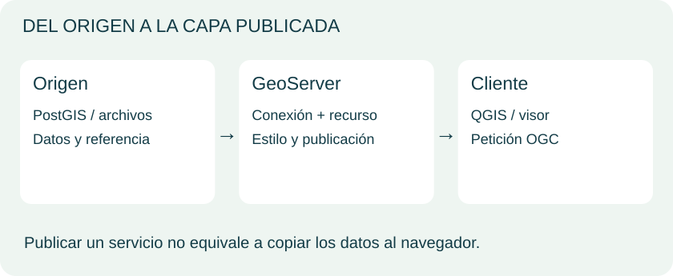
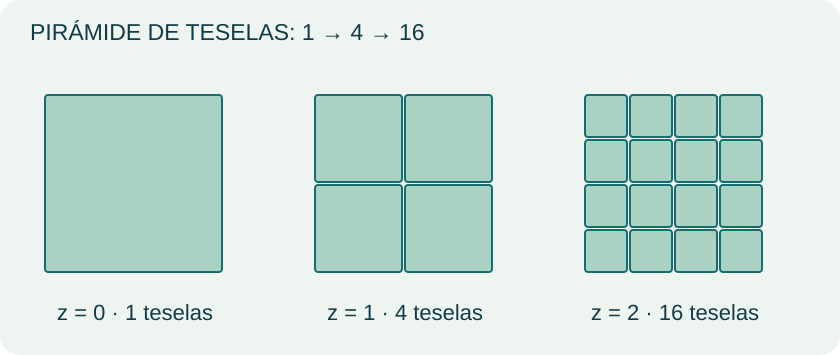
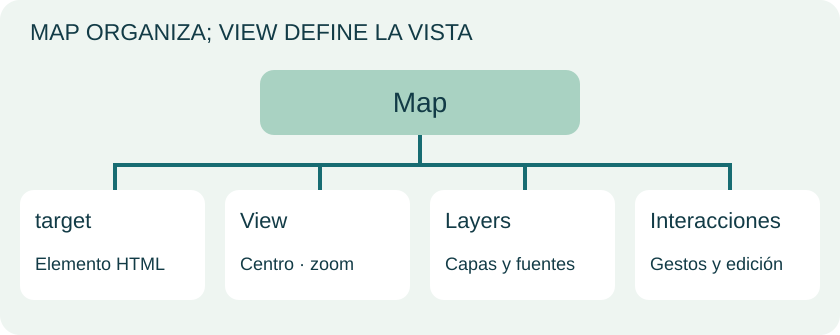

<h1 class="course-home-title">Guía visual deWebmapping</h1>

Conceptos, esquemas y ejercicios originales del curso, organizados en ocho unidades.

<a class="course-card" href="unidades/unidad-1/">
Unidad 01<b>Del dato al mapa web</b>
Arquitectura, formatos y decisiones.
<small>Unidad conceptual, sin ejercicios originales.</small>
</a>
<a class="course-card" href="unidades/unidad-2/">
Unidad 02<b>Pensar espacialmente con PostGIS</b>
Geometrías, referencias, índices y análisis.
<small>17 ejercicios originales.</small>
</a>
<a class="course-card" href="unidades/unidad-3/">
Unidad 03<b>Publicar mapas con GeoServer</b>
Servicios OGC, recursos y simbología.
<small>18 ejercicios originales.</small>
</a>
<a class="course-card" href="unidades/unidad-4/">
Unidad 04<b>GeoWebCache y las teselas</b>
Caché, cuadrículas, estrategias y actualización.
<small>4 ejercicios originales.</small>
</a>
<a class="course-card" href="unidades/unidad-5/">
Unidad 05<b>Construir un visor con Leaflet</b>
HTML, CSS, JavaScript, capas y eventos.
<small>9 ejercicios web + 12 de Leaflet.</small>
</a>
<a class="course-card" href="unidades/unidad-6/">
Unidad 06<b>OpenLayers por componentes</b>
Mapa, vista, fuentes, estilos e interacción.
<small>16 ejercicios originales.</small>
</a>
<a class="course-card" href="unidades/unidad-7/">
Unidad 07<b>Componer recursos con MapStore</b>
Mapas, filtros, paneles y contextos.
<small>9 ejercicios originales.</small>
</a>
<a class="course-card" href="unidades/unidad-8/">
Unidad 08<b>Integrar y publicar el proyecto</b>
Arquitectura, diseño, pruebas y entrega.
<small>Proyecto final original.</small>
</a>

