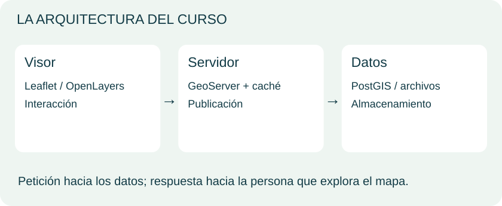
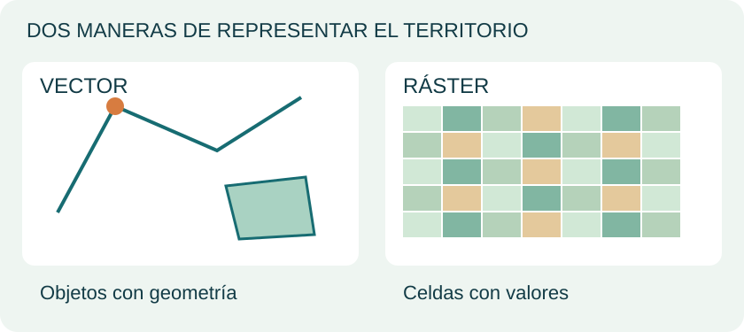
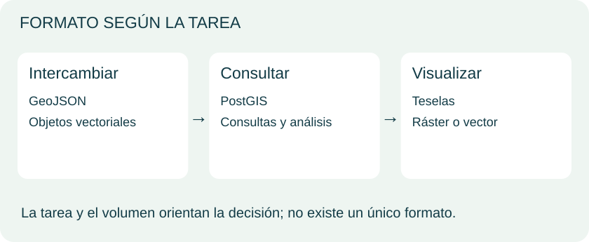

# Unidad 1 · Del dato al mapa web

<div class="visual-hero">
<div class="eyebrow">Laboratorio visual / Unidad 01</div>
<h2>Un mapa es la parte visible.<br>Descubre lo que hay detrás.</h2>
<p>Aprende a conectar datos, servicios y una interfaz para convertir información geográfica en una experiencia que se puede explorar.</p>
<p>Ruta: comprender → visualizar → elegir → aplicar.</p>
</div>

Esta muestra reorganiza los temas del material de MappingGIS y añade explicaciones originales. **Meta:** poder dibujar una arquitectura sencilla y justificar cómo publicar tus datos.

## 1. La idea en una imagen

Una aplicación de webmapping permite explorar información geográfica desde el navegador. Puede combinar un mapa base, capas temáticas, controles y fichas de información.

<svg class="visual-map" viewBox="0 0 900 320" role="img" aria-labelledby="map-title map-desc" xmlns="http://www.w3.org/2000/svg">
<title id="map-title">Capas de un visor de equipamientos</title><desc id="map-desc">Mapa esquemático con calles, un río, tres puntos de equipamiento y una ficha de atributos. No representa una ubicación real.</desc>
<path d="M0 80L560 290M80 0L690 300M290 0L90 320M520 0L330 320M0 220L620 90" stroke="white" stroke-width="22" fill="none"/>
<path d="M480 0Q360 110 470 180T500 320" stroke="#9eced9" stroke-width="38" fill="none"/>
<g fill="#da763d" stroke="white" stroke-width="5"><circle cx="170" cy="115" r="14"/><circle cx="330" cy="205" r="14"/><circle cx="395" cy="72" r="14"/></g>
<path d="M345 200L625 130" stroke="#176c72" stroke-width="3" stroke-dasharray="7 5"/>
<rect x="600" y="45" width="275" height="230" rx="16" fill="#123b46"/>
<g fill="white" font-family="sans-serif"><text x="625" y="82" font-size="15">CAPA · EQUIPAMIENTOS</text><text x="625" y="125" font-size="24">Biblioteca del barrio</text><text x="625" y="164" font-size="17">Geometría: punto</text><text x="625" y="196" font-size="17">Atributo: nombre</text><text x="625" y="242" font-size="15">Clic → consultar información</text></g>
</svg>
<div class="visual-grid">
<div class="visual-card"><span class="visual-number">01</span><b>Datos</b>¿Dónde está y qué sabemos del lugar? Geometría y atributos.</div>
<div class="visual-card"><span class="visual-number">02</span><b>Representación</b>¿Cómo lo mostramos? Símbolos, colores, etiquetas y escalas.</div>
<div class="visual-card"><span class="visual-number">03</span><b>Interacción</b>¿Qué puede hacer la persona? Mover, acercar, filtrar o consultar.</div>
</div>

<p class="content-source"><strong>Fuente del apartado:</strong> <a href="../../materiales/Unidad1_webmapping.pdf">MappingGIS · Unidad1_webmapping.pdf</a>.</p>

## 2. El recorrido de una petición

<figure class="lesson-figure"><a href="../../assets/unidad-1/cliente-servidor.svg" target="_blank" rel="noopener"></a></figure>


Imagina un visor de bibliotecas: al mover el mapa, la aplicación puede solicitar información para la zona visible.

<div class="visual-flow">
<div class="visual-card"><b>Navegador</b>Leaflet / OpenLayers<br>Presenta el mapa y recibe acciones.</div><span class="arrow" aria-hidden="true">⇄</span>
<div class="visual-card"><b>Servidor de mapas</b>GeoServer / MapServer<br>Recibe peticiones y publica capas.</div><span class="arrow" aria-hidden="true">⇄</span>
<div class="visual-card"><b>Almacenamiento</b>PostGIS / archivos<br>Conserva geometrías y atributos.</div>
</div>

1. El visor solicita una capa o una zona.
2. El servidor obtiene los datos necesarios.
3. Devuelve imágenes de mapa o entidades geográficas, según el servicio.
4. El navegador muestra el resultado y permite interactuar.

<div class="visual-note"><strong>Una arquitectura, varias posibilidades.</strong> Un visor pequeño puede cargar un GeoJSON directamente: no siempre necesitas GeoServer ni una base de datos. QGIS es un cliente de escritorio; Leaflet y OpenLayers son bibliotecas para el navegador. GeoWebCache añade caché de teselas para reutilizar resultados.</div>

### ¿Pedir una imagen o pedir objetos?

| Necesidad | Servicio | Qué recibes |
|---|---|---|
| Mostrar cartografía con el estilo del servidor | WMS | Imágenes georreferenciadas del mapa |
| Obtener geometrías y atributos para trabajar con entidades | WFS | Entidades geográficas; formatos según el servidor |

WMS también puede ofrecer consultas de información con `GetFeatureInfo`; eso no lo convierte en un servicio de descarga vectorial. Referencias: [OGC WMS](https://www.ogc.org/standards/wms/) y [OGC WFS](https://www.ogc.org/standards/wfs/).

<p class="content-source"><strong>Fuente del apartado:</strong> <a href="../../materiales/Unidad1_webmapping.pdf">MappingGIS · Unidad1_webmapping.pdf</a><br><strong>Ampliación y precisión técnica:</strong> <a href="https://www.ogc.org/standards/wms/">OGC · WMS</a> · <a href="https://www.ogc.org/standards/wfs/">OGC · WFS</a>.</p>

## 3. Elegir cómo guardar y entregar los datos

### Vector y ráster

<figure class="lesson-figure"><a href="../../assets/unidad-1/vector-raster.svg" target="_blank" rel="noopener"></a></figure>

### Elegir según la tarea

<figure class="lesson-figure"><a href="../../assets/unidad-1/elegir-datos.svg" target="_blank" rel="noopener"></a></figure>


**Vector:** objetos con geometría (puntos, líneas, polígonos). **Ráster:** celdas o píxeles (imágenes, elevación). Antes de elegir, pregunta: ¿quiero analizar, intercambiar o visualizar?

<div class="visual-grid">
<div class="visual-card"><b>Intercambiar pocos objetos</b>GeoJSON<br>Texto fácil de inspeccionar; útil para capas vectoriales pequeñas.</div>
<div class="visual-card"><b>Consultar y analizar</b>PostGIS / GeoPackage<br>PostGIS: base de datos espacial cliente-servidor. GeoPackage: contenedor en un archivo SQLite.</div>
<div class="visual-card"><b>Distribuir teselas</b>MBTiles<br>Contenedor SQLite para teselas ráster o vectoriales; requiere un mecanismo de publicación compatible.</div>
</div>

| Caso | Punto de partida | Pregunta que falta resolver |
|---|---|---|
| 30 bibliotecas con nombre y horario | GeoJSON | ¿Cuánto pesa la descarga? |
| Millones de registros que varias personas consultan | PostGIS | ¿Qué índices, filtros y permisos necesitas? |
| Datos portátiles para trabajo local | GeoPackage | ¿Qué herramientas lo van a leer? |
| Ortofotos para explorar rápidamente | Teselas ráster, eventualmente MBTiles | ¿Necesitas visualizar o analizar los píxeles originales? |
| Mapa base con estilo en el cliente | Teselas vectoriales | ¿Cómo gestionarás el estilo y la distribución? |

**Matices útiles:** un archivo binario también se puede transmitir por la web. GeoJSON se puede filtrar después de cargarlo; el formato por sí solo no ofrece un servidor de consultas. Las teselas vectoriales necesitan un estilo para representarse. Para analizar imágenes originales puede convenir conservar GeoTIFF, en lugar de trabajar únicamente con teselas.

### Leer un punto en GeoJSON

```json
{
  "type": "Feature",
  "geometry": {"type": "Point", "coordinates": [-70.65, -33.45]},
  "properties": {"nombre": "Biblioteca de ejemplo"}
}
```

Ejemplo ficticio. En GeoJSON conforme a RFC 7946, las coordenadas se expresan como **longitud, latitud** en grados. La geometría responde «dónde» y `properties` responde «qué sabemos». Consulta [RFC 7946](https://datatracker.ietf.org/doc/html/rfc7946) y la [especificación MBTiles](https://github.com/mapbox/mbtiles-spec).

<p class="content-source"><strong>Fuente del apartado:</strong> <a href="../../materiales/Unidad1_webmapping.pdf">MappingGIS · Unidad1_webmapping.pdf</a><br><strong>Ampliación y precisión técnica:</strong> <a href="https://datatracker.ietf.org/doc/html/rfc7946">IETF · RFC 7946 (GeoJSON)</a> · <a href="https://github.com/mapbox/mbtiles-spec">MBTiles · especificación</a>.</p>

## 4. Cómo llegamos hasta aqué

| Etapa | Cambio que ayuda a entender el curso |
|---|---|
| Redes e informática geográfica | Se desarrollan las bases de la comunicación y del SIG digital. Internet y la Web son conceptos distintos. |
| Web y primeros visores | La cartografía llega al navegador y se consolida el modelo cliente-servidor. |
| Mapas interactivos y móviles | Las teselas, los gestos y las bibliotecas facilitan explorar mapas. |
| Aplicaciones y paneles | El mapa se combina con filtros, indicadores y otras vistas de los datos. |

Esta es una síntesis conceptual de la evolución presentada en el curso, no una cronología exhaustiva de lanzamientos.

<p class="content-source"><strong>Fuente del apartado:</strong> <a href="../../materiales/Unidad1_webmapping.pdf">MappingGIS · Unidad1_webmapping.pdf</a>.</p>

## 5. Construir por componentes o usar una plataforma

| Enfoque | Qué te aporta | Qué debes evaluar |
|---|---|---|
| Componentes independientes | Control sobre visor, servidor y almacenamiento | Instalación, integración y mantenimiento |
| Paquete integrado / IDE | Componentes coordinados para publicar y compartir | Actualizaciones, documentación y compatibilidad |
| Plataforma alojada | Infraestructura gestionada para publicar | Costos, límites, portabilidad y condiciones de uso |

El software libre permite inspeccionar y adaptar el código, pero sigue requiriendo recursos de operación. No hay un ganador universal de rendimiento: depende de los datos, las consultas y la configuración. El navegador amplía el acceso; el SIG de escritorio conserva su papel en edición y análisis especializado.

**Lista de requisitos para un proyecto:** formatos y proyecciones, leyendas, consultas, edición cuando se necesite, autenticación, permisos, accesibilidad y estándares. Leaflet es una biblioteca del visor, no una plataforma completa: [documentación oficial](https://leafletjs.com/).

<p class="content-source"><strong>Fuente del apartado:</strong> <a href="../../materiales/Unidad1_webmapping.pdf">MappingGIS · Unidad1_webmapping.pdf</a><br><strong>Ampliación y precisión técnica:</strong> <a href="https://leafletjs.com/examples/quick-start/">Leaflet · guía oficial</a>.</p>

## 6. Tu mapa mental de la unidad

<div class="visual-grid">
<div class="visual-card"><b>Qué publicas</b>Datos → geometría + atributos → vector o ráster.</div>
<div class="visual-card"><b>Cómo lo entregas</b>Archivo / servicio / teselas → intercambio, consulta o visualización.</div>
<div class="visual-card"><b>Cómo se usa</b>Visor → símbolos + controles + interacción → una pregunta resuelta.</div>
</div>

**Recuerda:** formato no es servicio; biblioteca no es servidor; publicar no es lo mismo que analizar.

<p class="content-source"><strong>Fuente del apartado:</strong> <a href="../../materiales/Unidad1_webmapping.pdf">MappingGIS · Unidad1_webmapping.pdf</a>.</p>

## Fuentes y alcance

- Base temática: material de la Unidad 1 de MappingGIS, consultado localmente. Las explicaciones, la ilustración de esta propuesta son originales; no se reproducen diapositivas.
- Ampliación técnica: [OGC WMS](https://www.ogc.org/standards/wms/), [OGC WFS](https://www.ogc.org/standards/wfs/), [RFC 7946](https://datatracker.ietf.org/doc/html/rfc7946), [MBTiles](https://github.com/mapbox/mbtiles-spec) y [Leaflet](https://leafletjs.com/). Consultadas el 24 de octubre de 2026.

## Ejercicio Unidad 1 {#7-ejercicios-de-la-unidad}

El PDF de la Unidad 1 no contiene ejercicios prácticos propios. La práctica original comienza en la Unidad 2.

[Continuar a la Unidad 2: PostGIS](unidad-2.md)
