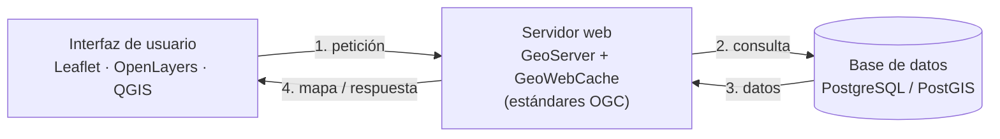

# Unidad 1. Introducción a la cartografía web y publicación de mapas online

**Antes de leer, mira el esquema.** Esta es la arquitectura open source que vas a encontrar una y otra vez, unidad tras unidad:

### Resumen estructurado

**1. Breve historia del webmapping**
- **Años 70:** nace internet; primer mapa de Internet (1969, redes en EEUU).
- **Años 80:** crece la "web" y aparece el software libre. En 1982 se lanza ArcInfo.
- **Años 90:** web 1.0, software open source, aparece ArcIMS.
- **Años 00s:** web 2.0 y móviles → el webmapping despega (OpenStreetMap, Google Maps, OpenLayers).
- **Años 10s:** explosión de aplicaciones webmapping (Leaflet, CARTO, Mapbox, OpenGeoSuite, GeoNode) — se empieza a debatir si sustituirá al SIG de escritorio.
- **Años 20s:** crear mapas web es cada vez más sencillo; auge de los *dashboards* o paneles de mando.

**2. Formatos de datos para aplicaciones webmapping**

| | Formatos GIS tradicionales | Formatos GIS modernos |
|---|---|---|
| Vector | Shapefile, geodatabases ESRI, PostGIS | GeoJSON (transmisible), PostGIS/GeoPackage (consultable) |
| Raster | GeoTIFF | .mbtiles (archivo único) |
| Problema | binarios, no consultables, complejos (pensados para offline) | pensados para transmitirse/consultarse en la web |

- **GeoJSON** (2008): basado en JSON. Soporta Point, LineString, Polygon, MultiPoint, MultiLineString, MultiPolygon, GeometryCollection.
  - *Ventajas:* texto plano legible, transmisible, simple, integrado con estándares web, buen formato de intercambio.
  - *Desventajas:* texto sin formato es ineficiente, no consultable, solo vectorial.
- **MBTiles** (creado por Mapbox): almacena millones de teselas en una única base SQLite. Solución portátil de un solo archivo.
  - *Ventajas:* consultable, acceso rápido con recursos limitados, teselas vectoriales con estilo.
  - *Desventajas:* pensado para servir (no para análisis), un dataset ocupa varios niveles de zoom, difícil de modificar una vez creado (ej. reproyectar).

**Cómo elegir el formato correcto** — preguntarse:
1. ¿Vector o raster?
2. ¿Vas a analizar o solo servir el dato?
3. ¿En qué ambiente trabajas (local o web)?

*Ejemplos del curso:*
- Gran dataset vectorial de puntos para analizar → **PostGIS/GeoPackage**
- Cientos de imágenes de drones → **MBTiles**
- Mapa base de calles con estilo propio para publicar → **teselas vectoriales**
- Un conjunto pequeño de datos → **GeoJSON**

**3. ¿Qué es una aplicación webmapping (SIG web)?**
Aplicación que permite visualizar cartografía en internet e interactuar con el mapa y los datos. Dos formas de crearla:
1. Aplicación/paquete con los componentes de una arquitectura completa (BBDD + servidor + visor) — ej. PostGIS, GeoServer, OpenLayers, Leaflet, Mapbox.
2. Plataforma online que ya integra estas herramientas (ej. CARTO, Mapbox, ArcGIS Online, Google Maps Engine/My Maps).

**4. Ventajas del webmapping frente al SIG de escritorio**
1. No requiere software SIG específico.
2. Perfil de usuario menos técnico.
3. Potencia el trabajo colaborativo.
4. Información más actualizada (incluso tiempo real).
5. Independencia del sistema operativo.
6. Personalización de aplicaciones.
7. Combinación de cartografía con otros elementos.

**5. Paquetes de software GIS web**

*Requisitos de un paquete completo:* soporte raster/vector, transformaciones de proyección, interactividad, herramientas de dibujo, leyendas/herramientas personalizadas, edición de datos, seguridad configurable, soporte de estándares (WMS, WFS).

*Open source destacados:* GeoNode, Lizmap, geOrchestra, mapfish, GeoMajas, GeoMoose, GeoSHAPE.
- Ventaja: ahorro de tiempo/dinero al no configurar componentes desde cero.
- Desventaja: dependen de que la institución mantenga actualizadas las versiones → suelen quedar relegados a uso de prueba. Por eso a menudo es preferible instalar los componentes por separado.

*Open source vs comercial (stack típico):*
- Comercial (ESRI): ArcSDE → ArcGIS Server → ArcGIS Web Service APIs → ArcGIS Explorer/Desktop.
- Open source: PostgreSQL+PostGIS → MapServer/GeoServer → OpenLayers → QGIS/uDig.
- El stack open source (QGIS/Leaflet/OpenLayers + GeoServer/MapServer + PostGIS) supera a ArcGIS Server en: compatibilidad multiplataforma (Windows/Linux/Mac vs solo Windows/Linux), ahorro en desarrollo/hardware/licencias, y mejor rendimiento en peticiones WFS según pruebas comparativas.

**Arquitectura típica de una IDE open source:**
- Interfaz de usuario: Leaflet, OpenLayers, QGIS
- Servidor web: GeoServer + GeoWebCache (estándares OGC)
- Base de datos: PostgreSQL/PostGIS

---

