# Unidad 2 · Pensar espacialmente con PostGIS

<div class="visual-hero">
<div class="eyebrow">Unidad 02 / Bases de datos espaciales</div>
<h2>De guardar coordenadas<br>a responder preguntas espaciales.</h2>
<p>Comprende cómo una base de datos reconoce formas, relaciona lugares y construye nuevas geometrías.</p>
<p>Fundamentos → gestión de datos → análisis espacial → ejercicios originales.</p>
</div>

Esta guía visual integra las tres clases de la unidad: introducción a PostGIS, gestión de datos y análisis espacial. Las ilustraciones son explicativas; la práctica al final corresponde exclusivamente al PDF original de MappingGIS.


## Antes de comenzar {#antes-de-comenzar}

| Necesitas | Cómo saber si está listo |
|---|---|
| PostgreSQL con PostGIS y pgAdmin 4 | Puedes conectarte al servidor y ejecutar `SELECT version();` |
| QGIS con el Administrador de bases de datos | Encuentras el menú **Base de datos → Administrador de BBDD** |
| El paquete `webmapping.zip` del curso | Tienes la carpeta `Capas` con países, lugares poblados y `ne_110_rivers_lake.gpkg` |
| Una carpeta para guardar resultados | Puedes guardar capturas y archivos exportados |

**Disponibilidad de datos.** El paquete `webmapping.zip` se obtiene desde la plataforma del curso. En tu carpeta de trabajo el paquete se llama `Unidad_2/Archivos_webmapping.zip` y también está extraído en `Unidad_2/Archivos_curso_webmapping`. Copia su contenido a la ruta de práctica si lo necesitas. El sitio publicado no incluye ese paquete: los PDF por sí solos no contienen las capas. Si no lo conservas, debes recuperarlo antes de realizar las importaciones y los ejercicios que dependen de él. La creación de `lugares` y sus tres registros escritos en SQL funciona sin ese paquete, una vez activado PostGIS; las consultas sobre las capas importadas requieren los archivos del curso.

**Versiones y nombres de menú.** El curso utiliza PostgreSQL 17 y PostGIS 3.5. Las rutas siguientes describen ese flujo en Windows; los nombres de algunos botones pueden variar con la versión o el idioma. Anota tus versiones para poder interpretar diferencias.

## 1. Arquitectura y datos

### Del archivo a PostGIS

<figure class="lesson-figure">
<a href="../../assets/unidad-2/recorrido.svg" target="_blank" rel="noopener">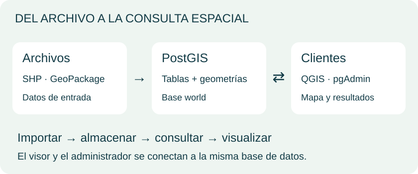</a>

</figure>


<div class="visual-flow">
<div class="visual-card"><span class="visual-number">01</span><b>Tipos espaciales</b>Guardar puntos, líneas y polígonos junto a nombres y otros atributos.</div><span class="arrow" aria-hidden="true">+</span>
<div class="visual-card"><span class="visual-number">02</span><b>Funciones</b>Medir, comparar, convertir y construir geometrías mediante SQL.</div><span class="arrow" aria-hidden="true">+</span>
<div class="visual-card"><span class="visual-number">03</span><b>Índices espaciales</b>Reducir la búsqueda de candidatos antes de evaluar relaciones exactas.</div>
</div>

**PostgreSQL** administra tablas, transacciones, permisos y consultas. **PostGIS** es la extensión que añade capacidades espaciales. Una base centralizada ayuda a trabajar con varias personas y a consultar grandes conjuntos sin intercambiar copias de archivos; requiere administración y un modelo de datos adecuado.

| Papel | Herramienta | Qué hace en esta unidad |
|---|---|---|
| Motor de datos | PostgreSQL + PostGIS | Almacenar, consultar y procesar geometrías |
| Administración y SQL | pgAdmin / psql | Gestionar objetos y ejecutar consultas |
| Cliente cartográfico | QGIS | Conectar, importar, exportar y visualizar capas |
| Publicación web, más adelante | GeoServer → visor | Llevar las capas al navegador |

<p class="content-source"><strong>Referencia:</strong> <a href="https://postgis.net/workshops/postgis-intro/indexing.html">PostGIS · índices espaciales</a>.</p>

## 2. Geometrías y formatos

<svg class="visual-map" viewBox="0 0 900 240" role="img" aria-labelledby="types-title types-desc" xmlns="http://www.w3.org/2000/svg">
<title id="types-title">Punto, línea y polígono</title><desc id="types-desc">Tres geometrías básicas: un punto representa una ubicación, una línea un recorrido y un polígono una superficie cerrada.</desc>
<g stroke="#176c72" stroke-width="5" fill="none"><circle cx="150" cy="90" r="12" fill="#d77c40"/><path d="M340 130L390 55L460 110L530 65"/><path d="M650 55L790 70L810 135L680 145Z" fill="#a9d2c2"/></g>
<g fill="#123b46" font-family="sans-serif" text-anchor="middle"><text x="150" y="190" font-size="22">POINT</text><text x="435" y="190" font-size="22">LINESTRING</text><text x="735" y="190" font-size="22">POLYGON</text></g>
</svg>

### De una fila a una entidad

<figure class="lesson-figure">
<a href="../../assets/unidad-2/tabla-mapa.svg" target="_blank" rel="noopener">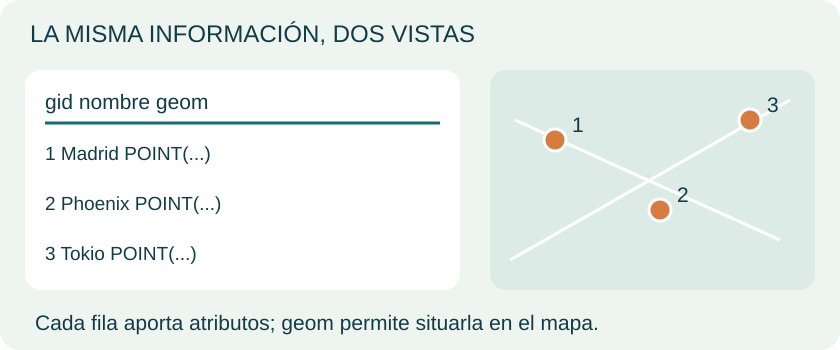</a>

</figure>

| Atributo | Ejemplo de la tabla `lugares` del curso |
|---|---|
| Identificador | `gid` |
| Información descriptiva | `nombre`, `comentario`, `año` |
| Geometría | `geom geometry(Point, 4326)` |

`Point` limita el tipo de forma y `4326` identifica el sistema de referencia. Las variantes `MULTI*` agrupan varias geometrías del mismo tipo; `GEOMETRYCOLLECTION` admite tipos distintos. Un polígono puede tener un anillo exterior y anillos interiores. Z añade una coordenada adicional, habitualmente altura; M representa una medida. La presencia de Z no significa que toda función opere en 3D.

### WKT, WKB y conversiones

<div class="visual-flow">
<div class="visual-card"><b>Texto WKT</b><code>POINT(-3.683352 40.400026)</code><br>Representación legible.</div><span class="arrow" aria-hidden="true">→</span>
<div class="visual-card"><b>Geometría PostGIS</b><code>ST_GeomFromText(..., 4326)</code><br>Objeto sobre el que se opera.</div><span class="arrow" aria-hidden="true">→</span>
<div class="visual-card"><b>Texto de salida</b><code>ST_AsText(geom)</code><br>Coordenadas legibles otra vez.</div>
</div>

| Representación | Entrada | Salida | Para qué sirve |
|---|---|---|---|
| WKT | `ST_GeomFromText` | `ST_AsText` | Inspeccionar geometrías como texto |
| WKB | `ST_GeomFromWKB` | `ST_AsBinary` | Intercambiar representación binaria |
| EWKT / EWKB | `ST_GeomFromEWKT` / `ST_GeomFromEWKB` | `ST_AsEWKT` / `ST_AsEWKB` | Incluir SRID y extensiones de PostGIS |
| GeoJSON | `ST_GeomFromGeoJSON` | `ST_AsGeoJSON` | Intercambio con aplicaciones web |
| GML / KML | `ST_GeomFromGML` / `ST_GeomFromKML` | `ST_AsGML` / `ST_AsKML` | Intercambio con herramientas compatibles |
| SVG | — | `ST_AsSVG` | Representación gráfica |

**Precisión respecto de los apuntes históricos:** WKT y WKB tienen variantes que admiten dimensiones adicionales; no conviene afirmar que todos sus usos se limitan a 2D. El WKT convencional no incorpora por sí solo el SRID; EWKT puede expresarlo como `SRID=4326;POINT(...)`.


## 3. Coordenadas y medidas

<div class="visual-grid">
<div class="visual-card"><b>Coordenadas</b>Los valores numéricos que describen la posición.</div>
<div class="visual-card"><b>Sistema de referencia</b>Las reglas con que se interpretan esos valores.</div>
<div class="visual-card"><b>SRID</b>El identificador que enlaza la geometría con ese sistema.</div>
</div>

### SRID: asignar o transformar

<figure class="lesson-figure">
<a href="../../assets/unidad-2/srid-transform.svg" target="_blank" rel="noopener">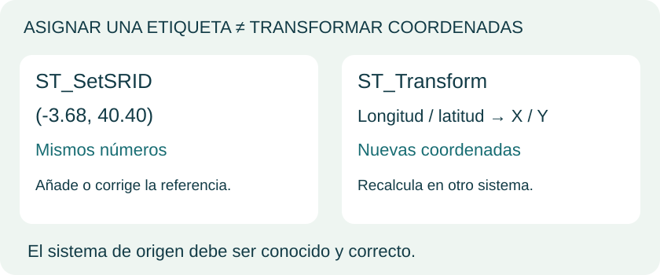</a>

</figure>

| Operación | Qué cambia | Uso correcto |
|---|---|---|
| `ST_SetSRID(geom, srid)` | La etiqueta del sistema; conserva coordenadas | Asignar el sistema conocido de coordenadas sin etiquetar |
| `ST_Transform(geom, srid)` | Recalcula coordenadas al sistema destino | Reproyectar desde un sistema correctamente identificado |
| `ST_SRID(geom)` | No modifica; informa el identificador | Revisar el contexto antes de operar |

<div class="visual-note"><strong>Etiquetar no es reproyectar.</strong> Si una capa tiene SRID 0, primero comprueba su sistema real. Asignar 4326 no convierte valores en metros a longitud y latitud. La corrección del SRID que aparece en el ejercicio solo procede si los datos realmente están en ese sistema.</div>

### Geometry frente a geography

<figure class="lesson-figure">
<a href="../../assets/unidad-2/geometry-geography.svg" target="_blank" rel="noopener">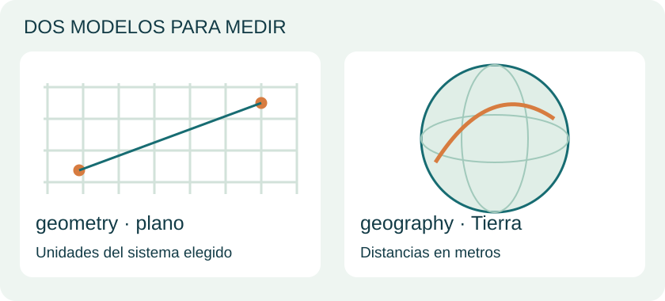</a>

</figure>


| | `geometry` | `geography` |
|---|---|---|
| Modelo habitual de cálculo | Plano cartesiano | Superficie terrestre, con cálculos geodésicos |
| Distancias | Unidades del sistema de coordenadas | Metros en las funciones de distancia |
| Ejemplo en EPSG:4326 | Coordenadas angulares; una distancia plana no está en metros | Distancias geodésicas entre ubicaciones |
| Decisión | Elegir una proyección apropiada para el área y la tarea | Útil para cálculos geográficos, especialmente áreas extensas |

No basta con que un sistema use metros para que cualquier medida sea adecuada: también importa la distorsión. En el ejercicio original se solicita un **buffer de 2 grados** sobre `cities`; se conserva esa consigna, que no equivale a un radio constante en kilómetros.

**Metadatos que encontrarás:** `spatial_ref_sys` describe sistemas de referencia; `geometry_columns` y `geography_columns` permiten inspeccionar columnas espaciales. `ST_GeometryType`, `ST_NDims` y `ST_SRID` describen una geometría. Los estándares Simple Features y SQL/MM aportan tipos y operaciones comunes; no todas las extensiones de PostGIS pertenecen al mismo estándar.

<p class="content-source"><strong>Referencia:</strong> <a href="https://postgis.net/docs/ST_SetSRID.html">PostGIS · ST_SetSRID</a> · <a href="https://postgis.net/docs/ST_Transform.html">PostGIS · ST_Transform</a> · <a href="https://postgis.net/docs/ST_DWithin.html">PostGIS · ST_DWithin</a>.</p>

## 4. Índices espaciales

### Cajas y comprobación exacta

<svg class="visual-map" viewBox="0 0 900 260" role="img" aria-labelledby="idx-title idx-desc" xmlns="http://www.w3.org/2000/svg">
<title id="idx-title">Dos pasos de una búsqueda espacial</title><desc id="idx-desc">Primero se comparan cajas delimitadoras para seleccionar candidatos; después se comprueba la geometría real de los candidatos. Coincidir en la caja no asegura una intersección exacta.</desc>
<g fill="none" stroke="#176c72" stroke-width="3"><rect x="45" y="38" width="180" height="130" stroke-dasharray="8 5"/><path d="M65 145L110 55L205 145Z" fill="#b4d9cd"/><rect x="165" y="75" width="105" height="95" stroke="#d77c40" stroke-dasharray="8 5"/><circle cx="245" cy="140" r="18" fill="#d77c40"/></g>
<g fill="#123b46" font-family="sans-serif"><text x="360" y="65" font-size="22">1. Cajas → candidatos</text><text x="360" y="105" font-size="17">Los rectángulos se solapan.</text><text x="360" y="158" font-size="22">2. Formas → comprobación</text><text x="360" y="198" font-size="17">Aquí el círculo y el triángulo no se tocan.</text></g>
</svg>

Una caja delimitadora simplifica la extensión de una geometría. El índice puede descartar muchos registros con rapidez, pero los candidatos pueden necesitar una comprobación exacta. El planificador decide si utilizar el índice según la consulta y los datos.

`ST_Intersects` y `ST_DWithin` pueden aprovechar índices compatibles. `ST_Distance` calcula una distancia; para filtrar por radio suele resultar apropiado `ST_DWithin`. Es una explicación del mecanismo, no una promesa de un tiempo fijo de ejecución.

<p class="content-source"><strong>Referencia:</strong> <a href="https://postgis.net/workshops/postgis-intro/indexing.html">PostGIS · índices espaciales</a>.</p>

## 5. Flujo de una consulta SQL

### Tabla → filtro → resultado

<figure class="lesson-figure">
<a href="../../assets/unidad-2/sql-flujo.svg" target="_blank" rel="noopener">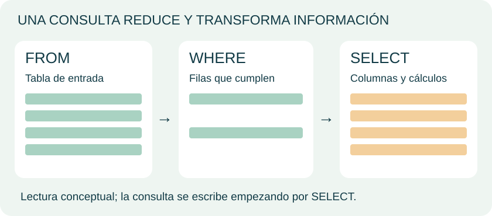</a>

</figure>


<div class="visual-flow">
<div class="visual-card"><b>FROM</b>¿De qué tabla salen los datos?</div><span class="arrow" aria-hidden="true">→</span>
<div class="visual-card"><b>WHERE</b>¿Qué registros cumplen la condición?</div><span class="arrow" aria-hidden="true">→</span>
<div class="visual-card"><b>SELECT</b>¿Qué columnas o cálculos se devuelven?</div>
</div>

Es una ayuda para comprender la consulta; el orden escrito habitual comienza por `SELECT` y el motor puede optimizar la ejecución. `GROUP BY` reúne grupos para agregaciones como `sum`, `avg` o `stddev`; `ORDER BY` ordena el resultado. `CREATE TABLE`, `INSERT`, `UPDATE` y `DELETE` crean y modifican datos.

En el curso se crea la base `world`, se activa la extensión, se importan capas, se conecta QGIS y se trabaja con `lugares`, `countries` y `cities`.

La preparación se desarrolla en [Conectar y crear la base world](#crear-world): primero crea o selecciona `world` y después activa PostGIS en esa base. Continúa con la importación y las consultas sobre las tablas originales siguiendo las secciones 9–11.


## 6. Funciones y resultados

### Booleano, número o geometría

<figure class="lesson-figure">
<a href="../../assets/unidad-2/resultados.svg" target="_blank" rel="noopener">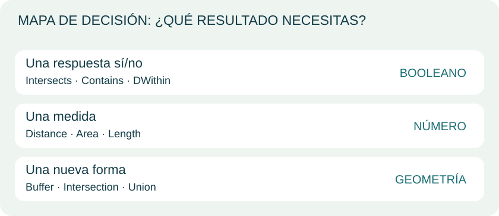</a>

</figure>


| Quiero… | Familia | Funciones de las clases |
|---|---|---|
| Leer o convertir una representación | Conversión | `ST_AsText`, `ST_GeomFromText`, `ST_AsGeoJSON` |
| Inspeccionar forma y medidas | Recuperación | `ST_Length`, `ST_Area`, `ST_Perimeter`, `ST_X`, `ST_Y` |
| Preguntar por una relación | Comparación | `ST_Intersects`, `ST_Contains`, `ST_Touches`, `ST_DWithin` |
| Construir una forma nueva | Generación | `ST_Buffer`, `ST_Centroid`, `ST_Intersection`, `ST_Union` |
| Gestionar columnas espaciales | Administración | `AddGeometryColumn`, `Populate_Geometry_Columns` |

Otros accesores del material: `ST_ExteriorRing`, `ST_InteriorRingN`, `ST_GeometryN`, `ST_NumGeometries`, `ST_NPoints`, `ST_NRings`, `ST_StartPoint` y `ST_EndPoint`. Comprueba el tipo de geometría que admite cada función; por ejemplo, `ST_ExteriorRing` trabaja con polígonos, no directamente con multipolígonos.


## 7. Relaciones espaciales

### Galería de relaciones

<div class="visual-grid relation-grid">
<div class="visual-card"><svg viewBox="0 0 270 130" role="img" aria-label="Sin puntos compartidos" xmlns="http://www.w3.org/2000/svg"><circle cx="80" cy="60" r="35" fill="#83bdb1" fill-opacity=".65" stroke="#176c72" stroke-width="3"/><circle cx="190" cy="60" r="35" fill="#efb36c" fill-opacity=".65" stroke="#b5632c" stroke-width="3"/></svg><b>ST_Disjoint</b>Sin puntos compartidos.</div>
<div class="visual-card"><svg viewBox="0 0 270 130" role="img" aria-label="Solo contacto de fronteras" xmlns="http://www.w3.org/2000/svg"><circle cx="95" cy="60" r="35" fill="#83bdb1" fill-opacity=".65" stroke="#176c72" stroke-width="3"/><circle cx="165" cy="60" r="35" fill="#efb36c" fill-opacity=".65" stroke="#b5632c" stroke-width="3"/></svg><b>ST_Touches</b>Solo contacto de fronteras.</div>
<div class="visual-card"><svg viewBox="0 0 270 130" role="img" aria-label="Parte común; ninguna contiene a la otra" xmlns="http://www.w3.org/2000/svg"><circle cx="110" cy="60" r="35" fill="#83bdb1" fill-opacity=".65" stroke="#176c72" stroke-width="3"/><circle cx="155" cy="60" r="35" fill="#efb36c" fill-opacity=".65" stroke="#b5632c" stroke-width="3"/></svg><b>ST_Overlaps</b>Parte común; ninguna contiene a la otra.</div>
<div class="visual-card"><svg viewBox="0 0 270 130" role="img" aria-label="Una forma contiene a la otra" xmlns="http://www.w3.org/2000/svg"><circle cx="130" cy="60" r="35" fill="#83bdb1" fill-opacity=".65" stroke="#176c72" stroke-width="3"/><circle cx="130" cy="60" r="17" fill="#efb36c" fill-opacity=".65" stroke="#b5632c" stroke-width="3"/></svg><b>ST_Contains</b>Una forma contiene a la otra.</div>
</div>

Los esquemas muestran relaciones entre superficies; las definiciones también consideran interiores, fronteras y dimensiones.

| Función | Qué pregunta |
|---|---|
| `ST_Equals(A,B)` | ¿Representan el mismo conjunto de puntos? No exige idéntico orden de vértices. |
| `ST_Intersects(A,B)` | ¿Comparten algún punto, incluso de frontera? |
| `ST_Disjoint(A,B)` | ¿No comparten ningún punto? |
| `ST_Touches(A,B)` | ¿Comparten puntos sin que sus interiores se intersecten? |
| `ST_Within(A,B)` / `ST_Contains(B,A)` | ¿A está dentro de B, con intersección de interiores? |
| `ST_Overlaps(A,B)` | ¿Son de la misma dimensión, comparten parte y ninguna contiene a la otra? |
| `ST_Crosses(A,B)` | ¿Se cruzan según la dimensión y los interiores de los tipos comparados? |
| `ST_DWithin(A,B,d)` | ¿Están a una distancia menor o igual a d? |
| `ST_Distance(A,B)` | ¿Cuál es la distancia mínima? Devuelve un número. |

**La frontera importa:** un punto situado solo sobre el borde de un polígono puede intersectarlo sin estar contenido según `ST_Contains`. **`ST_Intersects` devuelve un booleano; `ST_Intersection` devuelve una geometría.**

<p class="content-source"><strong>Referencia:</strong> <a href="https://postgis.net/docs/ST_DWithin.html">PostGIS · ST_DWithin</a>.</p>

## 8. Operaciones geométricas

### Buffer: punto y línea

<figure class="lesson-figure">
<a href="../../assets/unidad-2/buffer.svg" target="_blank" rel="noopener">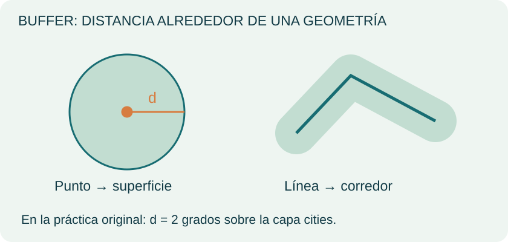</a>

</figure>

### Intersección y unión

<figure class="lesson-figure">
<a href="../../assets/unidad-2/overlay.svg" target="_blank" rel="noopener">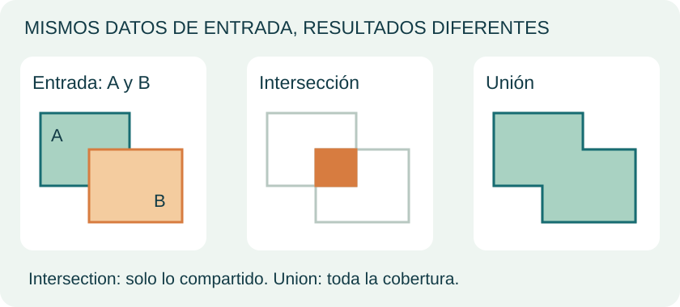</a>

</figure>


<div class="visual-grid">
<div class="visual-card"><b>Buffer</b>Geometría → zona alrededor.<br><code>ST_Buffer</code><p>La distancia debe interpretarse según el tipo y el sistema de referencia.</p></div>
<div class="visual-card"><b>Intersección</b>A + B → parte compartida.<br><code>ST_Intersection</code><p>Produce el resultado del recorte, no una respuesta verdadero/falso.</p></div>
<div class="visual-card"><b>Unión</b>A + B → cobertura combinada.<br><code>ST_Union</code><p>También se utiliza como agregado sobre varias filas.</p></div>
</div>

### Centroide y punto interior

<figure class="lesson-figure">
<a href="../../assets/unidad-2/centroide.svg" target="_blank" rel="noopener">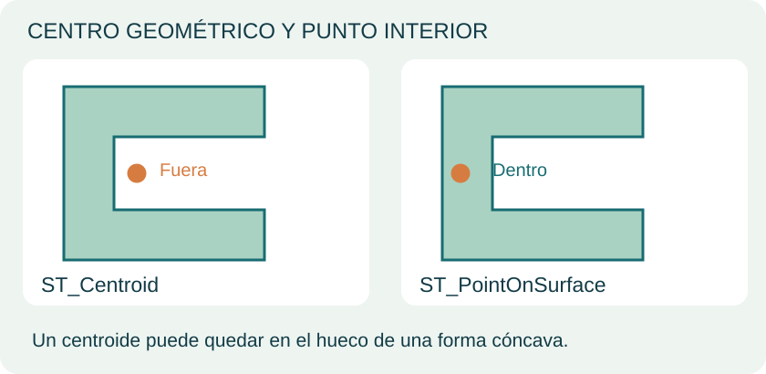</a>

</figure>

| Centroide | Punto sobre la superficie |
|---|---|
| `ST_Centroid` calcula un centro geométrico | `ST_PointOnSurface` busca un punto interior para superficies |
| Puede quedar fuera de un polígono cóncavo | Es útil cuando importa que el punto quede dentro |

Las consultas de la clase utilizan ejemplos de Nueva York para explicar relaciones y construcción. La práctica entregable de esta unidad utiliza las capas y ciudades indicadas en su PDF; se conserva esa distinción.


## Preparación de la práctica {#preparacion-practica}

### Preparar los archivos

1. Descarga `webmapping.zip` desde tu cuenta del curso y extrae **todo** su contenido en una ruta sin espacios, por ejemplo `C:\webmapping`.
2. Abre `C:\webmapping\Capas`. Localiza `ne_110m_admin_0_countries.shp`, `ne_110m_populated_places.shp` y `ne_110_rivers_lake.gpkg`.
3. Mantén cada shapefile junto a sus archivos auxiliares: `.dbf` contiene atributos, `.shx` el índice y `.prj` la referencia espacial. No copies solamente el `.shp`.
4. Guarda una captura de la carpeta para el ejercicio 1. Si conservas la plantilla de resultados del curso, úsala; para estudio personal puedes guardar capturas numeradas en tu carpeta de resultados.

### Instalar y abrir las herramientas

1. Si ya tienes PostgreSQL y PostGIS operativos, pasa a la conexión. Si no, descarga el instalador desde [PostgreSQL para Windows](https://www.postgresql.org/download/windows/).
2. En el instalador incluye **PostgreSQL Server**, **pgAdmin 4**, **Command Line Tools** y **Stack Builder**. Conserva las rutas predeterminadas y anota el puerto; el habitual es `5432`. Define y guarda tu propia contraseña del usuario `postgres`.
3. Abre **Stack Builder**, selecciona la instalación y el puerto anteriores y busca **Spatial Extensions → PostGIS**. Instala la edición compatible con esa instalación de PostgreSQL. El curso muestra PostgreSQL 17 con PostGIS 3.5; no mezcles paquetes de distintas versiones mayores de PostgreSQL.
4. Abre **pgAdmin 4** desde Inicio. Su interfaz puede abrirse en una ventana de escritorio o en el navegador. Esta es la aplicación que debes capturar en el ejercicio 2.
5. Abre QGIS. Si falta el Administrador de BBDD, revisa **Complementos → Administrar e instalar complementos** y activa **DB Manager / Administrador de BBDD**.

**Comprueba:** PostgreSQL debe estar ejecutándose como servicio de Windows. Abrir pgAdmin no inicia por sí solo un servidor detenido.

<p class="content-source"><strong>Referencias:</strong> <a href="https://postgis.net/documentation/getting_started/install_windows/">PostGIS · instalación en Windows</a> · <a href="https://docs.qgis.org/3.44/en/docs/user_manual/plugins/core_plugins/plugins_db_manager.html">QGIS · Administrador de BBDD</a>. Secuencia adaptada a la práctica original de MappingGIS.</p>

## 9. Conectar y crear la base world {#crear-world}

### Registrar el servidor en pgAdmin

1. En el árbol de pgAdmin despliega **Servers / Servidores**. Si ya aparece tu PostgreSQL local, abre esa conexión.
2. Si no aparece, pulsa el botón derecho en **Servers → Register → Server**. En versiones anteriores puede llamarse **Create → Server**.
3. En **General**, escribe un nombre identificativo, por ejemplo `PostgreSQL local`. En **Connection**, utiliza estos valores:

| Parámetro | Valor |
|---|---|
| Host name/address | `localhost` |
| Port | `5432`, o el que anotaste al instalar |
| Maintenance database | `postgres` |
| Username | `postgres` |
| Password | Tu contraseña de instalación |

4. Guarda la conexión. Debe desplegarse el nodo **Databases**. La contraseña maestra de pgAdmin, si la solicita, protege sus contraseñas guardadas; es distinta de la contraseña del servidor.

### Crear world y activar PostGIS

1. Pulsa el botón derecho en **Databases → Create → Database**.
2. Escribe `world` como nombre y deja `postgres` como propietario. Guarda. Si `world` ya existe por una práctica previa, úsala y revisa sus tablas antes de crear o importar objetos.
3. Selecciona **world** y abre **Tools → Query Tool**, o su opción en el menú contextual. Confirma en la conexión del editor que estás en `world`.
4. Pega y ejecuta este bloque con el botón **Execute**:

```sql
CREATE EXTENSION IF NOT EXISTS postgis;
SELECT current_database() AS base, postgis_full_version() AS version_postgis;
```

**Resultado esperado:** una fila cuyo campo `base` sea `world` y cuyo segundo campo contenga la versión de PostGIS. Si devuelve otra base, cambia la conexión antes de continuar. La extensión se activa **en cada base**, no una sola vez para todo el servidor.

### Ejecutar y leer consultas

Pega un bloque cada vez. Si seleccionas texto, comprueba qué sentencia ejecuta el botón de tu versión; evita dejar seleccionada una consulta anterior. Los `SELECT` devuelven filas en **Data Output**; las operaciones de creación y modificación informan en **Messages**. El árbol de objetos puede necesitar **Refresh / Actualizar** después de crear una tabla.

```sql
SELECT 2 + 3 AS comprobacion;
```

**Debes ver:** una columna `comprobacion` con el valor `5`. Este pequeño control separa los problemas de conexión de los problemas de datos.

<p class="content-source"><strong>Referencia:</strong> <a href="https://www.pgadmin.org/docs/pgadmin4/latest/query_tool.html">pgAdmin · editor de consultas y paneles de resultados</a>.</p>

## 10. Importar, visualizar y exportar {#importar-datos}

### Dos shapefiles con el importador de PostGIS

La práctica original pide importar dos tablas con la interfaz de PostGIS y una tercera desde QGIS. Sigue las dos rutas para conservar esa distinción.

1. En Inicio busca **PostGIS Shapefile and DBF Loader / Shapefile Import/Export Manager** de tu instalación.
2. Abre **View connection details** y configura `localhost`, tu puerto, la base `world`, el usuario `postgres` y tu contraseña. Acepta y comprueba la conexión.
3. En la pestaña **Import**, pulsa **Add File** y abre `ne_110m_populated_places.shp` desde `Capas`.
4. Configura la tabla de destino como `cities`, esquema `public`, columna geométrica `geom`, modo **Create** y SRID `4326`, tras comprobar que el `.prj` identifica WGS 84. En **Options**, la práctica usa `LATIN1`, carga con **COPY** y deja desmarcada la opción **Load into GEOGRAPHY column**.
5. Pulsa **Import** y revisa el mensaje final. Repite con `ne_110m_admin_0_countries.shp`, nombrando la tabla `countries` y conservando los demás parámetros.
6. Actualiza **world → Schemas → public → Tables** en pgAdmin. Deben aparecer `cities` y `countries`.

**Si el importador no está disponible:** puedes cargar esas capas con el procedimiento de QGIS que sigue. Obtendrás tablas para continuar, aunque la captura del ejercicio 4 ya no acreditará las dos vías originales. Si el importador no arranca por dependencias, comprueba que utilizas el instalado junto a tu PostgreSQL; el PDF original también describe añadir su carpeta `bin` al `PATH`.

### Conectar QGIS a world

1. En QGIS abre el panel **Navegador**; si no está visible, actívalo desde **Ver → Paneles → Navegador**.
2. Pulsa el botón derecho en **PostgreSQL → Nueva conexión**. Nómbrala `world local`.
3. Indica host `localhost`, puerto de tu instalación y base `world`. Introduce el usuario y la contraseña mediante el mecanismo de autenticación de QGIS.
4. Pulsa **Probar conexión**. Guarda cuando la prueba sea correcta.
5. Despliega la conexión y el esquema `public`. Arrastra `countries` y `cities` al lienzo.

**Comprueba:** debes ver polígonos de países y puntos de ciudades. Abre sus tablas de atributos y confirma que contienen registros. Esta conexión es la que documentarás en el ejercicio 3.

### Importar rivers desde QGIS

1. Añade `ne_110_rivers_lake.gpkg` a QGIS arrastrándolo al lienzo. Si contiene varias capas, selecciona la capa de datos correspondiente.
2. Abre **Base de datos → Administrador de BBDD**. Conecta a **PostGIS → world local** y selecciona el esquema `public`.
3. Abre **Importar capa/archivo**. Escoge la capa de ríos como entrada, esquema `public` y tabla `rivers`. Usa codificación `UTF-8` y `id` como clave primaria. Utiliza `geom` como columna de geometría; elige o crea una clave primaria única según las opciones del importador.
4. Revisa el CRS de origen. Conserva `EPSG:4326` como destino si es el sistema del paquete del curso; si el origen es otro, configura la transformación, sin cambiar solamente su etiqueta.
5. Activa la creación de índice espacial si está disponible e importa. No marques sobrescribir una tabla existente sin revisar si contiene trabajo previo.
6. Actualiza la conexión. Debes tener `cities`, `countries` y `rivers`: guarda su captura para el ejercicio 4.

### Comprobar nombres, geometrías y SRID

Ejecuta en pgAdmin, conectado a `world`:

```sql
SELECT f_table_schema, f_table_name, f_geometry_column, type, srid
FROM geometry_columns
WHERE f_table_schema = 'public'
ORDER BY f_table_name;

SELECT 'countries' AS tabla, count(*) AS filas FROM public.countries
UNION ALL
SELECT 'cities', count(*) FROM public.cities
UNION ALL
SELECT 'rivers', count(*) FROM public.rivers;
```

**Resultado esperado:** las tres tablas registradas, SRID `4326` para las capas del paquete y recuentos mayores que cero. La cantidad exacta de países o ciudades puede variar con la edición de los datos. Si aparecen otras columnas geométricas, utiliza sus nombres reales en las consultas siguientes o corrige la importación para seguir la nomenclatura del curso.

### Exportar sin perder la tabla original

1. En el Administrador de BBDD selecciona la tabla `cities`, como indica la práctica original, y abre **Tabla → Exportar a archivo**. También puedes añadirla al mapa y usar **Exportar → Guardar objetos como** en su menú contextual.
2. Elige **GeoJSON**, una ruta de salida y `EPSG:4326`. Guarda.
3. Repite con **GeoPackage** y un nombre distinto. Si el archivo ya existe, revisa si añadirás una capa o reemplazarás una existente.
4. Abre ambos archivos en QGIS y compara su número de objetos con la tabla de origen. Guarda la captura de los dos archivos para el ejercicio 5.

<p class="content-source"><strong>Referencia:</strong> <a href="https://docs.qgis.org/3.44/en/docs/user_manual/plugins/core_plugins/plugins_db_manager.html">QGIS · importación, exportación y visualización de tablas</a>. Nombres de capas y parámetros de carga: práctica original de MappingGIS, páginas 32–50.</p>

## 11. SQL guiado con las tablas del curso {#ejemplos-sql}

Trabaja en el editor de consultas de **world**, con `countries`, `cities` y `rivers` ya importadas. A continuación se prepara `lugares` con la estructura y los registros originales. Los ejemplos explican las herramientas que necesitarás; las actividades que debes resolver y documentar están al final.

### Crear lugares y comprobar su estructura

Primero revisa si la tabla existe:

```sql
SELECT to_regclass('public.lugares') AS tabla_existente;
```

Si devuelve `null`, ejecuta el bloque de creación del curso. Si devuelve `lugares`, no la crees otra vez: revisa su estructura y sus datos antes de continuar.

```sql
CREATE TABLE public.lugares (
  gid serial PRIMARY KEY,
  nombre varchar(50),
  comentario varchar(255),
  "año" numeric,
  geom geometry(Point, 4326)
);
```

`gid` identifica cada registro y se genera automáticamente; `geom` admite puntos en EPSG:4326. El campo `año` lleva comillas para conservar su nombre exacto.

```sql
SELECT f_table_name, f_geometry_column, type, srid
FROM geometry_columns
WHERE f_table_schema = 'public' AND f_table_name = 'lugares';
```

**Comprueba:** una fila para `lugares`, columna `geom`, tipo `POINT` y SRID `4326`. Esta vista se actualiza a partir de la definición de la tabla; no debes insertar manualmente una fila de metadatos.

### Insertar los tres lugares originales

Antes de insertar, ejecuta `SELECT gid, nombre FROM public.lugares ORDER BY gid;`. Si la tabla está vacía, incorpora los registros del curso:

```sql
INSERT INTO public.lugares (geom, nombre, comentario) VALUES
  (ST_GeomFromText('POINT(-3.683352 40.400026)', 4326),
   'Madrid', 'Capital de Espana'),
  (ST_GeomFromText('POINT(-112.069992 33.53998)', 4326),
   'Phoenix', 'Ciudad americana'),
  (ST_GeomFromText('POINT(139.751407 35.685017)', 4326),
   'Tokyo', 'Capital de Japon');

SELECT gid, nombre, comentario, ST_AsText(geom) AS coordenadas
FROM public.lugares
ORDER BY gid;
```

**Comprueba:** los tres nombres y sus puntos. Ejecuta las inserciones una sola vez: `nombre` no tiene una restricción de unicidad y repetir el bloque duplicaría ciudades con nuevos identificadores. Si ya hay datos, compáralos antes de insertar de nuevo.

Para verlos en el mapa, actualiza la conexión de QGIS, abre `public` y arrastra `lugares` al lienzo. También puedes consultar `SELECT * FROM public.lugares;` en pgAdmin y abrir su visor en la columna geométrica. Una salida convertida únicamente a WKT es texto, no una columna geométrica para ese visor.

### Leer, filtrar y ordenar countries

```sql
SELECT name, type
FROM public.countries
WHERE type = 'Disputed'
ORDER BY name;

SELECT name, type
FROM public.countries
ORDER BY name
LIMIT 5;
```

La primera consulta reproduce el ejemplo de filtro del material original. `WHERE` limita las filas; `ORDER BY` ordena la salida. La segunda muestra hasta cinco países por nombre. La cantidad de países clasificados como `Disputed` depende de la edición de los datos: un resultado vacío no implica por sí solo un error de SQL.

Si no reconoces un campo, revisa la tabla de atributos en QGIS o consulta:

```sql
SELECT column_name, data_type
FROM information_schema.columns
WHERE table_schema = 'public' AND table_name = 'countries'
ORDER BY ordinal_position;
```

### Resumir y agrupar

```sql
SELECT type, count(*) AS cantidad,
       avg(char_length(name)) AS longitud_media_nombre
FROM public.countries
GROUP BY type
ORDER BY type;
```

**Interpreta:** cada fila corresponde a un tipo de país; `count` cuenta sus registros y `avg` promedia la longitud de sus nombres. Una columna que aparece junto a agregaciones debe estar agrupada o formar parte de una agregación. Para las tareas de población, revisa el campo `pop_est`: `max` obtiene un valor máximo, mientras que recuperar el nombre asociado requiere relacionar ese valor con las filas de origen.

### Actualizar y eliminar sin perder el control

Las actividades 8 y 9 trabajan sobre los registros originales de `lugares`. Antes de ejecutar sus sentencias, consulta:

```sql
SELECT gid, nombre, comentario
FROM public.lugares
ORDER BY gid;
```

Compara los identificadores actuales con los que aparecen en las instrucciones originales. Una secuencia `serial` no vuelve a empezar al borrar una fila: si repetiste la práctica, `gid = 3` puede no identificar la misma ciudad.

Para revisar una modificación antes de conservarla, puedes ejecutarla dentro de una transacción: escribe `BEGIN;`, ejecuta la sentencia del ejercicio y comprueba la tabla con `SELECT`. Después ejecuta **una** de estas opciones: `COMMIT;` para conservarla o `ROLLBACK;` para deshacerla. No ejecutes ambas. Si un error deja la transacción abortada, ejecuta `ROLLBACK;` antes de intentarlo otra vez.

`UPDATE … SET … WHERE …` cambia los registros seleccionados; `DELETE FROM … WHERE …` los elimina. Sin `WHERE`, afectan a todas las filas. En el ejercicio 8 también debes volver a insertar el lugar eliminado antes de continuar, tal como indica su contexto original.

### Elegir la función y comprobar sus unidades

| Tarea sobre los datos originales | Herramienta que necesitas | Comprobación previa |
|---|---|---|
| Leer coordenadas de `lugares` | `ST_AsText`, `ST_X`, `ST_Y` | El campo es un punto y conoces su SRID |
| Medir límites de `countries` | `ST_Perimeter` | El sistema de referencia determina las unidades |
| Medir entre dos ciudades de `lugares` en metros | `ST_Distance` con valores `geography` | Seleccionas una sola fila por ciudad y ambas tienen SRID correcto |
| Generar puntos desde `countries` | `ST_Centroid` | El centroide puede quedar fuera del polígono |
| Construir una zona alrededor de `cities` | `ST_Buffer` | La consigna original pide **2 grados**, no metros |
| Relacionar una ciudad con `countries` | `ST_Intersects` | Ambas geometrías están en el mismo sistema |

La conversión `geom::geography` permite que `ST_Distance` devuelva metros para estas geometrías WGS 84. Un cálculo directo sobre `geometry` en 4326 produce distancia plana en grados. Antes de combinar tablas, revisa sus nombres y atributos; los alias permiten distinguir dos referencias a una misma tabla.

### Guardar y visualizar una geometría calculada

El patrón del curso es **crear una tabla con identificador y columna geométrica → insertar el resultado de una consulta con `INSERT … SELECT` → abrir la tabla en QGIS**. El tipo y el SRID de la columna de destino deben admitir las geometrías calculadas.

Consulta la distribución y el SRID de tus datos antes de aplicar ese patrón:

```sql
SELECT ST_SRID(geom) AS srid, ST_GeometryType(geom) AS tipo,
       count(*) AS filas
FROM public.countries
GROUP BY ST_SRID(geom), ST_GeometryType(geom);
```

**Comprueba:** SRID `4326` y geometrías de países. Para ver una nueva tabla permanente, actualiza la conexión de QGIS y arrástrala al mapa junto con su capa de origen. Las actividades finales conservan las instrucciones originales para `centroides`, `buffer` y la relación espacial con Sao Paulo.

<p class="content-source"><strong>Fuentes:</strong> preparación de <code>lugares</code> y ejemplos sobre <code>countries</code> del ejercicio original de MappingGIS, páginas 56–64. Explicaciones complementarias: <a href="https://www.postgresql.org/docs/current/tutorial-sql.html">PostgreSQL · SQL</a>, <a href="https://www.postgresql.org/docs/current/tutorial-transactions.html">transacciones</a>, <a href="https://postgis.net/docs/ST_Distance.html">PostGIS · ST_Distance</a> y <a href="https://postgis.net/docs/ST_Buffer.html">ST_Buffer</a>.</p>

## 12. Del procedimiento al ejercicio {#preparar-ejercicios}

Antes de resolver una actividad, identifica **qué objetos necesita**, **qué transformación solicita** y **qué evidencia debes guardar**. Los enunciados originales aparecen a continuación; esta tabla señala dónde prepararte.

| Ejercicios originales | Preparación en esta página | Qué debes poder comprobar |
|---|---|---|
| 1–2 · archivos y pgAdmin | [Antes de comenzar](#antes-de-comenzar) | Datos extraídos y aplicación abierta |
| 3–5 · conexión, importación y exportación | [Importar, visualizar y exportar](#importar-datos) | Tres tablas, capas visibles y dos archivos exportados |
| 6–9 · crear y editar lugares | [SQL con las tablas del curso](#ejemplos-sql) y contexto de cada actividad | Estructura, registros y modificaciones solicitadas |
| 10–11 · consultas sobre países | Filtrar, ordenar y resumir | Campos, condiciones y filas que solicita el enunciado |
| 12–14 · conversiones y medidas | Geometrías y formatos; coordenadas y medidas; ejemplos SQL | Formato de salida y unidades correctos |
| 15–17 · generación y relaciones | Operaciones geométricas; ejemplos SQL | Nuevas capas y comparación espacial solicitada |

**Para las actividades sobre `lugares`:** el bloque de creación y los tres registros originales están explicados en la sección SQL guiado y también conservados en el contexto de los ejercicios 6 y 7. Si ya los ejecutaste durante la preparación, no los repitas: revisa los resultados y documenta cada actividad antes de continuar con el 8 y el 9. Si ya habías insertado datos, consulta `SELECT gid, nombre FROM lugares ORDER BY gid;`: los identificadores no vuelven a empezar al borrar una fila y no debes suponer que coinciden con los de una instalación nueva.

### Errores frecuentes y cómo resolverlos

| Qué observas | Qué revisar | Cómo comprobar la corrección |
|---|---|---|
| Connection refused | Servicio PostgreSQL iniciado, host y puerto de la instalación | Prueba la conexión en pgAdmin y QGIS |
| Password authentication failed | Usuario y contraseña del servidor, no la clave maestra de pgAdmin | Reconecta con las credenciales correctas |
| Extension postgis is not available | PostGIS instalado para esa versión de PostgreSQL | Activa la extensión en `world` y consulta su versión |
| Relation does not exist | Base activa, esquema y nombre exacto de la tabla | Consulta `current_database()` y actualiza `public → Tables` |
| Column does not exist | Nombres reales de atributos y geometría | Revisa la pestaña de columnas o la tabla de atributos |
| SRID 0 o SRID incompatibles | CRS real del archivo y parámetros de importación | Revisa `geometry_columns`; reimporta correctamente si es necesario |
| Medidas enormes o diminutas | `geometry` frente a `geography`, grados frente a metros | Lee las unidades antes de interpretar el número |
| La capa no aparece | Recuento de filas, extensión del mapa y CRS | Acércate a la capa y abre su tabla de atributos |
| La tabla ya existe o hay claves duplicadas | Si ejecutaste de nuevo la creación o las inserciones | Inspecciona lo existente antes de repetir o modificar datos |
| Current transaction is aborted | Una sentencia anterior falló dentro de una transacción | Ejecuta `ROLLBACK`, corrige el error y repite el bloque |

**Control antes de pasar a la unidad 3:** conserva la base `world`, las capas importadas y los archivos originales. GeoServer utilizará ese trabajo más adelante. Guarda las consultas útiles en archivos `.sql` y registra las versiones empleadas.

## 13. Síntesis y referencias

<div class="visual-grid">
<div class="visual-card"><b>Guardar</b>Tabla + atributos + geometría + SRID.</div>
<div class="visual-card"><b>Preguntar</b>SQL + función adecuada + unidades compatibles.</div>
<div class="visual-card"><b>Interpretar</b>Booleano, medida o geometría: son resultados distintos.</div>
</div>

### Material y referencias

Base de la explicación: material del curso de MappingGIS. Síntesis e ilustraciones originales para estudio. Los ejercicios originales y sus paneles de contexto se conservan al final de esta página; el PDF queda como respaldo.

Ampliaciones técnicas contrastadas con la documentación oficial: [índices espaciales](https://postgis.net/workshops/postgis-intro/indexing.html), [ST_DWithin y sus unidades](https://postgis.net/docs/ST_DWithin.html), [ST_SetSRID](https://postgis.net/docs/ST_SetSRID.html) y [ST_Transform](https://postgis.net/docs/ST_Transform.html). Para el resto de funciones, consulta el [manual de PostGIS](https://postgis.net/docs/).


## Ejercicio Unidad 2 {#ejercicios-originales-del-curso}

**Solo práctica original de MappingGIS.** Los siguientes ejercicios conservan la numeración 1–17 del PDF `Ejercicio_2_PostGIS_2025.pdf` (69 páginas). Cada ejercicio incluye su enunciado original y un panel desplegable con el texto de las páginas de contexto. El PDF conserva las capturas y la maquetación de la clase.

[**Abrir el PDF original completo**](../materiales/Ejercicio_2_PostGIS_2025.pdf){target="_blank" rel="nofollow noopener noreferrer"}

<div class="visual-note"><strong>Cómo seguir la práctica.</strong> Completa la preparación de esta página y avanza en orden: los ejercicios dependen de los pasos anteriores. Conserva los nombres de tablas y las unidades indicadas. Abre los paneles de contexto para leer los pasos originales sin salir de la unidad. El PDF queda como respaldo de la maquetación y las capturas.</div>

### Ejercicio 1 · Datos extraídos en un directorio sin espacios

> **Enunciado original:** Haz una captura de pantalla como la de arriba con los datos extraídos en un directorio sin espacios.

<details class="original-exercise" markdown="1">
<summary>Instrucciones y contexto del PDF original</summary>

**Página 3 · texto original**

```text
Descarga de datos 
 
Todos los datos y archivos necesarios para este curso se encuentran en el archivo  
webmapping.zip que puedes descargar de la plataforma de formación.  
 
 
 
 
 
Descomprime la carpeta en un directorio que no contenga espacios, para evitar 
problemas. Lo ideal es en C:\webmapping\ 
 
 
 
 
 
 
Ejercicio nº1 . Haz una captura de pantalla como la de arriba con los datos 
extraídos en un directorio sin espacios. 
 
 
Los datos vectoriales que vamos a utilizar en el curso provienen de Natural Earth, a 
escala 1:110m. Se trata de las capas de:
```

</details>

<details class="source-page"><summary>Ver página 3 del PDF original, con sus capturas</summary>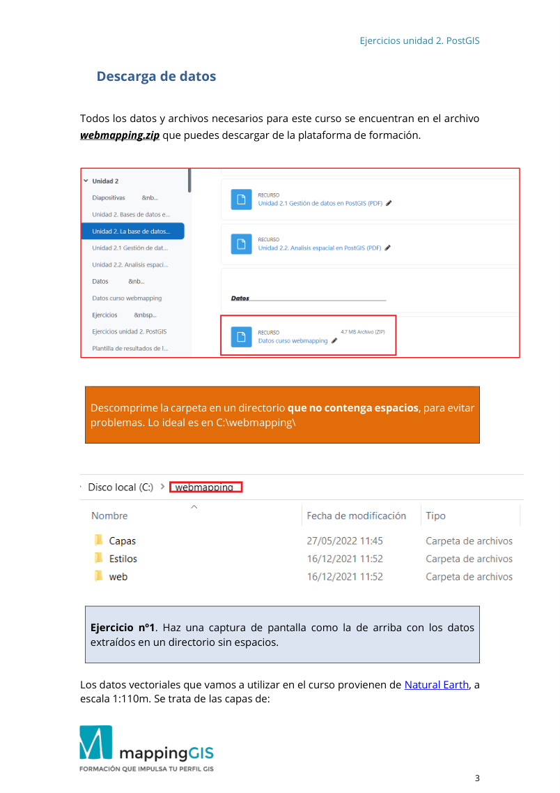</details>

[Ver las instrucciones originales · PDF, página 3](../materiales/Ejercicio_2_PostGIS_2025.pdf#page=3){target="_blank" rel="nofollow noopener noreferrer"}

### Ejercicio 2 · Abrir pgAdmin 4

> **Enunciado original:** Desde el menú Inicio ve a programas > pgAdmin 4 y abre la aplicación pgAdmin 4. Haz una captura de pantalla de pgAdmin 4 abierto en el navegador.

<details class="original-exercise" markdown="1">
<summary>Instrucciones y contexto del PDF original</summary>

**Página 20 · texto original**

```text
Una vez instalado abriremos la aplicación utilizando el nuevo acceso directo: 
 
 
 
  
Ejercicio nº2 . Desde el menú Inicio ve a programas > pgAdmin 4  y abre la 
aplicación pgAdmin 4. Haz una captura de pantalla de pgAdmin 4 abierto  en el 
navegador.
```

</details>

<details class="source-page"><summary>Ver página 20 del PDF original, con sus capturas</summary>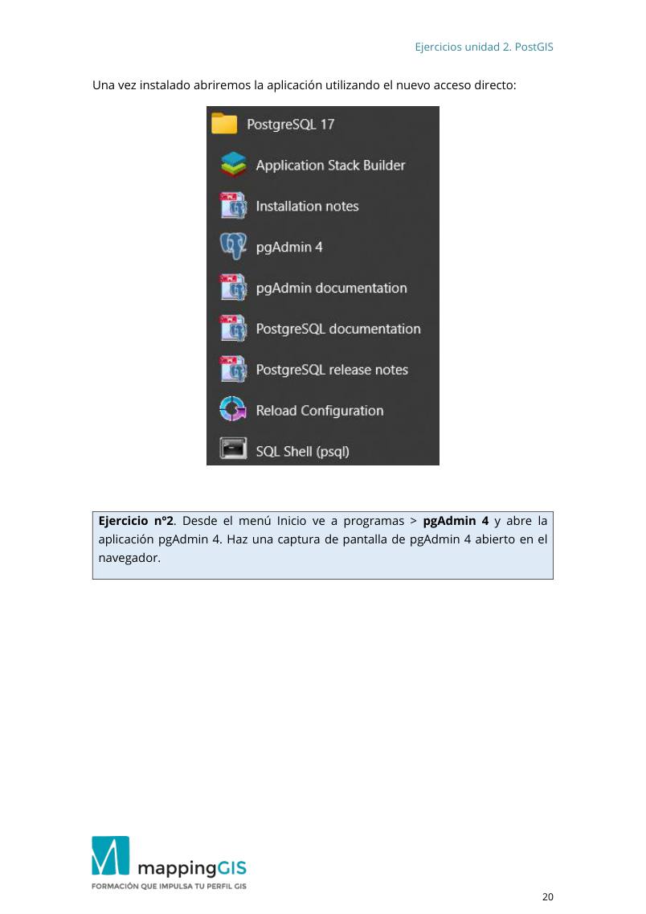</details>

[Ver las instrucciones originales · PDF, página 20](../materiales/Ejercicio_2_PostGIS_2025.pdf#page=20){target="_blank" rel="nofollow noopener noreferrer"}

### Ejercicio 3 · Conexión del cliente SIG a world

> **Enunciado original:** Realiza una conexión desde un cliente SIG de escritorio a la base de datos world y pega el resultado en la plantilla de resultados.

<details class="original-exercise" markdown="1">
<summary>Instrucciones y contexto del PDF original</summary>

**Página 40 · texto original**

```text
Nos pide los datos para la conexión. 
 Nombre: establecemos un nombre que defina a la conexión. Podemos 
poner el que queramos pero pondremos world para reconocer la conexión 
a las capas del mundo. 
 Servicio: Lo dejaremos en blanco.  El parámetro Servicio permite especificar 
un archivo de conexión, que  contiene los parámetros necesarios para 
acceder a una determinada base de datos. Si empleásemos este archivo 
podríamos omitir la entrada de puerto, usuario o contraseña, dejándolos en 
blanco. 
 Anfitrión: el nombre del servidor. 
 Puerto: normalmente será 5432. 
 Base de datos: Nombre de la base de datos donde tenemos las capas que 
queremos añadir a QGIS. En este caso world. 
 En el apartado Autenticación debemos ir a la pestaña Básica e introducir el 
nombre de usuario y contraseña: en PostgreSQL por defecto serán postgres 
/ postgres. 
 
Los parámetros de conexión son:
```

**Página 41 · texto original**

```text
Username postgres 
Password postgres 
Server Localhost 
Port 5432 
Database world 
 
Una vez creada la conexión, solamente tenemos que hacer clic sobre el botón 
Conectar y si hemos escrito bien los parámetros, debe realizarse la conexión. 
Nos aparecerá el esquema public. Y al hacer clic sobre public veremos las bases de 
datos con sus tablas.
```

**Página 42 · texto original**

```text
Ejercicio nº3. Realiza una conexión desde un cliente SIG de escritorio a la base de datos 
world y pega el resultado en la plantilla de resultados.
```

</details>

<details class="source-page"><summary>Ver página 42 del PDF original, con sus capturas</summary>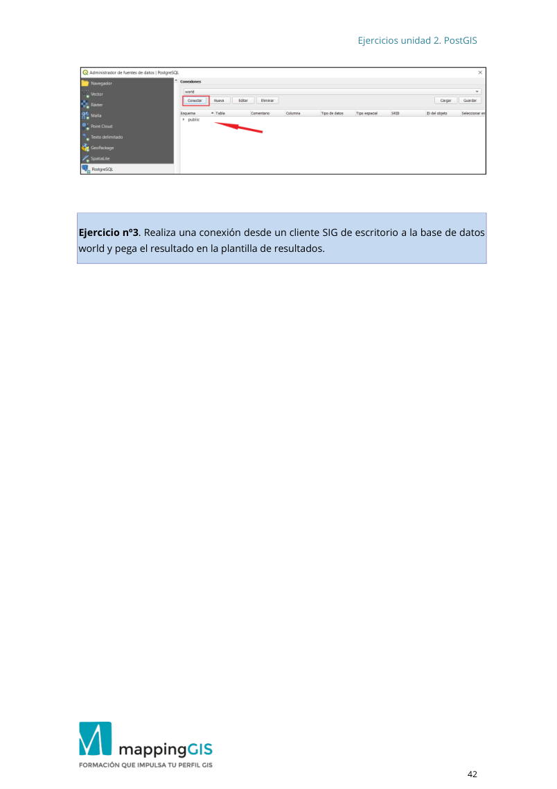</details>

[Ver las instrucciones originales · PDF, página 42](../materiales/Ejercicio_2_PostGIS_2025.pdf#page=42){target="_blank" rel="nofollow noopener noreferrer"}

### Ejercicio 4 · Captura de las tres tablas importadas

> **Enunciado original:** Haz una captura de pantalla que muestre las 3 tablas creadas (dos de ellas con la interfaz gráfica y otra con el Administrador de bases de datos de QGIS)

<details class="original-exercise" markdown="1">
<summary>Instrucciones y contexto del PDF original</summary>

**Página 46 · texto original**

```text
Ahora que hemos creado las tablas en nuestra base de datos haz las siguientes 
operaciones: 
 
1. Si entras en pgAdmin 4, encontrarás la nueva tabla dentro de la base de 
datos world > Schemas > public > Tables. 
 
2. Para facilitar el trabajo con estas tablas vamos renombrar las tablas 
ne_110m_admin_0_countries y ne_110m_populated_places a countries y cities, 
respectivamente.  
 
3.  Para ello hacemos clic derecho sobre cada una de las tablas > Properties…
```

**Página 47 · texto original**

```text
En la primera pestaña ( Properties), modificamos los nombres de los campos en el 
apartado Name. 
 
 
 
Clic en Save.
```

**Página 48 · texto original**

```text
Realizamos la misma operación para la tabla ne_110m_populated_places 
modificando el nombre a cities 
 
 
Ejercicio nº 4. Haz una captura de pantalla que muestre las 3 tablas creadas (dos de 
ellas con la interfaz gráfica y otra con el Administrador de bases de datos de QGIS) 
 
 
Exportar tablas de PostGIS a archivos vectoriales con el 
administrador de BBDD de QGIS  
 
Desde el administrador de bases de datos de PostGIS también podemos exportar 
las tablas, con la ventaja de que nos permite hacerlo en formatos como: 
GeoPackage, Archivo Shape de ESRI, AutoCAD DXF, GeoJSON y muchos más. 
Si has retomado el trabajo desde aquí puede que te pida ingresar las credenciales: 
postgres/postgres 
 
Cuando tengamos abierto el administrador de BBDD, seleccionamos PostGIS y la 
base de Datos. A continuación, seleccionamos la tabla a exportar. Haz clic en cities 
para seleccionar esta tabla.
```

</details>

<details class="source-page"><summary>Ver página 48 del PDF original, con sus capturas</summary>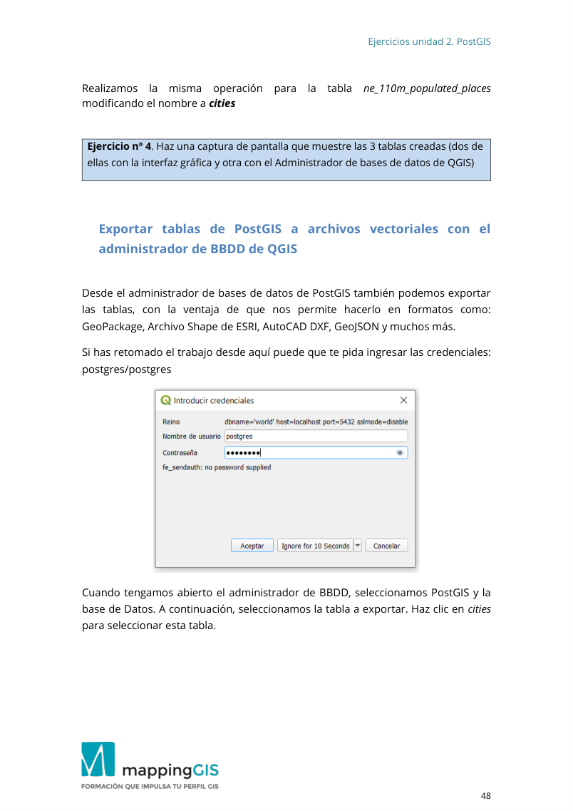</details>

[Ver las instrucciones originales · PDF, página 48](../materiales/Ejercicio_2_PostGIS_2025.pdf#page=48){target="_blank" rel="nofollow noopener noreferrer"}

### Ejercicio 5 · Archivos exportados a GeoJSON y GeoPackage

> **Enunciado original:** Haz una captura de pantalla como la de arriba en que se vean los dos archivos exportados (uno en formato GeoJSON y el otro en formato GeoPackage) y pégala en la plantilla de resultados.

<details class="original-exercise" markdown="1">
<summary>Instrucciones y contexto del PDF original</summary>

**Página 49 · texto original**

```text
Cuando tengas la tabla seleccionada haz clic sobre el botón: Exportar a archivo 
 
Se nos abre una ventana donde debemos escribir los datos para la exportación del 
archivo. 
 
Completamos el formulario: 
 Formato: nos permite elegir el formato de salida, Selecciona GeoJSON. 
 Guardar como:  indica la ruta, puedes elegir el directorio Temp en C: o 
cualquier otro si lo prefieres. 
 Opciones: nos permite elegir el SRID de Origen y de salida, así como la 
codificación. Indicamos 4326 tanto para el SRID de entrada como para el de 
salida. En Codificación: UTF-8. 
 
QGIS nos ofrece un mensaje indicando que se ha exportado el archivo.
```

**Página 50 · texto original**

```text
Ahora dispones de los datos de la tabla cities en un formato vectorial que puedes 
utilizar en un mapa de Leaflet u Openlayers. 
1. Vamos a la carpeta, y encontramos los archivos que hemos creado. 
 
Ejercicio nº5. Haz una captura de pantalla como la de arriba en que se vean los dos 
archivos exportados (uno en formato GeoJSON y el otro en formato GeoPackage) y 
pégala en la plantilla de resultados.
```

</details>

<details class="source-page"><summary>Ver página 50 del PDF original, con sus capturas</summary>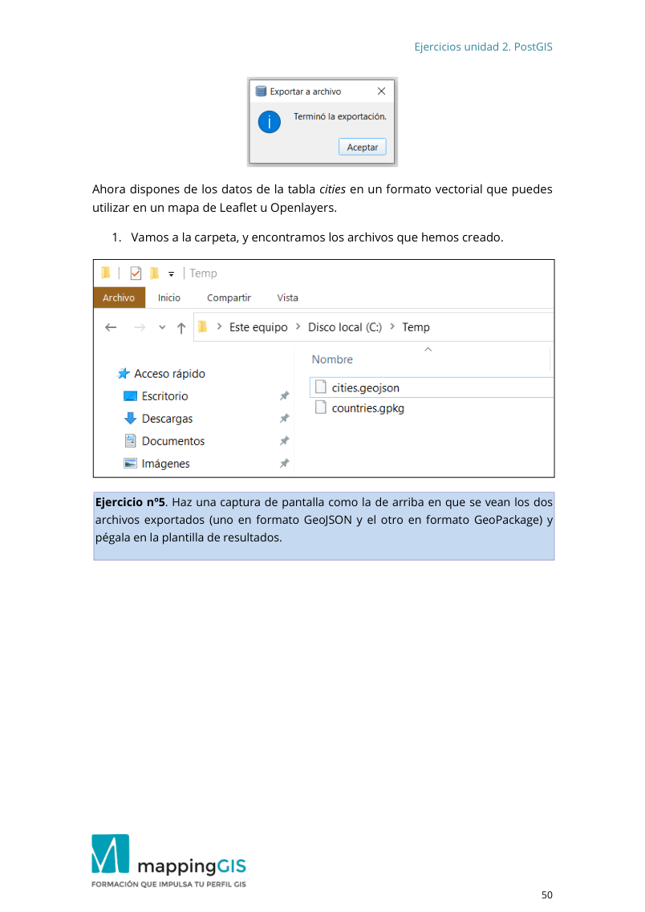</details>

[Ver las instrucciones originales · PDF, página 50](../materiales/Ejercicio_2_PostGIS_2025.pdf#page=50){target="_blank" rel="nofollow noopener noreferrer"}

### Ejercicio 6 · Registro de la tabla lugares en geometry_columns

> **Enunciado original:** Haz una captura de pantalla en la que se vea el nuevo registro y pégala en la plantilla de resultados.

<details class="original-exercise" markdown="1">
<summary>Instrucciones y contexto del PDF original</summary>

**Página 56 · texto original**

```text
Creación de una tabla habilitada para operaciones espaciales 
 
Un pequeño ejemplo nos muestra cómo dotar de capacidades espaciales a una 
tabla recién creada en nuestra base de datos PostGIS utilizando la función 
AddGeometryColumn. 
1. Si no lo está ya, abre tu ventana de consultas: 
 
2. Copia y pega el siguiente bloque en el Editor de consultas SQL. 
CREATE TABLE "lugares"  
  (gid serial PRIMARY KEY,   
  "nombre" varchar(50),  
  "comentario" varchar(255),  
  "año" numeric, 
  geom geometry (Point, 4326) 
); 
 
3. Haz clic en el botón Ejecutar consulta  para ejecutar los comandos. 
La primera línea en el código CREATE TABLE..., crea una tabla con las columnas 
especificadas y las claves. Estas son las acciones SQL sin componente espacial. 
Fíjate en la última línea. Se crea el campo de geometría: 
 Se especifica el tipo de geometría "Point",  
 Y el identificador de referencia espacial "4326". 
Si echamos un vistazo a los registros de la vista geometry_colums, podemos ver la 
fila de la tabla lugares habilitada para operaciones espaciales. 
 
Ejercicio nº 6. Haz una captura de pantalla en la que se vea el nuevo registro y pégala 
en la plantilla de resultados. 
 
A continuación, vamos a añadir algunas características a nuestra tabla lugares. Para 
añadir datos mediante SQL, utilizamos los comandos:
```

</details>

<details class="source-page"><summary>Ver página 56 del PDF original, con sus capturas</summary>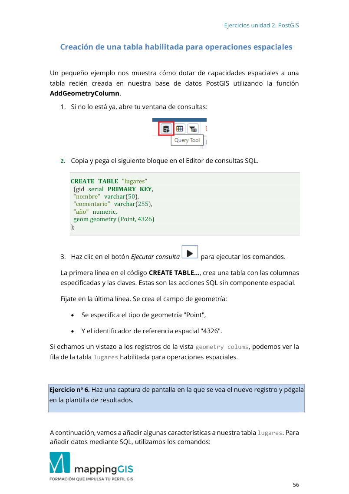</details>

[Ver las instrucciones originales · PDF, página 56](../materiales/Ejercicio_2_PostGIS_2025.pdf#page=56){target="_blank" rel="nofollow noopener noreferrer"}

### Ejercicio 7 · Nuevos registros y su información

> **Enunciado original:** Haz una captura de pantalla en la que se vean los nuevos registros y su información y pégala en la plantilla de resultados.

<details class="original-exercise" markdown="1">
<summary>Instrucciones y contexto del PDF original</summary>

**Página 57 · texto original**

```text
“INSERT INTO table (columns) VALUES (value)”. 
 
 Table es el nombre de la tabla en la que queremos añadir datos; 
 Columns son los nombres de las columnas que queremos añadir a la tabla, 
pueden ser todas las columnas o solo parte de ellas;  
 Values son los valores que queremos introducir en la tabla siguiendo el orden 
de las columnas. 
 
1. Si no lo está ya, abre tu ventana de consultas SQL pgAdmin. 
2. Copia y pega el siguiente bloque en el Editor de consultas SQL. 
INSERT INTO lugares (geom, nombre, comentario) VALUES 
(ST_GeomFromText('POINT(-3.683352 40.400026)',4326), 'Madrid', 'Capital de 
Espana'); 
INSERT INTO lugares (geom, nombre, comentario) VALUES 
(ST_GeomFromText('POINT(-112.069992 33.53998)',4326), 'Phoenix', 'Ciudad 
americana'); 
INSERT INTO lugares (geom, nombre, comentario) VALUES 
(ST_GeomFromText('POINT (139.751407 35.685017)',4326), 'Tokyo', 'Capital de 
Japon'); 
3. Haz clic en el botón Execute para ejecutar los comandos. 
4. Echa un vistazo de nuevo a la tabla lugares. Botón derecho en 
Tablas > Refresh… 
5. Botón derecho en la tabla lugares > View/Edit Data> All Rows. 
6. Desplázate hasta la pestaña geom y abre el visor de geometrías .
 
7. Haz clic sobre un elemento:
```

**Página 58 · texto original**

```text
Ejercicio nº 7. Haz una captura de pantalla en la que se vean los nuevos registros y su 
información y pégala en la plantilla de resultados. 
 
Una vez añadidos los objetos geográficos borra las sentencias anteriores del editor 
SQL.  
Vamos a eliminar una de las filas. La sintaxis para borrar una fila es: 
DELETE FROM lugares 
WHERE gid= 3 
 
Ejercicio nº 8. Ejecuta la consulta y haz una captura de pantalla con la fila eliminada. Pega 
la captura en la plantilla de resultados. 
 
A continuación, vuelve a añadirla con el comando INSERT INTO  que hemos visto 
anteriormente y los mismos datos. 
Para cambiar el valor de una o varias columnas en una fila podemos utilizar el 
comando: 
 
 “UPDATE table SET column = value WHERE id_column = id”.  
 
Utilizamos el valor de ID para identificar la fila, ya que es el único valor que no se 
puede repetir, es un identificador unívoco. Vamos a cambiar el valor del comentario 
de la ciudad de Phoenix. Para ello abrimos la ventana de consultas SQL y escribimos: 
 
UPDATE lugares  
SET comentario = 'capital del estado de Arizona' 
WHERE gid = 2
```

</details>

<details class="source-page"><summary>Ver página 58 del PDF original, con sus capturas</summary>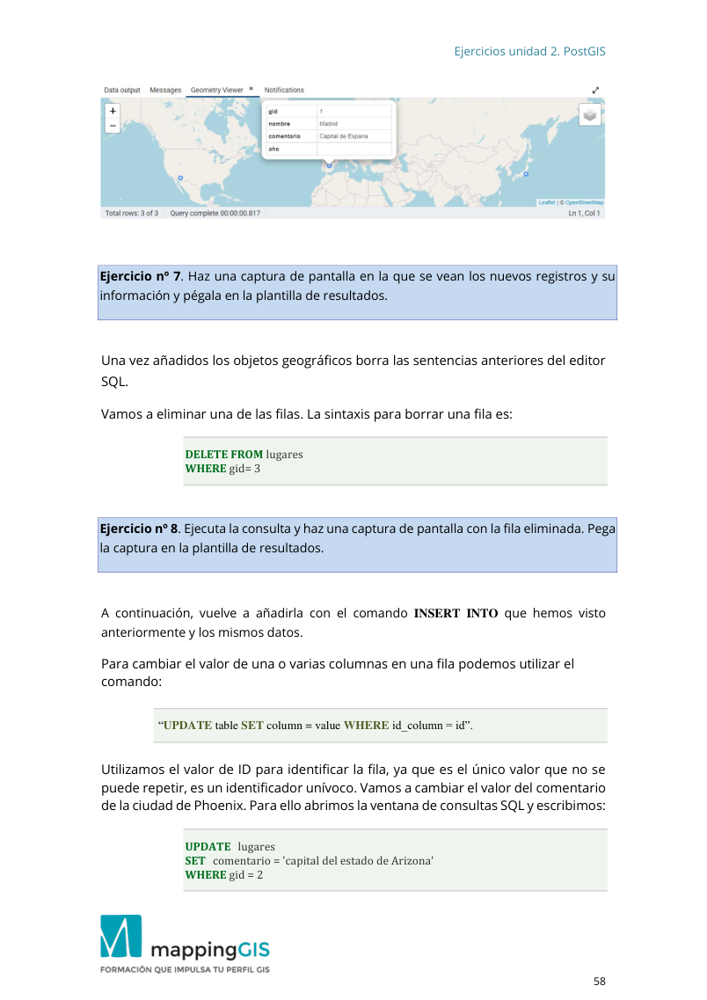</details>

[Ver las instrucciones originales · PDF, página 58](../materiales/Ejercicio_2_PostGIS_2025.pdf#page=58){target="_blank" rel="nofollow noopener noreferrer"}

### Ejercicio 8 · Eliminar una fila y capturar el resultado

> **Enunciado original:** Ejecuta la consulta y haz una captura de pantalla con la fila eliminada. Pega la captura en la plantilla de resultados.

<details class="original-exercise" markdown="1">
<summary>Instrucciones y contexto del PDF original</summary>

**Página 58 · texto original**

```text
Ejercicio nº 7. Haz una captura de pantalla en la que se vean los nuevos registros y su 
información y pégala en la plantilla de resultados. 
 
Una vez añadidos los objetos geográficos borra las sentencias anteriores del editor 
SQL.  
Vamos a eliminar una de las filas. La sintaxis para borrar una fila es: 
DELETE FROM lugares 
WHERE gid= 3 
 
Ejercicio nº 8. Ejecuta la consulta y haz una captura de pantalla con la fila eliminada. Pega 
la captura en la plantilla de resultados. 
 
A continuación, vuelve a añadirla con el comando INSERT INTO  que hemos visto 
anteriormente y los mismos datos. 
Para cambiar el valor de una o varias columnas en una fila podemos utilizar el 
comando: 
 
 “UPDATE table SET column = value WHERE id_column = id”.  
 
Utilizamos el valor de ID para identificar la fila, ya que es el único valor que no se 
puede repetir, es un identificador unívoco. Vamos a cambiar el valor del comentario 
de la ciudad de Phoenix. Para ello abrimos la ventana de consultas SQL y escribimos: 
 
UPDATE lugares  
SET comentario = 'capital del estado de Arizona' 
WHERE gid = 2
```

</details>

<details class="source-page"><summary>Ver página 58 del PDF original, con sus capturas</summary></details>

[Ver las instrucciones originales · PDF, página 58](../materiales/Ejercicio_2_PostGIS_2025.pdf#page=58){target="_blank" rel="nofollow noopener noreferrer"}

### Ejercicio 9 · Actualizar el comentario y mostrar el resultado

> **Enunciado original:** Ejecuta la consulta y pega el resultado en la plantilla de resultados.

<details class="original-exercise" markdown="1">
<summary>Instrucciones y contexto del PDF original</summary>

**Página 58 · texto original**

```text
Ejercicio nº 7. Haz una captura de pantalla en la que se vean los nuevos registros y su 
información y pégala en la plantilla de resultados. 
 
Una vez añadidos los objetos geográficos borra las sentencias anteriores del editor 
SQL.  
Vamos a eliminar una de las filas. La sintaxis para borrar una fila es: 
DELETE FROM lugares 
WHERE gid= 3 
 
Ejercicio nº 8. Ejecuta la consulta y haz una captura de pantalla con la fila eliminada. Pega 
la captura en la plantilla de resultados. 
 
A continuación, vuelve a añadirla con el comando INSERT INTO  que hemos visto 
anteriormente y los mismos datos. 
Para cambiar el valor de una o varias columnas en una fila podemos utilizar el 
comando: 
 
 “UPDATE table SET column = value WHERE id_column = id”.  
 
Utilizamos el valor de ID para identificar la fila, ya que es el único valor que no se 
puede repetir, es un identificador unívoco. Vamos a cambiar el valor del comentario 
de la ciudad de Phoenix. Para ello abrimos la ventana de consultas SQL y escribimos: 
 
UPDATE lugares  
SET comentario = 'capital del estado de Arizona' 
WHERE gid = 2
```

**Página 59 · texto original**

```text
Ejercicio nº 9. Ejecuta la consulta y pega el resultado en la plantilla de resultados. 
 
Nota 
Hemos visto como  crear, actualizar y borrar filas en SQL, pero también puedes 
crear una nueva fila en la tabla, actualizar los valores o borrar la fila pinchando 
sobre la fila e interactuando con la tabla.
```

</details>

<details class="source-page"><summary>Ver página 59 del PDF original, con sus capturas</summary>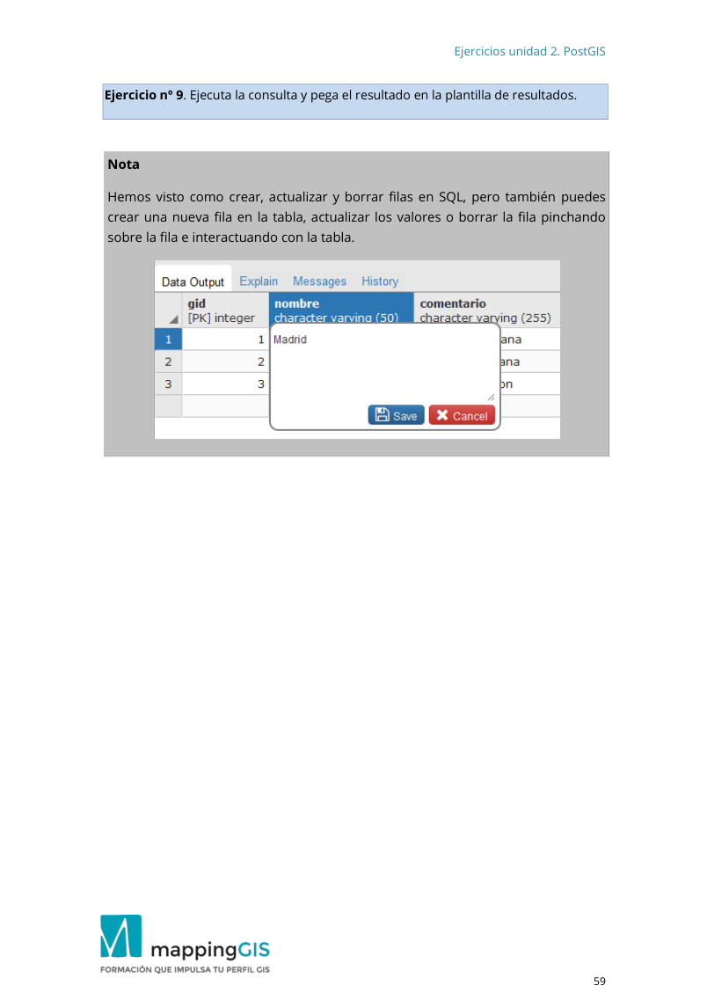</details>

[Ver las instrucciones originales · PDF, página 59](../materiales/Ejercicio_2_PostGIS_2025.pdf#page=59){target="_blank" rel="nofollow noopener noreferrer"}

### Ejercicio 10 · Nombre y población del país más poblado

> **Enunciado original:** Realiza una consulta de tal modo que devuelva una única fila con el nombre y población del país con la población más alta y pega el resultado en la plantilla de resultados.

<details class="original-exercise" markdown="1">
<summary>Instrucciones y contexto del PDF original</summary>

**Página 65 · texto original**

```text
Para realizar los ejercicios de Consultas vamos a utilizar la tabla countries que 
importamos anteriormente. 
En primer lugar, vamos a seleccionar la población del país con mayor población. 
Para ello tenemos que escribir un código SQL. Utilizamos el comando max, para 
indicar el máximo valor, y la aplicamos a la columna pop_est (población) sobre la 
tabla countries: 
SELECT max (pop_est) FROM countries 
 
Ejercicio nº 10. Realiza una consulta de tal modo que devuelva una única fila con el 
nombre y población del país con la población más alta y pega el resultado en la plantilla 
de resultados. 
Pista: 
Nombre y la población 
De la capa de países, 
Dónde la población sea igual 
(a la máxima población de 
la capa de países) 
 
Para seleccionar los países con más de 200 millones de habitantes, tenemos que 
seleccionar la columna name (nombre), e indicar que seleccione los registros en los 
que el campo pop_est sea mayor a 200.000.000. 
 
Ejercicio nº 11. Haz una captura de pantalla con el resultado y pégala en la plantilla de 
resultados. 
 
Para crear una lista ordenada utiliza el comando ORDER BY (ordenar por). 
 
SELECT name  
FROM countries 
ORDER BY name 
Funciones espaciales 
 
Vamos a echar un vistazo a los diferentes tipos de funciones espaciales disponibles 
en PostGIS.
```

</details>

<details class="source-page"><summary>Ver página 65 del PDF original, con sus capturas</summary>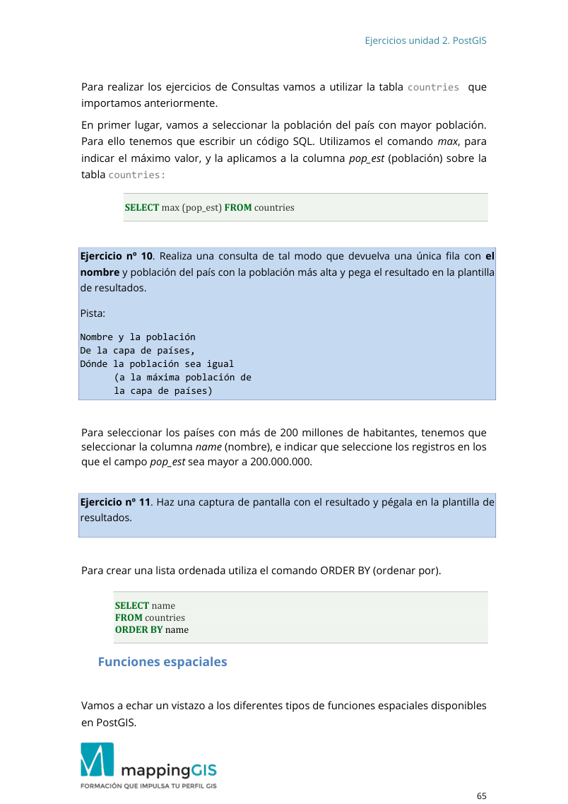</details>

[Ver las instrucciones originales · PDF, página 65](../materiales/Ejercicio_2_PostGIS_2025.pdf#page=65){target="_blank" rel="nofollow noopener noreferrer"}

### Ejercicio 11 · Países con más de 200 millones de habitantes

> **Enunciado original:** Haz una captura de pantalla con el resultado y pégala en la plantilla de resultados.

<details class="original-exercise" markdown="1">
<summary>Instrucciones y contexto del PDF original</summary>

**Página 65 · texto original**

```text
Para realizar los ejercicios de Consultas vamos a utilizar la tabla countries que 
importamos anteriormente. 
En primer lugar, vamos a seleccionar la población del país con mayor población. 
Para ello tenemos que escribir un código SQL. Utilizamos el comando max, para 
indicar el máximo valor, y la aplicamos a la columna pop_est (población) sobre la 
tabla countries: 
SELECT max (pop_est) FROM countries 
 
Ejercicio nº 10. Realiza una consulta de tal modo que devuelva una única fila con el 
nombre y población del país con la población más alta y pega el resultado en la plantilla 
de resultados. 
Pista: 
Nombre y la población 
De la capa de países, 
Dónde la población sea igual 
(a la máxima población de 
la capa de países) 
 
Para seleccionar los países con más de 200 millones de habitantes, tenemos que 
seleccionar la columna name (nombre), e indicar que seleccione los registros en los 
que el campo pop_est sea mayor a 200.000.000. 
 
Ejercicio nº 11. Haz una captura de pantalla con el resultado y pégala en la plantilla de 
resultados. 
 
Para crear una lista ordenada utiliza el comando ORDER BY (ordenar por). 
 
SELECT name  
FROM countries 
ORDER BY name 
Funciones espaciales 
 
Vamos a echar un vistazo a los diferentes tipos de funciones espaciales disponibles 
en PostGIS.
```

</details>

<details class="source-page"><summary>Ver página 65 del PDF original, con sus capturas</summary></details>

[Ver las instrucciones originales · PDF, página 65](../materiales/Ejercicio_2_PostGIS_2025.pdf#page=65){target="_blank" rel="nofollow noopener noreferrer"}

### Ejercicio 12 · Coordenadas geométricas de Madrid

> **Enunciado original:** Extrae las coordenadas geométricas de Madrid y pega el resultado obtenido en el Panel de salida en la plantilla de resultados.

<details class="original-exercise" markdown="1">
<summary>Instrucciones y contexto del PDF original</summary>

**Página 66 · texto original**

```text
Funciones de conversión 
Las funciones de conversión permiten que los datos se conviertan entre geometrías 
y formatos de datos externos 
El siguiente ejemplo usa la función ST_AsText para descifrar la representación 
binaria. 
1. Seleccionamos la geometría en binario de nuestra tabla lugares: 
SELECT geom FROM lugares; 
 
Obtenemos como resultado: 
0101000020E6100000E8AAF9FF0D7662C0EA1099E022355040 
0101000020E6100000CFC2DFBFD7D965402330B95D63A044C0 
0101000020E6100000D753F09FD2365AC043259A5810D24340 
 
2. Utiliza la función ST_AsText () para hacer que el valor de la geometría sea un 
poco más legible. Esta función nos devuelve el texto WKT (Well-Known Text): 
SELECT ST_AsText(geom) FROM lugares; 
Obtenemos como resultado: 
"POINT(-3.683352 40.400026)" 
"POINT(139.751407 35.685017)" 
"POINT(-112.069992 33.53998)" 
 
Ejercicio nº 1 2. Extrae las coordenadas geométricas de Madrid y p ega el resultado 
obtenido en el Panel de salida en la plantilla de resultados. 
 
Funciones de recuperación 
Las funciones de recuperación nos muestran las medidas o propiedades de una 
geometría. 
Utiliza la función ST_Perimeter para determinar la longitud exterior de algunos 
elementos de la tabla countries. Limita el resultado a 5 países.
```

</details>

<details class="source-page"><summary>Ver página 66 del PDF original, con sus capturas</summary>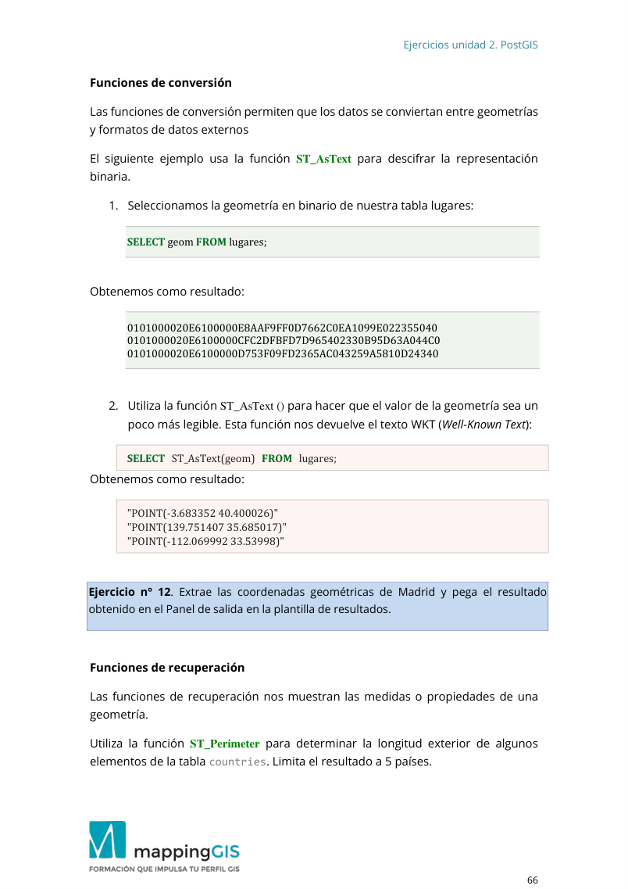</details>

[Ver las instrucciones originales · PDF, página 66](../materiales/Ejercicio_2_PostGIS_2025.pdf#page=66){target="_blank" rel="nofollow noopener noreferrer"}

### Ejercicio 13 · Perímetro de cinco países

> **Enunciado original:** Crea la consulta y ejecútala. Pega el resultado obtenido en el Panel de salida en la plantilla de resultados.

<details class="original-exercise" markdown="1">
<summary>Instrucciones y contexto del PDF original</summary>

**Página 66 · texto original**

```text
Funciones de conversión 
Las funciones de conversión permiten que los datos se conviertan entre geometrías 
y formatos de datos externos 
El siguiente ejemplo usa la función ST_AsText para descifrar la representación 
binaria. 
1. Seleccionamos la geometría en binario de nuestra tabla lugares: 
SELECT geom FROM lugares; 
 
Obtenemos como resultado: 
0101000020E6100000E8AAF9FF0D7662C0EA1099E022355040 
0101000020E6100000CFC2DFBFD7D965402330B95D63A044C0 
0101000020E6100000D753F09FD2365AC043259A5810D24340 
 
2. Utiliza la función ST_AsText () para hacer que el valor de la geometría sea un 
poco más legible. Esta función nos devuelve el texto WKT (Well-Known Text): 
SELECT ST_AsText(geom) FROM lugares; 
Obtenemos como resultado: 
"POINT(-3.683352 40.400026)" 
"POINT(139.751407 35.685017)" 
"POINT(-112.069992 33.53998)" 
 
Ejercicio nº 1 2. Extrae las coordenadas geométricas de Madrid y p ega el resultado 
obtenido en el Panel de salida en la plantilla de resultados. 
 
Funciones de recuperación 
Las funciones de recuperación nos muestran las medidas o propiedades de una 
geometría. 
Utiliza la función ST_Perimeter para determinar la longitud exterior de algunos 
elementos de la tabla countries. Limita el resultado a 5 países.
```

**Página 67 · texto original**

```text
Ejercicio nº 1 3. Crea la consulta y ejecútala. Pega el resultado obtenido en el Panel de 
salida en la plantilla de resultados.  
 
Funciones de comparación 
Las funciones de comparación evalúan relaciones espaciales entre dos geometrías. 
Utiliza la función ST_Distance para calcular la distancia que hay entre Phoenix y 
Madrid. 
La sintaxis será similar a esta (las coordenadas mostradas aquí no son correctas): 
SELECT ST_Distance( 
   ST_GeomFromText('POINT(14.8 39.64)'), 
   ST_GeomFromText('POINT(73.91 40.17)') 
); 
 
ST_GeometryFromText devuelve el resultado en la unidad de la capa, (grados)   
ST_GeographyFromText devuelve el resultado en metros. 
 
Ejercicio nº 1 4. Pega el resultado obtenido de la distancia expresada en metros entre 
Phoenix y Madrid. Estas ciudades están en la capa lugares. 
 
Funciones de generación 
Las funciones de generación crean geometrías a partir de otras. 
Utilizaremos la función  ST_Centroid para crear los puntos geométricos 
correspondientes a la capa de países. Llamaremos a la capa nueva centroides. 
Para crear los centroides , primero crearemos una tabla de tipo punto  para 
almacenar las geometrías. 
 
CREATE TABLE centroides ( 
  id serial primary key, 
geom geometry (Point, 4326) 
);
```

</details>

<details class="source-page"><summary>Ver página 67 del PDF original, con sus capturas</summary>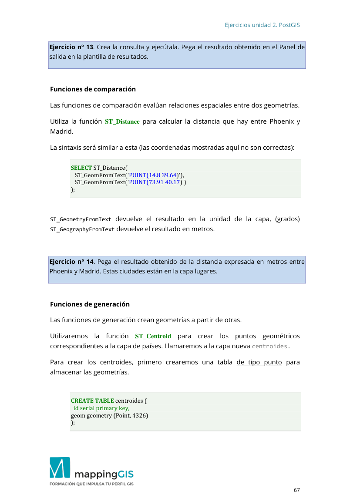</details>

[Ver las instrucciones originales · PDF, página 67](../materiales/Ejercicio_2_PostGIS_2025.pdf#page=67){target="_blank" rel="nofollow noopener noreferrer"}

### Ejercicio 14 · Distancia en metros entre Phoenix y Madrid

> **Enunciado original:** Pega el resultado obtenido de la distancia expresada en metros entre Phoenix y Madrid. Estas ciudades están en la capa lugares.

<details class="original-exercise" markdown="1">
<summary>Instrucciones y contexto del PDF original</summary>

**Página 67 · texto original**

```text
Ejercicio nº 1 3. Crea la consulta y ejecútala. Pega el resultado obtenido en el Panel de 
salida en la plantilla de resultados.  
 
Funciones de comparación 
Las funciones de comparación evalúan relaciones espaciales entre dos geometrías. 
Utiliza la función ST_Distance para calcular la distancia que hay entre Phoenix y 
Madrid. 
La sintaxis será similar a esta (las coordenadas mostradas aquí no son correctas): 
SELECT ST_Distance( 
   ST_GeomFromText('POINT(14.8 39.64)'), 
   ST_GeomFromText('POINT(73.91 40.17)') 
); 
 
ST_GeometryFromText devuelve el resultado en la unidad de la capa, (grados)   
ST_GeographyFromText devuelve el resultado en metros. 
 
Ejercicio nº 1 4. Pega el resultado obtenido de la distancia expresada en metros entre 
Phoenix y Madrid. Estas ciudades están en la capa lugares. 
 
Funciones de generación 
Las funciones de generación crean geometrías a partir de otras. 
Utilizaremos la función  ST_Centroid para crear los puntos geométricos 
correspondientes a la capa de países. Llamaremos a la capa nueva centroides. 
Para crear los centroides , primero crearemos una tabla de tipo punto  para 
almacenar las geometrías. 
 
CREATE TABLE centroides ( 
  id serial primary key, 
geom geometry (Point, 4326) 
);
```

</details>

<details class="source-page"><summary>Ver página 67 del PDF original, con sus capturas</summary></details>

[Ver las instrucciones originales · PDF, página 67](../materiales/Ejercicio_2_PostGIS_2025.pdf#page=67){target="_blank" rel="nofollow noopener noreferrer"}

### Ejercicio 15 · Países y centroides en un visor SIG

> **Enunciado original:** Abre la nueva capa con un visor SIG, haz una captura de pantalla en la que se vean las capas de países y centroides.

<details class="original-exercise" markdown="1">
<summary>Instrucciones y contexto del PDF original</summary>

**Página 67 · texto original**

```text
Ejercicio nº 1 3. Crea la consulta y ejecútala. Pega el resultado obtenido en el Panel de 
salida en la plantilla de resultados.  
 
Funciones de comparación 
Las funciones de comparación evalúan relaciones espaciales entre dos geometrías. 
Utiliza la función ST_Distance para calcular la distancia que hay entre Phoenix y 
Madrid. 
La sintaxis será similar a esta (las coordenadas mostradas aquí no son correctas): 
SELECT ST_Distance( 
   ST_GeomFromText('POINT(14.8 39.64)'), 
   ST_GeomFromText('POINT(73.91 40.17)') 
); 
 
ST_GeometryFromText devuelve el resultado en la unidad de la capa, (grados)   
ST_GeographyFromText devuelve el resultado en metros. 
 
Ejercicio nº 1 4. Pega el resultado obtenido de la distancia expresada en metros entre 
Phoenix y Madrid. Estas ciudades están en la capa lugares. 
 
Funciones de generación 
Las funciones de generación crean geometrías a partir de otras. 
Utilizaremos la función  ST_Centroid para crear los puntos geométricos 
correspondientes a la capa de países. Llamaremos a la capa nueva centroides. 
Para crear los centroides , primero crearemos una tabla de tipo punto  para 
almacenar las geometrías. 
 
CREATE TABLE centroides ( 
  id serial primary key, 
geom geometry (Point, 4326) 
);
```

**Página 68 · texto original**

```text
Después, insertaremos en nuestra tabla las nuevas geometrías generadas con la 
función ST_Centroid: 
INSERT INTO centroides (geom) 
SELECT ST_Centroid(geom) FROM countries; 
 
Si al ejecutar esta segunda sentencia aparece el error: 
ERROR: Geometry SRID (0) does not match column SRID (4326) 
Probablemente cuando se realizó la importación de la tabla countries no se definió 
correctamente su SRID y se ha importado con el valor 0. Por lo tanto no es posible 
insertar en la capa de centroides (con SRID 4326) una geometría con valor de SRID 
diferente (0). Para solucionarlo tenemos dos opciones: 
 Opción 1. Eliminar la tabla de la base de datos y volver a importarla 
introduciendo el código EPSG 4326. 
 Opción 2. Actualizar el SRID mediante una sente ncia SQL en el constructor 
de consultas de pgAdmin: 
SELECT UpdateGeometrySRID('countries','geom',4326); 
 
 
Ejercicio nº 15. Abre la nueva capa con un visor SIG, haz una captura de pantalla en la que 
se vean las capas de países y centroides.   
 
Ahora debes crear un área de influencia (buffer) de 2 grados alrededor de nuestra 
capa cities.
```

</details>

<details class="source-page"><summary>Ver página 68 del PDF original, con sus capturas</summary>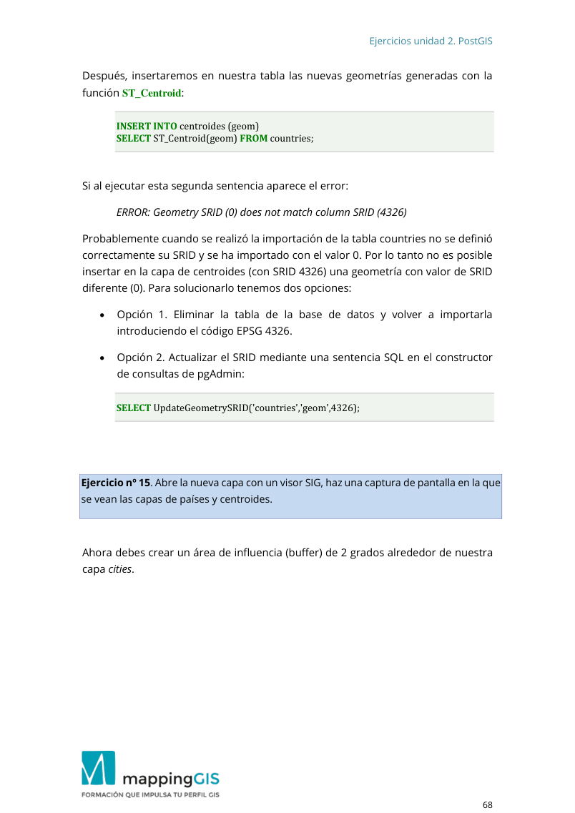</details>

[Ver las instrucciones originales · PDF, página 68](../materiales/Ejercicio_2_PostGIS_2025.pdf#page=68){target="_blank" rel="nofollow noopener noreferrer"}

### Ejercicio 16 · Buffer de 2 grados sobre cities

> **Enunciado original:** Añade a la plantilla de resultados los pasos que has dado y comprueba el resultado en un cliente SIG, mostrando la capa cities y la del buffer.

<details class="original-exercise" markdown="1">
<summary>Instrucciones y contexto del PDF original</summary>

**Página 68 · texto original**

```text
Después, insertaremos en nuestra tabla las nuevas geometrías generadas con la 
función ST_Centroid: 
INSERT INTO centroides (geom) 
SELECT ST_Centroid(geom) FROM countries; 
 
Si al ejecutar esta segunda sentencia aparece el error: 
ERROR: Geometry SRID (0) does not match column SRID (4326) 
Probablemente cuando se realizó la importación de la tabla countries no se definió 
correctamente su SRID y se ha importado con el valor 0. Por lo tanto no es posible 
insertar en la capa de centroides (con SRID 4326) una geometría con valor de SRID 
diferente (0). Para solucionarlo tenemos dos opciones: 
 Opción 1. Eliminar la tabla de la base de datos y volver a importarla 
introduciendo el código EPSG 4326. 
 Opción 2. Actualizar el SRID mediante una sente ncia SQL en el constructor 
de consultas de pgAdmin: 
SELECT UpdateGeometrySRID('countries','geom',4326); 
 
 
Ejercicio nº 15. Abre la nueva capa con un visor SIG, haz una captura de pantalla en la que 
se vean las capas de países y centroides.   
 
Ahora debes crear un área de influencia (buffer) de 2 grados alrededor de nuestra 
capa cities.
```

**Página 69 · texto original**

```text
Al igual que en el ejemplo anterior, para crear la zona de buffer, primero debemos 
crear una tabla para almacenar las geometrías. Denomínala buffer.  
¿De qué tipo debe ser esta tabla?  
A continuación, inserta en la nueva tabla las nuevas geometrías generadas. 
¿Qué función debes utilizar?  
 
Ejercicio nº 16 . Añade a la plantilla de resultados los pasos que has dado y 
comprueba el resultado en un cliente SIG, mostrando la capa cities y la del buffer. 
 
¿En qué país se encuentra la ciudad de Sao Paulo? 
 
Para responder a esta pregunta debes realizar una intersección utilizando la función 
ST_Intersects (geometry A, geometry B) que devuelve verdadero si la geometría A 
intersecta con la geometría B.  
 
Deberás SELECT el nombre del país FROM la tabla de países WHERE ST_Intersects 
(geometría de la tabla countries, coordenadas de Sao Paulo). 
 
 
Ejercicio nº 17. Haz una captura de pantalla con la respuesta y las consultas utilizadas 
para resolver la pregunta.
```

</details>

<details class="source-page"><summary>Ver página 69 del PDF original, con sus capturas</summary>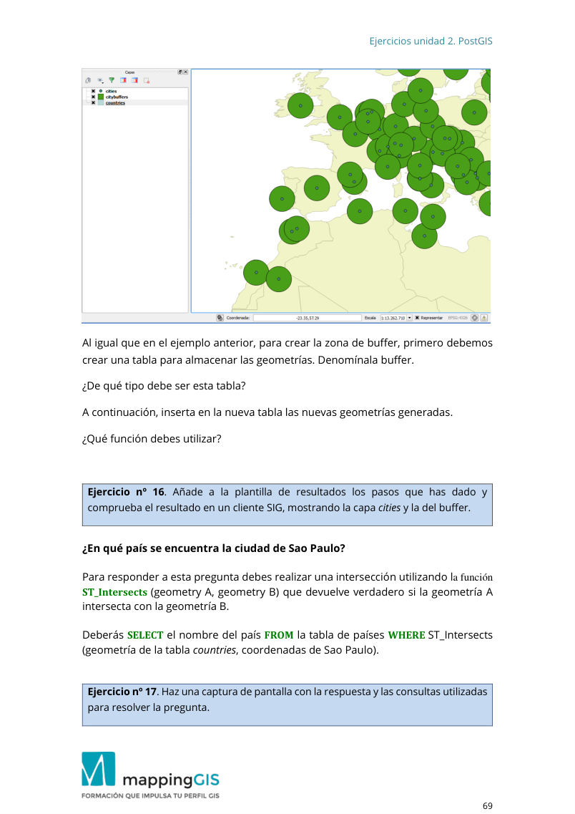</details>

[Ver las instrucciones originales · PDF, página 69](../materiales/Ejercicio_2_PostGIS_2025.pdf#page=69){target="_blank" rel="nofollow noopener noreferrer"}

### Ejercicio 17 · País en el que se encuentra Sao Paulo

> **Enunciado original:** Haz una captura de pantalla con la respuesta y las consultas utilizadas para resolver la pregunta.

<details class="original-exercise" markdown="1">
<summary>Instrucciones y contexto del PDF original</summary>

**Página 69 · texto original**

```text
Al igual que en el ejemplo anterior, para crear la zona de buffer, primero debemos 
crear una tabla para almacenar las geometrías. Denomínala buffer.  
¿De qué tipo debe ser esta tabla?  
A continuación, inserta en la nueva tabla las nuevas geometrías generadas. 
¿Qué función debes utilizar?  
 
Ejercicio nº 16 . Añade a la plantilla de resultados los pasos que has dado y 
comprueba el resultado en un cliente SIG, mostrando la capa cities y la del buffer. 
 
¿En qué país se encuentra la ciudad de Sao Paulo? 
 
Para responder a esta pregunta debes realizar una intersección utilizando la función 
ST_Intersects (geometry A, geometry B) que devuelve verdadero si la geometría A 
intersecta con la geometría B.  
 
Deberás SELECT el nombre del país FROM la tabla de países WHERE ST_Intersects 
(geometría de la tabla countries, coordenadas de Sao Paulo). 
 
 
Ejercicio nº 17. Haz una captura de pantalla con la respuesta y las consultas utilizadas 
para resolver la pregunta.
```

</details>

<details class="source-page"><summary>Ver página 69 del PDF original, con sus capturas</summary></details>

[Ver las instrucciones originales · PDF, página 69](../materiales/Ejercicio_2_PostGIS_2025.pdf#page=69){target="_blank" rel="nofollow noopener noreferrer"}

Los resultados se incorporan a la plantilla indicada en la clase. No se han añadido preguntas, retos, soluciones ni autoevaluaciones nuevas.
