# Unidad 3 · Publicar mapas con GeoServer

<div class="visual-hero"><div class="eyebrow">Unidad 03 / Piloto visual</div><h2>Tus datos, un servicio.<br>Muchos clientes posibles.</h2><p>Conecta datos con aplicaciones diferentes mediante estándares abiertos. Comprende cómo GeoServer organiza recursos, publica servicios y representa las capas.</p><p>Origen → publicación → servicios → peticiones → estilos</p></div>

Síntesis visual de las clases, con diagramas originales para explicar los conceptos. La práctica se conserva al final de esta misma unidad.

## 1. Del dato al servicio

<figure class="lesson-figure"><a href="../../assets/unidad-3/publicacion.svg" target="_blank" rel="noopener"></a></figure>

Una **infraestructura de datos espaciales (IDE)** reúne datos, servicios, metadatos y acuerdos para que la información se pueda encontrar y utilizar. El geoportal es una puerta de acceso; un servidor de mapas es una de sus piezas.

GeoServer recibe peticiones, accede a un origen y prepara una respuesta geográfica. QGIS y un visor web pueden consumir el mismo servicio. La base de datos conserva las entidades; el servicio define cómo se accede a ellas.

| Componente | Responsabilidad |
|---|---|
| PostGIS o archivos | Conservar geometrías, atributos o celdas |
| GeoServer | Publicar servicios y aplicar configuración |
| Cliente | Solicitar y representar el resultado |
| Catálogo | Facilitar la búsqueda mediante metadatos |

HTTP admite imágenes, XML y otros contenidos: no se limita a páginas HTML.

<p class="content-source"><strong>Fuente del apartado:</strong> <a href="../../materiales/Unidad3_Est%C3%A1ndares%20abiertos%20e%20interoperables%20del%20OGC.pdf">MappingGIS · Unidad3_Estándares abiertos e interoperables del OGC.pdf</a> · <a href="../../materiales/Unidad3.1_Servidores%20de%20datos%20espaciales.%20Geoserver.pdf">MappingGIS · Unidad3.1_Servidores de datos espaciales. Geoserver.pdf</a><br><strong>Ampliación y precisión técnica:</strong> <a href="https://docs.geoserver.org/stable/en/user/data/webadmin/index.html">GeoServer · organización de datos</a>.</p>

## 2. Workspace, store, layer y style

<figure class="lesson-figure"><a href="../../assets/unidad-3/jerarquia.svg" target="_blank" rel="noopener">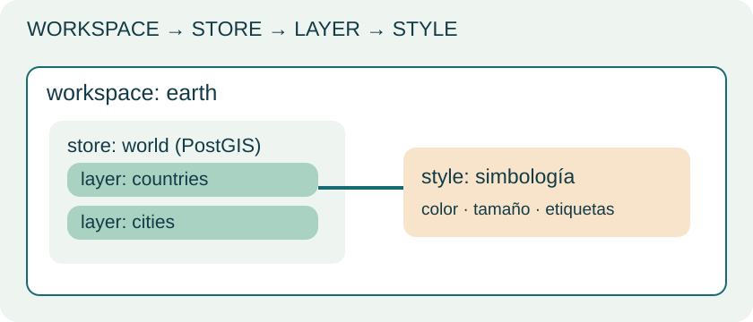</a></figure>

El **workspace** agrupa recursos de un proyecto. El **store** describe una conexión a un origen. La **layer** publica un recurso concreto y el **style** indica cómo dibujarlo. Un almacén PostGIS puede ofrecer varias tablas como capas.

En la práctica se utiliza el espacio `earth` y la base `world`. El nombre `earth:countries` distingue la capa de su espacio de trabajo.

Un **layer group** combina capas en un orden de dibujo. Comprueba fondo, transparencia y límites. El directorio de datos conserva la configuración; los binarios y los datos del proyecto tienen ciclos de mantenimiento distintos.

<p class="content-source"><strong>Fuente del apartado:</strong> <a href="../../materiales/Unidad3.1_Servidores%20de%20datos%20espaciales.%20Geoserver.pdf">MappingGIS · Unidad3.1_Servidores de datos espaciales. Geoserver.pdf</a><br><strong>Ampliación y precisión técnica:</strong> <a href="https://docs.geoserver.org/stable/en/user/data/webadmin/index.html">GeoServer · organización de datos</a>.</p>

## 3. Elegir el servicio OGC

<figure class="lesson-figure"><a href="../../assets/unidad-3/servicios.svg" target="_blank" rel="noopener">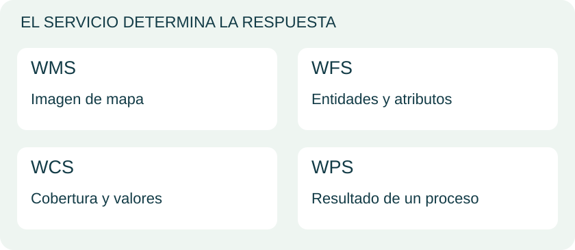</a></figure>

Para elegir un servicio, empieza por el resultado que necesitas.

| Servicio | Resultado típico | Operaciones de las clases |
|---|---|---|
| WMS | Representación cartográfica | `GetCapabilities`, `GetMap`, `GetFeatureInfo` |
| WFS | Entidades y atributos | `GetCapabilities`, `DescribeFeatureType`, `GetFeature` |
| WCS | Cobertura con valores | `GetCapabilities`, `DescribeCoverage`, `GetCoverage` |
| WPS | Resultado de un proceso | `GetCapabilities`, `DescribeProcess`, `Execute` |

`GetCapabilities` anuncia las capacidades del servicio. WMS puede permitir consultar una posición; eso no sustituye el acceso a entidades de WFS. WCS conserva el sentido de los valores de una cobertura, mientras una imagen puede representarlos mediante colores. SLD describe estilos; no es otro servicio de descarga.

<p class="content-source"><strong>Fuente del apartado:</strong> <a href="../../materiales/Unidad3_Est%C3%A1ndares%20abiertos%20e%20interoperables%20del%20OGC.pdf">MappingGIS · Unidad3_Estándares abiertos e interoperables del OGC.pdf</a><br><strong>Ampliación y precisión técnica:</strong> <a href="https://www.ogc.org/standards/wms/">OGC · WMS</a> · <a href="https://www.ogc.org/standards/wfs/">OGC · WFS</a>.</p>

## 4. Leer una petición de mapa

<figure class="lesson-figure"><a href="../../assets/unidad-3/peticion.svg" target="_blank" rel="noopener">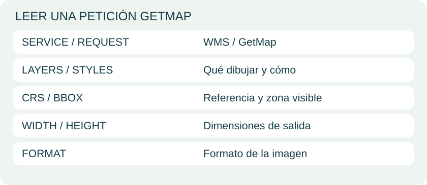</a></figure>

La URL combina un punto de acceso con parámetros. Capa, estilo, referencia, encuadre y tamaño determinan qué se dibuja. Una petición debe respetar la versión y los valores anunciados por el servidor.

**El orden de ejes importa:** no reutilices una `BBOX` sin revisar versión y CRS. En WMS 1.3.0, el orden depende de la definición del CRS. Si una capa no aparece, revisa referencia, encuadre, nombre y respuesta del servidor.

El servidor puede reproyectar al vuelo cuando su configuración lo permite, sin modificar necesariamente los datos almacenados. La práctica conecta los servicios con QGIS antes de consumirlos en un visor.

<p class="content-source"><strong>Fuente del apartado:</strong> <a href="../../materiales/Unidad3_Est%C3%A1ndares%20abiertos%20e%20interoperables%20del%20OGC.pdf">MappingGIS · Unidad3_Estándares abiertos e interoperables del OGC.pdf</a><br><strong>Ampliación y precisión técnica:</strong> <a href="https://www.ogc.org/standards/wms/">OGC · WMS</a>.</p>

## 5. Simbología, etiquetas y escala

<figure class="lesson-figure"><a href="../../assets/unidad-3/estilos.svg" target="_blank" rel="noopener">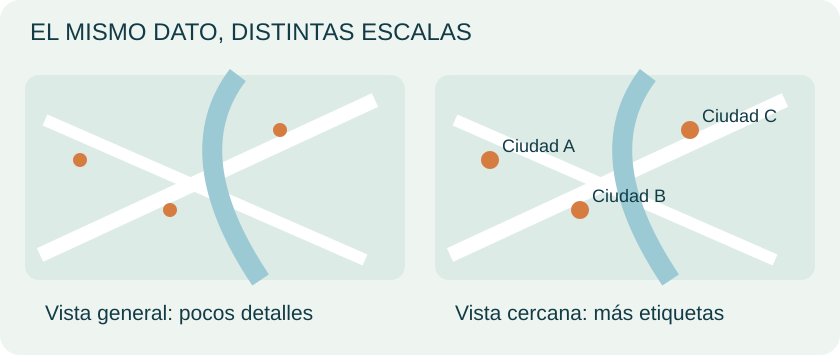</a></figure>

El estilo convierte atributos y geometrías en símbolos. Sus reglas controlan color, tamaño, grosor, etiquetas y visibilidad por escala. GeoServer trabaja con SLD y puede incorporar estilos CSS mediante una extensión, como en el curso.

| Geometría | Revisa |
|---|---|
| Puntos | Tamaño y solapamiento |
| Líneas | Grosor y etiquetas |
| Polígonos | Relleno y transparencia |
| Grupos | Orden y extensión |

Una vista general necesita menos detalle que una cercana. Las comparaciones de versiones del PDF describen el contexto de las clases; revisa la compatibilidad para la versión instalada.

<p class="content-source"><strong>Fuente del apartado:</strong> <a href="../../materiales/Unidad3.1_Servidores%20de%20datos%20espaciales.%20Geoserver.pdf">MappingGIS · Unidad3.1_Servidores de datos espaciales. Geoserver.pdf</a><br><strong>Ampliación y precisión técnica:</strong> <a href="https://docs.geoserver.org/stable/en/user/data/webadmin/index.html">GeoServer · organización de datos</a>.</p>

## Material y referencias

- [Unidad3.1_Servidores de datos espaciales. Geoserver.pdf](../materiales/Unidad3.1_Servidores%20de%20datos%20espaciales.%20Geoserver.pdf) · material original.
- [Unidad3_Estándares abiertos e interoperables del OGC.pdf](../materiales/Unidad3_Est%C3%A1ndares%20abiertos%20e%20interoperables%20del%20OGC.pdf) · material original.

Ampliación técnica: [Organización de datos en GeoServer](https://docs.geoserver.org/stable/en/user/data/webadmin/index.html) · [OGC WMS](https://www.ogc.org/standards/wms/) · [OGC WFS](https://www.ogc.org/standards/wfs/). Las versiones e interfaces del PDF corresponden al entorno de las clases; los diagramas muestran conceptos.


## Ejercicio Unidad 3 {#ejercicios-originales-del-curso}

Enunciados y contexto de los PDF de MappingGIS. No se añaden actividades ni soluciones. Los paneles incluyen los pasos originales dentro de la unidad; el PDF conserva la maquetación completa.

**Conexiones QGIS:** [PDF original completo](../materiales/Ejercicio_3_0_Conexiones_QGIS-v1.pdf){target="_blank" rel="noopener noreferrer"}.

### Ejercicio 1 · WMS en QGIS

<div class="original-statement"><span class="eyebrow">Enunciado original · Conexiones QGIS</span><p>Haz una captura de pantalla en la que se aprecie el servicio WMS cargado en la interfaz y pégala en la Plantilla de Resultados.</p></div>

<details class="original-exercise" markdown="1">
<summary>Pasos y contexto originales de la clase</summary>

**Página 3**

```text
Ejercicio 3. Protocolos OGC 
                                                                                                                                                                     3 
 
Conexiones Web Map Service (WMS) 
WMS son las siglas de Web Map Service, se trata de un servicio y no de una página 
web por lo que es necesario emplear un software SIG para poder visualizarlo.  
Se trata de un estándar internacional que define un mapa como la representación 
de la información geográfica en forma de un archivo d e imagen digital, siendo el 
formato más común PNG, GIF o JPEG. Pueden ser invocados desde cualquier 
plataforma corporativa o software capacitado para la visualización de éstos 
servicios.  
El estándar define tres operaciones:  
 GetCapabilities permite devolver los metadatos del nivel de servicio.  
 GetMap devuelve un mapa con parámetros geográficos y dimensionales 
bien definidos.  
 GetFeatureInfo devuelve información de características particulares 
mostradas en el mapa.  
Nota: Puede que en ocasiones el servicio WMS se encuentre inoperativo debido a 
un error en el servidor o bien a labores de actualización. En caso de no poder 
conectar al mismo, podrás acceder a multitud de servicios WMS para realizar el 
ejercicio en la página oficial de Infraestructuras de Datos Espaciales de España (IDEE) 
del Ministerio de Fomento en el siguiente link: 
http://www.idee.es/web/guest/directorio-de-servicios 
 
Para llevar a cabo el ejercicio debemos:  
1. Abre un nuevo proyecto en QGIS.  
2. Puedes escoger entre dos maneras de añadir una capa WMS. A través del 
menú Capa/Añadir Capa WMS/WMTS , o bien, haciendo click sobre Añadir 
Capa WMS/WMTS   de la barra de herramientas Administrar Capas….. 
Una vez hecho esto aparecerá el cuadro de diálogo correspondiente.
```

**Página 4**

```text
Ejercicio 3. Protocolos OGC 
                                                                                                                                                                     4 
 
 
3. Una vez abierto, presionamos el botón Nuevo para crear una nueva 
conexión WMS, en la interfaz aparecerá una nueva ventana en la que se nos 
requiere los parámetros para la conexión.
```

**Página 5**

```text
Ejercicio 3. Protocolos OGC 
                                                                                                                                                                     5 
 
4. Introducimos los siguientes parámetros:  
- Nombre: PNOA.  
- URL: Ruta para el acceso al servicio WMS. Esta ruta generalmente está 
publicada por los generadores del servicio. 
Copia la siguiente ruta:  
http://www.ign.es/wms-inspire/pnoa-ma? 
 
5. Presionamos sobre el botón OK y la nueva conexión WMS quedará 
guardada automáticamente.  
6. Haz clic sobre el botón Conectar, tras seleccionar la conexión recién creada, 
y aparecerán en la ventana la información disponible para su visualización.
```

**Página 6**

```text
Ejercicio 3. Protocolos OGC 
                                                                                                                                                                     6 
 
 
7. Para cargar en la interfaz cualquiera de las capas, simplemente selecciona 
la misma entre las disponibles y presiona el botón Añadir. Tras unos 
segundos aparecerá en la Tabla de Contenidos la capa seleccionada, haz clic 
en Cerrar para salir de la ventana de carga de datos.  
 
 
Ejercicio nº 1. Haz una captura de pantalla en la que se aprecie el servicio WMS 
cargado en la interfaz y pégala en la Plantilla de Resultados.
```

</details>

<details class="source-page"><summary>Ver página 6 del PDF original, con sus capturas</summary><a href="../../materiales/Ejercicio_3_0_Conexiones_QGIS-v1.pdf#page=6" target="_blank" rel="noopener">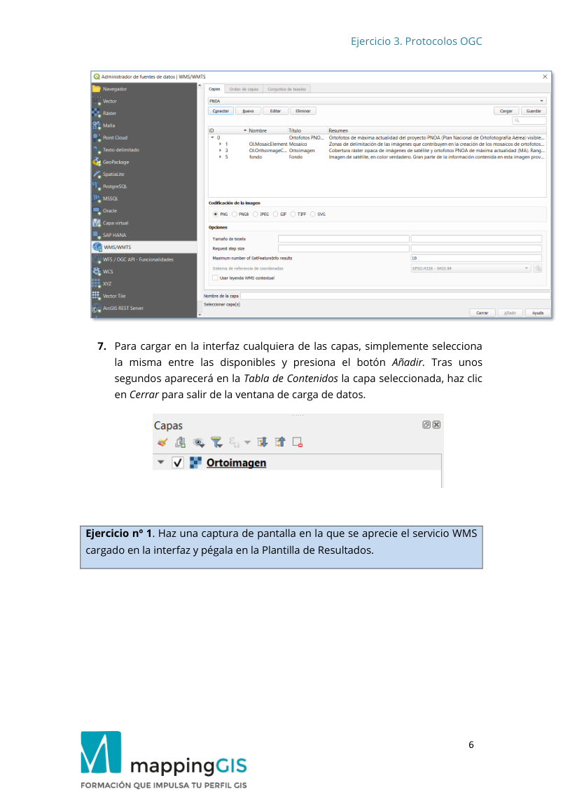</a></details>

[Consultar en el PDF · página 6](../materiales/Ejercicio_3_0_Conexiones_QGIS-v1.pdf#page=6){target="_blank" rel="noopener noreferrer"}

### Ejercicio 2 · WFS en QGIS

<div class="original-statement"><span class="eyebrow">Enunciado original · Conexiones QGIS</span><p>Haz una captura de pantalla de programa en la cual se aprecien las capas cargadas y pégala en la Plantilla de Resultados.</p></div>

<details class="original-exercise" markdown="1">
<summary>Pasos y contexto originales de la clase</summary>

**Página 6**

```text
Ejercicio 3. Protocolos OGC 
                                                                                                                                                                     6 
 
 
7. Para cargar en la interfaz cualquiera de las capas, simplemente selecciona 
la misma entre las disponibles y presiona el botón Añadir. Tras unos 
segundos aparecerá en la Tabla de Contenidos la capa seleccionada, haz clic 
en Cerrar para salir de la ventana de carga de datos.  
 
 
Ejercicio nº 1. Haz una captura de pantalla en la que se aprecie el servicio WMS 
cargado en la interfaz y pégala en la Plantilla de Resultados.
```

**Página 7**

```text
Ejercicio 3. Protocolos OGC 
                                                                                                                                                                     7 
 
Conexiones Web Feature Service (WFS) 
El uso de los datos provenientes de servicios Web Feature Services (WFS)  en QGIS es 
relativamente sencillo.  
Para ejecutar dicho servicio en QGIS vamos a seguir los siguientes pasos:  
1. Abre un nuevo proyecto en QGIS.  
2. Existen dos formas para incluir una ca pa WFS. La primera de ellas es 
utilizando el menú Capa/Añadir Capa WFS. La otra opción es utilizar el botón 
Añadir capa WFS  . Después de utilizar cualquiera de las dos opciones 
anteriores, aparecerá el siguiente cuadro de diálogo.  
 
3. En la ventana Añadir capa WFS desde un servidor , si es l a primera vez que 
accedemos a lo s datos de un servicio WFS, hacemos clic sobre el botón 
Nuevo, con el fin de crear una nueva conexión a un servicio WFS.  
4. En la ventana Crear una nueva conexión WFS , digitalizamos los siguientes 
parámetros:  
- Nombre: Digitalizamos aquí el nombre arbitrario con el que se 
denominará a la conexión. En nuestro caso la denominamos Riesgos 
Naturales en la Comunidad de Andalucía.
```

**Página 8**

```text
Ejercicio 3. Protocolos OGC 
                                                                                                                                                                     8 
 
- URL: Ruta para el acceso al servicio WFS. Esta ruta generalmente está 
publicada por los generadores del servicio.  
Copia la siguiente ruta: 
http://www.juntadeandalucia.es/medioambiente/mapwms/REDIAM_WFS_riesgos_naturales? 
 
 
En algunos casos es necesario ingresar los datos de autentificación, en tal 
caso, éstos se digitalizan en los campos Nombre de usuario y Contraseña. En 
nuestro caso, deja éstos campos vacíos.  
 
5. Finalmente, presionamos sobre el botón OK. De esta forma, hemos creado 
una conexión a un servicio WFS.  
Como podemos apreciar la conexión aparece disponible en el desplegable 
de la ventana Añadir capa WFS desde un servidor.
```

**Página 9**

```text
Ejercicio 3. Protocolos OGC 
                                                                                                                                                                     9 
 
 
6. Haz clic sobre el botón Conectar y aparecerán en la ventana las capas 
disponibles en este servicio.  
 
 
 
7. Finalmente, para cargar una capa, únicamente es necesario seleccionarla 
en la columna Cache Features y pulsar sobre Añadir.  
 
El programa presentará una ventana en la que se informa del proceso de 
carga de las capas seleccionadas.  
 
Una vez finalizado el proceso aparecerá gráficamente en pantalla así como 
en la Tabla de Contenidos (ToC) las capas cargadas.
```

**Página 10**

```text
Ejercicio 3. Protocolos OGC 
                                                                                                                                                                     10 
 
 
 
Ejercicio nº 2 . Haz una captura de pantalla de programa en la cual se aprecien 
las capas cargadas y pégala en la Plantilla de Resultados.  
 
 
Para extraer información del servicio WFS cargado se puede utilizar la herramienta 
Identificar objetos espaciales  , selecciona un elemento en pantalla y en la 
ventana del Identificador aparecerá su información relacionada.
```

</details>

<details class="source-page"><summary>Ver página 10 del PDF original, con sus capturas</summary><a href="../../materiales/Ejercicio_3_0_Conexiones_QGIS-v1.pdf#page=10" target="_blank" rel="noopener">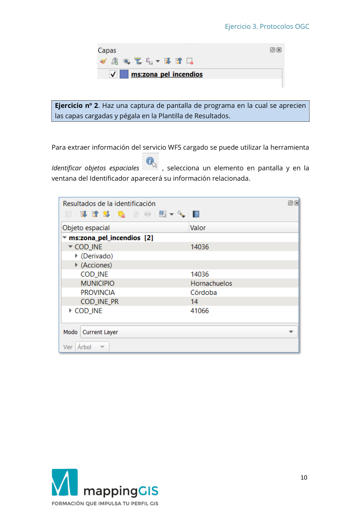</a></details>

[Consultar en el PDF · página 10](../materiales/Ejercicio_3_0_Conexiones_QGIS-v1.pdf#page=10){target="_blank" rel="noopener noreferrer"}

### Ejercicio 3 · WCS en QGIS

<div class="original-statement"><span class="eyebrow">Enunciado original · Conexiones QGIS</span><p>Haz una captura de pantalla de programa en la cual se aprecien las capas cargadas y pégala en la Plantilla de Resultados.</p></div>

<details class="original-exercise" markdown="1">
<summary>Pasos y contexto originales de la clase</summary>

**Página 10**

```text
Ejercicio 3. Protocolos OGC 
                                                                                                                                                                     10 
 
 
 
Ejercicio nº 2 . Haz una captura de pantalla de programa en la cual se aprecien 
las capas cargadas y pégala en la Plantilla de Resultados.  
 
 
Para extraer información del servicio WFS cargado se puede utilizar la herramienta 
Identificar objetos espaciales  , selecciona un elemento en pantalla y en la 
ventana del Identificador aparecerá su información relacionada.
```

**Página 11**

```text
Ejercicio 3. Protocolos OGC 
                                                                                                                                                                     11 
 
Conexiones OGC API 
 
OGC API es un Nuevo estándar que aún está en desarrollo. Supone una evolución 
del WFS, de tal forma que se puede acceder a los datos de una página en formato 
web, ya que utiliza HTML y opcionalmente JSON. 
Las OGC API utilizan un enfoque moderno que sigue la arquitectura web 
actual y, en particular, las mejores prácticas del W3C/OGC para compartir 
datos espaciales en la web.  La idea de utilizar tecnologías API hace que la 
exploración de datos sea más amigable tanto para el navegador web como 
para el desarrollador web. 
 
Para acceder a la API se utilizan unos “ puntos finales ” que se incorporan 
en la url del recurso. El punto final genérico de acceso a la página es / y se 
conoce como Landing page. 
Para ver un ejemplo podemos accede r al servicio OGC API del Instituto 
Geográfico Nacional de España. 
https://api-features.ign.es/ 
 
En ésta página de inicio podemos ver información sobre el Proyecto como el 
Proveedor y sus datos de contacto , los términos del servicio  y la licencia. 
También podemos elegir el forma to entre HTML y JSON. HTML es el lenguaje 
habitual de las páginas web y JSON es un lenguaje muy utilizado por los
```

**Página 12**

```text
Ejercicio 3. Protocolos OGC 
                                                                                                                                                                     12 
 
desarrolladores web porque es eficiente y se adapta bien al manejo de los datos 
por los navegadores. 
Desde esta página de inicio podemos acceder también a los principales elementos 
de una OGC API. 
 
 Conformance declaration . La conformidad identifica las especificaciones 
que cumplen los enlaces del recurso. 
 API definition . La definición de API  describe los métodos y recursos 
soportados por el servicio.  
 Collections. Las colecciones se refieren a los datos propiamente dichos. 
Haz clic en el enlace de las colecciones. 
 
Verás en la url que el punto final es /collections y el formato es html (f=html) 
 
Las colecciones que sirve el IGN como OGC API son las indicadas en la página.
```

**Página 13**

```text
Ejercicio 3. Protocolos OGC 
                                                                                                                                                                     13 
 
 
A partir de aquí puedes navegar por las páginas para ver los datos. Por ejemplo , 
desde la colección Unidades Administrativas puedes llegar a ver los datos de los 
municipios 
 
Como puedes observar los datos se pueden consultar desde un mapa o desde una 
tabla.
```

**Página 14**

```text
Ejercicio 3. Protocolos OGC 
                                                                                                                                                                     14 
 
Estos datos pueden ser consumidos desde GIS de escrito rio como QGIS o desde 
librerías JavaScript como Leaflet u OpenLayers.  
OGC API en QGIS 
 
Podemos añadir los datos OGC API en QGIS del mismo modo que las conexiones a 
los servicios WFS. 
 
La opción de OGC API en QGIS se encuentra en la misma ubicación que el servicio 
WFS. Haz clic en el botón “Nuevo” para crear una nueva conexión. 
En la ventana que se abre debemos definir un nombre y una url con el servicio. 
Nombre: IGN OGC API 
URL: https://api-features.ign.es/ 
Escribimos la dirección de la página de inicio que vimos antes para el servicio OGC 
API del Instituto Geográfico Nacional.
```

**Página 15**

```text
Ejercicio 3. Protocolos OGC 
                                                                                                                                                                     15 
 
 
Cuando lo tengas haz clic en Aceptar. 
Una vez creado el servicio en QGIS haz clic en “Conectar”. Se muestran las 
colecciones que forman este servicio.
```

**Página 16**

```text
Ejercicio 3. Protocolos OGC 
                                                                                                                                                                     16 
 
 
Puedes seleccionar la colección de datos que desees, pero como contienen 
muchos datos, puede tardar un tiempo en descargarlo, por ese motivo, para que 
puedas probar el servicio sin dificultad te aconsej amos que veas la colección: Red 
de Estaciones de Referencia (ERGNSS) porque es más ligera. 
Cuando lo tengas haz clic en “Añadir” para incorporar la capa a la vista de QGIS.
```

**Página 17**

```text
Ejercicio 3. Protocolos OGC 
                                                                                                                                                                     17 
 
Conexiones Web Coverage Service (WCS) 
El servicio WCS o Web Coverage Service proporciona información ráster con su 
semántica original, es decir, permite el acceso no sólo a la imagen en sí (tal y como 
sucede con el servicio WMS), sino también a los valores o propiedades de la misma 
(como por ejemplo valores de altitud de un MDE o Modelo Digital de Elevaciones).  
La especificación OGC para los servicios WCS define las siguientes operaciones:  
 GetCapabilities. Metadatos del servicio y de las coberturas que ofrece.  
 DescribeCoverage. Descripción detallada de una o varias coberturas.  
 GetCoverage. Obtener una cobertura o parte de ella.  
 
Nota: Dependiendo del pc o de la conexión a internet, desde donde accedamos, 
es posible que ésta tarde unos minutos o que incluso el pc se bloquee, debido al 
gran volumen de datos de consulta, por ello el éxito de la ejecución del ejercicio 
no está garantizado.  
 
Para realizar una conexión a un servicio WCS desde QGIS hemos de seguir los 
siguientes pasos:  
1. Abre un nuevo proyecto en QGIS. 
2. Al igual que en los dos casos anteriores existen dos formas de iniciar el 
proceso. E n primer lugar, mediante el menú Capa/Añadir capa WCS  o, en 
segundo lugar, seleccionando el botón Agregar capa WCS  de la barra 
de herramientas Administrar capas. Una vez seleccionada cualquiera de las 
dos anteriores opciones aparecerá el siguiente cuadro de diálogo.
```

**Página 18**

```text
Ejercicio 3. Protocolos OGC 
                                                                                                                                                                     18 
 
 
3. Vamos a conectarnos al servicio WCS de la Red de Información Ambiental 
de Andalucía (REDIAM) para tener acceso a los  Modelos Meteorológicos 
para su uso en sistemas de pre -alerta hidrometeorológica en 
Andalucía.  
4. Haz click sobre el botón Nuevo para crear una nueva conexión a un servicio 
WCS e introduce los siguientes parámetros:  
- Nombre: Modelos Meteorológicos REDIAM  
- URL: Copia la siguiente ruta:  
http://www.juntadeandalucia.es/medioambiente/mapwms/REDIAM_WCS_modelos_meteorologicos_prealertas?
```

**Página 19**

```text
Ejercicio 3. Protocolos OGC 
                                                                                                                                                                     19 
 
 
5. Finalmente, presionamos el botón OK y la conexión WCS quedará guardada. 
Si accedemos al desplegable ésta aparecerá disponible.  
 
6. Haz clic sobre el botón Conectar y aparecerá la cobertura disponible para su 
consulta.
```

**Página 20**

```text
Ejercicio 3. Protocolos OGC 
                                                                                                                                                                     20 
 
7. Señala la cobertura en la ventana y pulsa el botón Añadir para cargarla en la 
interfaz de QGIS.  
Puedes emplear el botón Cambiar… para escoger el Sistema de 
Coordenadas en el que desees trabajar.  
 
¿No te funciona este WCS? Puedes probar con un WCS de tu elección o probar con: 
https://geoservicios.cantabria.es/inspire/services/MDT/MapServer/WCSServer 
 
Ejercicio nº 3 . Haz una captura de pantalla de programa en la cual se 
aprecien las capas cargadas y pégala en la Plantilla de Resultados.
```

</details>

<details class="source-page"><summary>Ver página 20 del PDF original, con sus capturas</summary><a href="../../materiales/Ejercicio_3_0_Conexiones_QGIS-v1.pdf#page=20" target="_blank" rel="noopener">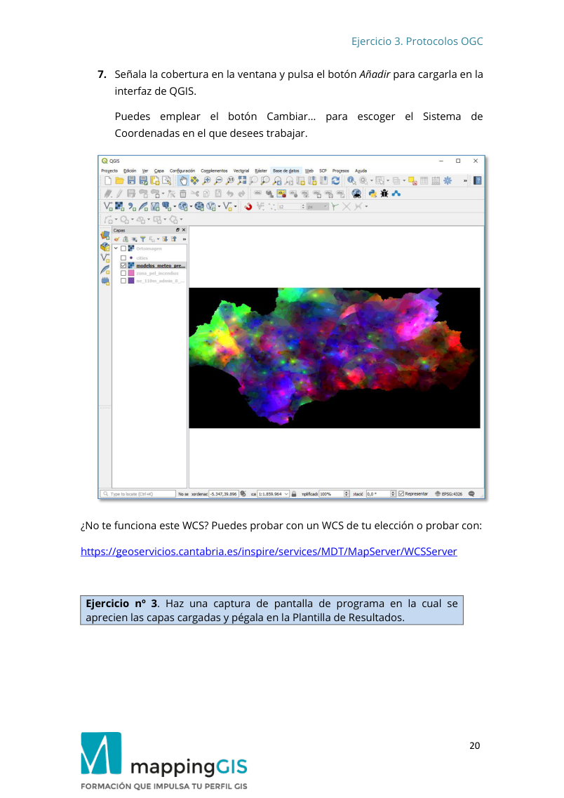</a></details>

[Consultar en el PDF · página 20](../materiales/Ejercicio_3_0_Conexiones_QGIS-v1.pdf#page=20){target="_blank" rel="noopener noreferrer"}

**GeoServer:** [PDF original completo](../materiales/Ejercicio_3_1_GeoServer_2025-v7.pdf){target="_blank" rel="noopener noreferrer"}.

### Ejercicio 4 · Extensión WPS

<div class="original-statement"><span class="eyebrow">Enunciado original · GeoServer</span><p>Adjunta una captura de pantalla como la anterior mostrando la el enlace “Generador de consultas WPS”.</p></div>

<details class="original-exercise" markdown="1">
<summary>Pasos y contexto originales de la clase</summary>

**Página 3**

```text
Ejercicios 3.1 GeoServer 
                                                                                          3 
La petición WFS GetFeature .......................................................................................... 42 
La petición WFS GetCapabilities ................................................................................... 42 
Visualización de nuestros servicios WMS y WFS en un cliente SIG ...................... 43 
Visualización de nuestro servicio WCS en un cliente SIG ....................................... 43 
Servicio de Procesamiento Web (WPS) ....................................................................... 44 
Otros Formatos de datos soportados ............................................................................ 48 
Carga de datos desde un archivo Geopackage ........................................................ 49 
Creación de un grupo de capas ....................................................................................... 51 
Estilos ..................................................................................................................................... 54 
Estructura de un SLD ...................................................................................................... 54 
Cargando estilos .............................................................................................................. 55 
Estilos CSS en GeoServer ................................................................................................... 59 
Creando un estilo en una capa de puntos ................................................................ 60 
La sintaxis de CSS ............................................................................................................ 62 
Símbolos ............................................................................................................................ 63 
Selectores de símbolos .................................................................................................. 63 
CSS Cookbook .................................................................................................................. 66 
Filtros en GeoServer ........................................................................................................... 66 
Proporcionando metadatos .......................................................................................... 69 
Estilos basados en escalas ................................................................................................ 71 
Las teselas vectoriales y su creación con GeoServer ...................................................... 72 
Generación de teselas vectoriales con GeoServer ...................................................... 73 
Formatos de las teselas vectoriales ................................................................................ 74 
Publicación de teselas vectoriales con GeoWebCache ............................................... 74
```

**Página 4**

```text
Ejercicios 3.1 GeoServer 
                                                                                          4 
Instalación de GeoServer sobre Windows 
 
Instalación 
 
Vamos a realizar la instalación de GeoServer utilizando los archivos binarios que 
son independientes de la plataforma que se utilice. Esta versión es una aplicación 
web de GeoServer construida dentro de Jetty (Jetty es un servidor de aplicaciones 
ligero y portátil ). Esto tiene la ventaja de trabajar de forma similar en cualquier 
sistema operativo y es muy sencillo de configurar. 
 
GeoServer requiere la instalación de un entorno JDK 17 en su sistema, disponible 
en los instaladores de OpenJDK, Adoptium.  Esto debe  hacerse antes de la 
instalación. 
 
Actualizar Java 
 
En primer lugar, debemos asegura rnos de que tenemos instalado J DK en el 
sistema. Las versiones recientes de GeoServer, concretamente a partir de la 
versión 2.25 , requieren de un entorno JDK 17. Hay otras versiones de JDK más 
recientes pero no te recomendamos que las utilices  con Geoserve r, porque 
pueden dar algunos problemas. 
 
Si ya tienes instalado JDK 17 puedes saltarte este paso, en caso contrario 
procederemos a instalarlo. Una forma sencilla de instalar JDK 17 es mediante 
https://adoptium.net/es/
```

**Página 5**

```text
Ejercicios 3.1 GeoServer 
                                                                                          5 
 
 
Nos dirigimos a la página de Adoptium y buscamos el botón “Otras descargas”. 
 
 
 
 
En la ventana que se abre nos permite elegir la versión de Java según nuestro 
sistema operativo. Como verás está disponible para los principales sistemas 
operativos: Windows. Linux, Mac 
 
Elegimos JDK 17-LTS y nuestro sistema operativo. 
 
Haz clic en el botón de descargas. Se descargará el archivo correspondiente. 
 
 
 
Abrimos el archivo y da comienzo a la instalación:
```

**Página 6**

```text
Ejercicios 3.1 GeoServer 
                                                                                          6 
 
 
 
Haz clic en Siguiente. 
Nos muestra la licencia. 
 
 
Acepta los términos de la licencia. Haz clic en Siguiente.
```

**Página 7**

```text
Ejercicios 3.1 GeoServer 
                                                                                          7 
 
 
A continuación veremos una ventana para personalizar la instalación, deja los 
valores por defecto. 
 
 
 
Nos va a indicar el lugar (carpeta) donde nos hace la instalación. Puedes 
seleccionar una diferente aunque recomendamos que dejes la que indica por 
defecto.
```

**Página 8**

```text
Ejercicios 3.1 GeoServer 
                                                                                          8 
En la ventana siguiente confirmamos la instalación. Clic en Instalar. 
 
 
 
Cuando termine la instalación veremos la ventana de instalación completada. 
 
  
 
Haremos clic en finalizar.
```

**Página 9**

```text
Ejercicios 3.1 GeoServer 
                                                                                          9 
Si hemos seguido estas indicaciones nos encontraremos con una carpeta con 
la versión jdk en el directorio Archivos de programa>> Eclipse Adoptium 
 
 
 
Instalar GeoServer 
 
Ahora que ya tenemos Java en una versión apta para GeoServer podemos 
comenzar con su instalación: 
  
1. Ve a la página de descargas de GeoServer: http://geoserver.org/download/ 
 
2. Seleccionamos la versión estable de GeoServer. 
 
 
3. Seleccionamos Platform Independent Binary.
```

**Página 10**

```text
Ejercicios 3.1 GeoServer 
                                                                                          10 
 
 
4. Se realizará la conexión a l a página web de sourceforge.net y comenzará la 
descarga. Al finalizar tendremos un archivo de tipo bin comprimido. 
 
 
5. Descomprimimos en el directorio raíz del equipo: (p. ej C:\Geoserver  
2.28.0).  
 
 
 
Establecer las variables de entorno
```

**Página 11**

```text
Ejercicios 3.1 GeoServer 
                                                                                          11 
Necesitamos establecer la variable de entorno JAVA_HOME si aún no está 
configurada. Esta es la ruta a nuestro JRE de modo que la ruta 
%JAVA_HOME%\bin\java.exe exista. 
 
Para crear variables de entorno debemos ir al Panel de control > Sistema > 
Configuración avanzada del sistema: 
 
 
 
Clic sobre el botón Variables de entorno… 
 
 
Y en Variables del sistema, hacemos clic en el botón Nueva…
```

**Página 12**

```text
Ejercicios 3.1 GeoServer 
                                                                                          12 
 
 
Para Nombre de variable, ingresaremos JAVA_HOME: 
 
 
 
Para e stablecer e l campo Valor de la variable , debemos ir a Examinar 
directorio… y na vegaremos por el árbol de directorios para localizar la ruta a 
nuestro directorio JDK / JRE:
```

**Página 13**

```text
Ejercicios 3.1 GeoServer 
                                                                                          13 
 
 
Aceptamos. 
 
Y aceptamos tres veces más. 
 
También establecer emos la variable  GEOSERVER_HOME, que es el directorio 
donde está instalado GeoServer. 
 
 
 
Directorio de datos de GeoServer 
 
Durante la instalación, GeoServer crea un directorio de datos en el mismo 
directorio de instalación. El riesgo de dejar el directorio de datos en la ubicación 
por defecto radica en que en el momento de desinstalar GeoServer para rea lizar 
una actualización, se eliminará el directorio completo de GeoServer  y, por 
tanto, el directorio de los Datos con toda nuestra información. 
 
Por lo tanto, antes de proceder con una actualización o reinstalación de 
GeoServer, el primer paso que debemos  realizar será hacer una copia de la 
carpeta data_dir y pegarla en la raíz C:/
```

**Página 14**

```text
Ejercicios 3.1 GeoServer 
                                                                                          14 
 
 
La creación de un directorio de datos en una ubicación separada nos garantiza la 
independencia de datos y del directorio de instalación. 
 
La carpeta data_dir de GeoServer es el corazón de la configuración y los datos 
de GeoServer . Contiene toda la información necesaria para que GeoServer 
funcione: configuración, estilos, datos de usuario, logs, etc. 
 
La variable GEOSERVER_DATA_DIR, hace referencia a la ubicación del directorio de 
datos de GeoServer (que por defecto es  %GEOSERVER_HOME\data_dir). Est a 
variable es obligatori a si desea mos utilizar un directorio de datos que no sea la 
ubicación predeterminada.  
 
 
 
El procedimiento para configurar estas variables es idéntico al de  la variable 
JAVA_HOME. 
Nota  
Una vez que hayamos definido la variable de entorno apuntando a la carpeta 
data_dir de la unidad C:, esta será nuestra carpeta de datos y es por tanto la que 
utilizaremos en adelante . NO confundir con la carpeta data_dir del d irectorio de 
GeoServer.
```

**Página 15**

```text
Ejercicios 3.1 GeoServer 
                                                                                          15 
Ejecución de GeoServer 
 
Navegaremos hasta dentro del directorio bin donde hemos instalado GeoServer. 
 
 
 
Y ejecutamos el archivo startup.bat 
 
Aparecerá y se mantendrá una ventana de línea de comandos. Esta ventana 
contiene información de diagnóstico y solución de problemas. Esta ventana debe 
dejarse abierta  durante la ejecución de GeoServer , si cerramos la ventana, 
GeoServer no se ejecutará. 
 
Ahora abrimos nuestro na vegador de internet (te sugerimos utilizar Google 
Chrome) y vamos a  http://localhost:8080/geoserver para acceder a la interfaz de 
administración web de GeoServer. 
 
Si ve mos el logotipo de GeoServer, ¡enhorabuena! GeoServer se ha instalado 
correctamente.
```

**Página 16**

```text
Ejercicios 3.1 GeoServer 
                                                                                          16 
 
 
Introducimos el n ombre de usuario y la contraseña para la administración de 
GeoServer. Los valores predeterminados son admin / geoserver. Utilizaremos 
estos valores durante el curso,  por lo que te recomendamos encarecidamente no 
modificarlos durante el curso.  
 
Detener GeoServer 
 
Para cerrar GeoServer, debemos cerrar la ventana de línea de comandos 
persistente o ejecutar el archivo shutdown.bat ubicado dentro del directorio bin. 
 
 
Desinstalar o actualizar GeoServer 
 
1. Detener GeoServer (si se está ejecutando). 
2. Eliminar el directorio donde está instalado GeoServer. 
3. Copiar el nuevo directorio de GeoServer con los nuevos archivos binarios. 
 
Cambiar el puerto en el que se ejecuta GeoServer 
 
GeoServer se ejecuta por defecto en el puerto 8080. En el caso ( y solo en el caso) 
de que tengas este puerto ocupado por otra aplicación, puedes modificarlo a otro 
puerto. 
 
Lo que debe s hacer es detener GeoServer y editar el archivo start.ini que se 
localiza en C:\Geoserver 2.28.0
```

**Página 17**

```text
Ejercicios 3.1 GeoServer 
                                                                                          17 
 
Y editar la línea 144 que dice: 
 
jetty.port=8080 
 
 
 
Cambiar a 
 
jetty.port=8585 
 
E iniciar GeoServer, ejecutando el archivo startup.bat
```

**Página 18**

```text
Ejercicios 3.1 GeoServer 
                                                                                          18 
Descarga e instalación de extensiones en GeoServer 
GeoServer, por defecto, incluye varias funcionalidades, pero para ampliar su 
potencial es posible utilizar complementos. P ara utilizar estos complementos, es 
necesario descargar e instalarlos manualmente. Veamos cómo hacerlo. 
La extensión CSS 
Para trabajar con CSS en GeoServer es necesario instalar la extensión disponible 
desde la página de descargas de GeoServer: https://geoserver.org/release/stable/ 
 
Nos descargaremos el archivo acorde a nuestra versión de GeoServer . Si l a 
versión de GeoServer utilizada es la versión 2.28.0 entonces el archivo deberá ser  
geoserver-2.28.0-css-plugin.zip 
Abre el archivo zip para ver los archivos:
```

**Página 19**

```text
Ejercicios 3.1 GeoServer 
                                                                                          19 
Extrae su contenido en el directorio de GeoServer: 
C:\Geoserver 2.28.0\webapps\geoserver\WEB-INF\lib 
Si nos pregunta, debemos proporcionar permisos de administrador y marcar la 
casilla “Hacer esto para todos los elementos”. 
Instalación de la extensión Vector Tiles 
 
Repetiremos la operación con el complemento que genera teselas vectoriales. 
Volvemos a  la página de descargas de GeoServer : 
https://geoserver.org/release/stable/ y en el apartado Output Formats  
seleccionamos Vector Tiles:
```

**Página 20**

```text
Ejercicios 3.1 GeoServer 
                                                                                          20 
 
 
https://sourceforge.net/projects/geoserver/files/GeoServer/2.28.0/extensions/geoserver-
2.28.0-vectortiles-plugin.zip/download 
 
Y copiamos los archivos .jar en el mismo directorio que antes: 
 
C:\Geoserver 2.28.2\webapps\geoserver\WEB-INF\lib 
 
Instalación de la extensión WPS 
 
Repetiremos la operación con el complemento que permite realizar 
geoprocesamiento. 
Volvemos a  la página de descargas de GeoServer : 
https://geoserver.org/release/stable/ 
y en el apartado Services seleccionamos WPS: 
 
https://sourceforge.net/projects/geoserver/files/GeoServer/2.28.0/extensions/geoserver-
2.28.0-wps-plugin.zip/download 
 
Como en las dos ocasi ones anteriores, copiamos los archivos .jar  al directorio 
C:\Geoserver 2.28.0\webapps\geoserver\WEB-INF\lib
```

**Página 21**

```text
Ejercicios 3.1 GeoServer 
                                                                                          21 
 
Para completar la instalación de las extensiones debemos reiniciar el equipo. De 
este modo los servicios se iniciarán de forma automática. 
 
Después de reiniciar, esperamos un par de minutos y accedemos a la interfaz de 
administración de GeoServer. 
 
 
Nota  
Desde ahora y hasta finalizar el curso debes utilizar un navegador web moderno.  
Te recomendamos utilizar Chrome, Firefox o Safari. 
 
La url por defecto de la interfaz de GeoServer es: 
http://localhost:8080/geoserver 
 
Para verificar que las extension es se han instalado , sin loguearte, ve al apartado 
Demos, en él deberías ver una entrada denominada Generador de consultas WPS: 
 
 
Ejercicio nº4. Adjunta una captura de pantalla como la anterior mostrando la el 
enlace “Generador de consultas WPS”.
```

</details>

<details class="source-page"><summary>Ver página 21 del PDF original, con sus capturas</summary><a href="../../materiales/Ejercicio_3_1_GeoServer_2025-v7.pdf#page=21" target="_blank" rel="noopener">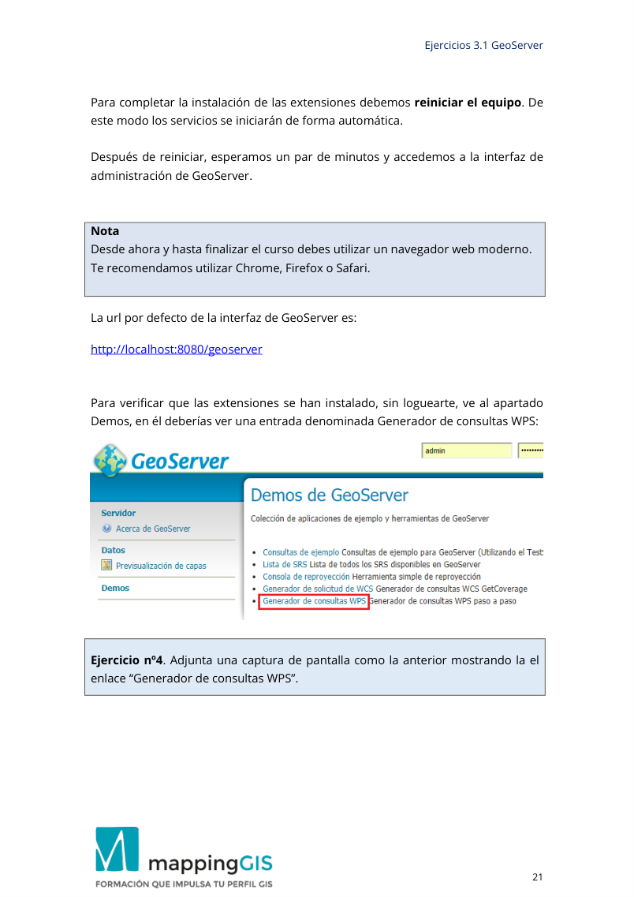</a></details>

[Consultar en el PDF · página 21](../materiales/Ejercicio_3_1_GeoServer_2025-v7.pdf#page=21){target="_blank" rel="noopener noreferrer"}

### Ejercicio 5 · Página web en GeoServer

<div class="original-statement"><span class="eyebrow">Enunciado original · GeoServer</span><p>Haz una captura de pantalla el contenido de la url http://localhost:8080/geoserver/www/web.html en blanco, sin errores.</p></div>

<details class="original-exercise" markdown="1">
<summary>Pasos y contexto originales de la clase</summary>

**Página 21**

```text
Ejercicios 3.1 GeoServer 
                                                                                          21 
 
Para completar la instalación de las extensiones debemos reiniciar el equipo. De 
este modo los servicios se iniciarán de forma automática. 
 
Después de reiniciar, esperamos un par de minutos y accedemos a la interfaz de 
administración de GeoServer. 
 
 
Nota  
Desde ahora y hasta finalizar el curso debes utilizar un navegador web moderno.  
Te recomendamos utilizar Chrome, Firefox o Safari. 
 
La url por defecto de la interfaz de GeoServer es: 
http://localhost:8080/geoserver 
 
Para verificar que las extension es se han instalado , sin loguearte, ve al apartado 
Demos, en él deberías ver una entrada denominada Generador de consultas WPS: 
 
 
Ejercicio nº4. Adjunta una captura de pantalla como la anterior mostrando la el 
enlace “Generador de consultas WPS”.
```

**Página 22**

```text
Ejercicios 3.1 GeoServer 
                                                                                          22 
 
El directorio de datos www como servidor web 
 
Para realizar determinados ejercicios del curso debemos utilizar el directorio www 
ubicado dentro de C:\data_dir\  
 
 
 
En esta ubicación guardaremos los archivos html que crearemos en el curso , 
que serán los que contendrán nuestros visores webmapping. 
La carpeta www dentro del directo rio data_dir de GeoServer tiene la función de 
servir contenido estático (como archivos HTML, imágenes, CSS, JavaScript, etc.) 
directamente desde el servidor web embebido de GeoServer, dicho de otra forma; 
el directorio www se utiliza para servir nuestras aplicaciones de mapas del lado del 
cliente, permitiendo a GeoServer actuar como un servidor web.  
 
El contenido de este directorio se sirve en http:/<host: puerto> /geoserver/www 
 
Entra dentro del directorio www y crea un archivo nuevo con el nombre web.html 
 
 
 
Puedes crear un nuevo documento de texto, del tipo "nuevo documento de texto  
con extensión .txt" y luego modificar el nombre y la extensión. 
 
Una vez modifiques la extensión a .html, se actualizará el icono del archivo.
```

**Página 23**

```text
Ejercicios 3.1 GeoServer 
                                                                                          23 
 
 
Mostrar u ocultar extensiones de nombre de archivo 
1. Para abrir Opciones de carpeta, haz clic en el botón  Inicio
 , en  Panel de 
control, en Apariencia y personalización y, por último, en Opciones de carpeta. 
2. Clic en la ficha  Ver y, a continuación, en Configuración avanzada, realiza una de 
las acciones siguientes: 
 Para mostrar las extensiones de nombre de archivo, desactive la 
casilla Ocultar las extensiones de archivo para tipos de archivo 
conocidos y, a continuación, haga clic en Aceptar. 
 Para ocultar las extensiones de nombre de arch ivo, activa la 
casilla Ocultar las extensiones de archivo para tipos de archivo 
conocidos y, a continuación, haz clic en Aceptar. 
 
Abre la web en tu navegador, ve a: http://localhost:8080/geoserver/www/web.html 
 
Debe aparecer un a web el b lanco (el archivo html está vacío). Esto nos sirve para 
verificar que el archivo está funcionando correctamente y que el servidor Jetty está 
iniciado. 
Ejercicio nº 5. Haz una captura de pantalla el contenido de la  url 
http://localhost:8080/geoserver/www/web.html en blanco, sin errores.
```

</details>

<details class="source-page"><summary>Ver página 23 del PDF original, con sus capturas</summary><a href="../../materiales/Ejercicio_3_1_GeoServer_2025-v7.pdf#page=23" target="_blank" rel="noopener">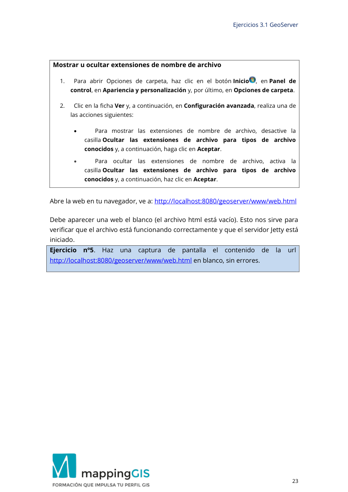</a></details>

[Consultar en el PDF · página 23](../materiales/Ejercicio_3_1_GeoServer_2025-v7.pdf#page=23){target="_blank" rel="noopener noreferrer"}

### Ejercicio 6 · Publicar relieve

<div class="original-statement"><span class="eyebrow">Enunciado original · GeoServer</span><p>Haz una captura de pantalla con el resultado y pégala en la p lantilla de resultados.</p></div>

<details class="original-exercise" markdown="1">
<summary>Pasos y contexto originales de la clase</summary>

**Página 23**

```text
Ejercicios 3.1 GeoServer 
                                                                                          23 
 
 
Mostrar u ocultar extensiones de nombre de archivo 
1. Para abrir Opciones de carpeta, haz clic en el botón  Inicio
 , en  Panel de 
control, en Apariencia y personalización y, por último, en Opciones de carpeta. 
2. Clic en la ficha  Ver y, a continuación, en Configuración avanzada, realiza una de 
las acciones siguientes: 
 Para mostrar las extensiones de nombre de archivo, desactive la 
casilla Ocultar las extensiones de archivo para tipos de archivo 
conocidos y, a continuación, haga clic en Aceptar. 
 Para ocultar las extensiones de nombre de arch ivo, activa la 
casilla Ocultar las extensiones de archivo para tipos de archivo 
conocidos y, a continuación, haz clic en Aceptar. 
 
Abre la web en tu navegador, ve a: http://localhost:8080/geoserver/www/web.html 
 
Debe aparecer un a web el b lanco (el archivo html está vacío). Esto nos sirve para 
verificar que el archivo está funcionando correctamente y que el servidor Jetty está 
iniciado. 
Ejercicio nº 5. Haz una captura de pantalla el contenido de la  url 
http://localhost:8080/geoserver/www/web.html en blanco, sin errores.
```

**Página 24**

```text
Ejercicios 3.1 GeoServer 
                                                                                          24 
Interfaz de GeoServer 
GeoServer incluye una interfaz de administración Web a través de la que podemos 
hacer la mayor p arte de las configuraciones de datos y servicios. Esta interfaz 
reduce la necesidad de editar los archivos de configuración a mano. 
Página de Bienvenida 
Para acceder a la página de bienvenida accedemos a 
http://localhost:8080/geoserver 
 
Identificación 
Para comenzar a trabajar con GeoServer es necesario identificarse. 
Por defecto, las credenciales de administración de GeoServer son admin y 
geoserver.  
1. Identifícate con las credenciales predeterminadas.
```

**Página 25**

```text
Ejercicios 3.1 GeoServer 
                                                                                          25 
2. Después de identificarte aparecen todos los menús disponibles. 
Interfaz de administración Web 
Los enlaces de la columna izquierda cargan páginas de administración para las 
características específicas de GeoServer: 
 Servidor 
 Datos 
 Servicios 
 Settings 
 Cacheado de Teselas 
 Seguridad 
 Demos 
 Herramientas 
Los vínculos en la parte central de la página principal nos llevan a los documentos 
de capacidades de cada servicio (WFS, WMS, WCS, WPS, TMS, etc).  
 
En este curso vamos a usar los enlaces situados a la izquierda: Datos (Espacios de 
trabajo, Almacenes de datos, Capas, etc), Cacheado de Teselas y Seguridad.
```

**Página 26**

```text
Ejercicios 3.1 GeoServer 
                                                                                          26 
Servidor  
La sección Servidor proporciona acceso a la información del entorno GeoServer. Es 
una combinación de herramientas de diagnóstico y de configuración, y puede ser 
particularmente útil para la depuración.  
La página de estado del servidor  muestra un resumen de los parámetros de 
configuración del servidor y tiempo de ejecución de estado. 
 
Política de Seguridad de Contenido (CSP) en GeoServer 
 
La página Content Se curity Policy  controla cómo GeoServer prepara los 
encabezados de respuesta HTTP de la Política de seguridad  de contenido (CSP). 
GeoServer en sus sucesivas versiones va ampliando las medidas de seguridad. En 
algunas versiones de Goserver  se ha activado por defecto "Habilitar encabezado 
de política de seguridad de contenido ”, esto tiene como consecuencia que cuando 
accedemos a recursos como Leaflet u OpenStreetMap mediante un enlace url (es 
decir sin tenerlos descargados) se produzca un bloqueo. Como nosotros estamos 
haciendo un trabajo de desarrollo y nos resulta más práctico trabajar con esas 
librerías sin descargarlas vamos a comprobar que está deshabilitar la opción.
```

**Página 27**

```text
Ejercicios 3.1 GeoServer 
                                                                                          27 
 
 
En el menú de GeoServer vamos a la sección de “Seguridad” y seleccionamos 
“Content Security Policy”. En la ventana que s e abre comprobamos que est é 
deshabilitada la opción “Enable Content-Security_policy header” y si no lo estuviese 
la deshabilitamos. Por último, si fuese necesario, hacemos click en “Apply” para 
aplicar los cambios y en “Save” para guardarlos. 
 
Servicios  
 
La sección de Servicios es para usuarios avanzados que necesiten configurar los  
protocolos de solicitud utilizados por GeoServer.  
La página Web Coverage Service  (WCS) gestiona la información de metadatos, 
común a las peticiones WCS, WFS y WMS.  
La página Web Feature Service  (WFS) permite la configuración de objetos 
geográficos, niveles de servicio, y las salidas GML.  
La página Web Map Service (WMS) establece las opciones de raster y SVG. 
La página Web Processing Service (WPS) administra metadatos y los recursos para 
WPS.
```

**Página 28**

```text
Ejercicios 3.1 GeoServer 
                                                                                          28 
La página Web Map Tile Service (WMTS) establece la  configuración de las teselas 
WMS. Un WMTS es un estándar que sirve las teselas de mapa pre -renderizadas en 
la web. 
Datos 
 
Los datos enlazan directamente a una página de tipo datos que nos permite 
editar, agregar y eliminar funcionalidad es. Todos los tipos de da tos de  las 
subsecciones siguen un flujo de trabajo similar.  
Como se ve en la imagen inferior (e l ejemplo de los estilos ), la página principal de 
cada tipo de datos muestra un listado indexado con los datos, en este caso la lista 
de estilos: 
 
Previsualización de la capa 
La página Previsualización de la capa (Layer Preview) ofrece vistas previas de capa 
en varios formatos de salida, incluyendo los formatos OpenLayers, KML y GML . 
Esta página ayuda a verificar visualmente y explorar la configuración de nuestras 
capas. 
1. Haz clic en el enlace Previsualización de la capa , situado en el lado 
izquierdo bajo Datos.
```

**Página 29**

```text
Ejercicios 3.1 GeoServer 
                                                                                          29 
 
Cada fila capa contiene un Tipo de geometría, un Título, un Nombre y los 
formatos disponibles para su visualización.  
La columna Tipo muestra un icono que indica el tipo de datos de la capa. El 
Título muestra una breve descripción, mientras que el Nombre muestra el 
espacio de trabajo y el nombre de la capa. 
2. Previsualiza algunas capas haciendo clic en el enlace OpenLayers situado al 
lado de cada capa. 
 
 
Crear un espacio de trabajo 
El primer paso para cargar datos es, generalmente, crear primero un espacio de 
trabajo o workspace.
```

**Página 30**

```text
Ejercicios 3.1 GeoServer 
                                                                                          30 
Se denomina workspace al contenedor usado para agrupar capas similares. Se ha 
diseñado para ser un espacio separado y aislado, relacionado con un determinado 
proyecto. Utilizando espacios de trabajo es posible utilizar capas con nombres 
idénticos (en otros workspaces), sin ningún conflicto. 
Los workspaces se utilizan generalmente como el prefijo de una capa o un almacén 
de datos. Por ej emplo, una capa llamada “ calles” en un workspace denominado 
“Madrid” se denominará  Madrid:calles. 
Todas las capas y almacenes de datos deben tener un workspace asociado. 
Un workspace consiste en un nombre y un espacio de nombres URI ( Uniform 
Resource Iden tifier). El nombre del espacio de trabajo es tá limitado a diez 
caracteres y no puede contener espacios. Un URI es similar a una dirección URL, 
excepto que los URI no necesitan apuntar a una ubicación en la red, sólo tienen 
que ser un identificador único. P ara un workspace URI se recomienda utilizar una 
dirección URL asociada con nuestro proyecto, tal vez con un identificador de 
arrastre diferente, como http://www.openplans.org/topp para el espacio de 
trabajo "topp". 
1. Ve a la página principal de GeoServer. 
2. Haz clic en el enlace Espacios de trabajo  en la columna de la izquierda, 
debajo de Datos. 
 
3. Clic en el botón "Agregar un nuevo espacio de trabajo" que aparece en el 
parte superior de la página.
```

**Página 31**

```text
Ejercicios 3.1 GeoServer 
                                                                                          31 
 
4. Un espacio de trabajo está compuesto por un nombre (también conocido a 
veces como un "prefijo de espacio de nombres") representada por unos 
pocos caracteres, y un URI del espacio de trabajo . Estos dos campos 
deben identificar el espacio de trabajo. Rellena la siguiente información: 
 
 Name: earth 
 URI del espacio de trabajo: http://geoserver.org/earth 
 Espacio de trabajo por defecto: Si 
 
 
5. Y nada más. Cuando termines, haz clic en Guardar. 
Ahora podremos ver el espacio de trabajo que hemos creado y que es el 
espacio por defecto.
```

**Página 32**

```text
Ejercicios 3.1 GeoServer 
                                                                                          32 
 
 
Con nuestro espacio de trabajo creado, ya podemos cargar nuestros archivos. 
 
Añadir un almacén de datos 
Se denomina almacén de datos o store al contenedor de datos geográficos.  
Un almacén de datos se conecta a una fuente de datos que contiene datos ráster o 
vectoriales. Un origen de datos puede ser un archivo (como un shapefile o un 
GeoPackage) o grupo de archivos, una tabla de una base de datos o un directorio. 
El uso del construc tor de almacenes de datos significa que los parámetros de 
conexión se definen una vez, en lugar de hacerlo para cada pieza de datos de una 
fuente. Como tal, es necesario registrar un  almacén de datos  antes de cargar los 
datos. 
Cada almacén de datos está asociado a un workspace (sólo a uno). 
En esta sección  vamos a cargar un único archivo GeoTIFF. Este GeoTIFF contiene 
relieves y sombreados para el área terrestre. 
Un GeoTIFF es un almacén de datos que contiene una única capa. 
1. Desde la página principal de GeoServer, haz clic en el enlace Almacenes de 
datos en el lado izquierdo, debajo de Datos. 
 
2. Pincha en Agregar nuevo almacén
```

**Página 33**

```text
Ejercicios 3.1 GeoServer 
                                                                                          33 
 
3. En Orígenes de datos raster, seleccionamos GeoTIFF: 
 
4. Rellenaremos el formulario con la siguiente información: 
 Espacio de trabajo: earth 
 Nombre del origen de datos: relieve 
 Descripción: Relieve y sombreado del mundo 
 Habilitado: Si (Si no lo marca mos solo se guarda la información de 
configuración). 
5. En el apartado Parámetros de conexión  > URL, escrib imos la ruta 
completa al GeoTIFF, o haz clic en el botón Buscar… para navegar hasta el 
archivo. La ruta en la que se encuentra el archivo es : 
<webmapping>\Capas\relieve.tif 
Puedes copiar directamente la url: 
file:C:\webmapping\Capas\relieve.tif
```

**Página 34**

```text
Ejercicios 3.1 GeoServer 
                                                                                          34 
 
Cuando termines, clic en Guardar. 
Ahora vamos a publicar esta capa: 
Publicación de una capa 
En GeoServer el término capa se refiere a los datos raster o vectorial es que 
contienen los elementos geográficos. Las c apas vectoriales son análogas a los 
featureTypes y las capas raster son análogas a las coberturas. Las capas 
representan cada característica que debe ser mostrado en un mapa. Todas las 
capas tienen una fuente de datos, conocidos como almacenes de datos o stores.  
En la sección Capas, podemos ver y editar las capas existentes, añadir  una nueva 
capa, o eliminar una capa. Al igual que en anteriores vistas, la  página de capas 
muestra las dependencias pertinentes:  su almacén y espacio de trabajo 
correspondiente. También muestra el SRS nativo de la capa y si está habilitada. 
Después de que se cargue el almacén, necesitamos configurar la forma en la que 
se va a publicar la capa.
```

**Página 35**

```text
Ejercicios 3.1 GeoServer 
                                                                                          35 
1. En la siguiente pantalla, se visualiza  una lista de capas del almacén de 
datos. Dado que estamos trabajando con un archivo GeoTIFF, hay una 
única capa. Haz clic en el enlace Publicación para configurar la capa. 
 
2. Esta es la página de configuración de capa. Aunque hay muchas opciones, 
la mayoría no son necesarias para trabajar ahora. 
3. En el apartado Editar capa > Información básica del recurso, modifica el 
nombre de la capa a relieve en los apartados nombre y título, para que 
quede como en la siguiente imagen:
```

**Página 36**

```text
Ejercicios 3.1 GeoServer 
                                                                                          36 
4. En el apartado Sistema de referenc ia de coordenadas  completa el 
formulario con la siguiente información: 
a. Ajuste el SRS declarado EPSG:4326, si no lo está ya. 
b. Establece la Gestión de SRS  a Forzar el declarado , una vez más si 
no se ha establecido. 
c. En la sección Encuadres, haz clic en los enl aces Calcular desde los 
datos y Calcular desde el enlace nativo para definir el encuadre de 
la capa. 
5. Cuando termines, pincha en Guardar. El archivo GeoTIFF se ha brá 
publicado en GeoServer. 
Ahora puedes ver la capa con el cliente integrado de OpenLayers (ut ilizando WMS) 
a través de la opción Previsualización de capas  que vimos en secciones 
anteriores. Al hacer clic en el mapa se muestran los valores RGB de ese punto en 
particular. 
 
Ejercicio nº 6. Haz una captura de pantalla con el resultado y pégala en la p lantilla de 
resultados. 
 
Importar una base de datos PostGIS 
En esta sección vamos cargar varias tablas de PostGIS simultáneamente en 
GeoServer. 
Podríamos seguir los mismos pasos que hemos utilizado para cargar nuestro 
GeoTIFF, y cargar tabla a tabla en un  almacén de datos PostGIS, pero sería muy 
repetitivo. 
GeoServer incluye una herramienta de importación que agiliza el flujo de trabajo , 
haciendo que en pocos pasos se puedan cargar varias tablas o shapefiles a la vez 
en una base de datos. 
En esencia, una v ez configurado el “objetivo”, la herramienta de importación crea 
un almacén de datos común para las entidades geográficas, las coloca como capas 
individuales y les asigna sus propiedades (nombre, SRID, etc).
```

</details>

<details class="source-page"><summary>Ver página 36 del PDF original, con sus capturas</summary><a href="../../materiales/Ejercicio_3_1_GeoServer_2025-v7.pdf#page=36" target="_blank" rel="noopener">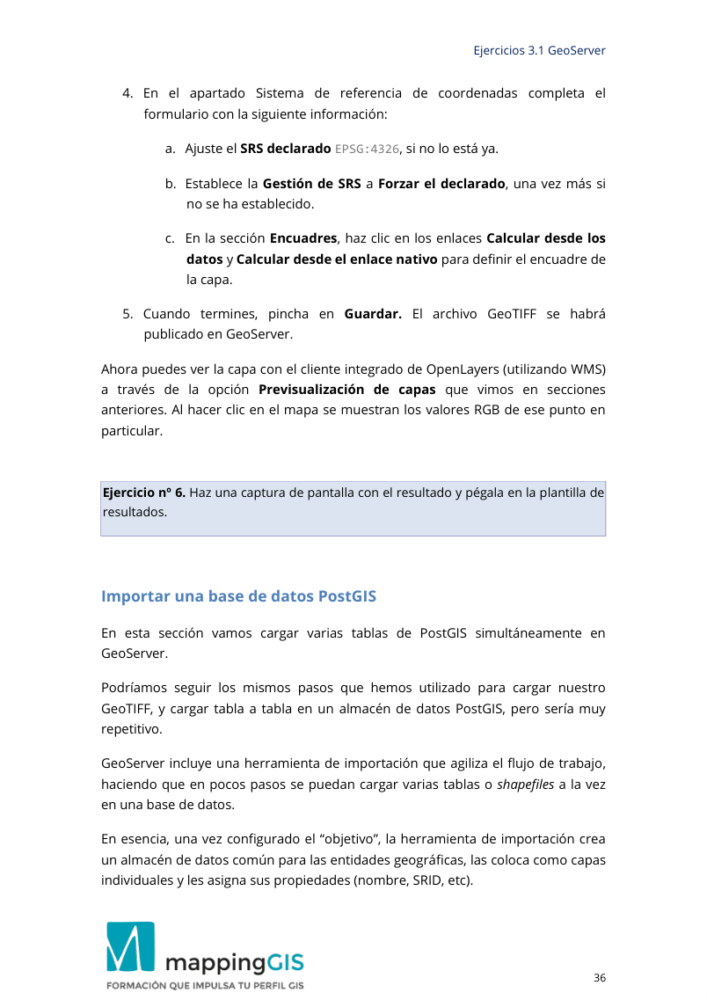</a></details>

[Consultar en el PDF · página 36](../materiales/Ejercicio_3_1_GeoServer_2025-v7.pdf#page=36){target="_blank" rel="noopener noreferrer"}

### Ejercicio 7 · Previsualizar countries

<div class="original-statement"><span class="eyebrow">Enunciado original · GeoServer</span><p>Haz una captura de pantalla con la previsualización de la capa countries.</p></div>

<details class="original-exercise" markdown="1">
<summary>Pasos y contexto originales de la clase</summary>

**Página 36**

```text
Ejercicios 3.1 GeoServer 
                                                                                          36 
4. En el apartado Sistema de referenc ia de coordenadas  completa el 
formulario con la siguiente información: 
a. Ajuste el SRS declarado EPSG:4326, si no lo está ya. 
b. Establece la Gestión de SRS  a Forzar el declarado , una vez más si 
no se ha establecido. 
c. En la sección Encuadres, haz clic en los enl aces Calcular desde los 
datos y Calcular desde el enlace nativo para definir el encuadre de 
la capa. 
5. Cuando termines, pincha en Guardar. El archivo GeoTIFF se ha brá 
publicado en GeoServer. 
Ahora puedes ver la capa con el cliente integrado de OpenLayers (ut ilizando WMS) 
a través de la opción Previsualización de capas  que vimos en secciones 
anteriores. Al hacer clic en el mapa se muestran los valores RGB de ese punto en 
particular. 
 
Ejercicio nº 6. Haz una captura de pantalla con el resultado y pégala en la p lantilla de 
resultados. 
 
Importar una base de datos PostGIS 
En esta sección vamos cargar varias tablas de PostGIS simultáneamente en 
GeoServer. 
Podríamos seguir los mismos pasos que hemos utilizado para cargar nuestro 
GeoTIFF, y cargar tabla a tabla en un  almacén de datos PostGIS, pero sería muy 
repetitivo. 
GeoServer incluye una herramienta de importación que agiliza el flujo de trabajo , 
haciendo que en pocos pasos se puedan cargar varias tablas o shapefiles a la vez 
en una base de datos. 
En esencia, una v ez configurado el “objetivo”, la herramienta de importación crea 
un almacén de datos común para las entidades geográficas, las coloca como capas 
individuales y les asigna sus propiedades (nombre, SRID, etc).
```

**Página 37**

```text
Ejercicios 3.1 GeoServer 
                                                                                          37 
Desde la página de administración de GeoServer, haz clic en el enlace  Almacenes 
de Datos en el lado izquierdo, debajo de Datos. 
 
1. Haz clic en Agregar nuevo almacén. 
2.  Selecciona PostGIS para seleccionar tablas espaciale s de PostGIS como 
tipo de datos bajo la sección Orígenes de datos vectoriales. 
 
3. Rellena el formulario. Muchos campos se dejarán con los valores por 
defecto. 
 Nombre del origen de datos: world 
 Host: localhost 
 Port: 5432 
 Database: world 
 Username: postgres 
 Password: postgres
```

**Página 38**

```text
Ejercicios 3.1 GeoServer 
                                                                                          38 
 
El resto de opciones las dejaremos como vienen por defecto. 
4. Haz clic en Guardar cuando lo tengas todo. 
5. Esta pantalla te pedirá que selecciones las capas que deseas importar de 
toda la lista de recursos que existan en el almacén de datos. 
 
6. Haz clic en la capa cities > Publicación.
```

**Página 39**

```text
Ejercicios 3.1 GeoServer 
                                                                                          39 
 
7. En la página siguiente, en el apartado Encuadres > clic en “Calcular desde 
los datos” y “calcular desde el encuadre nativo”. 
8. Ve a la parte final y haz clic en Guardar. 
9. Cuando el proceso se completa, puedes previsualizar la capa. 
10. Para importar las siguientes capas debemos ir al apartado Capas: 
 
11. Agregar nueva capa: 
 
12. Agregar capa de earth:world. 
 
13. Publica ahora las capas countries, lugares y rivers sin olvidar te de 
calcular los encuadres desde los datos y desde el encuadre nativo.
```

**Página 40**

```text
Ejercicios 3.1 GeoServer 
                                                                                          40 
 
Al finalizar deberías tener las cuatro capas en el apartado Capas: 
 
Listo. Nuestros datos de PostGIS ya han sido publicados en GeoServer. 
En una serie consolidada de pasos, se ha declarado un almacén e importado y 
publicado varias capas en GeoServer. 
Como paso final, vamos a previsualizar algo de lo que hemos hecho. 
1. En la lista de capas, una de ellas es countries. 
2. Haz clic en el enlace OpenLayers situado a la derecha de la capa. 
3. Una nueva pestaña se abre en el navegador para mostrar la capa dentro de 
la aplicación OpenLayers. 
 
Ejercicio nº 7. Haz una captura de pantalla con la previsualización de la capa countries.
```

</details>

<details class="source-page"><summary>Ver página 40 del PDF original, con sus capturas</summary><a href="../../materiales/Ejercicio_3_1_GeoServer_2025-v7.pdf#page=40" target="_blank" rel="noopener">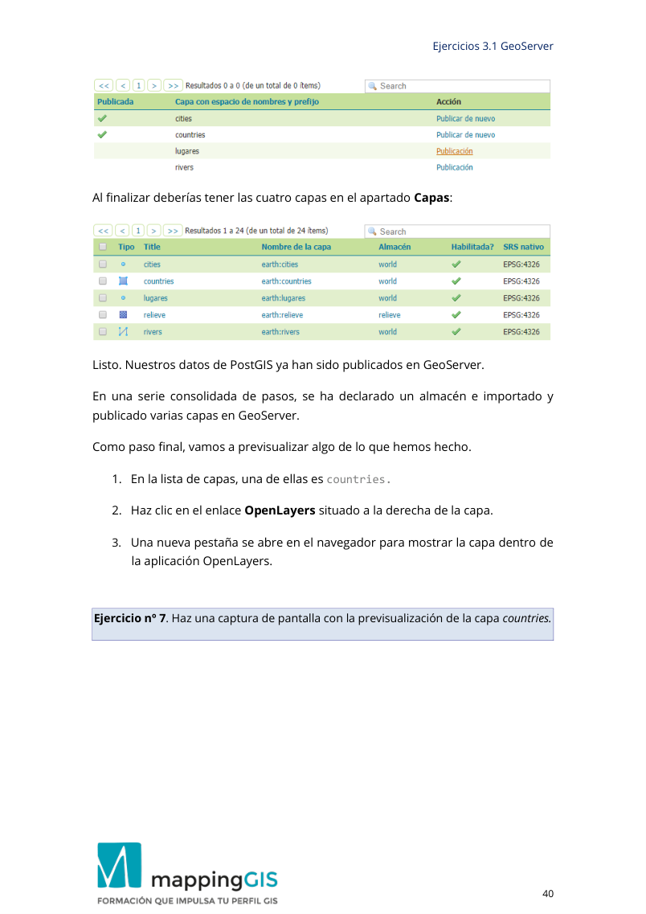</a></details>

[Consultar en el PDF · página 40](../materiales/Ejercicio_3_1_GeoServer_2025-v7.pdf#page=40){target="_blank" rel="noopener noreferrer"}

### Ejercicio 8 · Imagen de ciudades

<div class="original-statement"><span class="eyebrow">Enunciado original · GeoServer</span><p>Haz una captura de pantalla con la imagen de mapa de la capa de ciudades.</p></div>

<details class="original-exercise" markdown="1">
<summary>Pasos y contexto originales de la clase</summary>

**Página 40**

```text
Ejercicios 3.1 GeoServer 
                                                                                          40 
 
Al finalizar deberías tener las cuatro capas en el apartado Capas: 
 
Listo. Nuestros datos de PostGIS ya han sido publicados en GeoServer. 
En una serie consolidada de pasos, se ha declarado un almacén e importado y 
publicado varias capas en GeoServer. 
Como paso final, vamos a previsualizar algo de lo que hemos hecho. 
1. En la lista de capas, una de ellas es countries. 
2. Haz clic en el enlace OpenLayers situado a la derecha de la capa. 
3. Una nueva pestaña se abre en el navegador para mostrar la capa dentro de 
la aplicación OpenLayers. 
 
Ejercicio nº 7. Haz una captura de pantalla con la previsualización de la capa countries.
```

**Página 41**

```text
Ejercicios 3.1 GeoServer 
                                                                                          41 
Protocolos OGC – WMS, WFS, WCS y WPS 
La petición WMS GetMap 
Vamos a ver en el navegador la capa de ciudades, para mostrar la capa 
necesitamos realizar una petición GetMap: 
http://localhost:8080/geoserver/wms? 
SERVICE=WMS& 
VERSION=1.3.0& 
REQUEST=GetMap& 
BBOX=-180,-90,180,90& 
WIDTH=1000& 
HEIGHT=500& 
LAYERS=cities 
&FORMAT=image/png 
 
El navegador te devolverá un mapa con la capa de ciudades. Al escribir la 
sentencia en el navegador t en la precaución de eliminar todos los espacios (si los 
hubiese) después de &. 
 
 
 
Ejercicio nº 8. Haz una captura de pantalla con la imagen de mapa de la capa de 
ciudades.
```

</details>

<details class="source-page"><summary>Ver página 41 del PDF original, con sus capturas</summary><a href="../../materiales/Ejercicio_3_1_GeoServer_2025-v7.pdf#page=41" target="_blank" rel="noopener">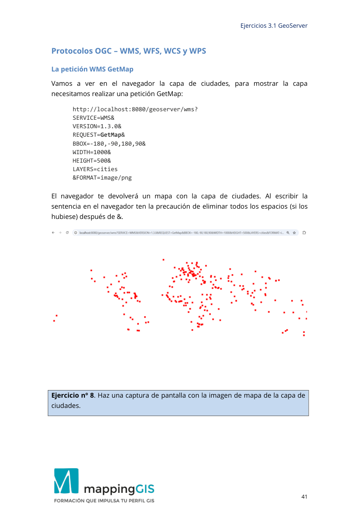</a></details>

[Consultar en el PDF · página 41](../materiales/Ejercicio_3_1_GeoServer_2025-v7.pdf#page=41){target="_blank" rel="noopener noreferrer"}

### Ejercicio 9 · Respuesta WFS

<div class="original-statement"><span class="eyebrow">Enunciado original · GeoServer</span><p>Haz una captura de pantalla del archivo xml generado al publicar el servicio WFS.</p></div>

<details class="original-exercise" markdown="1">
<summary>Pasos y contexto originales de la clase</summary>

**Página 41**

```text
Ejercicios 3.1 GeoServer 
                                                                                          41 
Protocolos OGC – WMS, WFS, WCS y WPS 
La petición WMS GetMap 
Vamos a ver en el navegador la capa de ciudades, para mostrar la capa 
necesitamos realizar una petición GetMap: 
http://localhost:8080/geoserver/wms? 
SERVICE=WMS& 
VERSION=1.3.0& 
REQUEST=GetMap& 
BBOX=-180,-90,180,90& 
WIDTH=1000& 
HEIGHT=500& 
LAYERS=cities 
&FORMAT=image/png 
 
El navegador te devolverá un mapa con la capa de ciudades. Al escribir la 
sentencia en el navegador t en la precaución de eliminar todos los espacios (si los 
hubiese) después de &. 
 
 
 
Ejercicio nº 8. Haz una captura de pantalla con la imagen de mapa de la capa de 
ciudades.
```

**Página 42**

```text
Ejercicios 3.1 GeoServer 
                                                                                          42 
 
La petición WFS GetFeature 
El siguiente código muestr a un ejemplo de una solicitud WFS  para ver las 
características de la República Democrática del Congo (id 34) 
http://localhost:8080/geoserver/wfs? 
SERVICE=wfs& 
VERSION=1.1.0& 
REQUEST=GetFeature& 
TYPENAME=earth:countries& 
FEATUREID=countries.34 
 
La respuesta contiene las coordenadas de cada vértice para el elemento en 
cuestión, junto con los atributos asociados a ese elemento. 
Podemos descargar estas geometrías indicando como formato de salida shape-
zip: 
http://localhost:8080/geoserver/earth/wfs? 
service=wfs& 
version=2.0.0& 
request=getfeature& 
typeName=earth:cities& 
outputFormat=shape-zip 
 
La petición WFS GetCapabilities 
Si introduces esta url en tu navegador: 
http://localhost:8080/geoserver/earth/wfs? 
service=wfs& 
request=getcapabilities  
El navegador te devolverá un xml que nos describe el servicio WFS. Por ahora es 
suficiente para ver que el s ervicio WFS está publicado. Lo utilizaremos más tarde 
en la sección de ejercicios de OpenLayers. 
 
Ejercicio nº 9. Haz una captura de pantalla del archivo xml generado al publicar el 
servicio WFS.
```

</details>

<details class="source-page"><summary>Ver página 42 del PDF original, con sus capturas</summary><a href="../../materiales/Ejercicio_3_1_GeoServer_2025-v7.pdf#page=42" target="_blank" rel="noopener">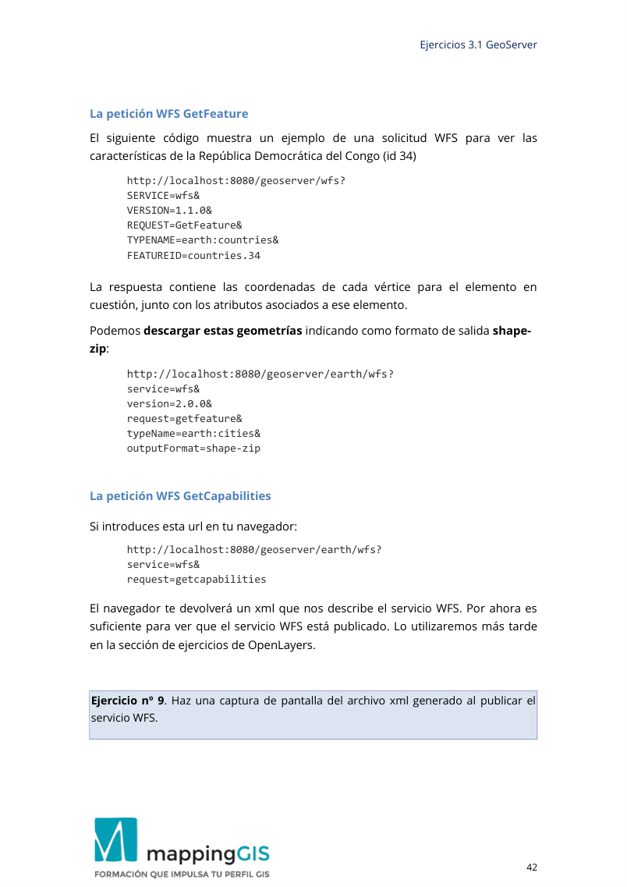</a></details>

[Consultar en el PDF · página 42](../materiales/Ejercicio_3_1_GeoServer_2025-v7.pdf#page=42){target="_blank" rel="noopener noreferrer"}

### Ejercicio 10 · WMS de cities y countries

<div class="original-statement"><span class="eyebrow">Enunciado original · GeoServer</span><p>Haz una captura de pantalla de las capas cities y countries añadidas como WMS en QGIS.</p></div>

<details class="original-exercise" markdown="1">
<summary>Pasos y contexto originales de la clase</summary>

**Página 42**

```text
Ejercicios 3.1 GeoServer 
                                                                                          42 
 
La petición WFS GetFeature 
El siguiente código muestr a un ejemplo de una solicitud WFS  para ver las 
características de la República Democrática del Congo (id 34) 
http://localhost:8080/geoserver/wfs? 
SERVICE=wfs& 
VERSION=1.1.0& 
REQUEST=GetFeature& 
TYPENAME=earth:countries& 
FEATUREID=countries.34 
 
La respuesta contiene las coordenadas de cada vértice para el elemento en 
cuestión, junto con los atributos asociados a ese elemento. 
Podemos descargar estas geometrías indicando como formato de salida shape-
zip: 
http://localhost:8080/geoserver/earth/wfs? 
service=wfs& 
version=2.0.0& 
request=getfeature& 
typeName=earth:cities& 
outputFormat=shape-zip 
 
La petición WFS GetCapabilities 
Si introduces esta url en tu navegador: 
http://localhost:8080/geoserver/earth/wfs? 
service=wfs& 
request=getcapabilities  
El navegador te devolverá un xml que nos describe el servicio WFS. Por ahora es 
suficiente para ver que el s ervicio WFS está publicado. Lo utilizaremos más tarde 
en la sección de ejercicios de OpenLayers. 
 
Ejercicio nº 9. Haz una captura de pantalla del archivo xml generado al publicar el 
servicio WFS.
```

**Página 43**

```text
Ejercicios 3.1 GeoServer 
                                                                                          43 
Visualización de nuestros servicios WMS y WFS en un cliente SIG 
 
Visualiza nuestras capas cities y countries como servicios WMS en QGIS. B asta con 
escribir: http://localhost:8080/geoserver/wms? 
 
 
 
 
Ejercicio nº 10 . Haz una captura de pantalla de las capas cities y countries 
añadidas como WMS en QGIS. 
 
 
Visualiza la capa cities como WFS en un cliente SIG con: 
 
http://localhost:8080/geoserver/wfs? 
 
Visualización de nuestro servicio WCS en un cliente SIG 
 
Para realizar la conexión y correcta visualización, en primer lugar, debemos ir al 
apartado Datos > Capas > Nombre de la capa earth:relieve y asegurarse de que 
las casillas "Habilitado" y “Anunciado” estén marcadas: 
 
 
 
Ejercicio nº 1 1. Haz una captura de pantalla de la capa  cities añadida como WFS 
en QGIS.
```

</details>

<details class="source-page"><summary>Ver página 43 del PDF original, con sus capturas</summary><a href="../../materiales/Ejercicio_3_1_GeoServer_2025-v7.pdf#page=43" target="_blank" rel="noopener">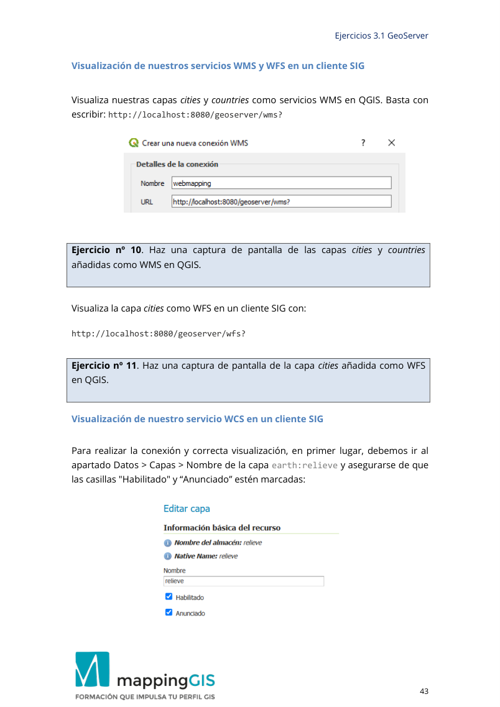</a></details>

[Consultar en el PDF · página 43](../materiales/Ejercicio_3_1_GeoServer_2025-v7.pdf#page=43){target="_blank" rel="noopener noreferrer"}

### Ejercicio 11 · WFS de cities

<div class="original-statement"><span class="eyebrow">Enunciado original · GeoServer</span><p>Haz una captura de pantalla de la capa cities añadida como WFS en QGIS.</p></div>

<details class="original-exercise" markdown="1">
<summary>Pasos y contexto originales de la clase</summary>

**Página 43**

```text
Ejercicios 3.1 GeoServer 
                                                                                          43 
Visualización de nuestros servicios WMS y WFS en un cliente SIG 
 
Visualiza nuestras capas cities y countries como servicios WMS en QGIS. B asta con 
escribir: http://localhost:8080/geoserver/wms? 
 
 
 
 
Ejercicio nº 10 . Haz una captura de pantalla de las capas cities y countries 
añadidas como WMS en QGIS. 
 
 
Visualiza la capa cities como WFS en un cliente SIG con: 
 
http://localhost:8080/geoserver/wfs? 
 
Visualización de nuestro servicio WCS en un cliente SIG 
 
Para realizar la conexión y correcta visualización, en primer lugar, debemos ir al 
apartado Datos > Capas > Nombre de la capa earth:relieve y asegurarse de que 
las casillas "Habilitado" y “Anunciado” estén marcadas: 
 
 
 
Ejercicio nº 1 1. Haz una captura de pantalla de la capa  cities añadida como WFS 
en QGIS.
```

</details>

<details class="source-page"><summary>Ver página 43 del PDF original, con sus capturas</summary><a href="../../materiales/Ejercicio_3_1_GeoServer_2025-v7.pdf#page=43" target="_blank" rel="noopener"></a></details>

[Consultar en el PDF · página 43](../materiales/Ejercicio_3_1_GeoServer_2025-v7.pdf#page=43){target="_blank" rel="noopener noreferrer"}

### Ejercicio 12 · WCS de relieve

<div class="original-statement"><span class="eyebrow">Enunciado original · GeoServer</span><p>Haz una captura de pantalla de la c apa relieve como WCS en QGIS.</p></div>

<details class="original-exercise" markdown="1">
<summary>Pasos y contexto originales de la clase</summary>

**Página 43**

```text
Ejercicios 3.1 GeoServer 
                                                                                          43 
Visualización de nuestros servicios WMS y WFS en un cliente SIG 
 
Visualiza nuestras capas cities y countries como servicios WMS en QGIS. B asta con 
escribir: http://localhost:8080/geoserver/wms? 
 
 
 
 
Ejercicio nº 10 . Haz una captura de pantalla de las capas cities y countries 
añadidas como WMS en QGIS. 
 
 
Visualiza la capa cities como WFS en un cliente SIG con: 
 
http://localhost:8080/geoserver/wfs? 
 
Visualización de nuestro servicio WCS en un cliente SIG 
 
Para realizar la conexión y correcta visualización, en primer lugar, debemos ir al 
apartado Datos > Capas > Nombre de la capa earth:relieve y asegurarse de que 
las casillas "Habilitado" y “Anunciado” estén marcadas: 
 
 
 
Ejercicio nº 1 1. Haz una captura de pantalla de la capa  cities añadida como WFS 
en QGIS.
```

**Página 44**

```text
Ejercicios 3.1 GeoServer 
                                                                                          44 
Visualiza nuestra capa relieve como WCS en un cliente SIG con: 
 
http://localhost:8080/geoserver/wcs? 
 
 
Servicio de Procesamiento Web (WPS) 
El Servicio de Procesamiento Web (WPS) es un servicio para la publicación de 
procesos geoespaciales, algoritmos y cálculos. 
WPS amplía el servidor de mapas web para proporcionar análisis geoespacial. WPS 
en GeoServer permite una integración directa con otros servicios de GeoServer y el 
catálogo de datos. Esto significa que es posible crear procesos sobre la base de 
datos servidas en GeoServer, incluyendo los resultados de un proceso que se 
almacenan como una nueva capa. De esta mane ra, WPS actúa como un completo 
navegador basado en las herramientas de análisis geoespacial, capaz de leer y 
escribir datos desde y hacia GeoServer. 
El Servicio de Procesamiento Web  es un complemento de GeoServer que hemos 
instalado al comienzo de la unidad. 
El complemento WPS proporciona una colección de decenas de procesos estándar 
y además dispone de la capacidad de agregar otros procesos adicionales.  
Vamos a realizar una petición para construir un geoproceso en el servidor. 
1. Para comenzar ve a la sección inferior izquierda Demos: 
 
Ejercicio nº 1 2. Haz una captura de pantalla de la c apa relieve como WCS en 
QGIS.  
 
En caso de que no se muestre la capa puedes realizar una petición 
DescribeCoverage desde el navegador:  
 
http://localhost:8080/geoserver/wcs?REQUEST=DescribeCoverage& 
SERVICE=WCS&VERSION=1.0.0&COVERAGE=relieve
```

</details>

<details class="source-page"><summary>Ver página 44 del PDF original, con sus capturas</summary><a href="../../materiales/Ejercicio_3_1_GeoServer_2025-v7.pdf#page=44" target="_blank" rel="noopener">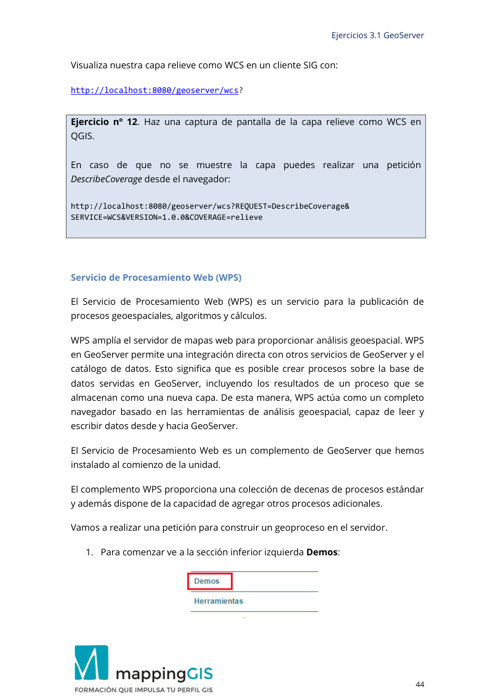</a></details>

[Consultar en el PDF · página 44](../materiales/Ejercicio_3_1_GeoServer_2025-v7.pdf#page=44){target="_blank" rel="noopener noreferrer"}

### Ejercicio 13 · Resultado del proceso

<div class="original-statement"><span class="eyebrow">Enunciado original · GeoServer</span><p>Haz una captura de pantalla con la visualización de la nueva capa generada utilizando un cliente SIG, añade también la ca pa countries para comprobar el resultado.</p></div>

<details class="original-exercise" markdown="1">
<summary>Pasos y contexto originales de la clase</summary>

**Página 44**

```text
Ejercicios 3.1 GeoServer 
                                                                                          44 
Visualiza nuestra capa relieve como WCS en un cliente SIG con: 
 
http://localhost:8080/geoserver/wcs? 
 
 
Servicio de Procesamiento Web (WPS) 
El Servicio de Procesamiento Web (WPS) es un servicio para la publicación de 
procesos geoespaciales, algoritmos y cálculos. 
WPS amplía el servidor de mapas web para proporcionar análisis geoespacial. WPS 
en GeoServer permite una integración directa con otros servicios de GeoServer y el 
catálogo de datos. Esto significa que es posible crear procesos sobre la base de 
datos servidas en GeoServer, incluyendo los resultados de un proceso que se 
almacenan como una nueva capa. De esta mane ra, WPS actúa como un completo 
navegador basado en las herramientas de análisis geoespacial, capaz de leer y 
escribir datos desde y hacia GeoServer. 
El Servicio de Procesamiento Web  es un complemento de GeoServer que hemos 
instalado al comienzo de la unidad. 
El complemento WPS proporciona una colección de decenas de procesos estándar 
y además dispone de la capacidad de agregar otros procesos adicionales.  
Vamos a realizar una petición para construir un geoproceso en el servidor. 
1. Para comenzar ve a la sección inferior izquierda Demos: 
 
Ejercicio nº 1 2. Haz una captura de pantalla de la c apa relieve como WCS en 
QGIS.  
 
En caso de que no se muestre la capa puedes realizar una petición 
DescribeCoverage desde el navegador:  
 
http://localhost:8080/geoserver/wcs?REQUEST=DescribeCoverage& 
SERVICE=WCS&VERSION=1.0.0&COVERAGE=relieve
```

**Página 45**

```text
Ejercicios 3.1 GeoServer 
                                                                                          45 
2. Selecciona la última opción: Generador de consultas WPS  Generador de 
consultas WPS paso a paso. 
 
 
Nota 
En el caso de que no aparezca esta opción, debes realizar de nuevo la copia 
de archivos .jar al directorio de GeoServer. 
3. A continuación, aparecerá un listado con todos los procesos disponibles en 
GeoServer.  
 
Los procesos se dividen en tres categorías: vector, ráster y geometría, haciendo 
referencia al tipo de contenido geoespacial utilizado como entrada del proceso. 
Estas categorías son amplias, ya que los procesos pueden tomar múltiples 
tipos de entrada. 
4. Busca el geoproceso vectorial vec:Centroid.
```

**Página 46**

```text
Ejercicios 3.1 GeoServer 
                                                                                          46 
 
Este es un proceso sencillo que calcula el centro  geométrico de los elementos 
de una capa, como puedes leer en la descripción. 
5. Como Entrada para el proceso  seleccionamos una capa vectorial 
(VECTOR_LAYER) y escogemos c omo capa de entrada la capa de pa íses 
(earth:countries). 
6. Como Salidas del proceso, vamos a escoger la opción application/zip para 
generar un archivo comprimido con la nueva capa de puntos.  
7. No es necesario autenticarnos porque el servicio no está restringido aun, 
pero cuando lo esté deberemos introducir aquí el nombre de usuario con 
permisos para realizar geoprocesamiento.
```

**Página 47**

```text
Ejercicios 3.1 GeoServer 
                                                                                          47 
 
8. Cuando estés listo pincha  en el botón Ejecute el proceso. Al cabo de unos 
segundos se descargará una nueva capa en un archivo comprimido ZIP. 
 
Ejercicio nº 13. Haz una captura de pantalla con la visualización de la nueva capa 
generada utilizando un cliente SIG, añade también la ca pa countries para 
comprobar el resultado.
```

</details>

<details class="source-page"><summary>Ver página 47 del PDF original, con sus capturas</summary><a href="../../materiales/Ejercicio_3_1_GeoServer_2025-v7.pdf#page=47" target="_blank" rel="noopener">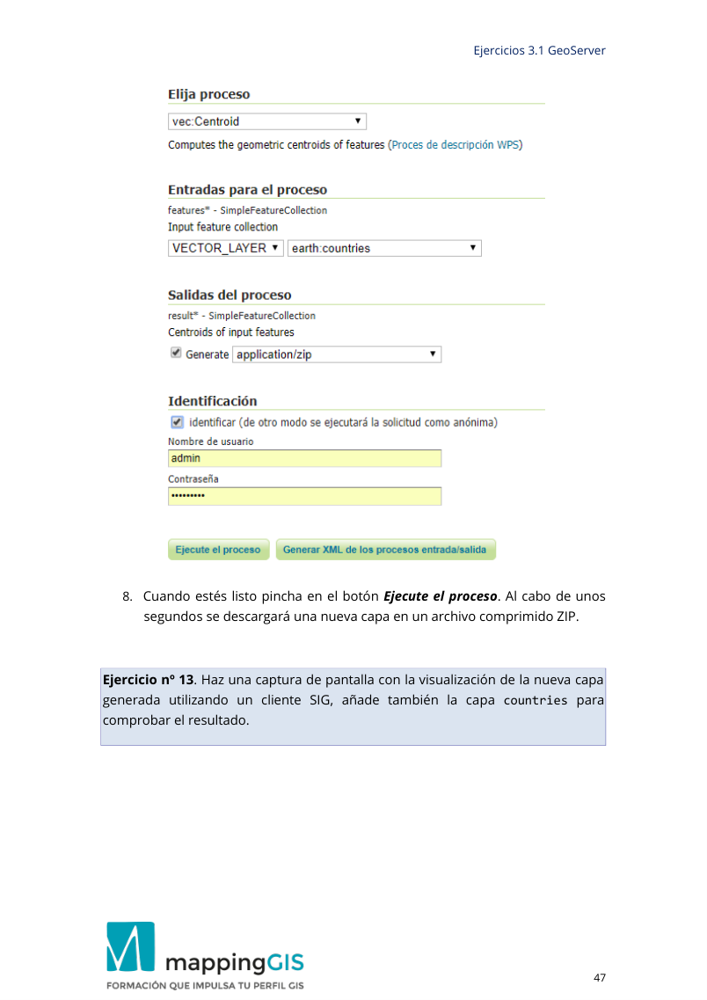</a></details>

[Consultar en el PDF · página 47](../materiales/Ejercicio_3_1_GeoServer_2025-v7.pdf#page=47){target="_blank" rel="noopener noreferrer"}

### Ejercicio 14 · Grupo worldgroup

<div class="original-statement"><span class="eyebrow">Enunciado original · GeoServer</span><p>Previsualiza la capa worldgroup. H az una captura de pantalla y pégala en la plantilla de resultados.</p></div>

<details class="original-exercise" markdown="1">
<summary>Pasos y contexto originales de la clase</summary>

**Página 47**

```text
Ejercicios 3.1 GeoServer 
                                                                                          47 
 
8. Cuando estés listo pincha  en el botón Ejecute el proceso. Al cabo de unos 
segundos se descargará una nueva capa en un archivo comprimido ZIP. 
 
Ejercicio nº 13. Haz una captura de pantalla con la visualización de la nueva capa 
generada utilizando un cliente SIG, añade también la ca pa countries para 
comprobar el resultado.
```

**Página 48**

```text
Ejercicios 3.1 GeoServer 
                                                                                          48 
Otros Formatos de datos soportados 
Sólo hemos trabajado con dos de los formatos de datos que soporta GeoServer. 
Veamos otros almacenes de datos que se pueden publicar a través de GeoServer: 
 
 
Esta lista no es exhaustiva. Cada cierto tiempo se desarrollan nuevas conexiones 
del almacén de datos. Los principales proveedores de bases de datos espaciales 
(Microsoft SQL Server, Oracle, ArcSDE, etc) son soportados por GeoServer. 
Es interesante el uso de un WMS en cascada , ya que podremos servir desde 
nuestro servidor un WMS externo,  gestionándolo como si estuviera en local. Pero  
con la limitación principal de que no será posible modificar su estilo. 
El utilizar las diferentes fuentes de datos no presenta dificultades, pues es el 
proceso es el mismo que hemos visto en los ejercicios anteriores. Con el fin de 
afianzar los conocimientos vamos a cargar una capa en formato Geopackage, 
creando un nuevo espacio de trabajo.
```

**Página 49**

```text
Ejercicios 3.1 GeoServer 
                                                                                          49 
Carga de datos desde un archivo Geopackage 
 
Trabajaremos en un nuevo espacio de trabajo llamado hotdogs_proyect. 
1. El primer paso será crear un nuevo espacio de trabajo: 
 
Y en la ventana que se abre escribimos el nombre y la URI. 
 
2. El segundo paso será importar una  capa de tipo GeoPackage al directorio 
privado. En la sección Almacen es de datos > Agregar nuevo almacén. Elige 
como fuente datos GeoPackage - GeoPackage
```

**Página 50**

```text
Ejercicios 3.1 GeoServer 
                                                                                          50 
 
3. En Espacio de trabajo selecciona el espacio de trabajo hotdogs_proyect. 
4. Como nombre del origen de datos escribimos hotdogs. 
5. Vamos a importar la capa hotdogs que se encue ntra en  
<webmapping>\Capas\hotdogs.gpkg. Escribe en la casilla: 
file://C:\webmapping\Capas\hotdogs.gpkg 
 
6. Clic en el botón Guardar.
```

**Página 51**

```text
Ejercicios 3.1 GeoServer 
                                                                                          51 
7. En la página siguiente clic en Publicación. 
 
8. Como recordarás de ejercicios anteriores debemos calcular los Encuadres 
(Bounding Box). 
9. Una vez calculados guarda los cambios. 
10. Vamos ahora a previsualizar la capa con OpenLayers. 
 
Creación de un grupo de capas 
Un grupo de capas es un contenedor en el que las capas y otros grupos pueden 
ser organizados en una estructura jerárquica.  
Un grupo de capas puede ser referido por un nombre, esto permite peticiones 
WMS más simples, al necesitar hacer referencia a una sola capa en lugar d e 
múltiples capas individuales. 
Un grupo de capas contiene información sobre las capas que componen el grupo 
de capas, el orden en que éstas se visualizan, la proyección, los estilos asociados, 
etc 
Los grupos de capas también nos permiten combinar datos de distinta geometría 
y contenido.
```

**Página 52**

```text
Ejercicios 3.1 GeoServer 
                                                                                          52 
En la sección anterior cargamos varias capas de PostGIS. Ahora vamos a utilizar un 
grupo de capas para combinarlas en una única capa “virtual”. 
1. Desde la página de administración de Geoserver haz clic en el enlace 
Grupos de capas, debajo del apartado Datos. 
 
2. Haz clic en Agregar nuevo grupo de capas  en la parte superior de la 
página. 
3. Introduce worldgroup en los campos Nombre y Título.  
4. No selecciones ningún espacio de trabajo. 
5. Ahora vamos a añadir capas a nuestro grupo de capas. (Obviaremos el 
apartado Límites y otros campos del formulario por ahora). Clic en el enlace 
Agregar capa. 
 
6. Selecciona cada una de las siguientes capas de modo que aparezcan en 
este orden: 
 earth:relieve 
 earth:countries 
 earth:cities 
 earth:rivers
```

**Página 53**

```text
Ejercicios 3.1 GeoServer 
                                                                                          53 
El orden de las capas en la definición de grupo es importante. 
La capa superior de la list a se dibujará en p rimer lugar, la de más abajo será 
la última. Asegúrate de que el orden coincide con el listado de arriba. 
Reordena las capas si es necesario haciendo clic en las flechas de posición para 
cada capa. 
7. Marca la casilla de Estilo por defecto para las cuatro capas. 
8. Ahora, haz clic en el botón Generar límites para determinar el encuadre 
para todo el grupo de capas. Este botón también determinará la proyección 
del grupo de capas, que por defecto es igual a la proyección de la capa 
superior. Si la proyección no se e ncuentra de forma automática, escribe 
EPSG: 4326. 
 
9. Haz clic en Guardar cuando hayas terminado. 
 
Ejercicio nº 14. Previsualiza la capa  worldgroup. H az una captura de pantalla y 
pégala en la plantilla de resultados.
```

</details>

<details class="source-page"><summary>Ver página 53 del PDF original, con sus capturas</summary><a href="../../materiales/Ejercicio_3_1_GeoServer_2025-v7.pdf#page=53" target="_blank" rel="noopener">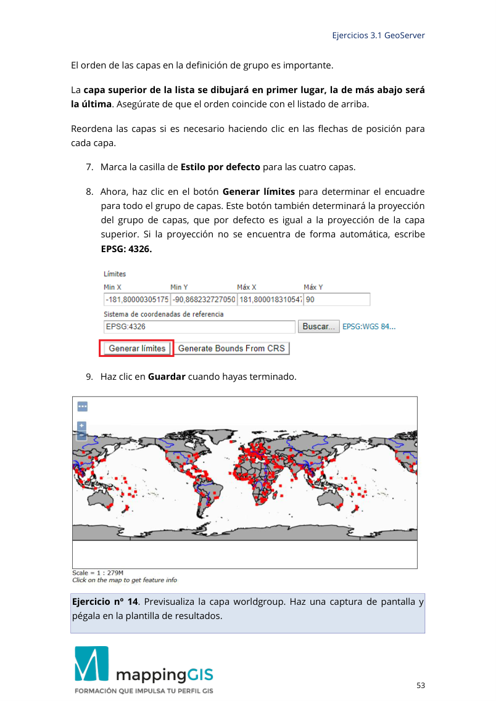</a></details>

[Consultar en el PDF · página 53](../materiales/Ejercicio_3_1_GeoServer_2025-v7.pdf#page=53){target="_blank" rel="noopener noreferrer"}

### Ejercicio 15 · Estilos de las capas

<div class="original-statement"><span class="eyebrow">Enunciado original · GeoServer</span><p>Haz una captura de pantalla de cada una de las capas y pégala en la plantilla de resultados.</p></div>

<details class="original-exercise" markdown="1">
<summary>Pasos y contexto originales de la clase</summary>

**Página 53**

```text
Ejercicios 3.1 GeoServer 
                                                                                          53 
El orden de las capas en la definición de grupo es importante. 
La capa superior de la list a se dibujará en p rimer lugar, la de más abajo será 
la última. Asegúrate de que el orden coincide con el listado de arriba. 
Reordena las capas si es necesario haciendo clic en las flechas de posición para 
cada capa. 
7. Marca la casilla de Estilo por defecto para las cuatro capas. 
8. Ahora, haz clic en el botón Generar límites para determinar el encuadre 
para todo el grupo de capas. Este botón también determinará la proyección 
del grupo de capas, que por defecto es igual a la proyección de la capa 
superior. Si la proyección no se e ncuentra de forma automática, escribe 
EPSG: 4326. 
 
9. Haz clic en Guardar cuando hayas terminado. 
 
Ejercicio nº 14. Previsualiza la capa  worldgroup. H az una captura de pantalla y 
pégala en la plantilla de resultados.
```

**Página 54**

```text
Ejercicios 3.1 GeoServer 
                                                                                          54 
 
Estilos 
Un estilo es una directiva de visualización para la representación de los datos 
geográficos. 
Un estilo contiene las instrucciones básicas sobre color, forma y tamaño, junto con 
reglas avanzadas para la representación de objetos geográficos de forma distinta 
según los atributos y los niveles de zoom. 
Cada capa debe estar asociada con al menos un estilo (GeoServer aplica un estilo 
predeterminado para cada nueva capa). 
GeoServer utiliza el lenguaje de marcado Styled Layer Descriptor  (SLD) para 
describir los datos geoespaciales. SLD es un estándar basado en XML que ha sido 
creado por la OGC. Para más información sobre los esquemas SLD, por favor ve a 
la página de la OGC: 
http://www.opengeospatial.org/standards/sld 
 
Estructura de un SLD 
 
Un archivo SLD contiene la siguiente estructura jerarquizada: 
 Header 
 FeatureTypeStyles 
◦ Rules 
▪ Symbolizers 
 
El header (encabezado) del SLD contiene metadatos sobre los namespaces del XML, 
y es generalmente idéntico en todos los SLD. Los detalles de la cabecera están más 
allá del alcance de este curso. 
Un FeatureTypeStyle es un conjunto de reglas de estilo. La agrupación por 
FeatureTypeStyle afecta al orden de representación, el primer FeatureTypeStyle se 
representará en primer lugar, seguido por el segundo, etc, 
Una Rule (regla) es una directiva única  de estilo. Se puede aplicar globalmente a 
una capa, o puede tener un filtro asociado con ella para que la regla se aplique de
```

**Página 55**

```text
Ejercicios 3.1 GeoServer 
                                                                                          55 
manera condicional. Estas condiciones pueden basarse en los atributos de los 
datos, o sobre el nivel de escala  (zoom) de los datos que se representan. 
Un Symbolizer (simbolizador) es la instrucción de estilo actual. Hay  cinco tipos de 
simbolizadores: 
 PointSymbolizer 
 LineSymbolizer 
 PolygonSymbolizer 
 RasterSymbolizer 
 TextSymbolizer 
 
Puede haber uno o más FeatureTypeStyles SLD, por una o más reglas por 
FeatureTypeStyles, y uno o más Symbolizers por regla. 
La documentación GeoServer (disponible en http://docs.geoserver.org) contiene 
una colección de estilos SLD llamado SLD Cookbook, diseñado para aquellos que 
deseen aprender SLD, o aquellos que quieren una referencia rápida. SLD Cookbook 
está disponible en: 
https://docs.geoserver.org/latest/en/user/styling/sld/cookbook/index.html 
En esta sección, haremos lo siguiente: 
1. Cargar un archivo SLD para nuestras capas, 
2. Echar un vistazo a la sintaxis de un SLD, y 
3. Aplicar dichos estilos a nuestras capas. 
Cargando estilos 
1. En el menú GeoServer, clic en el enlace de Estilos 
 
2. Se abre la lista de todos los estilos actualmente definidos en GeoServer.
```

**Página 56**

```text
Ejercicios 3.1 GeoServer 
                                                                                          56 
3. Busca el estilo point en tu lista. Desplázate u ordena por nombre si es 
necesario. 
4. Pincha en el enlace para abrir el Editor de SLD. 
5. Echa un vistazo a la visualización del SLD. Sin profundizar en los detalles, 
¿qué es lo que vemos? 
 Que es un subconjunto de XML. 
 Hay unas cuantas etiquetas y atributos “estándar”. 
 Por el medio hay algunas instrucciones específicas de simbología. 
6. Es un SLD muy básico que representa un cuadrado de color violeta. 
7. Podríamos comenzar a editar el SLD a mano para cambiar algo de esto, 
pero hay una manera más fácil de hacerlo. 
8. En la parte inferior de la página, haz clic en el botón Seleccionar archivo y 
busca el archivo <webmapping>\Estilos\earth_cities.sld. Selecciónalo y 
pincha en Abrir. 
9. Ahora haz clic en el botón “Cargar…”: 
 
10. Confirma que sí deseas sobre escribir el contenido del estilo actual. 
11. El contenido del editor SLD se sustituye por el contenido del arch ivo SLD 
que contiene unas instrucciones de estilo mucho más elegante que el 
predeterminado.
```

**Página 57**

```text
Ejercicios 3.1 GeoServer 
                                                                                          57 
 
12. Haz clic en el botón Previsualización de leyenda, situado en la parte superior 
derecha de la página, para comprobar que el estilo sea el siguiente: 
 
13.  Clic en Validar, Guardar y  Aplicar  para guardar la subida del SLD en la 
definición de estilo actual. 
 
La definición actualizada se guarda como un archivo de SLD en el equipo local en  
el directorio C:\data_dir\styles 
Repite este proceso para vincular los estilos  
 earth_countries al ya existente polygon. 
 earth_rivers al estilo existente line.  
Los SLD origen están en el directorio <webmapping>\Estilos\.
```

**Página 58**

```text
Ejercicios 3.1 GeoServer 
                                                                                          58 
Previsualiza cada una de las tres capas, asegúrate además que la capa worldgroup 
tiene este nuevo aspecto: 
 
 
Ejercicio nº 15. Haz una captura de pantalla de cada una de las capas y pégala en la 
plantilla de resultados.
```

</details>

<details class="source-page"><summary>Ver página 58 del PDF original, con sus capturas</summary><a href="../../materiales/Ejercicio_3_1_GeoServer_2025-v7.pdf#page=58" target="_blank" rel="noopener">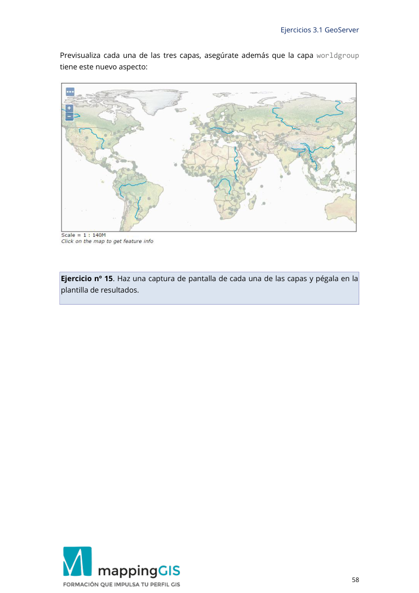</a></details>

[Consultar en el PDF · página 58](../materiales/Ejercicio_3_1_GeoServer_2025-v7.pdf#page=58){target="_blank" rel="noopener noreferrer"}

### Ejercicio 16 · Nueva simbología

<div class="original-statement"><span class="eyebrow">Enunciado original · GeoServer</span><p>Previsualiza la capa y pega el resultado con la nueva simbología en la plantilla de resultados.</p></div>

<details class="original-exercise" markdown="1">
<summary>Pasos y contexto originales de la clase</summary>

**Página 58**

```text
Ejercicios 3.1 GeoServer 
                                                                                          58 
Previsualiza cada una de las tres capas, asegúrate además que la capa worldgroup 
tiene este nuevo aspecto: 
 
 
Ejercicio nº 15. Haz una captura de pantalla de cada una de las capas y pégala en la 
plantilla de resultados.
```

**Página 59**

```text
Ejercicios 3.1 GeoServer 
                                                                                          59 
Estilos CSS en GeoServer 
 
El módulo CSS para GeoServer añade un editor de estilos 
alternativo a GeoServer que utiliza un lenguaje derivado de CSS e n 
lugar de SLD. Te será muy útil si estás familiarizado con el diseño 
web con CSS. 
Los estilos CSS (Cascading Style Sheets) se convierten internamente en SLD, 
siendo estos últimos los utilizados de forma normal por GeoServer. La sintaxis CSS 
se duplica desde un estilo SVG ( Scalable Vector Graphics) cuando es posible, pero 
extendido para evitar la pérdida de las opciones que ofrece el SLD. Por ejemplo, se 
proporcionan utilida des para extraer los atributos de los objetos geográficos y 
usarlos como etiquetas, el tamaño de los símbolos puntuales de acuerdo a los 
valores de los datos, etc. 
Este complemento ya lo hemos añadido como una extensión de GeoServer. 
Si la instalación se h a realizado correctamente, en el momento de crear un nuevo 
estilo podremos escoger dentro de las opciones el formato CSS:
```

**Página 60**

```text
Ejercicios 3.1 GeoServer 
                                                                                          60 
 
Creando un estilo en una capa de puntos 
El archivo SLD para la capa cities ahora se ve así: 
<?xml version="1.0" encoding="UTF-8"?> 
<sld:UserStyle xmlns="http://www.opengis.net/sld" xmlns:sld="http://www.opengi
s.net/sld" xmlns:ogc="http://www.opengis.net/ogc" xmlns:gml="http://www.opengi
s.net/gml"> 
  <sld:NamedLayer> 
    <sld:Name>earth_cities</sld:Name> 
    <sld:UserStyle> 
      <sld:Name>earth_cities</sld:Name> 
      <sld:Title>earth_cities</sld:Title> 
      <sld:IsDefault>1</sld:IsDefault> 
      <sld:FeatureTypeStyle> 
        <sld:Name>name</sld:Name> 
        <sld:Rule> 
          <sld:Title>earth_cities</sld:Title> 
          <sld:PointSymbolizer> 
            <sld:Graphic> 
              <sld:Mark> 
                <sld:WellKnownName>circle</sld:WellKnownName> 
                <sld:Fill> 
                  <sld:CssParameter name="fill">#B2BBB4</sld:CssParameter> 
                </sld:Fill> 
              </sld:Mark> 
              <sld:Size> 
                <ogc:Literal>8</ogc:Literal> 
              </sld:Size> 
            </sld:Graphic> 
          </sld:PointSymbolizer> 
        </sld:Rule> 
      </sld:FeatureTypeStyle> 
    </sld:UserStyle> 
  </sld:NamedLayer> 
</sld:StyledLayerDescriptor> 
 
   
¡Más de 25 líneas!  Ahora, vamos a escribir en CSS la misma simbología en menos 
de 10 líneas de código. 
En primer lugar, hacemos clic sobre el apartado Estilos, bajo el menú Datos y 
hacemos clic sobre el enlace Agregar un nuevo estilo:
```

**Página 61**

```text
Ejercicios 3.1 GeoServer 
                                                                                          61 
De este modo  iniciamos un nuevo esti lo. En la ventana que se abre l e asignamos 
un nombre (lugares_CSS), un espacio de trabajo (earth) y el formato (CSS). 
En la sección Style Content generamos un estilo por defecto de ti po punto para 
poder partir de un código base que podamos modificar. 
 
Seleccionamos pues en el menú desplegable Point y hacemos clic en Generar… 
 
 
 
El código que se crea por defecto será similar al siguiente: 
/* @title violet point */ 
* { 
    mark: symbol(square); 
    mark-size: 6px; 
    :mark { 
        fill: #3300ff; 
    } 
}
```

**Página 62**

```text
Ejercicios 3.1 GeoServer 
                                                                                          62 
La sintaxis de CSS 
La sintaxis de CSS es distinta de la de HTML. El formato general se ve así: 
selector { 
  propiedad: valor; 
} 
 
Un selector identifica una parte de los datos de est ilo. En este caso, el selector es 
*, lo que indica que todos los datos deben utilizar las propiedades de estilo. 
Las propiedades van dentro de llaves ( {}) y especifican cómo debe ser el estilo de 
los elementos afectados.  Las propiedades consisten en pares de nombre / valor 
separados por dos puntos (:). 
 
Un valor es una posible configuración de una propiedad.  La propiedad fill puede 
tener el valor gris, rojo, azul, negro o cualquier otro color.
```

**Página 63**

```text
Ejercicios 3.1 GeoServer 
                                                                                          63 
Símbolos 
La extensión CSS de GeoServer contiene una colección d e símbolos predefinidos 
que podemos utilizar y combinar para crear marcas simples, trazos y patrones de 
relleno sin necesidad de un programa de edición de imágenes. Podemos acceder a 
estos símbolos a través de la función CSS symbol (). 
 
Por ejemplo, el símbolo del círculo (circle) hace que sea fácil crear un sencillo punto 
sobre una capa de puntos: 
* { 
mark: symbol(circle); 
} 
 
Sin embargo, hay otros símbolos disponibles, como  circle, square, triangle, arrow, 
cross, star… 
 
Selectores de símbolos 
Los Símbolos ofrecen algunas opciones de estilo adicionales. Para especificar estas 
propiedades de estilo, sólo tenemos que añadir otra regla con un selector especial. 
Hay varios selectores “pseudoclases” que se utilizan para selectores de estilo. 
Volviendo a nuestro estilo para la capa lugares (que son puntos) vamos a sustituir 
el color en código hexadecimal por un nombre reconocible, el rojo: 
* { 
 mark: symbol(square); 
 mark-size: 6px; 
 } 
 
:mark { 
 fill: red; 
 } 
 
Hay dos reglas en este CSS, la primera de ellas (línea s 1 -4) es para todos los 
elementos, y les pide que se representen con una marca cuadrada y de 6 píxeles 
de ancho. 
La segunda regla usa el selector de símbolos  :mark, que selecciona todas las 
marcas en las normas anteriores, y permite especificar cómo relle nar el contenido 
del cuadrado, en este caso, con un sólido relleno rojo.
```

**Página 64**

```text
Ejercicios 3.1 GeoServer 
                                                                                          64 
 
Pincha en los botones Validar y Aplicar.  Al hacer clic en el botón Aplicar se genera 
el estilo que nos permite publicarlo para vincularlo a una o varias capas. 
 
Ahora vamos a la segunda pestaña: Publishing para asociar el estilo a nuestra capa 
lugares. 
 
Marcaremos la casilla Default para asociar este estilo por defecto cuando veamos 
la capa lugares: 
 
 
Clic en el botón Aplicar y en Guardar para enviar el estilo en el servidor. 
 
El nuevo estilo ya aparece dentro de nuestro listado de estilos:
```

**Página 65**

```text
Ejercicios 3.1 GeoServer 
                                                                                          65 
 
 
Hacemos clic sobre el estilo para continuar examinando las opciones disponibles. 
 
Ahora vamos a  la tercera pestaña Layer Preview para ver el aspecto de la nueva 
simbología de nuestra capa lugares:
```

**Página 66**

```text
Ejercicios 3.1 GeoServer 
                                                                                          66 
La cuarta pestaña Layer Attributes  nos muestra un listado de los campos que 
contiene la capa: 
 
 
 
Listo. Hemos creado un nuevo estilo mediante código CSS de una forma mucho 
más sencilla que mediante código SLD. 
  
CSS Cookbook 
 
El CSS Cookbook es una colección de recetas CSS para la creación de diversos tipos 
de estilos de mapa. Siempre que sea posible, cada ejemplo está diseñado para 
mostrar un único e lemento CSS para que el código se pueda copiar de los 
ejemplos y adaptarlo en nuestros estilos CSS. La mayoría de los ejemplos también 
existen en el  SLD Cookbook, para hacer una comparación  inmediata entre las dos 
sintaxis. 
Para más información puedes consultar la documentación de GeoServer. 
Filtros en GeoServer 
En esta sección definiremos un nuevo estilo para nuestra capa  cities. Crearemos 
una simbología para la capa de puntos de tal manera que tengamos tres clases: 
 Una clase con una simbología de puntos pequeños para las ciudades de 
menos de un millón de habitantes 
 Otra clase con otra simbología para las ciudades ente 1 millón y 10 millones 
con un punto mediano 
 Una tercera clase con las ciudades de m ás de 10 millones de habitantes, 
representado por un punto mayor.
```

**Página 67**

```text
Ejercicios 3.1 GeoServer 
                                                                                          67 
Crear un filtro en SLD nos llevaría decenas de líneas de código, esta operación es 
mucho más sencilla utilizando CSS. 
1. Ve a la sección Estilos y crea un nuevo estilo.  
2. Ponle como nombre cities_filter 
3. No selecciones ningún espacio de trabajo. 
4. Selecciona el formato CSS.  
 
5. En este estilo incluiremos la configuración de una marca base (círculo azul y 
el tamaño por  defecto) y cambiaremos el tamaño en fun ción del valor del 
atributo de la población, valores pequeños crearán círculos pequeños, y 
valores más grandes crearán círculos más grandes. Comenzamos creando 
una marca de tipo círculo y de color azul: 
* { 
   mark: symbol(circle); 
 } 
 
:mark { 
fill: #0033CC; 
} 
 
6. Valida el estilo y aplícalo. 
 
7. Ve a la pestaña  Publishing para asociarlo a la capa cities, aun que no lo 
estableceremos como estilo por defecto. Solo marcaremos pues la casilla 
“Associated”.
```

**Página 68**

```text
Ejercicios 3.1 GeoServer 
                                                                                          68 
 
 
8. Vamos a la pestaña Layer Preview para ver el aspecto del estilo vinculado a 
la capa cities. 
 
 
 
9. Desde esta pestaña continuaremos editando el estilo mediante código CSS. 
10. Utilizaremos una operación de comparación basado en CQL (Common 
Query Language), basándonos en los atributos y el valor de los atributos de 
la capa . De este modo el filtro pop_max < 1000000  establece la 
representación de las ciudades cuya población es menor a 1000000 
habitantes. Y fijamos un tamaño de 6 pixeles para esta primera regla. 
Añade el siguiente código después del código existente: 
          
[pop_max < 1000000] { 
mark-size: 6; 
} 
 
11. Para la segunda regla utilizaremos los selectores de comparación >= y <:
```

**Página 69**

```text
Ejercicios 3.1 GeoServer 
                                                                                          69 
[pop_max >= 1000000] [pop_max < 10000000] { 
mark-size: 10; 
} 
 
12. La tercera regla puede ser creada de la misma manera que la primera: 
 
[pop_max >= 10000000] { 
mark-size: 14; 
} 
Proporcionando metadatos 
Una característica que aparece en SLD y que también tiene análogo en CSS es la 
capacidad para proporcionar los metadatos de estilos y reglas de estilo.  
Estos metadatos sirven para crear automáticamente bonitas imágenes de leyenda 
desde el estilo. 
Podemos añadir comentarios antes de nuestras reglas incluyendo líneas que 
comiencen con ‘@title‘ y ‘@abstract’. 
/* @title Small cities */ 
 [pop_max < 1000000] {  
 mark-size: 6; } 
 
/* @title Medium cities */ 
 [pop_max >= 1000000] [pop_max < 10000000] { 
 mark-size: 10; } 
 
/* @title Large cities */ 
 [pop_max >= 10000000] { 
 mark-size: 14; 
 } 
13. Poniendo todo junto, ahora debería tener un estilo como este: 
 
 
 
 
 
 
 
 * {
```

**Página 70**

```text
Ejercicios 3.1 GeoServer 
                                                                                          70 
   mark: symbol(circle); 
 } 
 
 :mark { fill: #0033CC; 
 } 
/* @title Small cities */ 
 [pop_max < 1000000] {   
 mark-size: 6; } 
 
/* @title Medium cities */ 
 [pop_max >= 1000000] [pop_max < 10000000] {  
 mark-size: 10; } 
 
/* @title Large cities */ 
 [pop_max >= 10000000] {   
 mark-size: 14; } 
14. Pulsa el botón Enviar en la parte inferior del formulario de CSS para 
guardar los cambios . Cuidado porque esta acción nos “echa” al listado de 
estilos de GeoServer 
15. Accedemos de nue vo al estilo cities_filter y p inchamos en la pest aña Layer 
Preview para comprobar si el estilo se representa correctam ente sobre 
nuestra capa: 
 
16. Finalmente vamos al menú de la izquierda Datos >  Capas, hacemos clic 
sobre la capa cities > pestaña Publicación, y en la opción Estilo por 
defecto aplicamos el estilo que hemos creado: cities_filter.
```

**Página 71**

```text
Ejercicios 3.1 GeoServer 
                                                                                          71 
 
17. No olvides hacer clic en Guardar. 
 
Ejercicio nº 16. Previsualiza la capa y pega el resultado con la nueva simbología en 
la plantilla de resultados.  
 
Estilos basados en escalas 
Podemos modificar el estilo de nuestras capas en diferentes niveles de zoom, para 
ello se utiliza el operador @scale. Por ejemplo: 
* { 
   fill: none; 
} 
 
[@scale < 1000000] { 
   stroke-width: 6; 
 label: [feature_na]; 
 } 
 
 [@scale > 1000000] [@scale < 2000000] { 
   stroke-width: 4; 
} 
 
 [@scale > 2000000] { 
   stroke-width: 2; 
 } 
En el CSS Cookbok encontrarás varios ejemplos, para puntos, líneas y polígonos. 
Crea un nuevo estilo sobre la capa de ciudades que se llame  cities_labels. Utiliza 
para ello el CSS Cookbook. 
 Este estilo debe mostrar las etiquetas que muestren el nombre de las 
ciudades 
 Utiliza como marcador un triángulo.  
Ejercicio nº 17. Haz una captura de pantalla con la simbología cities_labels.
```

</details>

<details class="source-page"><summary>Ver página 71 del PDF original, con sus capturas</summary><a href="../../materiales/Ejercicio_3_1_GeoServer_2025-v7.pdf#page=71" target="_blank" rel="noopener">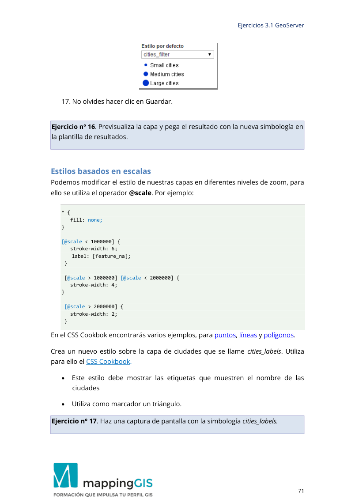</a></details>

[Consultar en el PDF · página 71](../materiales/Ejercicio_3_1_GeoServer_2025-v7.pdf#page=71){target="_blank" rel="noopener noreferrer"}

### Ejercicio 17 · Etiquetas cities_labels

<div class="original-statement"><span class="eyebrow">Enunciado original · GeoServer</span><p>Haz una captura de pantalla con la simbología cities_labels.</p></div>

<details class="original-exercise" markdown="1">
<summary>Pasos y contexto originales de la clase</summary>

**Página 71**

```text
Ejercicios 3.1 GeoServer 
                                                                                          71 
 
17. No olvides hacer clic en Guardar. 
 
Ejercicio nº 16. Previsualiza la capa y pega el resultado con la nueva simbología en 
la plantilla de resultados.  
 
Estilos basados en escalas 
Podemos modificar el estilo de nuestras capas en diferentes niveles de zoom, para 
ello se utiliza el operador @scale. Por ejemplo: 
* { 
   fill: none; 
} 
 
[@scale < 1000000] { 
   stroke-width: 6; 
 label: [feature_na]; 
 } 
 
 [@scale > 1000000] [@scale < 2000000] { 
   stroke-width: 4; 
} 
 
 [@scale > 2000000] { 
   stroke-width: 2; 
 } 
En el CSS Cookbok encontrarás varios ejemplos, para puntos, líneas y polígonos. 
Crea un nuevo estilo sobre la capa de ciudades que se llame  cities_labels. Utiliza 
para ello el CSS Cookbook. 
 Este estilo debe mostrar las etiquetas que muestren el nombre de las 
ciudades 
 Utiliza como marcador un triángulo.  
Ejercicio nº 17. Haz una captura de pantalla con la simbología cities_labels.
```

</details>

<details class="source-page"><summary>Ver página 71 del PDF original, con sus capturas</summary><a href="../../materiales/Ejercicio_3_1_GeoServer_2025-v7.pdf#page=71" target="_blank" rel="noopener"></a></details>

[Consultar en el PDF · página 71](../materiales/Ejercicio_3_1_GeoServer_2025-v7.pdf#page=71){target="_blank" rel="noopener noreferrer"}

### Ejercicio 18 · Activar teselas vectoriales

<div class="original-statement"><span class="eyebrow">Enunciado original · GeoServer</span><p>Haz una captura de pantalla con la casilla marcada. En las siguientes unidades veremos cómo consumir estas teselas vectoriales desde un cliente de mapas web como OpenLayers.</p></div>

<details class="original-exercise" markdown="1">
<summary>Pasos y contexto originales de la clase</summary>

**Página 71**

```text
Ejercicios 3.1 GeoServer 
                                                                                          71 
 
17. No olvides hacer clic en Guardar. 
 
Ejercicio nº 16. Previsualiza la capa y pega el resultado con la nueva simbología en 
la plantilla de resultados.  
 
Estilos basados en escalas 
Podemos modificar el estilo de nuestras capas en diferentes niveles de zoom, para 
ello se utiliza el operador @scale. Por ejemplo: 
* { 
   fill: none; 
} 
 
[@scale < 1000000] { 
   stroke-width: 6; 
 label: [feature_na]; 
 } 
 
 [@scale > 1000000] [@scale < 2000000] { 
   stroke-width: 4; 
} 
 
 [@scale > 2000000] { 
   stroke-width: 2; 
 } 
En el CSS Cookbok encontrarás varios ejemplos, para puntos, líneas y polígonos. 
Crea un nuevo estilo sobre la capa de ciudades que se llame  cities_labels. Utiliza 
para ello el CSS Cookbook. 
 Este estilo debe mostrar las etiquetas que muestren el nombre de las 
ciudades 
 Utiliza como marcador un triángulo.  
Ejercicio nº 17. Haz una captura de pantalla con la simbología cities_labels.
```

**Página 72**

```text
Ejercicios 3.1 GeoServer 
                                                                                          72 
Las teselas vectoriales y su creación con GeoServer 
Una tesela vectorial (vector tiles) contiene datos vectoriales  georreferenciados, 
recortados en teselas para facilitar su recuperación. 
Las teselas vectoriales crean mapas significativamente rápidos y a su vez ofrecen 
una flexibilidad completa en su diseño. 
Son los datos vectoriales equivalentes a las teselas de imagen para el 
webmapping, aplicando las ventajas de las teselas a los da tos vectoriales: 
desarrollados para guardarse en caché, escalabilidad y servir imágenes de mapa 
rápidamente. 
Las teselas vectoriales son un estándar abierto  bajo licencia Creative Commons 
Attribution 3.0 US. 
Al igual que los WFS, ambos devuelven datos vectoriales y sus atributos (sin estilo), 
pero hay diferencias: 
 Los WFS devuelven los datos subyacentes sin modificar. Tienes más detalle 
 Las teselas vectoriales devuelven objetos geográficos modificados (listos 
para representarse), por lo que es más fácil renderizarlos. 
Las ventajas de las teselas vectoriales frente a las teselas de imágenes son las 
siguientes: 
1. Los estilos se renderizan en el navegador del cliente  (por ejemplo, 
OpenLayers), no por el servidor. Esto permite disponer de diferentes mapas 
a partir de una única fuente de datos y no es necesario acceder al servidor. 
2. El tamaño  de una tesela vectorial suele ser menor que una tesela de 
imágenes, lo que resulta en una transferencia de datos más rápida y un 
menor uso de ancho de banda. 
3. GeoWebCache, integr ado con GeoServer, almacena eficientemente los 
datos de teselas vectoriales. GeoWebCache sólo necesita almacenar una 
tesela una sola vez para todos los estilos diferentes. 
4. Debido a que los datos vectoriales están disponibles en el lado del cliente, 
se pueden dibujar mapas de muy alta resolución  sin aumento del ancho 
de banda.
```

**Página 73**

```text
Ejercicios 3.1 GeoServer 
                                                                                          73 
5. El cliente tiene acceso nativo a la información actual del objeto geográfico 
(atributos y geometría), lo que permite un procesamiento muy sofisticado. 
6. Hay más "know-how" en el trabajo con datos vectoriales. 
Por otra parte, no son todo ventajas, también hay desventajas: 
1. Las teselas de imágenes son más fáciles de consumir. 
2. La principal desventaja de las teselas vectoriales es que los datos 
geográficos necesitan ser pre -procesados para p ermitir al cliente 
personalizar la simbología. 
Generación de teselas vectoriales con GeoServer 
Además de las teselas de imagen más estándar, GeoServer admite como formato 
de salida las "teselas vectoriales". Por el momento las teselas vectoriales son un 
formato de salida, no es una fuente de datos. 
Mientras que la salida estándar WMS generará una imagen de mapa 
georreferenciada, una tesela vectorial contiene datos vectoriales 
georreferenciados, recortados en teselas para facilitar su recuperación. 
Si recuerdas, al comienzo de la unidad instalamos la extensión Vector Tiles. 
Para verificar que la extensión se ha instalado correctamente debemos: 
1. Abrir la interfaz de administración Web accediendo normalmente 
a http://localhost:8080/geoserver/ y loguearnos. 
2. En el  menú izquierdo vamos a Datos > Capas y seleccionamos una capa 
vectorial. 
3. Hacemos clic en la pestaña Cacheado de Teselas. 
 
1. Bajamos hasta la sección Cache image formats . Además de los formatos 
estándar GIF / PNG / JPEG, deberemos ver lo siguiente: 
 application/json;type=geojson 
 application/json;type=topojson 
 application/vnd.mapbox-vector-tile
```

**Página 74**

```text
Ejercicios 3.1 GeoServer 
                                                                                          74 
Si no ves estas opciones, la extensión no se ha instalado correctamente, por lo que 
deberás proceder a su instalación nuevamente. 
Formatos de las teselas vectoriales 
GeoServer puede producir teselas vectoriales en tres formatos:  MapBox 
MVT, GeoJSON, TopoJSON. Algunos de los formatos GIS vectoriales más utilizados. 
De los tres, Mapbox MVT es el formato preferido en producción. 
 MapBox V ector (MVT)  - application/vnd.mapbox-vector-tile. Este es el 
formato recomendado. Es un formato binario ámpliamente soportado por 
casi todas las aplicaciones Vector Tiles. 
 GeoJSON - application/json;type=geojson - Se trata de un formato JSON 
legible por humanos. Aunque muchas aplicaciones geoespaciales soportan 
conjuntos de datos GeoJSON, pocas aplicaciones de Vector Tile admiten 
teselas en formato GeoJSON. Soportado por OpenLayers. 
 TopoJSON - application/json;type=topojson - Se trata de un formato JSON 
muy complejo y poco legible para el usuario. Sin embargo , es un buen 
formato para trabajar con coberturas de tipo polígono porque admite 
topología. No tiene un soporte generalizado por lo que muy pocas 
aplicaciones lo admiten. Sí que lo admite OpenLayers. 
Publicación de teselas vectoriales con GeoWebCache 
La creación de teselas vectoriales se realiza a través de GeoWebCache. 
El proceso es tan sencillo como acceder a la interfaz web de GeoServer, hacer  clic 
en Cacheado de Teselas > Capas en caché. 
 
A continuación, debemos seleccionar la capa earth:cities, que es la capa que 
queremos tener disponible en formato de teselas vectoriales y se abrirá la pestaña 
Cacheado de teselas.
```

**Página 75**

```text
Ejercicios 3.1 GeoServer 
                                                                                          75 
Bajamos hasta la sección Cache image formats y marcamos  la casilla para el 
formato: 
 application/vnd.mapbox-vector-tile  
 
Guardamos y tenemos lista la capa en formato Vector Tiles. 
Ejercicio nº18. Haz una captura de pantalla con la casilla marcada. 
En las siguientes unidades veremos cómo consumir estas teselas vectoriales desde 
un cliente de mapas web como OpenLayers.
```

</details>

<details class="source-page"><summary>Ver página 75 del PDF original, con sus capturas</summary><a href="../../materiales/Ejercicio_3_1_GeoServer_2025-v7.pdf#page=75" target="_blank" rel="noopener">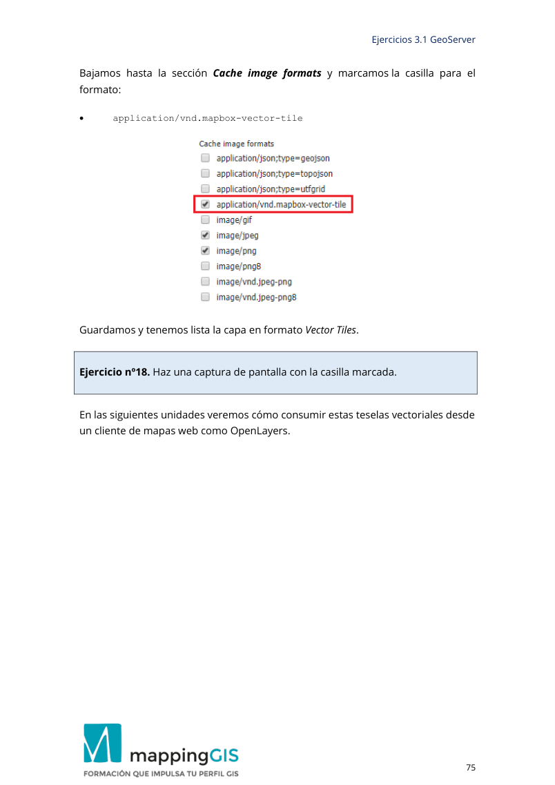</a></details>

[Consultar en el PDF · página 75](../materiales/Ejercicio_3_1_GeoServer_2025-v7.pdf#page=75){target="_blank" rel="noopener noreferrer"}

