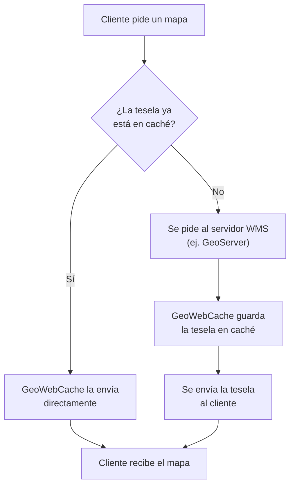

# Unidad 4. El caché de mapas — GeoWebCache

**Antes de leer, mira el esquema.** Esta es la decisión que toma GeoWebCache ante cada petición de tesela:

### Resumen estructurado

**1. ¿Qué es GeoWebCache?**
- **GeoWebCache** es una herramienta que **aumenta el rendimiento** de un WMS mediante un pre-dibujo y almacenamiento de imágenes de mapa, para dar una respuesta más rápida a las solicitudes de los clientes.
- Con el tiempo ha ido creciendo en funcionalidad y se puede considerar un **producto independiente**, aunque en general se utiliza conjuntamente con GeoServer.
- Esquema general: los **clientes** solicitan mapas a **GeoWebCache**, que actúa como intermediario frente a uno o varios **servidores WMS** (ej. GeoServer), sirviendo las imágenes ya generadas cuando es posible.

**Arquitectura típica con GeoWebCache:**
- Interfaz de usuario: Leaflet, OpenLayers, QGIS
- Servidor web: GeoServer ↔ GeoWebCache (GeoWebCache se sitúa entre la interfaz de usuario y GeoServer)
- Base de datos: PostGIS

**Conceptos de almacenamiento en caché (contenidos de la unidad):**

| Concepto | Descripción |
|---|---|
| **Tile Proxying** | Cómo GeoWebCache se integra con el proceso de renderizado de WMS de GeoServer |
| **Generación de teselas** | Cómo GeoWebCache guarda las imágenes de mapa pre-renderizadas |
| **Estrategias de generación de teselas** | Cómo y cuándo configurar las áreas que se almacenan en caché |

**2. ¿Cómo funciona? — Tile proxying**
- GeoWebCache actúa como un **proxy** entre los clientes y uno o varios servidores WMS: se encuentra entre el cliente que solicita la imagen y el servidor que la crea.
- Cuando el cliente (por ejemplo, OpenLayers) hace una solicitud, **GeoWebCache intercepta la petición** y realiza las comprobaciones necesarias para ver si ya tiene la imagen correspondiente:
  1. Si GeoWebCache **tiene** la imagen, se la envía al cliente de inmediato.
  2. Si **no** la tiene, la solicitud se envía al servidor WMS apropiado (por ejemplo, GeoServer). Cuando la respuesta WMS vuelve, GeoWebCache guarda una copia (la cachea) y después la envía al cliente.

**Flujo de trabajo de GeoWebCache:**
1. El cliente pide un mapa.
2. Se busca la imagen en el sistema de almacenamiento en caché.
3. Si la imagen **sí** está almacenada en caché → se envía directamente al cliente.
4. Si la imagen **no** está almacenada en caché → se realiza la petición de la imagen al servidor WMS, se guarda en caché y se envía al cliente.

**3. Ventajas del almacenamiento en caché**
- Una imagen en caché se sirve **más rápido**, y el almacenamiento en caché requiere **menos recursos del servidor WMS**.
- En cambio, una imagen **sin cachear** necesita, cada vez: agrupar los datos, interpretar las instrucciones de estilo, dibujar la imagen y, por último, entregar la imagen.

**4. Generación de teselas (tiles / map tiling)**
- La **generación de teselas** (*map tiling*) describe la forma en que las imágenes son pre-renderizadas y guardadas en la memoria caché.
- Una imagen de mapa **no se almacena "entera"**: se almacena en forma de pequeñas imágenes rectangulares del mismo tamaño (**teselas**), que se combinan para formar mapas más grandes.
- Las teselas de mapas **no se almacenan a una única resolución**: se almacenan en **más de una escala** (niveles de zoom, organizados en una pirámide: Level 1, Level 2, Level 3…), de tal manera que los usuarios pueden ampliar y reducir los niveles de mosaico sin necesidad de remuestrear.

**5. Estrategias de generación de teselas**
Una estrategia en la generación de teselas controla **cuándo se crean las teselas** y **para qué área** (extensión geográfica) se crean. Existen dos estrategias: **Pregeneración** y **Bajo demanda**.

**Pregeneración de teselas (seeding):**
- Es el proceso en el que se **generan y almacenan en caché todas las teselas deseadas** antes de que el cliente realice una solicitud, de tal manera que están disponibles cuando los primeros usuarios comiencen a navegar por el mapa.

| Ventajas (para el usuario) | Inconvenientes (para el administrador) |
|---|---|
| Al existir ya la imagen en el servidor, no hay tiempo de espera para que el mosaico se renderice; se envía inmediatamente al cliente | La planificación de la estrategia de pregeneración lleva tiempo |
| | La creación de teselas también lleva tiempo de computación |
| | El almacenamiento de las teselas ocupa espacio en disco |

**Creación de teselas bajo demanda:**
- En este caso, las teselas se almacenan en caché **a medida que son solicitadas** a través de la navegación por el mapa (por ejemplo, en OpenLayers).
- El primer usuario que se desplace sobre un área no almacenada en caché tendrá que esperar mientras las teselas son dibujadas.
- Una vez renderizadas, las teselas se agregan a la carpeta de caché del servicio y permanecen en el servidor hasta que se actualizan o se eliminan por el administrador del servidor.

| Ventaja | Desventaja |
|---|---|
| No requiere ningún proceso previo. Solo se almacenan en caché los datos solicitados, por lo que potencialmente se puede ahorrar mucho espacio en disco | La visualización será variable, lo que afecta a la experiencia del usuario |

**¿Qué estrategia de generación de teselas elijo?**
- En la práctica **se combinan ambas estrategias**: ciertas áreas (con muchas solicitudes) pueden ser pregeneradas, y el resto se representará "bajo demanda" (áreas con escasas peticiones). *Ejemplo del curso:* para la extensión general de un mapa se opta por "bajo demanda", mientras que una zona muy consultada (ej. una zona poblada) se pregenera.

**6. Espacio en disco**
- Cada nivel de zoom generalmente añade **4 teselas más** (organización piramidal): si el primer nivel de zoom tiene una tesela, el segundo añade 4, el tercero 16, el cuarto añade 64, etc.
- Si se asume que un mapa tiene **12 niveles de zoom**, eso supondrá **10.000.000 de teselas**. Por ejemplo, para una tesela de 20 kB, se guardarían unos **200 GB**; añadir otro nivel de zoom supondría llegar al terabyte.
- De esta manera se entiende por qué es necesario **planificar una estrategia de espacio de disco** antes de generar la caché.

**Ejercicios prácticos de esta unidad:** [ver ejercicios →](../ejercicios/ejercicio-4.md)

---

