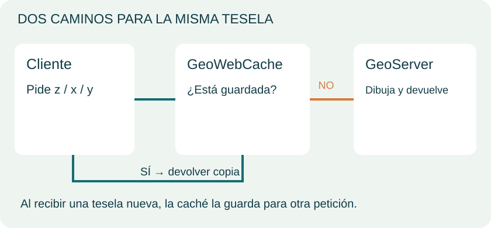
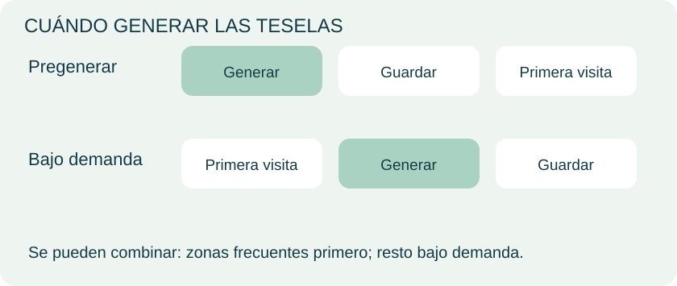
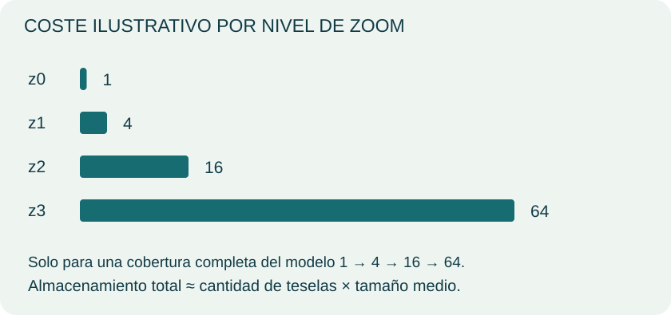
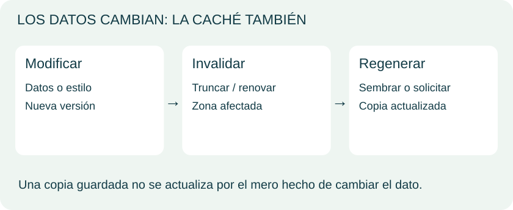
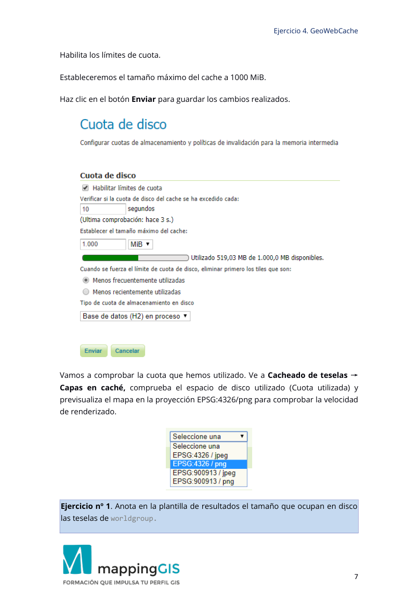
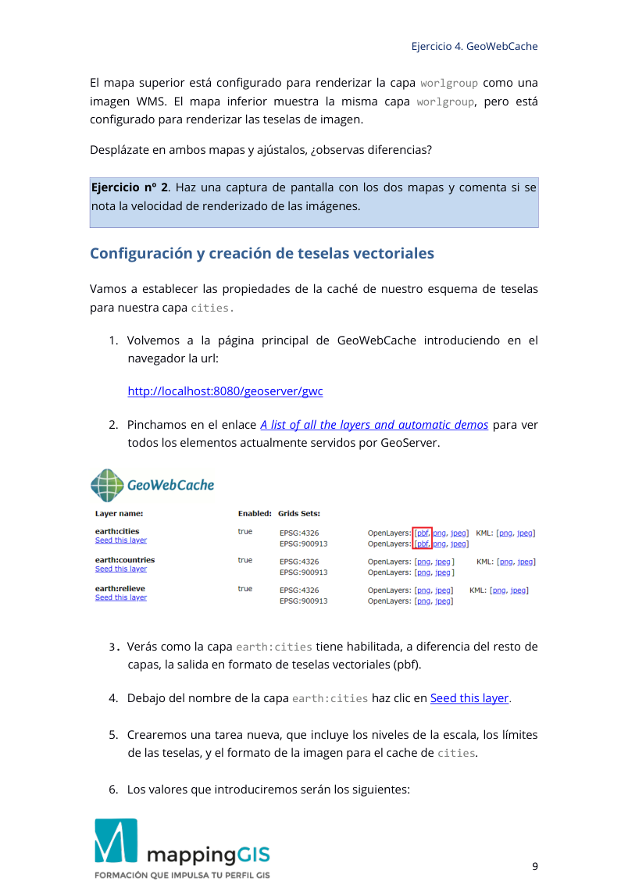
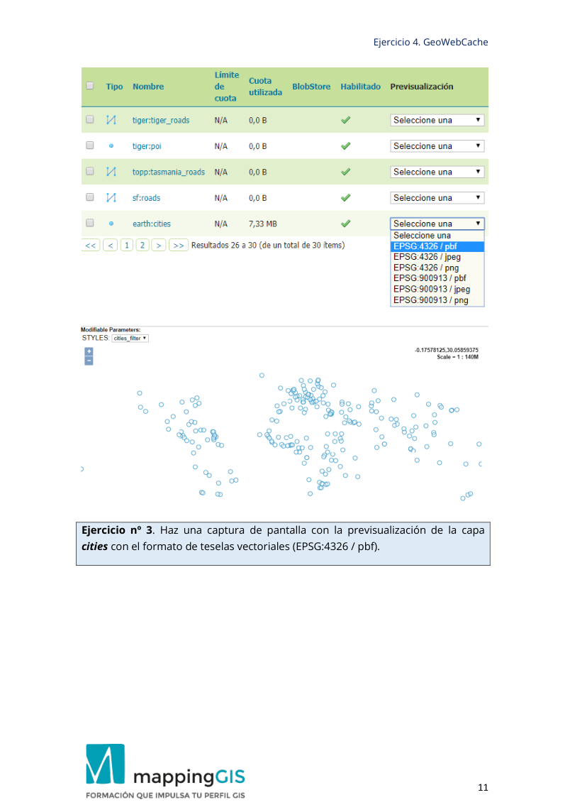
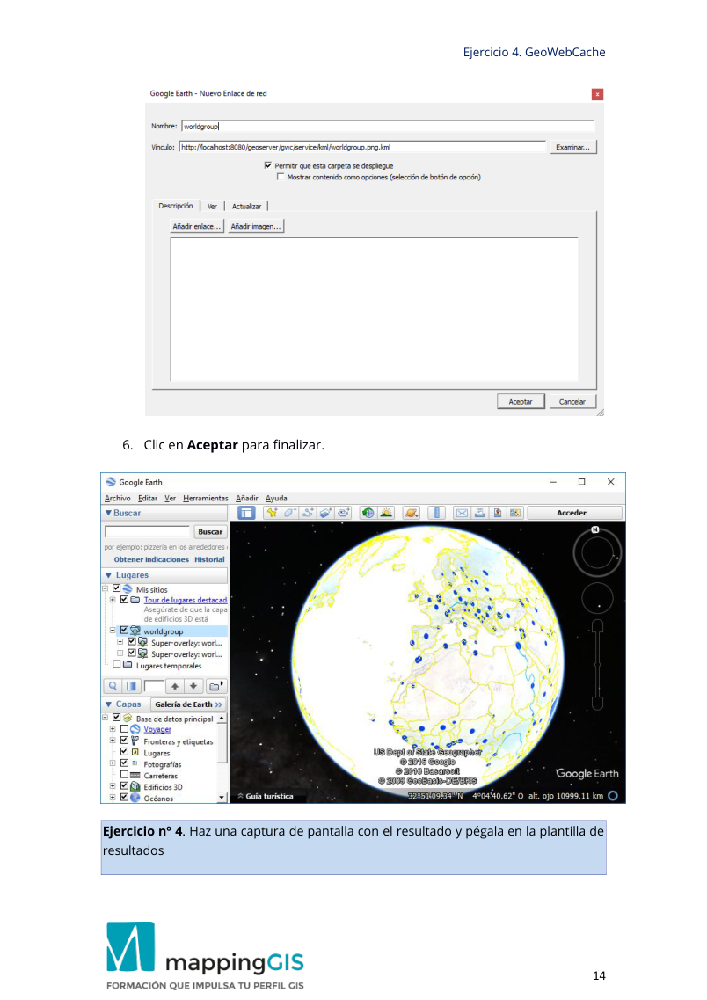

# Unidad 4 · GeoWebCache y las teselas

<div class="visual-hero"><div class="eyebrow">Unidad 04 / Piloto visual</div><h2>Dibujar una vez.<br>Reutilizar muchas veces.</h2><p>Comprende cómo la caché se interpone entre el visor y el servidor, qué cambia al aumentar el zoom y cómo decidir qué conviene guardar.</p><p>Petición → caché → teselas → estrategia → actualización</p></div>

Síntesis visual de las clases, con diagramas originales para explicar los conceptos. La práctica se conserva al final de esta misma unidad.

## 1. Acierto o fallo de caché

<figure class="lesson-figure"><a href="../../assets/unidad-4/hit-miss.svg" target="_blank" rel="noopener"></a></figure>

GeoWebCache puede actuar entre un cliente y un servidor WMS. Busca una copia compatible con la petición: si existe, la entrega; si falta, obtiene una nueva, la almacena y la devuelve.

La primera visita a un área no cacheada puede requerir dibujar el mapa. Las siguientes pueden reutilizarlo. La mejora depende de la configuración, las peticiones y los recursos: no hay un tiempo universal de respuesta.

| Situación | Trabajo necesario |
|---|---|
| Tesela disponible | Leer y entregar la copia |
| Tesela ausente | Generar, guardar y entregar |

La caché reduce trabajo repetido; no sustituye la preparación de datos ni la configuración del servicio.

<p class="content-source"><strong>Referencia:</strong> <a href="https://docs.geoserver.org/stable/en/user/geowebcache/index.html">GeoServer · GeoWebCache</a>.</p>

## 2. Una pirámide de cuadrículas

<figure class="lesson-figure"><a href="../../assets/unidad-4/piramide.svg" target="_blank" rel="noopener"></a></figure>

El visor construye una vista con piezas pequeñas. Un **grid set** define referencia, extensión, resoluciones y dimensiones de tesela.

Al acercarte, el visor solicita piezas de un nivel más detallado. En el modelo ideal mostrado, cada pieza se divide en cuatro. Otras cuadrículas pueden tener configuraciones diferentes.

La petición identifica el nivel y la posición. WMTS y otros esquemas teselados permiten acceder a mapas organizados en cuadrículas. La práctica configura caché integrada con GeoServer.

<p class="content-source"><strong>Referencia:</strong> <a href="https://docs.geoserver.org/stable/en/user/geowebcache/index.html">GeoServer · GeoWebCache</a>.</p>

## 3. Pregeneración y demanda

<figure class="lesson-figure"><a href="../../assets/unidad-4/estrategias.svg" target="_blank" rel="noopener"></a></figure>

**Pregenerar** prepara teselas antes de las visitas. **Bajo demanda** las crea conforme se explora el mapa.

| Estrategia | Beneficio | Coste o límite |
|---|---|---|
| Pregeneración | Áreas previstas preparadas | Cómputo y disco por adelantado |
| Demanda | Genera zonas solicitadas | Primera petición potencialmente más lenta |
| Combinación | Prioriza zonas frecuentes | Requiere decidir extensión y zoom |

El PDF propone combinar ambas estrategias. En las herramientas del curso, `seed`, `reseed` y `truncate` corresponden a creación, regeneración y eliminación de caché.

<p class="content-source"><strong>Referencia:</strong> <a href="https://docs.geoserver.org/stable/en/user/geowebcache/index.html">GeoServer · GeoWebCache</a>.</p>

## 4. Zoom y almacenamiento

<figure class="lesson-figure"><a href="../../assets/unidad-4/coste.svg" target="_blank" rel="noopener"></a></figure>

Para una cobertura completa del modelo de una tesela inicial y subdivisión por cuatro, los niveles contienen 1, 4, 16 y 64 piezas. La suma hasta un nivel incluye los anteriores.

**Estimación:** tamaño total ≈ número de teselas × tamaño medio. El resultado real depende de cobertura, niveles, compresión, formato, estilos y variantes de petición. Las barras muestran un modelo, no tu instalación.

Las cuotas ayudan a limitar el almacenamiento. La práctica pide anotar el tamaño real y comparar dos visores; esos resultados se obtienen con la configuración y los archivos originales.

<p class="content-source"><strong>Referencia:</strong> <a href="https://docs.geoserver.org/stable/en/user/geowebcache/index.html">GeoServer · GeoWebCache</a>.</p>

## 5. Renovar y distinguir contenidos

<figure class="lesson-figure"><a href="../../assets/unidad-4/actualizar.svg" target="_blank" rel="noopener"></a></figure>

Si cambian datos o estilos, una copia anterior puede seguir mostrando la versión antigua. Define qué área y qué niveles necesitan invalidación o regeneración; después comprueba el visor.

Las **teselas ráster** contienen una representación dibujada. Las **vectoriales** transmiten geometrías y atributos codificados para que un cliente compatible las represente. Vector no equivale a PNG.

La práctica incluye teselas vectoriales y Google Earth. Se conserva íntegramente al final; aplicaciones y proveedores externos pueden haber cambiado desde la clase.

<p class="content-source"><strong>Referencia:</strong> <a href="https://docs.geoserver.org/stable/en/user/geowebcache/index.html">GeoServer · GeoWebCache</a>.</p>

## Material y referencias


Ampliación técnica: [GeoWebCache integrado en GeoServer](https://docs.geoserver.org/stable/en/user/geowebcache/index.html). Las versiones e interfaces del PDF corresponden al entorno de las clases; los diagramas muestran conceptos.


## Ejercicio Unidad 4 {#ejercicios-originales-del-curso}

Enunciados y contexto de los PDF de MappingGIS. No se añaden actividades ni soluciones. Los paneles incluyen los pasos originales dentro de la unidad; el PDF conserva la maquetación completa.

**Práctica:** [PDF original completo](../materiales/Ejercicio_4_GeoWebCache_2025.pdf){target="_blank" rel="nofollow noopener noreferrer"}.

### Ejercicio 1 · Tamaño de la caché

<div class="original-statement"><span class="eyebrow">Enunciado original · Práctica</span><p>Anota en la plantilla de resultados el tamaño que ocupa n en disco las teselas de worldgroup.</p></div>

<details class="original-exercise" markdown="1">
<summary>Pasos y contexto originales de la clase</summary>

**Página 3**

```text
Ejercicio 4. GeoWebCache 
                                                                                                   3 
Creación de un caché de teselas raster 
 
Hay dos pasos en la creación pro-activa de una cache de teselas: 
1. Configuración de las propiedades del almacenamiento en caché, y 
2. La creación de teselas 
Vamos a establecer las propiedades de la caché de nuestro esquema de teselas 
para nuestro mapa base worldgroup. 
1. Para comenzar abre GeoWebCache introduciendo en el navegador la url:  
http://localhost:8080/geoserver/gwc 
2. Pincha en el enlace A list of all the layers and automatic demos para ver todos 
los elementos actualmente servidos por GeoServer.  
 
 
3. Verás como la capa cities tiene habilitada, a diferencia del resto de capas, 
la salida en formato de teselas vectoriales : pbf (protobuf). Puedes hacer 
clic en alguno de estos enlaces para ver el aspecto y fijarte en la url que se 
genera, que será de este estilo: 
 
http://localhost:8080/geoserver/gwc/demo/earth:cities?gridSet=EPSG:4326
&format=application/vnd.mapbox-vector-tile
```

**Página 4**

```text
Ejercicio 4. GeoWebCache 
                                                                                                   4 
4. Busca el grupo de capas worldgroup en la lista y haz clic en la vista previa 
con OpenLayers [png] 
 
 
5. Vuelve a la página principal GeoWebCache. 
6. Busca el grupo de capas worldgroup y haz clic en Seed this layer: 
 
 
Otra manera de acceder a las opciones de cacheado de imágenes es desde 
GeoServer. 
Accede al panel de la izquierda al grupo Cacheado de teselas → Capas en caché. 
A continuación, seleccionamos el grupo de capas worldgroup y pinchamos en la 
opción Seed/truncate. También podemos eliminar todas las teselas, haciendo clic 
en Empty. 
7. Crearemos una tarea nueva, que incluye los niveles  de la escala, los límites 
de las teselas, y el formato de la imagen para el cache de worldgroup.
```

**Página 5**

```text
Ejercicio 4. GeoWebCache 
                                                                                                   5 
8. Procura que los valores sean como los que se indican a continuación: 
 Number of tasks to use: Esto se refiere a la gestión de procesador 
para la tarea. La regla de oro es establecer este valor en dos veces 
(2x) el número de núcleos de tu sistema. Si trabajas a nivel local, deja 
el número en 2. 
 Type of operation: Selecciona Reseed. 
o Reseed, genera todos los tiles. 
o Seeds, llena los huecos donde no existen tiles. 
o Truncate, vacía la memoria caché. 
 SRS: Tienes que elegir el SRS en el que se renderizarán las teselas. Lo 
vamos a hacer en EPSG:4326 
 Format: Este valor determina que formato de salida de imagen 
usará el serv icio de mapas cuando se creen la s teselas. Esto  
determina: 
o El tamaño en el disco de las teselas 
o La calidad de imagen, y 
o La capacidad de hacer el fondo de las teselas transparente. 
Esto se puede dejar como image/png. 
 Zoom start : El nivel de zoom superior, en general suele ser una 
buena idea crear las teselas desde el nivel de zoom más alto hacia 
abajo. Deja esto en 00. 
 Zoom stop: El nivel de zoom más bajo. Cuanto más alto, el proceso 
llevará más tiempo. Deja esto en 8. 
 Bounding box: Como se señaló anteriormente, se puede elegir pre -
crear solo una porción  del área total. Vamos a generar el cache de 
toda la zona, así que deja estos campos en blanco. 
Las propiedades quedan así:
```

**Página 6**

```text
Ejercicio 4. GeoWebCache 
                                                                                                   6 
 
Number of tasks to use: 2 
Type of operation: Reseed 
Grid Set: EPSG:  4326 
Format: png 
Zoom Start: 0 
Zoom Stop: 8 
Bounding Box: [empty]  
9. El botón Submit inicia el proceso de creación de tiles. El equipo irá lento 
durante un rato mientras se generan los tiles y se guardan en el  directorio 
de caché. Paciencia, debes esperar a que el proceso finalice.  El proceso 
durará alrededor de 1 hora (depende del procesador de tu equipo). 
 
10. Haz clic en Refresh List  para ver la cuenta atrás del tiempo restante 
estimado. Cuando la capa se almacene en caché se te redirigirá a la página 
de propiedades. 
Ya hemos almacenado en cache nuestro primer mapa.  Las teselas se almacenan 
en directorios dentro de \data_dir\gwc 
Para más detalles sobre cómo configurar tu propio esquema de teselas, 
incluyendo las proyecciones personalizadas, visita la documentación de 
GeoWebCache. 
Vuelve a GeoServer y en el panel de la izquierda en el grupo selecciona Cacheado 
de teselas → Cuota de disco.
```

**Página 7**

```text
Ejercicio 4. GeoWebCache 
                                                                                                   7 
Habilita los límites de cuota.  
Estableceremos el tamaño máximo del cache a 1000 MiB. 
Haz clic en el botón Enviar para guardar los cambios realizados. 
 
Vamos a comprobar la cuota que hemos utilizado. Ve a  Cacheado de teselas  → 
Capas en caché , comprueba el espacio de disco utilizado ( Cuota utilizada)  y 
previsualiza el mapa en la proyección EPSG:4326/png para comprobar la velocidad 
de renderizado.  
 
Ejercicio nº 1. Anota en la plantilla de resultados el tamaño que ocupa n en disco 
las teselas de worldgroup.
```

</details>

<details class="source-page"><summary>Ver página 7 del PDF original, con sus capturas</summary><a href="../../materiales/Ejercicio_4_GeoWebCache_2025.pdf#page=7" target="_blank" rel="nofollow noopener"></a></details>

[Consultar en el PDF · página 7](../materiales/Ejercicio_4_GeoWebCache_2025.pdf#page=7){target="_blank" rel="nofollow noopener noreferrer"}

### Ejercicio 2 · Comparar los dos mapas

<div class="original-statement"><span class="eyebrow">Enunciado original · Práctica</span><p>Haz una captura de pantalla con los dos mapas y comenta si se nota la velocidad de renderizado de las imágenes.</p></div>

<details class="original-exercise" markdown="1">
<summary>Pasos y contexto originales de la clase</summary>

**Página 7**

```text
Ejercicio 4. GeoWebCache 
                                                                                                   7 
Habilita los límites de cuota.  
Estableceremos el tamaño máximo del cache a 1000 MiB. 
Haz clic en el botón Enviar para guardar los cambios realizados. 
 
Vamos a comprobar la cuota que hemos utilizado. Ve a  Cacheado de teselas  → 
Capas en caché , comprueba el espacio de disco utilizado ( Cuota utilizada)  y 
previsualiza el mapa en la proyección EPSG:4326/png para comprobar la velocidad 
de renderizado.  
 
Ejercicio nº 1. Anota en la plantilla de resultados el tamaño que ocupa n en disco 
las teselas de worldgroup.
```

**Página 8**

```text
Ejercicio 4. GeoWebCache 
                                                                                                   8 
 
Almacenamiento en cache “bajo demanda” 
No necesitamos hacer mucho para almacenar en cache los tiles bajo demanda. 
Sólo tenemos que solicitar las imágenes del mapa desde nuestro WMS a través del 
proxy de tiles. GeoWebCache (GWC) se encargará de todo lo demás. 
En esta sección vamos a visualizar dos mapas: un mapa para usar imágenes en 
caché de GWC por encima de nuestro WMS local, luego compararemos los 
tiempos de entrega de los elementos cacheados con peticiones completas de 
WMS. 
El mapa visualizado tendrá 8 niveles de zoom almacenados en caché co n el 
método by seeding  y el resto de tiles se crearán bajo demanda cuando 
naveguemos por debajo de ese nivel de zoom. 
Ve al directorio < webmapping>\web y abre el archivo 
ol_map_comparativa_GeoWebCache.html 
Deberías ver dos mapas en una página web. Los mapas en el mismo nivel de zoom 
y extensión:
```

**Página 9**

```text
Ejercicio 4. GeoWebCache 
                                                                                                   9 
El mapa superior está configurado para renderizar la capa worlgroup como una 
imagen WMS. El mapa inferior muestra la misma capa worlgroup, pero está 
configurado para renderizar las teselas de imagen. 
Desplázate en ambos mapas y ajústalos, ¿observas diferencias? 
 
Ejercicio nº 2 . Haz una captura de pantalla con los dos mapas y comenta si se 
nota la velocidad de renderizado de las imágenes. 
Configuración y creación de teselas vectoriales 
Vamos a establecer las propiedades de la caché de nuestro esquema de teselas 
para nuestra capa cities. 
1. Volvemos a la página principal de  GeoWebCache introduciendo en el 
navegador la url:  
http://localhost:8080/geoserver/gwc 
2. Pinchamos en el enlace A list of all the layers and automatic demos  para ver 
todos los elementos actualmente servidos por GeoServer.  
 
 
3. Verás como la capa earth:cities tiene habilitada, a diferencia del resto de 
capas, la salida en formato de teselas vectoriales (pbf). 
 
4. Debajo del nombre de la capa earth:cities haz clic en Seed this layer. 
 
5. Crearemos una tarea nueva, que incluye los niveles de la escala, los límites 
de las teselas, y el formato de la imagen para el cache de cities. 
 
6. Los valores que introduciremos serán los siguientes:
```

</details>

<details class="source-page"><summary>Ver página 9 del PDF original, con sus capturas</summary><a href="../../materiales/Ejercicio_4_GeoWebCache_2025.pdf#page=9" target="_blank" rel="nofollow noopener"></a></details>

[Consultar en el PDF · página 9](../materiales/Ejercicio_4_GeoWebCache_2025.pdf#page=9){target="_blank" rel="nofollow noopener noreferrer"}

### Ejercicio 3 · Teselas vectoriales

<div class="original-statement"><span class="eyebrow">Enunciado original · Práctica</span><p>Haz una captura de pantalla con la previsualización de la capa cities con el formato de teselas vectoriales (EPSG:4326 / pbf).</p></div>

<details class="original-exercise" markdown="1">
<summary>Pasos y contexto originales de la clase</summary>

**Página 9**

```text
Ejercicio 4. GeoWebCache 
                                                                                                   9 
El mapa superior está configurado para renderizar la capa worlgroup como una 
imagen WMS. El mapa inferior muestra la misma capa worlgroup, pero está 
configurado para renderizar las teselas de imagen. 
Desplázate en ambos mapas y ajústalos, ¿observas diferencias? 
 
Ejercicio nº 2 . Haz una captura de pantalla con los dos mapas y comenta si se 
nota la velocidad de renderizado de las imágenes. 
Configuración y creación de teselas vectoriales 
Vamos a establecer las propiedades de la caché de nuestro esquema de teselas 
para nuestra capa cities. 
1. Volvemos a la página principal de  GeoWebCache introduciendo en el 
navegador la url:  
http://localhost:8080/geoserver/gwc 
2. Pinchamos en el enlace A list of all the layers and automatic demos  para ver 
todos los elementos actualmente servidos por GeoServer.  
 
 
3. Verás como la capa earth:cities tiene habilitada, a diferencia del resto de 
capas, la salida en formato de teselas vectoriales (pbf). 
 
4. Debajo del nombre de la capa earth:cities haz clic en Seed this layer. 
 
5. Crearemos una tarea nueva, que incluye los niveles de la escala, los límites 
de las teselas, y el formato de la imagen para el cache de cities. 
 
6. Los valores que introduciremos serán los siguientes:
```

**Página 10**

```text
Ejercicio 4. GeoWebCache 
                                                                                                   10 
Number of tasks to use: 2 
Type of operation: Reseed - regenerate all tiles 
Grid Set: EPSG:  4326 
Format: application/vnd.mapbox-vector-tile 
Zoom Start: 0 
Zoom Stop: 8 
Modifiable Parameters: STYLES: cities_filter 
Bounding Box: [vacío] 
Dejaremos el resto de valores con los valores que aparecen por defecto.  
 
7. El botón Submit inicia el proceso de creación de teselas. De nuevo debes ser 
paciente, aunque este proceso durará mucho menos que la generación de 
teselas raster. 
 
8. Haz clic en el enlace Refresh List  para ver la cuenta atrás del tiempo 
restante estimado. Cuando la capa se almacene en caché se te redirigirá a 
la página de propiedades. 
9. Ahora v amos a comprobar la cuota de disco que hemos utilizado. En 
GeoServer, ve a  Cacheado de teselas  → Capas en caché , comprueba el 
espacio de disco utilizado ( Cuota utilizada)  y previsualiza el mapa en la 
proyección EPSG:4326/pbf.
```

**Página 11**

```text
Ejercicio 4. GeoWebCache 
                                                                                                   11 
 
 
 
 
Ejercicio nº 3 . Haz una captura de pantalla con la previsualización de la capa 
cities con el formato de teselas vectoriales (EPSG:4326 / pbf).
```

</details>

<details class="source-page"><summary>Ver página 11 del PDF original, con sus capturas</summary><a href="../../materiales/Ejercicio_4_GeoWebCache_2025.pdf#page=11" target="_blank" rel="nofollow noopener"></a></details>

[Consultar en el PDF · página 11](../materiales/Ejercicio_4_GeoWebCache_2025.pdf#page=11){target="_blank" rel="nofollow noopener noreferrer"}

### Ejercicio 4 · Google Earth

<div class="original-statement"><span class="eyebrow">Enunciado original · Práctica</span><p>Haz una captura de pantalla con el resultado y pégala en la plantilla de resultados</p></div>

<details class="original-exercise" markdown="1">
<summary>Pasos y contexto originales de la clase</summary>

**Página 11**

```text
Ejercicio 4. GeoWebCache 
                                                                                                   11 
 
 
 
 
Ejercicio nº 3 . Haz una captura de pantalla con la previsualización de la capa 
cities con el formato de teselas vectoriales (EPSG:4326 / pbf).
```

**Página 12**

```text
Ejercicio 4. GeoWebCache 
                                                                                                   12 
Visualización de capas con Google Earth 
Google Earth es un potente visor de mapas 3D. GeoServer se integra con Google 
Earth, proporcionando como salida nativa un KML, lo que permite a cualquier capa 
servida por GeoServer cargarse dentro de Google Earth. Además, hay funciones 
adicionales de visualización que son posibles a través de Google Earth, tales como 
filtros, leyendas y extrusiones. En este ejercicio visualizaremos en Google Earth el 
grupo de capas que hemos almacenado en caché. 
Visualizando las capas 
GeoServer genera de forma nativa datos en KML ( Keyhole Markup Language ). Este 
es el lenguaje de marcado que se utiliza en Google Maps y Google Earth. De esta 
manera, es fácil convertir shapefiles o cualquier otro dato geoespacial a un 
formato que Google entienda. 
Hay dos formas de ver los datos  en Google Earth. La primera es estáticamente 
cargando un archivo KML. El segundo es el uso de un enlace de red. Vamos a ver 
esta segunda opción. 
Enlace de red  
Conectaremos Google Earth a un KML de GeoServer a través de un enlace de red. 
Esto permite que la vista en Google Earth se actualice dinámicamente. 
1. Descarga e instala la aplicación Google Earth. 
2. Abre Google Earth. 
3. Para añadir un nuevo enlace de red, ve al menú superior y selecciona 
Añadir → Enlace de red.
```

**Página 13**

```text
Ejercicio 4. GeoWebCache 
                                                                                                   13 
 
4. En el cuadro de  diálogo que aparece, escribe "world group" en el campo 
Nombre. 
5. En el campo Vínculo introduce la siguiente URL: 
http://localhost:8080/geoserver/gwc/service/kml/worldgroup.png.kml
```

**Página 14**

```text
Ejercicio 4. GeoWebCache 
                                                                                                   14 
 
6. Clic en Aceptar para finalizar. 
 
Ejercicio nº 4. Haz una captura de pantalla con el resultado y pégala en la plantilla de 
resultados
```

</details>

<details class="source-page"><summary>Ver página 14 del PDF original, con sus capturas</summary><a href="../../materiales/Ejercicio_4_GeoWebCache_2025.pdf#page=14" target="_blank" rel="nofollow noopener"></a></details>

[Consultar en el PDF · página 14](../materiales/Ejercicio_4_GeoWebCache_2025.pdf#page=14){target="_blank" rel="nofollow noopener noreferrer"}

