# Unidad 5 · Construir un visor con Leaflet

<div class="visual-hero"><div class="eyebrow">Unidad 05 / Piloto visual</div><h2>Estructura, estilo y acción.<br>Una página se convierte en mapa.</h2><p>Une HTML, CSS y JavaScript con capas, controles y eventos de Leaflet. Distingue qué hace cada pieza antes de combinarlas.</p><p>Página → contenedor → capas → eventos → coordenadas</p></div>

Síntesis visual de las clases, con diagramas originales para explicar los conceptos. La práctica se conserva al final de esta misma unidad.

## 1. HTML, CSS y JavaScript

<figure class="lesson-figure"><a href="../../assets/unidad-5/tres-lenguajes.svg" target="_blank" rel="noopener">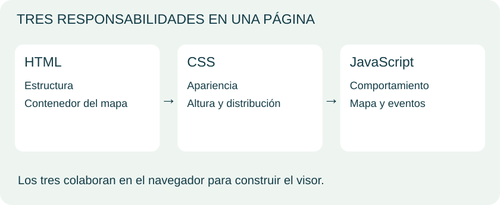</a></figure>

**HTML** aporta estructura: encabezados, párrafos, listas, enlaces e imágenes. **CSS** selecciona elementos y define su aspecto. **JavaScript** contiene funciones, instrucciones y eventos que cambian el comportamiento.

| Lenguaje | En el visor |
|---|---|
| HTML | Declarar el contenedor |
| CSS | Dar altura y ancho |
| JavaScript | Crear mapa y capas |

Un `id` identifica un elemento; una `class` agrupa estilos. CSS combina selector, propiedad y valor. La hoja CSS de la página y la simbología del servidor actúan en niveles distintos.

<p class="content-source"><strong>Referencia:</strong> <a href="https://developer.mozilla.org/es/docs/Learn_web_development/Core/Structuring_content">MDN · estructura HTML</a>.</p>

## 2. Del documento a L.map

<figure class="lesson-figure"><a href="../../assets/unidad-5/dom.svg" target="_blank" rel="noopener">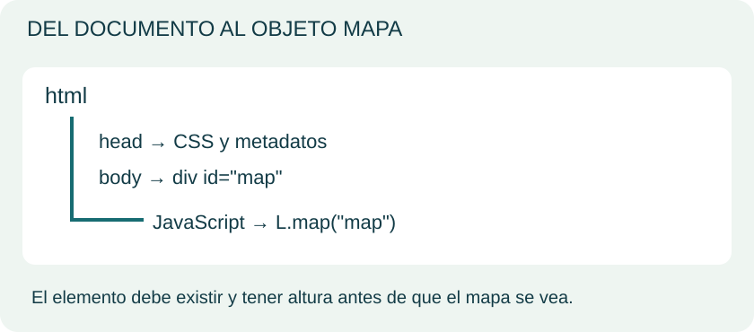</a></figure>

Leaflet necesita un elemento existente con tamaño visible. Si no tiene altura, un mapa bien inicializado puede no aparecer.

El curso carga `leaflet.css` y `leaflet.js`. `L.map` crea la instancia, `setView` establece centro y zoom y `fitBounds` ajusta la extensión.

```html
<!-- Estructura conceptual: no es un ejercicio adicional. -->
<div id="map"></div>
```

La consola muestra errores y la pestaña de red permite revisar recursos. Sigue el primer error antes de cambiar varias partes. Sirve el visor mediante HTTP como indica la clase: abrir un archivo local no reproduce todos los comportamientos de un servidor.

<p class="content-source"><strong>Referencia:</strong> <a href="https://leafletjs.com/examples/quick-start/">Leaflet · guía oficial</a>.</p>

## 3. Fondo, WMS y vectores

<figure class="lesson-figure"><a href="../../assets/unidad-5/capas.svg" target="_blank" rel="noopener">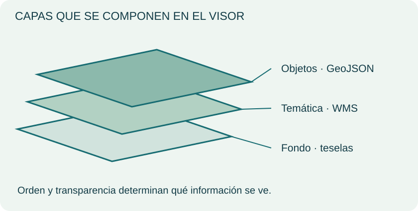</a></figure>

`L.tileLayer` carga teselas del fondo. `L.tileLayer.wms` solicita imágenes WMS. `L.geoJSON` crea capas vectoriales que pueden responder a acciones en el cliente.

| Contenido | Qué llega | Estilo |
|---|---|---|
| Teselas ráster | Imágenes | Ya aplicado |
| WMS | Imagen de mapa | Del servidor |
| GeoJSON | Geometrías y atributos | En el cliente |

Marcadores, líneas, polígonos y grupos organizan el mapa. `addTo`, `addLayer` y `removeLayer` controlan su presencia. Conserva la atribución de los proveedores: los fondos tienen condiciones de uso propias.

<p class="content-source"><strong>Referencia:</strong> <a href="https://leafletjs.com/examples/quick-start/">Leaflet · guía oficial</a>.</p>

## 4. Eventos, popups y controles

<figure class="lesson-figure"><a href="../../assets/unidad-5/eventos.svg" target="_blank" rel="noopener">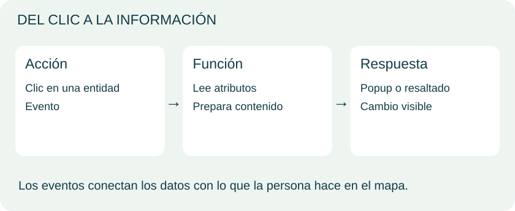</a></figure>

Un evento comunica algo ocurrido, como un clic. Una función puede leer atributos, abrir información o cambiar un estilo. Popups y tooltips aportan contexto.

Los controles permiten manejar zoom, escala y capas. El control de capas distingue fondos alternativos y superposiciones. Título y leyenda ayudan a interpretar los símbolos.

Una función de estilo puede representar atributos con colores o tamaños. `onEachFeature` facilita asociar acciones a cada entidad GeoJSON. Los plugins añaden funciones como búsqueda; comprueba la compatibilidad con la versión utilizada.

<p class="content-source"><strong>Referencia:</strong> <a href="https://leafletjs.com/examples/quick-start/">Leaflet · guía oficial</a>.</p>

## 5. Coordenadas, radio y depuración

<figure class="lesson-figure"><a href="../../assets/unidad-5/coordenadas.svg" target="_blank" rel="noopener">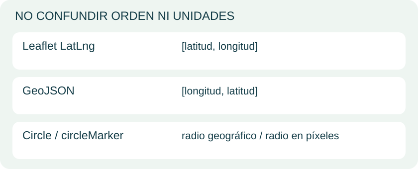</a></figure>

En llamadas habituales de Leaflet que reciben `LatLng`, el orden es **latitud, longitud**. En GeoJSON es **longitud, latitud**. Intercambiarlos puede situar los datos en otro lugar.

`L.circle` usa radio geográfico en metros; `L.circleMarker`, píxeles. Un símbolo de pantalla y una zona de influencia tienen significados distintos.

Si el mapa falla, revisa tamaño del contenedor, bibliotecas, ejecución, variables, coordenadas y respuestas de red. Se conservan dos prácticas diferenciadas: **9 ejercicios de HTML/CSS/JavaScript y 12 de Leaflet**, con numeración propia.

<p class="content-source"><strong>Referencia:</strong> <a href="https://leafletjs.com/examples/quick-start/">Leaflet · guía oficial</a> · <a href="https://datatracker.ietf.org/doc/html/rfc7946">IETF · RFC 7946 (GeoJSON)</a>.</p>

## Material y referencias


Ampliación técnica: [Guía de Leaflet](https://leafletjs.com/examples/quick-start/) · [HTML en MDN](https://developer.mozilla.org/es/docs/Learn_web_development/Core/Structuring_content). Las versiones e interfaces del PDF corresponden al entorno de las clases; los diagramas muestran conceptos.


## Ejercicio Unidad 5 {#ejercicios-originales-del-curso}

Enunciados y contexto de los PDF de MappingGIS. No se añaden actividades ni soluciones. Los paneles incluyen los pasos originales dentro de la unidad; el PDF conserva la maquetación completa.

**HTML/CSS/JS:** [PDF original completo](../materiales/Ejercicio_5.0_HTML5_CSS_y_JavaScript._Depuraci%C3%B3n_de_errores_2024.pdf){target="_blank" rel="nofollow noopener noreferrer"}.

### HTML/CSS/JS · Ejercicio 1 · Editar título y cuerpo

<div class="original-statement"><span class="eyebrow">Enunciado original · HTML/CSS/JS</span><p>Modifica tanto el título de la página como el texto del cuerpo y realiza una captura de pantalla con el resultado.</p></div>

<details class="original-exercise" markdown="1">
<summary>Pasos y contexto originales de la clase</summary>

**Página 3**

```text
Unidad 5. HTML5, CSS, JavaScript y depuración de errores 
 
                                                                                                  3 
Programa, sentencias y comentarios ............................................................................. 25 
Variables ................................................................................................................................ 25 
Sintaxis ...................................................................................................................................... 27 
Delimitación de sentencias ............................................................................................... 27 
Nombre de variables .......................................................................................................... 27 
Orden en la creación de variables ................................................................................... 27 
Declaraciones y expresiones ............................................................................................ 29 
Funciones útiles ....................................................................................................................... 29 
Script con fecha ................................................................................................................... 29 
Script con expresión ........................................................................................................... 30 
Funciones .................................................................................................................................. 30 
Condicionales y bucles ........................................................................................................... 31 
Depuración de JavaScript ...................................................................................................... 34 
Corrección de errores con Firefox ................................................................................... 34 
Depuración de errores con Chrome ............................................................................... 40
```

**Página 4**

```text
Unidad 5. HTML5, CSS, JavaScript y depuración de errores 
 
                                                                                                  4 
HTML 
Es un lenguaje de marcas para formatear y estructurar un documento, que puede 
leerse en cualquier navegador. 
<html> … …</html> 
 
Estructura de un HTML 
 
Un documento HTML tiene tres etiquetas que describen la estructura general de 
un documento y dan una información sencilla sobre él: 
 <html> 
 <head> y 
 <body> 
 
Dentro de un HTML debemos escribir siempre  
<!doctype html>  
en la primera línea. Esto le dice al navegador cuál es el lenguaje que está leyendo 
(en este caso, HTML5).  
Doctype comienza a utilizarse en HTML4.01 y XHTML https://validator.w3.org/ 
 
La cabecera <head> 
 
El contenido que irá dentro de nuestro archivo HTML irá en medio de las 
etiquetas de inicio <html> y de cierre </html>. 
El archivo siempre consiste de dos partes: la cabecera y el cuerpo. Vamos a 
centrarnos en la cabecera. 
Tiene una etiqueta de inicio y una de cierre. 
La cabecera incluye información importante, como el título de la página web. El 
título <TITLE> es el nombre que aparece en la cabecera del visualizador y en los 
buscadores, de ahí la importancia de que sea significativo.
```

**Página 5**

```text
Unidad 5. HTML5, CSS, JavaScript y depuración de errores 
 
                                                                                                  5 
 
La etiqueta meta define varios tipos de metadatos. 
El atributo charset especifica la codificación usada en nuestra página. 
<meta charset="character_set"> 
Charset utf-8 es la Unicode Transformation Format 8-bit representa el código 
de caracteres UNICODE. Es compatible con ASCII. 
Permite visualizar los caracteres de todos los idiomas. 
Hay otras etiquetas como description o keywords. Estas etiquetas meta  se 
utilizan para dar información sobre el contenido de la página web pero  
normalmente no son mostradas en pantalla. Es información relevante para  el 
navegador porque permite realizar las búsquedas y conocer los datos  más 
relevantes de la página pero como hemos dicho no son visibles para el usuario. 
 
Un elemento importante a incluir en la cabecera del documento es <link>. 
 
Esta etiqueta es la que se utiliza para incorporar a nuestra página otros archivos 
externos con imágenes, iconos, código,… Con <link> necesitaremos utilizar dos 
atributos: rel y href. 
 
A continuación se muestra un ejemplo típico de una cabecera: 
 
<!DOCTYPE html> 
<html> 
<head> 
<meta charset="UTF-8"> 
<meta name="description" content="Mi primer HTML"> 
<meta name="keywords" content="HTML , MappinGIS, Leaflet"> 
<link rel="stylesheet" type="text/css" href="mihojadeestilos.css"> 
<title> MappingGIS.com </title> 
</head> 
</html> 
 
 
El atributo rel indica la relación entre el documento y el archivo que  estamos 
cargando. En este ejemplo el atributo rel tiene el valor stylesheet (hoja de estilos) 
que está indicando que el archivo que incorporamos  (“mihojadeestilos.css”) es 
un archivo CSS. Durante este curso veremos algún  ejemplo de archivo css y 
como traba jar con él. El atributo href indica la ruta  donde se encuentra el 
archivo que vamos a utilizar.
```

**Página 6**

```text
Unidad 5. HTML5, CSS, JavaScript y depuración de errores 
 
                                                                                                  6 
 
El cuerpo <body> 
El contenido en el cuerpo es lo que será visible en la página web. Contiene los 
elementos visibles en la página web: párrafos, imágenes, encabezados, listas, 
etc. 
<!DOCTYPE html> 
<html> 
 <head>                   
      <title>MappingGIS.com</title> 
 </head> 
 <body>Formación que impulsa tu perfil GIS</body> 
</html> 
 
Edita el archivo web.html que creamos en la unidad 1 y que hemos guardado en el 
directorio \data_dir\www 
Si haces doble clic sobre él, se abrirá como una página web en tu navegador, pero 
si lo abres con un editor de texto, como Notepad++ o Sublime Text nos aparecerá 
su código fuente. 
Antes de continuar instala uno de los editores anteriores. 
La instalación de Notepad++ es muy sencilla. Accede a la página de descargas y haz 
clic sobre Download. Ejecuta el archivo .exe que se descarga y sigue los pasos. 
Una vez que se haya instalado h az clic con el botón derecho del ratón  y clic sobre 
Edit with Notepadd++. 
 
 
Copia el texto anterior y pégalo en el editor:
```

**Página 7**

```text
Unidad 5. HTML5, CSS, JavaScript y depuración de errores 
 
                                                                                                  7 
 
 
Explicación del ejemplo 
 
<!doctype html> especifica que el lenguaje es HTML5. 
 
<html> Indica al navegador que abre un archivo HTML. 
 
<head> Apertura de la cabecera del documento. Sección que no se muestra en la 
pantalla. 
 
<title> MappingGIS.com </title> Título de la página. 
 
</head> Cierre de la cabecera del documento. 
 
<body> Apertura del cuerpo del documento. Esta sección aparece en la pantalla. 
Formación GIS y difusión tecnológica . Texto que va a ser mostrado por el 
navegador. 
 
</body> Cierre del cuerpo del documento. 
 
</html> Cierre del archivo HTML 
 
Fíjate que al situar el cursor sobre la etiqueta <head> también se ilumina la etiqueta 
de cierre </head> 
Abre la web en tu navegador, ve a: http://localhost:8080/geoserver/www/web.html
```

**Página 8**

```text
Unidad 5. HTML5, CSS, JavaScript y depuración de errores 
 
                                                                                                  8 
En la pestaña verás el título de la página web y en contenido una breve descripción: 
 
 
 
Si al abrir el navegador te aparecen caracteres extraños en el texto y no reconoce 
las tildes, ñ, etc hay un problema con la codificación del archivo. Con un editor de 
texto, como Notepad++ o Sublime Text, puedes modificar su codificación a UTF-8: 
 
 
 
Ejercicio nº1  Modifica tanto el título de la página como el texto del cuerpo y 
realiza una captura de pantalla con el resultado. 
 
 
 
 
 
Video: Visualiza el video correspondiente a esta sección
```

</details>

<details class="source-page"><summary>Ver página 8 del PDF original, con sus capturas</summary><a href="../../materiales/Ejercicio_5.0_HTML5_CSS_y_JavaScript._Depuraci%C3%B3n_de_errores_2024.pdf#page=8" target="_blank" rel="nofollow noopener">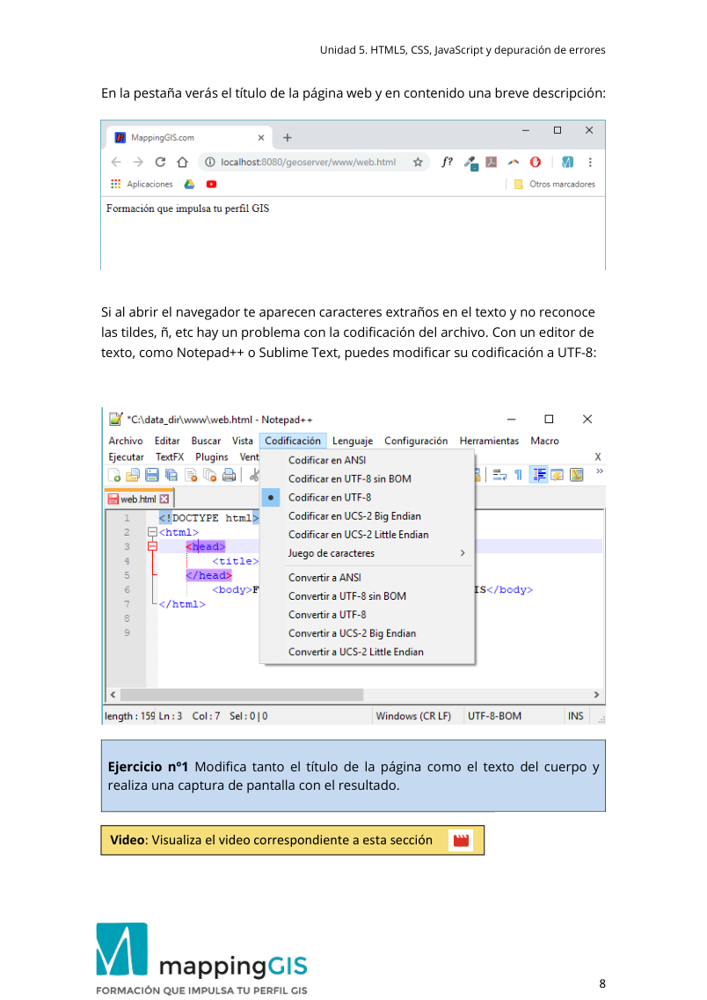</a></details>

[Consultar en el PDF · página 8](../materiales/Ejercicio_5.0_HTML5_CSS_y_JavaScript._Depuraci%C3%B3n_de_errores_2024.pdf#page=8){target="_blank" rel="nofollow noopener noreferrer"}

### HTML/CSS/JS · Ejercicio 2 · Lista de favoritos

<div class="original-statement"><span class="eyebrow">Enunciado original · HTML/CSS/JS</span><p>Escribe un código HTML para crear una lista con tus libros, películas de cine,... preferidas. Haz que el marcador del item de la lista sea un cuadrado y que el primer elemento de la lista esté en negrita. Elige además un color para el fondo del cuerpo del documento.</p></div>

<details class="original-exercise" markdown="1">
<summary>Pasos y contexto originales de la clase</summary>

**Página 8**

```text
Unidad 5. HTML5, CSS, JavaScript y depuración de errores 
 
                                                                                                  8 
En la pestaña verás el título de la página web y en contenido una breve descripción: 
 
 
 
Si al abrir el navegador te aparecen caracteres extraños en el texto y no reconoce 
las tildes, ñ, etc hay un problema con la codificación del archivo. Con un editor de 
texto, como Notepad++ o Sublime Text, puedes modificar su codificación a UTF-8: 
 
 
 
Ejercicio nº1  Modifica tanto el título de la página como el texto del cuerpo y 
realiza una captura de pantalla con el resultado. 
 
 
 
 
 
Video: Visualiza el video correspondiente a esta sección
```

**Página 9**

```text
Unidad 5. HTML5, CSS, JavaScript y depuración de errores 
 
                                                                                                  9 
Etiquetas de HTML 
 
1. Lo que va dentro de los signos “<” y “>” se denominan etiquetas. 
2. Las etiquetas casi siempre vienen en pares: una etiqueta de inicio y una 
etiqueta de cierre. 
3. Un ejemplo de una etiqueta de inicio: <html> 
4. Un ejemplo de una etiqueta de cierre: </html> 
5. El texto que se encuentra entre dos etiquetas es el contenido del 
elemento. 
Imagina que las etiquetas son como paréntesis; cuando abres uno, debes 
cerrarlo. Las etiquetas también pueden anidarse, así que debes cerrarlas en el 
orden correcto: la etiqueta abierta más recientemente debe ser la primera que 
se cierre, como en el ejemplo de abajo. 
<primera etiqueta> 
 <segunda etiqueta>¡Algún texto!</segunda etiqueta> 
</primera etiqueta> 
En el ejemplo: 
 <b>Este texto es en negrita.</b> 
 
El elemento HTML comienza con la etiqueta de apertura <b> (etiqueta que nos 
muestra el texto en negrita). 
El contenido de dicho elemento es: Este texto es en negrita. 
El fin del elemento HTML es con la etiqueta de cierre </b>. 
 
Párrafos y encabezados 
Cada párrafo requiere etiquetas de inicio y de cierre:  <p> y </p>. Colocamos el 
contenido en medio de las etiquetas. 
El siguiente paso es colocarle encabezados a nuestros párrafos, usando 
las etiquetas de encabezado.  
HTML nos permite tener más de un tamaño de encabezado. Hay seis tamaños 
de encabezado: <h1> es el más importante y <h6> el menos importante.
```

**Página 10**

```text
Unidad 5. HTML5, CSS, JavaScript y depuración de errores 
 
                                                                                                  10 
Etiquetas para crear listas 
Para crear una lista en HTML utilizaremos el elemento <ul> en combinación con 
<li>, como en el ejemplo siguiente: 
<!DOCTYPE html> 
<html> 
<head> 
<meta charset="UTF-8"> 
<meta name="description" content="Mi segundo HTML"> 
<meta name="keywords" content="HTML , MappinGIS, Leaflet"> 
 
<title> Mis bebidas preferidas </title> 
</head> 
<body> 
<h2>Lista de capas base</h2> 
<ul> 
<li>Stamen</li> 
<li>OpenStreetMap</li> 
<li>Google Maps</li> 
</ul> 
</body> 
</html> 
 
La etiqueta <ul> del ejemplo anterior crea una lista de elementos sin un orden 
definido, (se mostrarán en el mismo orden que han sido escritos). 
Para declarar cada elemento utilizaremos <li>. 
Se ha añadido además una etiqueta de encabezado <h2> que mostrará el texto 
“Lista de capas base” al ejecutar la página en el navegador. 
 
Atributos de las etiquetas 
Muchas etiquetas llevan atributos. Los atributos proveen de mayor información 
a los elementos HTML. 
 Los atributos siempre van con la estructura: nombre="valor". 
 Los atributos siempre van en la etiqueta de apertura. 
 Los valores siempre hay que ponerlos entre comillas. 
Un ejemplo de los atributos sería: 
<body bgcolor="#FFFF00"> 
Hola a todos. <b>Este texto es en negrita</b> 
</body>  
Resultado
```

**Página 11**

```text
Unidad 5. HTML5, CSS, JavaScript y depuración de errores 
 
                                                                                                  11 
Hola a todos. Este texto es en negrita 
En la etiqueta <body> podemos observar el atributo bgcolor= (color de fondo) y 
el valor "#FFFF00"(representa el color amarillo en hexadecimal). 
Esto quiere decir que el color de fondo de la página será amarillo. 
Nota: La etiqueta <b> y su correspondiente par de cierre </b> indican que el 
texto incluido entre ambas se mostrará en negrita. 
 
Otro ejemplo del uso de atributos los podemos aplicar al caso de las listas 
que explicamos en el ejemplo anterior. 
 
<ul style="list-style-type:square"> 
 
Mediante el atributo style podemos indicar el aspecto que tendrá el  
marcador de cada item de la lista, por ejemplo en este caso le estamos  
indicando que sea un cuadrado. 
 
 
Ejercicio nº2  Escribe un código HTML para crear una lista con tus libros,  
películas de cine,... preferidas. Haz que el marcador del item de la lista sea un 
cuadrado y que el primer elemento de la lista esté en negrita. Elige además un 
color para el fondo del cuerpo del documento.  
 
Haz una captura de pantalla con el resultado y pégalo en la hoja de resultados  
 
 
Imágenes 
 
Para añadir imágenes a  un sitio web  solamente necesitas una etiqueta de 
imagen: . Esta etiqueta es un poco diferente a las demás. En vez de colocar 
el contenido en medio de las etiquetas, le dices a la etiquetas dónde está la 
imagen, usando src. 
La dirección web (o URL, por localizador de recursos uniforme) después de src= 
le dice a la etiqueta  de dónde obtener la imagen. 
<!DOCTYPE html> 
<html> 
 <head> 
  <title> Curso online desarrollo de aplicaciones web 
mapping</title> 
 </head> 
 <body>
```

</details>

<details class="source-page"><summary>Ver página 11 del PDF original, con sus capturas</summary><a href="../../materiales/Ejercicio_5.0_HTML5_CSS_y_JavaScript._Depuraci%C3%B3n_de_errores_2024.pdf#page=11" target="_blank" rel="nofollow noopener">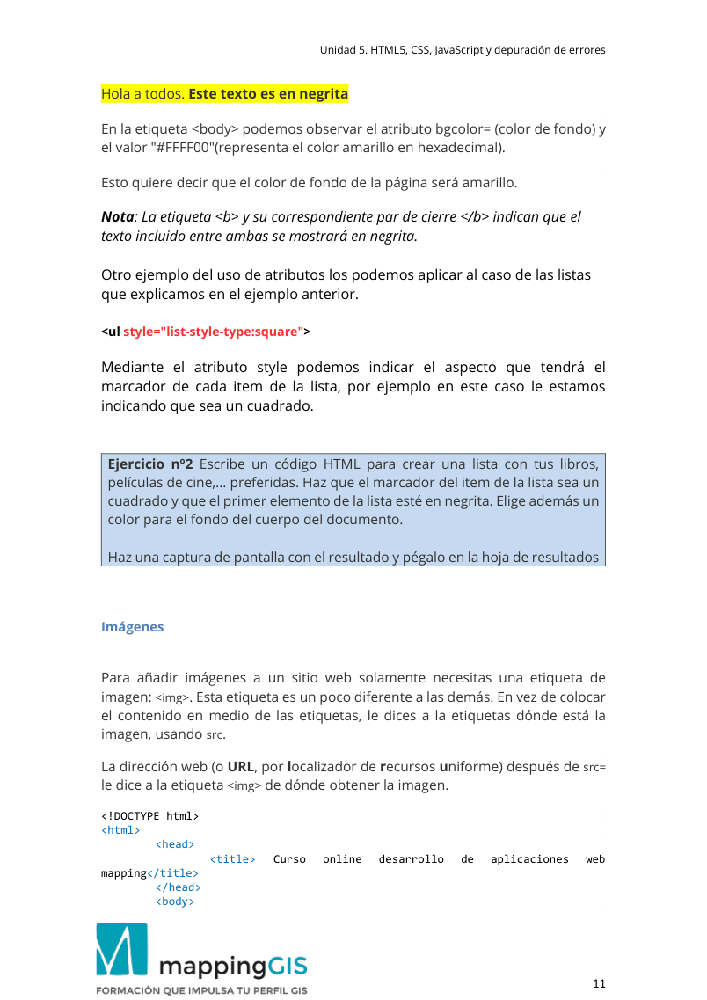</a></details>

[Consultar en el PDF · página 11](../materiales/Ejercicio_5.0_HTML5_CSS_y_JavaScript._Depuraci%C3%B3n_de_errores_2024.pdf#page=11){target="_blank" rel="nofollow noopener noreferrer"}

### HTML/CSS/JS · Ejercicio 3 · Comentarios HTML

<div class="original-statement"><span class="eyebrow">Enunciado original · HTML/CSS/JS</span><p>Sustituye el párrafo Insertando una imagen por el mismo texto como un comentario.</p></div>

<details class="original-exercise" markdown="1">
<summary>Pasos y contexto originales de la clase</summary>

**Página 11**

```text
Unidad 5. HTML5, CSS, JavaScript y depuración de errores 
 
                                                                                                  11 
Hola a todos. Este texto es en negrita 
En la etiqueta <body> podemos observar el atributo bgcolor= (color de fondo) y 
el valor "#FFFF00"(representa el color amarillo en hexadecimal). 
Esto quiere decir que el color de fondo de la página será amarillo. 
Nota: La etiqueta <b> y su correspondiente par de cierre </b> indican que el 
texto incluido entre ambas se mostrará en negrita. 
 
Otro ejemplo del uso de atributos los podemos aplicar al caso de las listas 
que explicamos en el ejemplo anterior. 
 
<ul style="list-style-type:square"> 
 
Mediante el atributo style podemos indicar el aspecto que tendrá el  
marcador de cada item de la lista, por ejemplo en este caso le estamos  
indicando que sea un cuadrado. 
 
 
Ejercicio nº2  Escribe un código HTML para crear una lista con tus libros,  
películas de cine,... preferidas. Haz que el marcador del item de la lista sea un 
cuadrado y que el primer elemento de la lista esté en negrita. Elige además un 
color para el fondo del cuerpo del documento.  
 
Haz una captura de pantalla con el resultado y pégalo en la hoja de resultados  
 
 
Imágenes 
 
Para añadir imágenes a  un sitio web  solamente necesitas una etiqueta de 
imagen: . Esta etiqueta es un poco diferente a las demás. En vez de colocar 
el contenido en medio de las etiquetas, le dices a la etiquetas dónde está la 
imagen, usando src. 
La dirección web (o URL, por localizador de recursos uniforme) después de src= 
le dice a la etiqueta  de dónde obtener la imagen. 
<!DOCTYPE html> 
<html> 
 <head> 
  <title> Curso online desarrollo de aplicaciones web 
mapping</title> 
 </head> 
 <body>
```

**Página 12**

```text
Unidad 5. HTML5, CSS, JavaScript y depuración de errores 
 
                                                                                                  12 
  <p>Insertando una imagen</p> 
   
        
 </body> 
</html> 
 
La indentación 
La indentación es el espaciado que hay desde el margen en cada línea. Podrás 
ver que cuando ponemos etiquetas dentro de otras etiquetas, las indentamos 
aún más.  
JavaScript no es un lenguaje indentado (es recomendable pero no  necesario), 
La indentación hace que tu código se pueda leer mejor.  
Trata de seguir este estilo de indentación cuando estés escribiendo HTML, para 
que no te confundas: 
 
<!DOCTYPE html> 
<html> 
 <head> 
  <title></title> 
 </head> 
 <body> 
 </body> 
</html> 
 
Comentarios 
Puedes incluir pequeñas notas, que el navegador no mostrará, en tu código 
HTML. Los comentarios son muy útiles en nuestro código para ayudar nos a 
recordar porqué hicimos ciertas cosas. 
Los comentarios en HTML comienzan con <!-- y terminan con -->, así: 
<!-- ¡Este es un ejemplo de un comentario en HTML! --> 
 
 
Ejercicio nº3. Sustituye el párrafo Insertando una imagen por el mismo texto 
como un comentario. 
 
Haz una captura de pantalla del código utilizado.
```

</details>

<details class="source-page"><summary>Ver página 12 del PDF original, con sus capturas</summary><a href="../../materiales/Ejercicio_5.0_HTML5_CSS_y_JavaScript._Depuraci%C3%B3n_de_errores_2024.pdf#page=12" target="_blank" rel="nofollow noopener">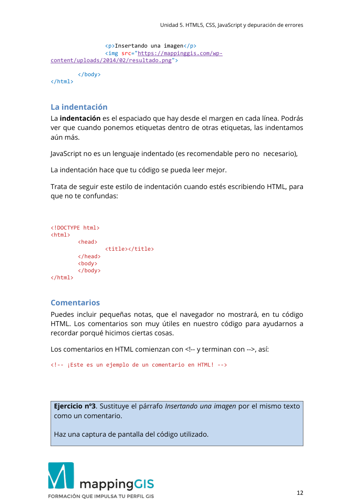</a></details>

[Consultar en el PDF · página 12](../materiales/Ejercicio_5.0_HTML5_CSS_y_JavaScript._Depuraci%C3%B3n_de_errores_2024.pdf#page=12){target="_blank" rel="nofollow noopener noreferrer"}

### HTML/CSS/JS · Ejercicio 4 · Estilo del párrafo

<div class="original-statement"><span class="eyebrow">Enunciado original · HTML/CSS/JS</span><p>Añade un párrafo que lleve como nombre Mapa de Leaflet pero de color azul, tamaño 18 y el tipo de fuente Tahoma.</p></div>

<details class="original-exercise" markdown="1">
<summary>Pasos y contexto originales de la clase</summary>

**Página 12**

```text
Unidad 5. HTML5, CSS, JavaScript y depuración de errores 
 
                                                                                                  12 
  <p>Insertando una imagen</p> 
   
        
 </body> 
</html> 
 
La indentación 
La indentación es el espaciado que hay desde el margen en cada línea. Podrás 
ver que cuando ponemos etiquetas dentro de otras etiquetas, las indentamos 
aún más.  
JavaScript no es un lenguaje indentado (es recomendable pero no  necesario), 
La indentación hace que tu código se pueda leer mejor.  
Trata de seguir este estilo de indentación cuando estés escribiendo HTML, para 
que no te confundas: 
 
<!DOCTYPE html> 
<html> 
 <head> 
  <title></title> 
 </head> 
 <body> 
 </body> 
</html> 
 
Comentarios 
Puedes incluir pequeñas notas, que el navegador no mostrará, en tu código 
HTML. Los comentarios son muy útiles en nuestro código para ayudar nos a 
recordar porqué hicimos ciertas cosas. 
Los comentarios en HTML comienzan con <!-- y terminan con -->, así: 
<!-- ¡Este es un ejemplo de un comentario en HTML! --> 
 
 
Ejercicio nº3. Sustituye el párrafo Insertando una imagen por el mismo texto 
como un comentario. 
 
Haz una captura de pantalla del código utilizado.
```

**Página 13**

```text
Unidad 5. HTML5, CSS, JavaScript y depuración de errores 
 
                                                                                                  13 
Estilos 
Tamaño de fuente 
Como recordarás, HTML es el esqueleto de la página web, y CSS te permite darle 
al esqueleto algo de piel y de maquillaje. 
Pero es posible hacer algo de CSS en líneas. Esto simplemente quiere decir que 
podemos poner algo de estilo en nuestro HTML sin preocuparnos por un archivo 
CSS aparte. 
Recuerda que <p> y </p> son etiquetas de inicio y de cierre. 
Le podemos dar a las etiquetas más instrucciones mediante la inclusión de 
atributos en la etiqueta de inicio. Un atributo es solamente una característica o 
una descripción del contenido en el elemento. 
Vamos a cambiar el tamaño del texto usando el atributo style. Escribimos igual 
a font -size, seguido de dos puntos, el tamaño que deseamos, y finalizamos 
con px (abreviatura de "pixeles"). Por ejemplo: 
<p style = "font-size: 12px"></p> 
Color de fuente 
Para cambiar el color del texto, simplemente añade el atributo style en la 
etiqueta de inicio, luego haz que sea igual a "color:blue" (color azul) o cualquier 
otro color. Por ejemplo: 
<p style="color:red"></p> 
Si quieres cambiar el color  y el tamaño del texto  basta con añadir un punto y 
coma en medio de cada parte. Por ejemplo: 
<p style="color: red; font-size:8px"></p> 
Familia de fuentes tipográficas 
Para cambiar el tipo de fuente, añade el atributo style en la etiqueta de inicio, 
luego hazlo igual a "font-family:Helvetica" (o cualquier fuente que quieras). Por 
ejemplo: 
<p style="font-family:Futura"></p> 
 
Ejercicio nº 4. Añade un párrafo que lleve como nombre Mapa de Leaflet pero 
de color azul, tamaño 18 y el tipo de fuente Tahoma.  
 
Haz una captura de pantalla y pégala en la hoja de resultados.
```

</details>

<details class="source-page"><summary>Ver página 13 del PDF original, con sus capturas</summary><a href="../../materiales/Ejercicio_5.0_HTML5_CSS_y_JavaScript._Depuraci%C3%B3n_de_errores_2024.pdf#page=13" target="_blank" rel="nofollow noopener">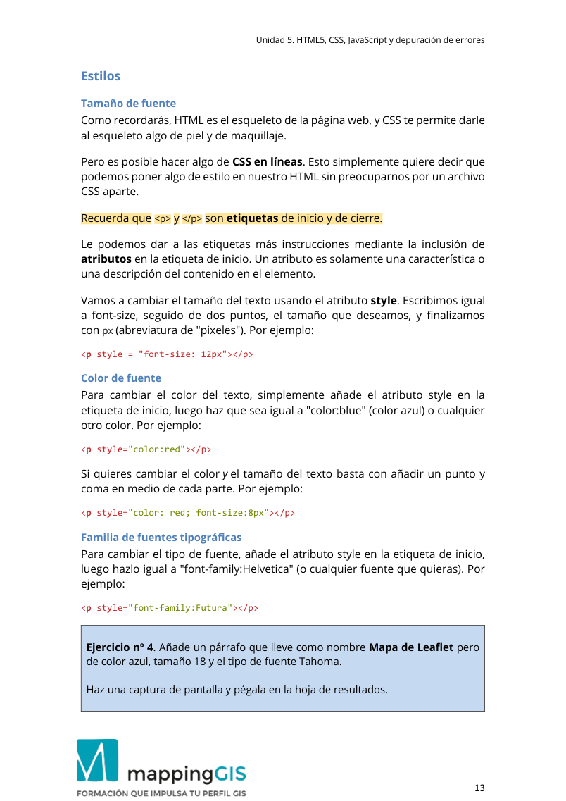</a></details>

[Consultar en el PDF · página 13](../materiales/Ejercicio_5.0_HTML5_CSS_y_JavaScript._Depuraci%C3%B3n_de_errores_2024.pdf#page=13){target="_blank" rel="nofollow noopener noreferrer"}

### HTML/CSS/JS · Ejercicio 5 · Propiedades CSS

<div class="original-statement"><span class="eyebrow">Enunciado original · HTML/CSS/JS</span><p>Incluye las propiedades y valores dentro de las etiquetas de estilo CSS y sube el html a la plataforma de formación.</p></div>

<details class="original-exercise" markdown="1">
<summary>Pasos y contexto originales de la clase</summary>

**Página 13**

```text
Unidad 5. HTML5, CSS, JavaScript y depuración de errores 
 
                                                                                                  13 
Estilos 
Tamaño de fuente 
Como recordarás, HTML es el esqueleto de la página web, y CSS te permite darle 
al esqueleto algo de piel y de maquillaje. 
Pero es posible hacer algo de CSS en líneas. Esto simplemente quiere decir que 
podemos poner algo de estilo en nuestro HTML sin preocuparnos por un archivo 
CSS aparte. 
Recuerda que <p> y </p> son etiquetas de inicio y de cierre. 
Le podemos dar a las etiquetas más instrucciones mediante la inclusión de 
atributos en la etiqueta de inicio. Un atributo es solamente una característica o 
una descripción del contenido en el elemento. 
Vamos a cambiar el tamaño del texto usando el atributo style. Escribimos igual 
a font -size, seguido de dos puntos, el tamaño que deseamos, y finalizamos 
con px (abreviatura de "pixeles"). Por ejemplo: 
<p style = "font-size: 12px"></p> 
Color de fuente 
Para cambiar el color del texto, simplemente añade el atributo style en la 
etiqueta de inicio, luego haz que sea igual a "color:blue" (color azul) o cualquier 
otro color. Por ejemplo: 
<p style="color:red"></p> 
Si quieres cambiar el color  y el tamaño del texto  basta con añadir un punto y 
coma en medio de cada parte. Por ejemplo: 
<p style="color: red; font-size:8px"></p> 
Familia de fuentes tipográficas 
Para cambiar el tipo de fuente, añade el atributo style en la etiqueta de inicio, 
luego hazlo igual a "font-family:Helvetica" (o cualquier fuente que quieras). Por 
ejemplo: 
<p style="font-family:Futura"></p> 
 
Ejercicio nº 4. Añade un párrafo que lleve como nombre Mapa de Leaflet pero 
de color azul, tamaño 18 y el tipo de fuente Tahoma.  
 
Haz una captura de pantalla y pégala en la hoja de resultados.
```

**Página 14**

```text
Unidad 5. HTML5, CSS, JavaScript y depuración de errores 
 
                                                                                                  14 
Color de fondo 
De nuevo vamos a usar el atributo style. Lo haremos igual a "background-color: 
red" (color de fondo: rojo) o cualquier color que quieras. ¡Es así de fácil! 
<body style="background-color: blue">
```

**Página 15**

```text
Unidad 5. HTML5, CSS, JavaScript y depuración de errores 
 
                                                                                                  15 
Etiqueta iframe 
 
Es posible incrustar mapas web en la p ágina haciendo uso de la etiqueta 
<iframe>. 
La etiqueta <iframe> sirve para crear un espacio dentro de la página donde se 
puede incrustar otra web.  
Es un cuadrado cuyas dimensiones debe especificar el desarrollador en la propia 
etiqueta iframe, que tiene asociada una página web que se carga en dicho 
espacio. Esa página web tendrá sus propios contenidos y estilos, independientes 
del contexto donde se está mo strando. Además será perfectamente funcional: 
si tiene enlaces se mostrarán en ese mismo espacio y si tiene scripts o 
aplicaciones dentro se ejecutarán también de manera autónoma en el espacio 
reservado al iframe. 
<iframe style="border: none;" height="400" width="600"  
        src="http://localhost:8080/geoserver/www/web.html"></iframe>
```

**Página 16**

```text
Unidad 5. HTML5, CSS, JavaScript y depuración de errores 
 
                                                                                                  16 
CSS 
CSS (cuyas siglas significan Cascading StyleSheets, u Hojas de Estilo en Cascada) 
es un lenguaje usado para describir la apariencia y el formato de tu HTML. 
Una hoja de estilo es un archivo que describe como debería verse un archivo 
HTML.  
Decimos que estas hojas de estilo están  en cascada porque las hojas pueden 
aplicar el formato cuando corresponde más de un estilo. Por ejemplo, si indicas 
que todos los párrafos debe n tener una fuente de color azul, pero señalas que 
un párrafo específico debe tener fuente de color rojo, CSS lo puede hacer. 
El archivo stylesheet.css contiene toda la información de estilo de CSS: en dónde 
deberían ir los elementos de HTML, cuál color de berían tener, qué tamaño 
deberían tener, y más. 
Existen dos razones principales para separar tu forma/formato (CSS) de tu 
contenido/estructura funcional (HTML): 
a. Puedes aplicarle el mismo formato a diversos elementos de HTML sin 
reescribir el código (p.ej., style="color:red":) una y otra vez. 
b. Puedes aplicarle una apariencia y un formato similares a varias páginas 
de HTML desde un solo archivo CSS. 
 
Incluir CSS en HTML 
 
Para que tu archivo HTML pueda ver la información de CSS puedes colocar una 
etiqueta <link> entre las etiquetas <head></head> de tu página HTML. Tu etiqueta 
<link> necesitará tres atributos: 
1. Un atributo type que será igual a "text/css" 
2. Un atributo rel que será igual a "stylesheet" 
3. Un atributo href que debe apuntar a la dirección web de tu archivo CSS
```

**Página 17**

```text
Unidad 5. HTML5, CSS, JavaScript y depuración de errores 
 
                                                                                                  17 
 
<!DOCTYPE html> 
<html> 
 <head> 
  <link type="text/css" rel="stylesheet" 
href="stylesheet.css"/> 
  <title>Título</title> 
 </head> 
 <body> 
  <p>párrafo</p> 
 </body> 
</html> 
 
Como nada va en medio de las etiquetas<link></link>, está bien usar un solo par 
de <> para que sirvan como etiquetas de inicio y de cierre. 
 
La sintaxis de CSS 
 
La sintaxis de CSS es distinta de la de HTML. El formato general se ve así: 
selector { 
    propiedad: valor; 
} 
 
Un selector puede ser cualquier elemento de HTML, como <p>, , o <table>. 
Simplemente es necesario obviar los <>. Para hacer que el texto de un párrafo 
tenga color rojo con CSS, escribirías: 
p { 
    color: red; 
} 
 
Una propiedad es un aspecto de un selector. Por ejemplo, puedes cambiar font-
family, color, y font-size del texto en tus páginas web (además de muchos más). 
Un valor es una posible configuración de una propiedad.  color puede ser rojo , 
azul, negro o cualquier otro color; font-family puede ser prácticamente cualquier 
fuente; y así sucesivamente. 
Debes finalizar cada propiedad-valor con un punto y coma ( ;). Así es como CSS 
sabe que ya terminaste de trabajar en un par y que estás listo para trabajar en 
el siguiente.
```

**Página 18**

```text
Unidad 5. HTML5, CSS, JavaScript y depuración de errores 
 
                                                                                                  18 
Además un selector puede tener muchas propiedades. Por ejemplo, si quieres 
establecer la fuente, el color de fuente y el tamaño de fuente de un párrafo, 
sencillamente puedes escribir: 
p { 
    font-family: Arial; 
    color: blue; 
    font-size: 24px; 
} 
 
Ahora vamos a incluir código CSS dentro de nuestro HTML. Deberás incluir las 
etiquetas <style> y </style> dentro de la etiqueta <head>. 
<!DOCTYPE html>  
<html>  
<head>  
<style> 
<!-- aquí dentro va nuestro código CSS -->  
</style>  
</head>  
 
<body> </body>  
</html> 
 
Dentro de las etiquetas de estilo incluiremos nuestr as propiedades y valores 
para el párrafo Mapa de Leaflet. 
Elimina las definiciones de estilo que incluimos en el ejercicio anterior . La línea 
debería quedar así: 
<p> Mapa de Leaflet</p>  
 
Ahora incluye este código dentro de las etiquetas style: 
p { 
    font-family: Arial; 
    color: red; 
    font-size: 18px; 
} 
 
 
 
Ejercicio nº5. Incluye las propiedades y valores dentro de las etiquetas de estilo 
CSS y sube el html a la plataforma de formación.
```

</details>

<details class="source-page"><summary>Ver página 18 del PDF original, con sus capturas</summary><a href="../../materiales/Ejercicio_5.0_HTML5_CSS_y_JavaScript._Depuraci%C3%B3n_de_errores_2024.pdf#page=18" target="_blank" rel="nofollow noopener">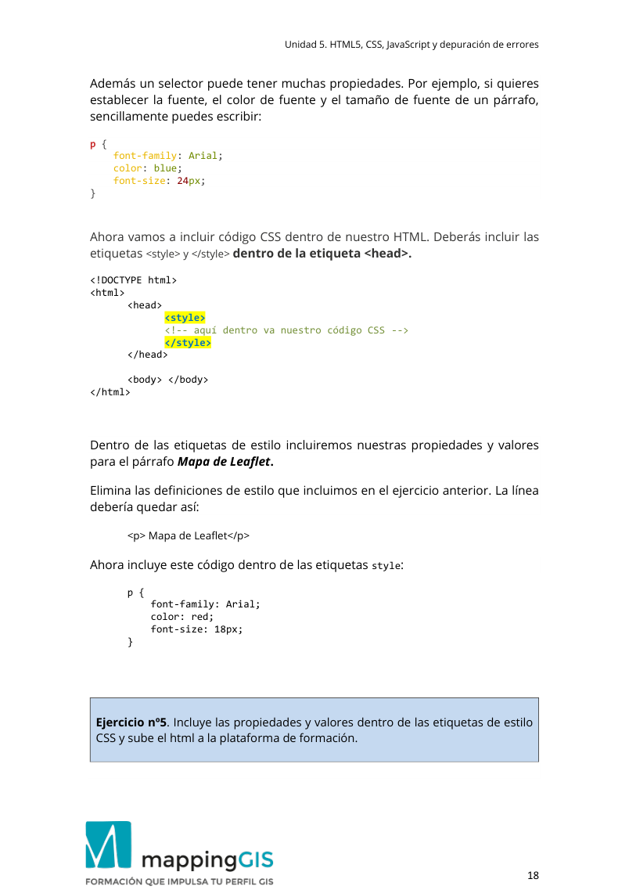</a></details>

[Consultar en el PDF · página 18](../materiales/Ejercicio_5.0_HTML5_CSS_y_JavaScript._Depuraci%C3%B3n_de_errores_2024.pdf#page=18){target="_blank" rel="nofollow noopener noreferrer"}

### HTML/CSS/JS · Ejercicio 6 · Encabezado y párrafos

<div class="original-statement"><span class="eyebrow">Enunciado original · HTML/CSS/JS</span><p>Utilizando como modelo el código d el ejemplo anterior escribe un texto con un encabezado y varios párrafos en los que se destaquen algunas de sus partes.</p></div>

<details class="original-exercise" markdown="1">
<summary>Pasos y contexto originales de la clase</summary>

**Página 18**

```text
Unidad 5. HTML5, CSS, JavaScript y depuración de errores 
 
                                                                                                  18 
Además un selector puede tener muchas propiedades. Por ejemplo, si quieres 
establecer la fuente, el color de fuente y el tamaño de fuente de un párrafo, 
sencillamente puedes escribir: 
p { 
    font-family: Arial; 
    color: blue; 
    font-size: 24px; 
} 
 
Ahora vamos a incluir código CSS dentro de nuestro HTML. Deberás incluir las 
etiquetas <style> y </style> dentro de la etiqueta <head>. 
<!DOCTYPE html>  
<html>  
<head>  
<style> 
<!-- aquí dentro va nuestro código CSS -->  
</style>  
</head>  
 
<body> </body>  
</html> 
 
Dentro de las etiquetas de estilo incluiremos nuestr as propiedades y valores 
para el párrafo Mapa de Leaflet. 
Elimina las definiciones de estilo que incluimos en el ejercicio anterior . La línea 
debería quedar así: 
<p> Mapa de Leaflet</p>  
 
Ahora incluye este código dentro de las etiquetas style: 
p { 
    font-family: Arial; 
    color: red; 
    font-size: 18px; 
} 
 
 
 
Ejercicio nº5. Incluye las propiedades y valores dentro de las etiquetas de estilo 
CSS y sube el html a la plataforma de formación.
```

**Página 19**

```text
Unidad 5. HTML5, CSS, JavaScript y depuración de errores 
 
                                                                                                  19 
Por supuesto podemos utilizar las propiedades de estilo para d ar formato a 
nuestro mapa. En los ejercicios de OpenLayers y Leaflet veremos cómo hacerlo. 
 
 
<style> 
#map {  
Width: 50 px 
height: 580px;  
} 
</style> 
 
Comentarios 
 
Como hemos visto, los comentarios de HTML se ven así: 
<!--¡Soy un comentario!--> 
Por otro lado, los comentarios de CSS lucen así: 
/*¡Soy un comentario!*/ 
 
Volvemos a insistir: e scribir bueno s comentarios es un buen hábito para 
recordar porqué hicimos algunas cosas. 
 
Todos los elementos de HTML son posibles selectores 
 
Podemos usar todos de elementos de nuestro HTML como selectores de CSS: le 
podemos dar estilo a las etiquetas de HTML <h1></h1> con el selector de CSS h1, 
a <p></p> con p, y así sucesivamente. 
Además existen dos selectores importantes que puedes usar, los elementos de 
HTML: de clase y de identificadores. 
 
 
Video: Visualiza el video correspondiente a esta sección
```

**Página 20**

```text
Unidad 5. HTML5, CSS, JavaScript y depuración de errores 
 
                                                                                                  20 
Las clases 
 
Las clases son útiles cuando tienes un montón de elementos que deberían tener 
el mismo estilo. En vez de aplicar las mismas reglas a varios selectores, 
simplemente puedes aplicar la misma clase a todos esos elementos de HTML y 
luego definir el estilo para esa clase en la pestaña de CSS. 
Las clases son asignadas a los elementos de HTML usando la palabra  class y un 
signo de igual, así: 
<div class="cuadrado"></div> 
 
<td class="cuadrado"></td> 
 
En CSS, las clases se identifican con un punto (.), así: 
.cuadrado { 
    height: 100px; 
    width: 100px; 
} 
 
Esto te permite tomar elementos de diferentes tipos y darles el mismo estilo. 
Entenderemos mejor como se utiliza con un ejemplo. 
<!DOCTYPE html> 
<html> 
<head> 
<meta charset="UTF-8"> 
<title> Practicando con clases </title> 
<style> 
span.nota { 
font-size: 120%; 
color: red; 
} 
</style> 
</head> 
<body> 
<h1>Es importante proteger <span class="nota">el medio ambiente</span> de 
nuestro planeta</h1> 
 
<p>También es importante conservar la <span class="nota">biodiversidad</span> 
de la tierra y sus océanos, para lo cual es imprescindible reducir la emisión 
a la atmósfera de <span class="nota"> gases de efecto invernadero</span> 
responsables del calentamiento global. </p> 
 
</body> 
</html> 
 
En el código anterior cada vez que el navegador se encuentre con la  definición de 
clase aplicará el estilo CSS que hemos creado. Estamos  utilizando también una
```

**Página 21**

```text
Unidad 5. HTML5, CSS, JavaScript y depuración de errores 
 
                                                                                                  21 
etiqueta <span> que lo único que hace es separar o  definir una zona del texto. La 
etiqueta span no hace nada por si sola, es la definición de la clase la que nos permite 
asignar estilos a esta parte del  texto, lo cual conseguimos esc ribiendo span.nota 
dentro de las etiquetas <style> de la cabecera. Como explicamos antes la referencia 
a una clase se  realiza colocando un punto delante del nombre de la clase, que en 
esta ocasión es .nota. 
Ejercicio nº6. Utilizando como modelo el código d el ejemplo anterior escribe un 
texto con un encabezado y varios párrafos en los que se  destaquen algunas de 
sus partes.  
 
Haz una captura de pantalla del resultado y pégalo en la plantilla de resultados. 
 
Los identificadores 
 
Por otra parte, los identificadores son la mejor opción  cuando tene mos 
exactamente un elemento que debe tener cierto estilo. 
Los identificadores son asignados a los elementos de HTML usando la 
palabra id y un signo de igual: 
<div id="primero"></div> 
<div id="segundo></div> 
<p id="intro"></p> 
 
Los identificadores se reconocen en CSS con un signo (#): 
#primero { 
    height: 50px; 
} 
#segundo { 
    height: 100px; 
} 
#intro { 
    color: #FF0000; 
} 
Esto te permite aplicarle estilo a una sola instancia de un selector, en vez de 
a todas las instancias. En el ejemplo siguiente veremos cómo hacerlo. 
<!DOCTYPE html> 
<html> 
<head> 
<meta charset="UTF-8">
```

</details>

<details class="source-page"><summary>Ver página 21 del PDF original, con sus capturas</summary><a href="../../materiales/Ejercicio_5.0_HTML5_CSS_y_JavaScript._Depuraci%C3%B3n_de_errores_2024.pdf#page=21" target="_blank" rel="nofollow noopener">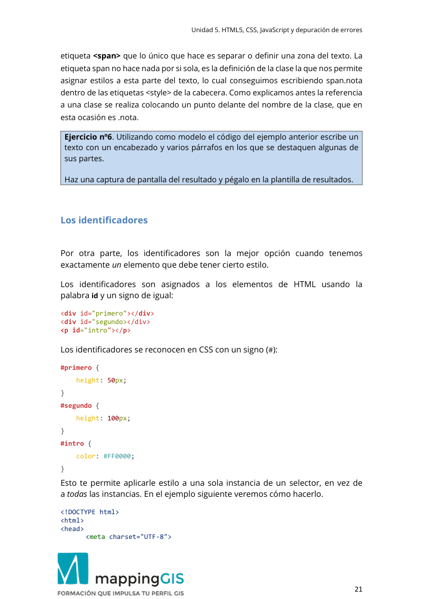</a></details>

[Consultar en el PDF · página 21](../materiales/Ejercicio_5.0_HTML5_CSS_y_JavaScript._Depuraci%C3%B3n_de_errores_2024.pdf#page=21){target="_blank" rel="nofollow noopener noreferrer"}

### HTML/CSS/JS · Ejercicio 7 · Identificadores id

<div class="original-statement"><span class="eyebrow">Enunciado original · HTML/CSS/JS</span><p>Utilizando como modelo el código del ejemplo anterior escribe dos textos a los que se les asigne estilo s diferentes mediante el empleo de dos identificadores “id”.</p></div>

<details class="original-exercise" markdown="1">
<summary>Pasos y contexto originales de la clase</summary>

**Página 21**

```text
Unidad 5. HTML5, CSS, JavaScript y depuración de errores 
 
                                                                                                  21 
etiqueta <span> que lo único que hace es separar o  definir una zona del texto. La 
etiqueta span no hace nada por si sola, es la definición de la clase la que nos permite 
asignar estilos a esta parte del  texto, lo cual conseguimos esc ribiendo span.nota 
dentro de las etiquetas <style> de la cabecera. Como explicamos antes la referencia 
a una clase se  realiza colocando un punto delante del nombre de la clase, que en 
esta ocasión es .nota. 
Ejercicio nº6. Utilizando como modelo el código d el ejemplo anterior escribe un 
texto con un encabezado y varios párrafos en los que se  destaquen algunas de 
sus partes.  
 
Haz una captura de pantalla del resultado y pégalo en la plantilla de resultados. 
 
Los identificadores 
 
Por otra parte, los identificadores son la mejor opción  cuando tene mos 
exactamente un elemento que debe tener cierto estilo. 
Los identificadores son asignados a los elementos de HTML usando la 
palabra id y un signo de igual: 
<div id="primero"></div> 
<div id="segundo></div> 
<p id="intro"></p> 
 
Los identificadores se reconocen en CSS con un signo (#): 
#primero { 
    height: 50px; 
} 
#segundo { 
    height: 100px; 
} 
#intro { 
    color: #FF0000; 
} 
Esto te permite aplicarle estilo a una sola instancia de un selector, en vez de 
a todas las instancias. En el ejemplo siguiente veremos cómo hacerlo. 
<!DOCTYPE html> 
<html> 
<head> 
<meta charset="UTF-8">
```

**Página 22**

```text
Unidad 5. HTML5, CSS, JavaScript y depuración de errores 
 
                                                                                                  22 
<title> Practicando con clases </title> 
 
<style> 
#texto1 { 
font-size: 120%; 
color: red; 
} 
 
#texto2 { 
font-family: Arial; 
color: blue; 
font-size: 18px; 
} 
 
</style> 
 
</head> 
 
<body> 
 
<h2>Declaración Universal de los derechos Humanos</h2> 
<p id ="texto1">Artículo 1 </p> 
<p id ="texto2">Todos los seres humanos nacen libres e iguales en dignidad y 
derechos y, dotados como están de razón y conciencia, deben comportarse 
fraternalmente los unos con los otros.</p> 
 
</body> 
</html> 
 
El código anterior da como resultado lo siguiente: 
 
Ejercicio nº7. Utilizando como modelo el código del ejemplo anterior escribe dos 
textos a los que se les asigne estilo s diferentes mediante el  empleo de dos 
identificadores “id”.  
 
Haz una captura de pantalla y pégala en la plantilla de resultados.
```

</details>

<details class="source-page"><summary>Ver página 22 del PDF original, con sus capturas</summary><a href="../../materiales/Ejercicio_5.0_HTML5_CSS_y_JavaScript._Depuraci%C3%B3n_de_errores_2024.pdf#page=22" target="_blank" rel="nofollow noopener">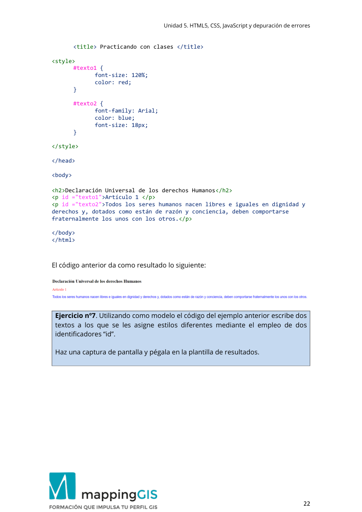</a></details>

[Consultar en el PDF · página 22](../materiales/Ejercicio_5.0_HTML5_CSS_y_JavaScript._Depuraci%C3%B3n_de_errores_2024.pdf#page=22){target="_blank" rel="nofollow noopener noreferrer"}

### HTML/CSS/JS · Ejercicio 8 · Ejecutar JavaScript

<div class="original-statement"><span class="eyebrow">Enunciado original · HTML/CSS/JS</span><p>Inserta el código JavaScript anterior en un HTML. Ejecútalo y describe en la hoja de resultados lo que sucede.</p></div>

<details class="original-exercise" markdown="1">
<summary>Pasos y contexto originales de la clase</summary>

**Página 22**

```text
Unidad 5. HTML5, CSS, JavaScript y depuración de errores 
 
                                                                                                  22 
<title> Practicando con clases </title> 
 
<style> 
#texto1 { 
font-size: 120%; 
color: red; 
} 
 
#texto2 { 
font-family: Arial; 
color: blue; 
font-size: 18px; 
} 
 
</style> 
 
</head> 
 
<body> 
 
<h2>Declaración Universal de los derechos Humanos</h2> 
<p id ="texto1">Artículo 1 </p> 
<p id ="texto2">Todos los seres humanos nacen libres e iguales en dignidad y 
derechos y, dotados como están de razón y conciencia, deben comportarse 
fraternalmente los unos con los otros.</p> 
 
</body> 
</html> 
 
El código anterior da como resultado lo siguiente: 
 
Ejercicio nº7. Utilizando como modelo el código del ejemplo anterior escribe dos 
textos a los que se les asigne estilo s diferentes mediante el  empleo de dos 
identificadores “id”.  
 
Haz una captura de pantalla y pégala en la plantilla de resultados.
```

**Página 23**

```text
Unidad 5. HTML5, CSS, JavaScript y depuración de errores 
 
                                                                                                  23 
Introducción a JavaScript.  ¿Qué es JavaScript? 
 
Es uno de los lenguajes de programación más importante. ¿Por qué?  Porque en él 
se programan las aplicaciones para internet y la Web. 
Los navegadores modernos soportan la versión JavaScript 1.5 (diciembre de 2009). 
Valores 
 
JavaScript tiene todos los valor es que cabría esperar de los lenguajes de 
programación: booleanos, números, cadenas, matrices, etc. Todos los valores en 
JavaScript tienen propiedades. Cada propiedad tiene una clave (o nombre) y un 
valor. Piensa en los campos de un registro. Se utiliza el operador punto (.) para leer 
una propiedad (.): 
value.propKey 
Un ejemplo: La cadena 'texto' tiene la propiedad length 
> var str = 'texto'; 
> str.length 
5 
Tipos de JavaScript (valores) 
 number son cantidades y puedes hacer operaciones matemáticas con ellas. 
1, 2, 10.5. 
 strings son secuencias de caracteres, como las letras  a-z, los espacios, e 
incluso los números. Los strings son muy útiles como etiquetas, nombres y 
contenido para tus programas. Para escribir un string, debes ponerlo  entre 
comillas:  
"¿Cuál es tu nombre?" 
 
 booleanos.  Un booleano puede tener dos valores: 
o true (verdadero) 
o false (falso). 
Puedes usarlos en tu código haciendo sentencias que  sean 
igual a true o false.
```

**Página 24**

```text
Unidad 5. HTML5, CSS, JavaScript y depuración de errores 
 
                                                                                                  24 
10 > 3 es igual a true 
5 < 4 es igual a false 
 “undefined”:  undefined, null 
 
Objetos 
Representan agregaciones estructuradas de valores.  
Los objetos se agrupan en clases: Object, Array, Date 
Todos los valores que no son primitivos son objetos. Los tipos más comunes son: 
 Objetos planos (tipo objet) pueden ser creados por objetos literales: 
 
{ 
       Nombre: 'Felipe', 
       Apellidos: 'González' 
} 
El anterior objeto tiene dos propiedades: el valor de la propiedad nombre 
es 'Felipe', el valor de la propiedad apellido es 'Gonzalez'. 
 Matrices (tipo Array) pueden ser creados por literales de matriz: 
     ['cities', 'countries', 'ocean'] 
La matriz anterior tiene tres elementos que se puede acceder a través de los 
índices numéricos. Por ejemplo, el índice de 'cities' es 0. 
 Las expresiones regulares (tipo RegExp) pueden ser creados por literales de 
expresiones regulares: 
     / ^ a + b + $ / 
 
 Objeto nulo 
Operadores y expresiones
```

**Página 25**

```text
Unidad 5. HTML5, CSS, JavaScript y depuración de errores 
 
                                                                                                  25 
Con los tipos y objetos podemos crear expresiones utilizando operadores. 
Por ejemplo las operaciones matemáticas ( +, - , *, / ) 
5 + 5 => 10 
 
Programa, sentencias y comentarios 
 
Un programa es una secuencia de sentencias  que se ejecutan en el orden en que 
han sido definidas. 
Las sentencias realizan tareas al ejecutarse en un ordenador: 
var x = 5 
Los comentarios son muy útiles para explicar partes difíciles de tu código o como 
recordatorios para ti mismo.  
JavaScript tiene dos tipos de comentarios: comentarios de una sola línea y 
comentarios multilínea.  
Comentarios de una sola línea comienzan con / / y terminan al final de la línea: 
 x + +; // comentario de una sola línea 
 
Comentarios de varias líneas se delimitan con / * y * / 
/ * Este es un 
comentario  
de varias líneas 
* / 
Es recomendable utilizar comentarios monolínea // 
Variables 
Para escribir un código que sea más complejo, necesitamos una forma de 'guardar' 
los valores de nuestro código. Esto lo hacemos definiendo una variable con un 
nombre específico, que distingue entre mayúsculas y minúsculas.  
En JavaScript debemos declarar las variables a través de  la palabra reservada  var 
seguida de la variable. 
Se pueden crear va rias variables en una sentencia, separando las definiciones por 
comas.
```

**Página 26**

```text
Unidad 5. HTML5, CSS, JavaScript y depuración de errores 
 
                                                                                                  26 
var nombre; // declaramos la variable ‘nombre’  
 
> var x; //creamos la variable x y asigna el valor undefined 
> x = 1; //asignamos el valor 1 a x 
> y = 2; //asignamos el valor 2 a y. Esta sentencia daría un error 
porque no se ha definido la variable y 
 
ReferenceError: y is not defined 
Podemos declarar una variable y asignarle un valor al mismo tiempo: 
var osm = L.tileLayer();//crea osm y le asignamos el valor de una capa 
de teselas  
El valor de una variable se puede cambiar fácilmente mediante una sentencia de 
asignación. 
var osm = L.tileLayer.wms(); 
 
Dentro de una variable podemos incluir cualquier cosa (un número, un string, una 
fecha, etc)
```

**Página 27**

```text
Unidad 5. HTML5, CSS, JavaScript y depuración de errores 
 
                                                                                                  27 
Sintaxis 
 
Delimitación de sentencias 
Los “;” delimitan el final de una sentencia. 
Son opcionales, pero se recomienda utilizarlo siempre, porque su omisión puede 
dar lugar a sorpresas. Además los programas son más legibles y seguros. 
var x = 1; //bien 
var x; //no recomendable porque esta como undefined 
x = 1  //no recomendable porque falta el ; 
var x = 1 //no recomendable porque falta el ; 
 
Nombre de variables 
 
El nombre de una variable debe comenzar por  letra, _ o $ 
x, map, map1, _map, &f 
Por lo tanto un nombre de una variable no debe comenzar por números, porque 
crearía un error de ejecución. 
var #1 = 1; //Error de ejecución 
var 1_1 = 1; //Error de ejecución 
 
Tampoco podemos poner como nombre a una variable una palabra reservada. 
Las variables son sensibles a mayúsculas y minúsculas: 
MiMapa y mimapa son variables distintas. 
Orden en la creación de variables 
 
JavaScript es un lenguaje de procedimientos, que va leyendo el código de arriba 
hacia abajo, por lo tanto no podemos utilizar una variable que aún no haya sido 
creada. Aunque se defina más adelantes. En este ejemplo vemos cómo NO hay que 
trabajar en JavaScript:
```

**Página 28**

```text
Unidad 5. HTML5, CSS, JavaScript y depuración de errores 
 
                                                                                                  28 
 
Este script no mostrará nada, ya que estamos intentando utilizar la capa de OSM en 
el mapa, pero el objeto OSM aun no ha sido creado, lo creamos en la línea 30. 
El depurador de errores nos ayuda informándonos de que OSM no se ha definido: 
 
Nota 
Por el momento no te preocupes por la sintaxis utilizada ni por la depuración de 
errores, ya que lo veremos más adelante. 
 
 
Aquí vemos el script correcto, donde primero creamos la variable y a continuación 
la utilizamos:
```

**Página 29**

```text
Unidad 5. HTML5, CSS, JavaScript y depuración de errores 
 
                                                                                                  29 
 
 
Declaraciones y expresiones 
 
Para entender la sintaxis de JavaScript, es muy útil saber que tiene dos grandes 
categorías sintácticas: declaraciones y expresiones. 
Las Declaraciones "hacen cosas". Un programa es una secuencia de declaraciones. 
Ejemplo de una declaración, que declara (crea) una variable foo: 
var foo; 
Las expresiones producen valores. Son el lado derecho de una asignación, 
argumentos de funciones, etc. Ejemplo de una expresión: 
2 + 1 
Funciones útiles 
Script con fecha 
Un script es un programa JavaScript insertado en una página HTML. 
Delimitado por marcaras <script> con atributo type=”text/javascript”. 
document.write("Texto") inserta un texto en la página Web: 
<!DOCTYPE html> 
<html> 
 <body> 
<script type="text/javascript"> 
  document.write("Hoy es: " + new Date ()); 
</script>
```

**Página 30**

```text
Unidad 5. HTML5, CSS, JavaScript y depuración de errores 
 
                                                                                                  30 
</body> 
</html> 
 
Script con expresión 
alert("Texto") muestra un mensaje al usuario  en una ventana emergente: 
<!DOCTYPE html> 
<html> 
 <body> 
<script type="text/javascript"> 
  document.write("Hoy es: " + new Date ()); 
  alert ("Hola Mundo"); 
</script> 
 
</body> 
</html> 
 
Otras funciones: 
confirm () presenta un mensaje y pide confirmación o rechazo. 
prompt (msj) presenta un mensaje y pide un dato de entrada. 
Funciones 
Una manera de definir una función es a través de una declaración de la función: 
    function add (param1, param2) { 
         return param1 + param2; 
     } 
El código anterior define una función add que tiene dos parámetros param1 y 
param2 y devuelve la suma de ambos parámetros. Así es como se llama a esa 
función: 
 
> add(6, 1) 
7 
 
> add('a', 'b') 
'ab' 
 
Otra manera de definir add() es a través de una expresión de función: 
 
var add = function (param1, param2) { 
        return param1 + param2; 
}; 
 
Esta función tiene cuatro partes.
```

**Página 31**

```text
Unidad 5. HTML5, CSS, JavaScript y depuración de errores 
 
                                                                                                  31 
1. Declara la función usando var, y luego asígnale un nombre. 
2. Luego debes usar el comando  function para decirle al computador que 
estás haciendo una función. 
3. El fragmento entre paréntesis es llamado el parámetro. Piensa que es 
una palabra de reemplazo a la que le asignamos un valor específico 
cuando llamamos a la función.  
4. Luego escribe tu código reusable entre { }. Cada línea de código en este 
bloque deber terminar con un ; 
 
Condicionales y bucles 
 
Los principales declaraciones en JavaScript para establecer condiciones son: 
 
if, switch, for y while. 
 
- IF 
 
<script> 
 
var mivariable = 9; 
if(mivariable < 10) { 
alert("El valor es menor que 10"); 
} 
</script> 
 
La declaración if controla la expresión entre paréntesis y procesa las  
instrucciones entre llaves si la condición es verdadera. En el código del  listado 
anterior asignamos el valor 9 a mivariable. Como este valor es  inferior al que 
indica la condición, nos mostrará el mensaje en la pantalla. 
 
- SWITCH 
 
La declaración switch se utiliza para comprobar múltiples condiciones. 
 
 
<script> 
var mivariable = 3; 
switch(mivariable) { 
case 5: 
alert("El valor es cinco"); 
break; 
case 8: 
alert("El valor es ocho"); 
break; 
case 10:
```

**Página 32**

```text
Unidad 5. HTML5, CSS, JavaScript y depuración de errores 
 
                                                                                                  32 
alert("El valor es diez"); 
break; 
default: 
alert("El valor es " + mivariable); 
} 
</script> 
 
 
La declaración switch evalúa una expresión, compara el resultado con la opción  
case que están dentro de las llaves y devuelve el resultado correspondiente. En 
el ejemplo anterior creamos una variable a la que  asignamos valor 3. A 
continuación se pasa a analizar las diferentes  opciones. El primer valor es 5, 
como no es coincidente con el valor de  mivariable pasa al segundo case. De 
esta forma continúa el proceso hasta  que se cumpla alguna condición. En el 
ejemplo que hemos puesto, como no se cumple ninguna de las condiciones llega 
la final del proceso y muestra el valor por defecto. 
 
 
- FOR 
 
La declaración for ejecutará el código entre llaves mientras la condición indicada 
en el segundo parámetro sea verdadera. Utiliza la sintaxis for (inicialización; 
condición, incremento). 
 
<script> 
var mivariable = 9; 
for(var f = 0; f < mivariable; f++) { 
alert("El valor actual es " + f); 
} 
</script> 
 
 
El primer valor de la condición for es f=0. Este será el valor de inicialización. 
 
La condición que se marca es que ese valor sea menor que el indicado en 
mivariable. 
 
En caso de que la condición sea verdadera el código entre llaves es ejecutado. Al 
finalizar el intérprete de JavaScript ejecuta el tercer parámetro de for (es decir 
f++, con el que se incrementará en una unidad el valor de f) y comprueba la 
condición nuevamente. Si la condición es verdadera, las instrucciones son 
ejecutadas una vez más. El bucle continúa hasta que la condición es falsa. 
 
 
Ejercicio nº8. Inserta el código JavaScript anterior en un HTML. Ejecútalo y  
describe en la hoja de resultados lo que sucede.
```

</details>

<details class="source-page"><summary>Ver página 32 del PDF original, con sus capturas</summary><a href="../../materiales/Ejercicio_5.0_HTML5_CSS_y_JavaScript._Depuraci%C3%B3n_de_errores_2024.pdf#page=32" target="_blank" rel="nofollow noopener">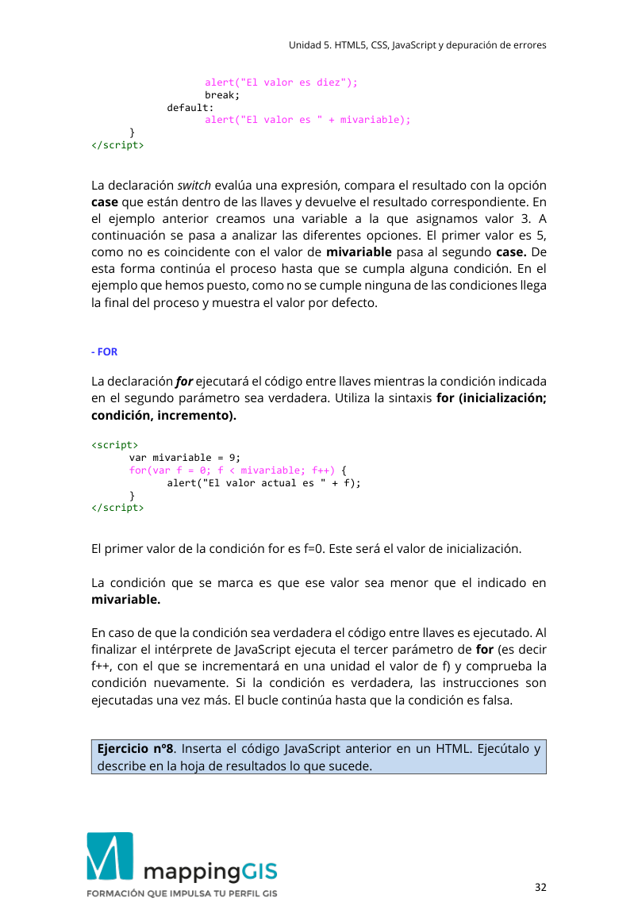</a></details>

[Consultar en el PDF · página 32](../materiales/Ejercicio_5.0_HTML5_CSS_y_JavaScript._Depuraci%C3%B3n_de_errores_2024.pdf#page=32){target="_blank" rel="nofollow noopener noreferrer"}

### HTML/CSS/JS · Ejercicio 9 · Depurar la página

<div class="original-statement"><span class="eyebrow">Enunciado original · HTML/CSS/JS</span><p>Nos han pasado una web pero su código tiene varios errores. Utiliza un depurador para corregirlos y poder ver la web correctamente.</p></div>

<details class="original-exercise" markdown="1">
<summary>Pasos y contexto originales de la clase</summary>

**Página 32**

```text
Unidad 5. HTML5, CSS, JavaScript y depuración de errores 
 
                                                                                                  32 
alert("El valor es diez"); 
break; 
default: 
alert("El valor es " + mivariable); 
} 
</script> 
 
 
La declaración switch evalúa una expresión, compara el resultado con la opción  
case que están dentro de las llaves y devuelve el resultado correspondiente. En 
el ejemplo anterior creamos una variable a la que  asignamos valor 3. A 
continuación se pasa a analizar las diferentes  opciones. El primer valor es 5, 
como no es coincidente con el valor de  mivariable pasa al segundo case. De 
esta forma continúa el proceso hasta  que se cumpla alguna condición. En el 
ejemplo que hemos puesto, como no se cumple ninguna de las condiciones llega 
la final del proceso y muestra el valor por defecto. 
 
 
- FOR 
 
La declaración for ejecutará el código entre llaves mientras la condición indicada 
en el segundo parámetro sea verdadera. Utiliza la sintaxis for (inicialización; 
condición, incremento). 
 
<script> 
var mivariable = 9; 
for(var f = 0; f < mivariable; f++) { 
alert("El valor actual es " + f); 
} 
</script> 
 
 
El primer valor de la condición for es f=0. Este será el valor de inicialización. 
 
La condición que se marca es que ese valor sea menor que el indicado en 
mivariable. 
 
En caso de que la condición sea verdadera el código entre llaves es ejecutado. Al 
finalizar el intérprete de JavaScript ejecuta el tercer parámetro de for (es decir 
f++, con el que se incrementará en una unidad el valor de f) y comprueba la 
condición nuevamente. Si la condición es verdadera, las instrucciones son 
ejecutadas una vez más. El bucle continúa hasta que la condición es falsa. 
 
 
Ejercicio nº8. Inserta el código JavaScript anterior en un HTML. Ejecútalo y  
describe en la hoja de resultados lo que sucede.
```

**Página 33**

```text
Unidad 5. HTML5, CSS, JavaScript y depuración de errores 
 
                                                                                                  33 
 
- WHILE 
 
La declaración while solo requiere la declaración de la condición entre 
paréntesis y el código a ser ejecutado entre llaves. El bucle se ejecutará hasta 
que la condición sea falsa. Veamos un ejemplo: 
 
<script> 
var mivariable = 9; 
do { 
                mivariable++; 
   }while (mivariable > 100); 
             alert( "El valor de mivariable es " + mivariable); 
</script> 
 
En este código estamos indicando como condición que "mivariable" sea mayor 
de 100. Como el valor asignado inicialmente a la variable fue 9, está condición 
es falsa, pero como estamos usando la condición do while, el código dentro del 
bucle es ejecutado una vez antes de que la condición sea evaluada. La ventana 
emergente mostrará el valor 10  (9+1)
```

**Página 34**

```text
Unidad 5. HTML5, CSS, JavaScript y depuración de errores 
 
                                                                                                  34 
Depuración de JavaScript 
Hasta hace unos años, la depuración de JavaScript en sitios web era horrible; escribir 
código en un editor de texto, añadir declaraciones de  alerta para inspeccionar 
valores, y repetir hasta que las cosas funcionasen. 
El editor de texto sigue siendo aún la principal herramienta para los desarrolladores 
de JavaScript, pero actualmente ya existen ayudas como el resaltado de sintaxis, el 
autocompletado de código y otras herramientas específicas de lenguaje.  
Dependiendo de dónde provengan los desarrolladores, las opciones más populares 
son  vi, UltraEdit, TextMate o gedit. También hay plugins para IDEs como Eclipse o 
distribuciones completas de Eclipse realizadas para el desarrollo de JavaScript, como 
Aptana Studio. 
JavaScript es ahora al menos tan importante como HTML para crear páginas web, y 
los principales navegadores incluyen ya herramientas de depuración para 
desarrolladores. 
 
Corrección de errores con Firefox 
 
Para depurar un script con Firefox, solamente es necesario acceder a la opción 
Consola de error dentro del menú Herramientas. 
La consola de errores permite diferenciar los mensajes de información, los 
mensajes de aviso y los mensajes de error. Además, permite visualizar todos los 
errores de la página simultáneamente. Por cada error detectado se indica la posible 
solución mediante un mensaje en inglés y se muestra el trozo de código del script 
donde se ha producido el error. Además, pulsando sobre el enlace incluido se 
accede a la línea concreta del archivo concreto donde se ha producido el error. 
 
 
 
Ejemplo práctico
```

**Página 35**

```text
Unidad 5. HTML5, CSS, JavaScript y depuración de errores 
 
                                                                                                  35 
Hemos creado un HTML con la API de OpenLayers y el mapa no aparece, ¡qué 
horror! 
 
 
Para acceder a las herramientas de desarrollo debemos hacer botón derecho 
Inspeccionar elemento:
```

**Página 36**

```text
Unidad 5. HTML5, CSS, JavaScript y depuración de errores 
 
                                                                                                  36 
 
A continuación pinchamos sobre la pestaña Consola y vemos el error:
```

**Página 37**

```text
Unidad 5. HTML5, CSS, JavaScript y depuración de errores 
 
                                                                                                  37 
 
A la derecha se muestra la línea en la que se ha detectado un error, en este caso se 
trata de la línea 33, en la que hay un problema. 
Si pinchamos ahí, se abrirá una nueva pestaña con la línea del código que debemos 
corregir:
```

**Página 38**

```text
Unidad 5. HTML5, CSS, JavaScript y depuración de errores 
 
                                                                                                  38 
 
En este caso el problema es que hemos escrito  
Ol.layer.Tile 
Y debería poner 
ol.layer.Tile 
Corregimos el código en nuestro editor de texto , guardamos y actualizamos el 
navegador.
```

**Página 39**

```text
Unidad 5. HTML5, CSS, JavaScript y depuración de errores 
 
                                                                                                  39 
 
Aquí nuestro mapa sin errores.
```

**Página 40**

```text
Unidad 5. HTML5, CSS, JavaScript y depuración de errores 
 
                                                                                                  40 
Depuración de errores con Chrome 
 
Al igual que con Firefox, u na manera muy sencilla es hacer botón derecho con el 
ratón y seleccionar la opción Inspeccionar. 
 
De este modo se abren las Herramientas de desarrollo de Google Chrome. 
Las Herramientas de desarrollo pueden ser separadas de la ventana del navegador 
que estamos depurando, haciendo clic en el icono de la pantalla en la esquina 
inferior izquierda de las herramientas de desarrollo.  
La primera pestaña, Elements, es útil para inspeccionar el estado actual de la DOM 
y para ver los estilos aplicados a todos los recursos de hojas de estilo. Ten en cuenta 
que tanto el DOM y los estilos se pueden modificar en esta ficha, para ver cómo 
podrían afectar a la apariencia de la página. Nótese, sin embargo, que estos cambios 
no se pueden conservar en la fuente de origen, por lo que son sólo temporales. 
La pestaña Console mostrará los errores. 
 
 
Al hacer clic sobre la línea en la que se encuentra el error, se mostrará el error en la 
pestaña Sources:
```

**Página 41**

```text
Unidad 5. HTML5, CSS, JavaScript y depuración de errores 
 
                                                                                                  41 
 
Corregimos el código en nuestro editor de texto , guardamos y actualizamos el 
navegador. 
 
Ejercicio nº9. Nos han pasado una web pero su código tiene varios errores.  
Utiliza un depurador para corregirlos y poder ver la web correctamente. 
Este es el código: 
<!DOCTYPE html> 
<html 
 
 <head> 
  <title> Depuración de errores </title> 
 <style> 
 .p { 
  font-family: Arial 
  color: red; 
  font-size 18px; 
 } 
</style> 
 </head> 
 
 <body> 
  <!--Insertando una imagen --> 
  <p Mapa de Leaflet</p> 
   
  </img> 
       <div> 
  <script type="text/javascript"> 
   var #x = Un mapa poco interactivo /creamos una variable 
denominada x 
       
   document.write(y); 
    
  </script> 
             </div> 
 </body> 
</html>
```

</details>

<details class="source-page"><summary>Ver página 41 del PDF original, con sus capturas</summary><a href="../../materiales/Ejercicio_5.0_HTML5_CSS_y_JavaScript._Depuraci%C3%B3n_de_errores_2024.pdf#page=41" target="_blank" rel="nofollow noopener">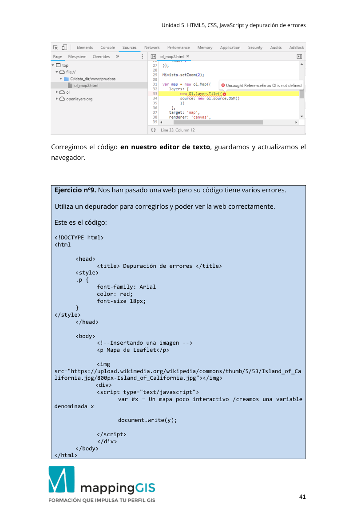</a></details>

[Consultar en el PDF · página 41](../materiales/Ejercicio_5.0_HTML5_CSS_y_JavaScript._Depuraci%C3%B3n_de_errores_2024.pdf#page=41){target="_blank" rel="nofollow noopener noreferrer"}

**Leaflet:** [PDF de clase (credenciales de ejemplo omitidas)](../materiales/Ejercicio_5-1_Leaflet-2025.pdf){target="_blank" rel="nofollow noopener noreferrer"}.

### Leaflet · Ejercicio 1 · Primer mapa

<div class="original-statement"><span class="eyebrow">Enunciado original · Leaflet</span><p>Pega el resultado de tu primer mapa realizado con Leaflet (L_map1.html) en la plantilla de resultados.</p></div>

<details class="original-exercise" markdown="1">
<summary>Pasos y contexto originales de la clase</summary>

**Página 3**

```text
Ejercicio 5.1. Leaflet 
 
                                                                                                  3 
 
Creación de un mapa sencillo con la API de Leaflet 
 
Como hemos hecho anteriormente, e l primer paso para la creación de cualquier 
mapa web JavaScript es elaborar el marco HTML básico. Esta es la estructura que 
tendrá nuestro HTML: 
 
<!DOCTYPE html> 
<html> 
<head> 
<meta charset="utf-8" /> 
<meta name="viewport" content="width=device-width, initial-scale=1.0, 
maximum-scale=1.0, user-scalable=no" /> 
 <style> 
 </style> 
</head> 
 <body> 
  <div id = 'map'> 
  </div> 
 </body> 
</html> 
 
Las etiquetas <meta> que hemos definido sirven para definir la codificación de 
caracteres y la visualización en pantalla. Esta última combinada con los estilos que 
veremos más adelante hacen que el mapa ocupe toda la pantalla del dispositivo 
independientemente de su tamaño. Es decir que el mapa puede verse en un 
dispositivo móvil o en la pantalla del ordenador.  
Utiliza un editor de texto básico. Copia el texto anterior en un archivo nuevo y 
guardarlo en la ruta: \data_dir\www con el nombre L_map1.html. 
Primeros pasos 
En primer lugar incluiremos en la cabecera <head> de nuestra página web la librería 
JavaScript leaflet.js y la hoja de estilo leaflet.css : 
 
<link rel="stylesheet" href="https://unpkg.com/leaflet@1.9.4/dist/leaflet.css"/> 
<script src="https://unpkg.com/leaflet@1.9.4/dist/leaflet.js"></script>
```

**Página 4**

```text
Ejercicio 5.1. Leaflet 
 
                                                                                                  4 
Dentro de la etiqueta <body> encontramos el marcado para el mapa, que genera un 
único elemento de documento. También damos al contenedor un atributo id para 
que podamos hacer referencia a él en nuestro código: 
<div id= 'map'></div> 
Estilo del mapa 
Nos aseguramos que el contenedor de mapa tenga un tamaño definido, dentro de 
la etiqueta <style> lo fijamos en CSS: 
 
body { 
      padding: 0; 
      margin: 0; 
  } 
 html, body, #map { 
      height: 100%; 
  } 
 
Código de inicialización del mapa 
Crearemos un mapa del centro de Valladolid con la capa base de OpenStreetMap . 
Primero inicializaremos el mapa y fijaremos su vista a nuestras coordenadas 
geográficas y un nivel de zoom. Vamos a añadir el siguiente código dentro del  
<script>: 
var map = L.map('map', { 
    center: [41.66, -4.72], 
    zoom: 15, 
}); 
 
L.map es la clase central de la API. Se usa para crear y manipular el mapa.  
La sintaxis de la clase L.map es la siguiente: 
L.map( <HTMLElement|String> id,  
<Map options> options? ) 
A continuación, añadimos un mapa base como  tile layer , en este caso las 
imágenes de OSM. Crear un tile layer lleva implícito establecer la URL, el texto 
con la atribución y el máximo nivel de zoom de la capa:
```

**Página 5**

```text
Ejercicio 5.1. Leaflet 
 
                                                                                                  5 
L.tileLayer('https://{s}.tile.openstreetmap.org/{z}/{x}/{y}.png', { 
    attribution: '&copy; <a href="http://osm.org/copyright">OpenStreetMap</a>'  
+ 'contributors', 
maxZoom: 18 
}).addTo(map); 
 
Para incluir esta capa en nuestro mapa como opción, vamos a crear una variable 
llamada OSM y la añadimos como layer a la clase map. 
var OSM = L.tileLayer('https://{s}.tile.openstreetmap.org/{z}/{x}/{y}.png', { 
    attribution: '&copy; <a href="http://osm.org/copyright">OpenStreetMap</a>'  
+ 'contributors', 
maxZoom: 18 
}); // eliminado el .addTo(map) porque se añade desde la clase map 
 
Y modificamos la creación del mapa para añadir la opción de incluir las capas: 
var map = L.map('map', { 
    center: [41.66, -4.72], 
    layers: OSM, 
    zoom: 15, 
}); 
 
Recuerda que es necesario crear la variable antes de poder utilizarla en el mapa. 
Por defecto, en Leaflet la rueda del ratón (el scroll) sirve para acercarse o alejarse 
en el mapa. Sin embargo , esta acción no es responsive si trabajamos en ento rnos 
móviles, por lo tanto conviene modificar la opción scrollWheelZoom a falso: 
var map = L.map('map', { 
    center: [41.66, -4.72], 
    layers: OSM, 
    zoom: 15, 
    scrollWheelZoom: false, 
}); 
 
Por último, añadiremos un control de escala al mapa: 
L.control.scale() 
.addTo(map);
```

**Página 6**

```text
Ejercicio 5.1. Leaflet 
 
                                                                                                  6 
Importante: Para evita errores, no debemos abrir los visores web haciendo doble 
clic sobre ellos. Debemos abrirlos escribiendo la siguiente url en el navegador 
web: 
http://localhost:8080/geoserver/www/L_map1.html 
 
El resultado sería un mapa como este:
```

**Página 7**

```text
Ejercicio 5.1. Leaflet 
 
                                                                                                  7 
El código fuente utilizado es el siguiente: 
 
<!DOCTYPE html>  
<html> 
<head> 
<meta charset="utf-8" /> 
<meta name="viewport" content="width=device-width, initial-scale=1.0, maximum-
scale=1.0, user-scalable=no" /> 
<link rel="stylesheet" href="https://unpkg.com/leaflet@1.9.4/dist/leaflet.css"/> 
<script src="https://unpkg.com/leaflet@1.9.4/dist/leaflet.js"></script> 
  
 <style> 
  body { 
      padding: 0; 
      margin: 0; 
  } 
  html, body, #map { 
      height: 100%; 
  } 
 
</style> 
</head> 
<body> 
<div id="map"></div> 
<script> 
var OSM = L.tileLayer('https://{s}.tile.openstreetmap.org/{z}/{x}/{y}.png', { 
attribution: '&copy; <a href="http://osm.org/copyright">OpenStreetMap</a>' 
  +'contributors', 
  maxZoom: 18 
 }); 
 
 var map = L.map('map', { 
  //scrollWheelZoom: false, 
  center: [41.66, -4.72], 
  zoom: 13, 
  layers: OSM 
 }); 
  
 L.control.scale().addTo(map); 
</script> 
 
 
</body> 
</html> 
 
 
 
Ejercicio nº 1.  Pega el resultado de tu primer mapa realizado con Leaflet 
(L_map1.html) en la plantilla de resultados.
```

</details>

<details class="source-page"><summary>Ver página 7 del PDF original, con sus capturas</summary><a href="../../materiales/Ejercicio_5-1_Leaflet-2025.pdf#page=7" target="_blank" rel="nofollow noopener">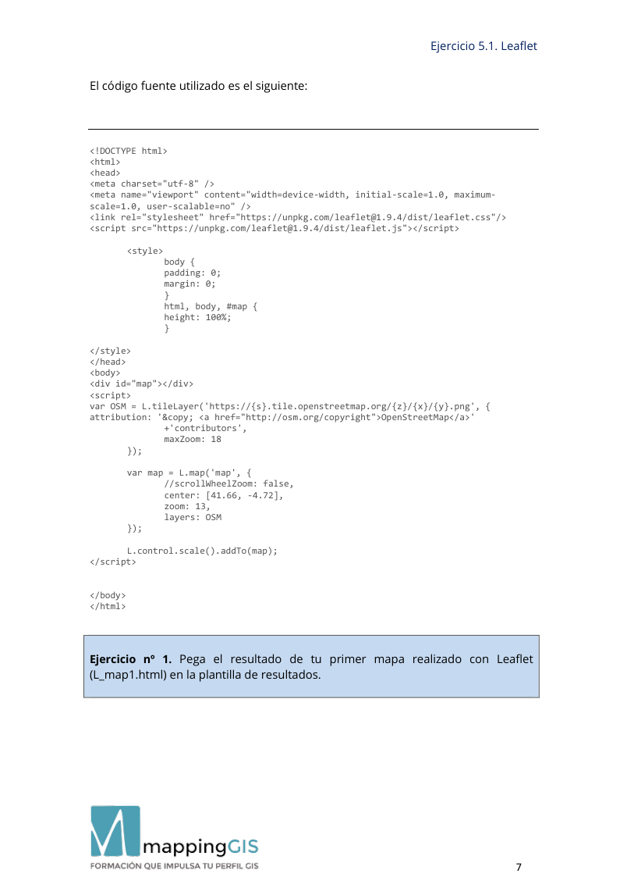</a></details>

[Consultar en el PDF · página 7](../materiales/Ejercicio_5-1_Leaflet-2025.pdf#page=7){target="_blank" rel="nofollow noopener noreferrer"}

### Leaflet · Ejercicio 2 · Capas WMS

<div class="original-statement"><span class="eyebrow">Enunciado original · Leaflet</span><p>Añade al mapa las capas rivers, countries y cities.</p></div>

<details class="original-exercise" markdown="1">
<summary>Pasos y contexto originales de la clase</summary>

**Página 7**

```text
Ejercicio 5.1. Leaflet 
 
                                                                                                  7 
El código fuente utilizado es el siguiente: 
 
<!DOCTYPE html>  
<html> 
<head> 
<meta charset="utf-8" /> 
<meta name="viewport" content="width=device-width, initial-scale=1.0, maximum-
scale=1.0, user-scalable=no" /> 
<link rel="stylesheet" href="https://unpkg.com/leaflet@1.9.4/dist/leaflet.css"/> 
<script src="https://unpkg.com/leaflet@1.9.4/dist/leaflet.js"></script> 
  
 <style> 
  body { 
      padding: 0; 
      margin: 0; 
  } 
  html, body, #map { 
      height: 100%; 
  } 
 
</style> 
</head> 
<body> 
<div id="map"></div> 
<script> 
var OSM = L.tileLayer('https://{s}.tile.openstreetmap.org/{z}/{x}/{y}.png', { 
attribution: '&copy; <a href="http://osm.org/copyright">OpenStreetMap</a>' 
  +'contributors', 
  maxZoom: 18 
 }); 
 
 var map = L.map('map', { 
  //scrollWheelZoom: false, 
  center: [41.66, -4.72], 
  zoom: 13, 
  layers: OSM 
 }); 
  
 L.control.scale().addTo(map); 
</script> 
 
 
</body> 
</html> 
 
 
 
Ejercicio nº 1.  Pega el resultado de tu primer mapa realizado con Leaflet 
(L_map1.html) en la plantilla de resultados.
```

**Página 8**

```text
Ejercicio 5.1. Leaflet 
 
                                                                                                  8 
Capas teseladas WMS 
 
Ahora que ya tenemos una capa base, vamos a añadir nuest ra capa de ciudades 
como un WMS, a través de la clase L.tileLayer.WMS 
Haz una copia del archivo L_map1.html y renómbralo como L_map2.html 
En primer lugar, vamos a cambiar el nivel de zoom a 4. 
zoom: 4, 
 
Ahora añadiremos debajo de la capa de OpenStreetMap el código necesario para 
agregar una capa WMS: 
var cities = L.tileLayer.wms("http://localhost:8080/geoserver/wms", { 
    layers: 'cities', 
    format: 'image/png', 
    transparent: true, 
    tiled: true, 
    attribution: "Natural Earth" 
}); 
 
 
Para forzar a que se utilicen las capas teseladas hemos añadido el parámetro: 
tiled: true. 
 
 
Ahora agregamos la capa a nuestro mapa: 
 
layers: [osm, cities] 
 
 
 
 
Ejercicio nº2. Añade al mapa las capas rivers, countries y cities. 
 
En la capa cities utiliza la propiedad styles para aplicarle el estilo cities_filter. 
Haz una captura de pantalla con el resultado.  
 
El orden en el que se localicen en el código determinará el orden en el que se van 
representando las capas. P or lo tanto , deberás jugar con el orden de las capas y 
con la transparencia de las capas.
```

</details>

<details class="source-page"><summary>Ver página 8 del PDF original, con sus capturas</summary><a href="../../materiales/Ejercicio_5-1_Leaflet-2025.pdf#page=8" target="_blank" rel="nofollow noopener">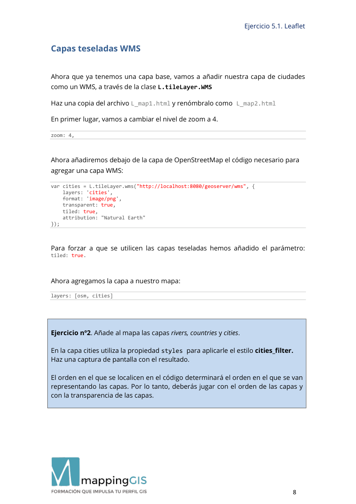</a></details>

[Consultar en el PDF · página 8](../materiales/Ejercicio_5-1_Leaflet-2025.pdf#page=8){target="_blank" rel="nofollow noopener noreferrer"}

### Leaflet · Ejercicio 3 · Geometrías y circleMarker

<div class="original-statement"><span class="eyebrow">Enunciado original · Leaflet</span><p>A las geometrías vistas añade además un marcador circular denominado circleMarker, debes utilizar la clase L.circleMarker.</p></div>

<details class="original-exercise" markdown="1">
<summary>Pasos y contexto originales de la clase</summary>

**Página 8**

```text
Ejercicio 5.1. Leaflet 
 
                                                                                                  8 
Capas teseladas WMS 
 
Ahora que ya tenemos una capa base, vamos a añadir nuest ra capa de ciudades 
como un WMS, a través de la clase L.tileLayer.WMS 
Haz una copia del archivo L_map1.html y renómbralo como L_map2.html 
En primer lugar, vamos a cambiar el nivel de zoom a 4. 
zoom: 4, 
 
Ahora añadiremos debajo de la capa de OpenStreetMap el código necesario para 
agregar una capa WMS: 
var cities = L.tileLayer.wms("http://localhost:8080/geoserver/wms", { 
    layers: 'cities', 
    format: 'image/png', 
    transparent: true, 
    tiled: true, 
    attribution: "Natural Earth" 
}); 
 
 
Para forzar a que se utilicen las capas teseladas hemos añadido el parámetro: 
tiled: true. 
 
 
Ahora agregamos la capa a nuestro mapa: 
 
layers: [osm, cities] 
 
 
 
 
Ejercicio nº2. Añade al mapa las capas rivers, countries y cities. 
 
En la capa cities utiliza la propiedad styles para aplicarle el estilo cities_filter. 
Haz una captura de pantalla con el resultado.  
 
El orden en el que se localicen en el código determinará el orden en el que se van 
representando las capas. P or lo tanto , deberás jugar con el orden de las capas y 
con la transparencia de las capas.
```

**Página 9**

```text
Ejercicio 5.1. Leaflet 
 
                                                                                                  9
```

**Página 10**

```text
Ejercicio 5.1. Leaflet 
 
                                                                                                  10 
Añadiendo capas de interfaz de usuario al mapa 
Insertar un marcador 
 
Ahora vamos a agregar fácilmente otros elementos al mapa . Haz una copia del 
archivo L_map1.html y renómbralo como L_map3.html 
Primero creamos un objeto marker utilizando la clase L.marker: 
var marker = L.marker( 
[41.66, -4.71] 
).addTo(map) 
     
Debemos incluir esta sentencia debajo de la creación del objeto mapa, ya que  
estamos utilizando el método .addTo 
Podemos añadir algunas opciones más a este marcador:  
draggable indica si el marcador puede ser movible o no con el ratón. 
title: Texto para la información sobre la herramienta que aparece sobre el 
indicador. 
Podemos añadir una ventana emergente con un texto que se abrirá al hacer clic 
sobre el marcador. Para ello utilizamos el método bindPopup: 
.bindPopup('Universidad de Valladolid'); 
 
Si además queremos que el mapa solo muestre un pop up a  la vez podemos 
utilizar el método .openPopup() 
 
Veamos cómo quedaría el código del marcador: 
var marker = L.marker([41.66, -4.71], { 
draggable: true, 
title: 'pincha aquí' 
}).addTo(map) 
    .bindPopup('Universidad de Valladolid') 
    .openPopup();
```

**Página 11**

```text
Ejercicio 5.1. Leaflet 
 
                                                                                                  11 
 
Este marcador podemos personalizarlo incluyendo algún icono que tengamos. 
 
Cómo insertar un icono 
 
Un icono marcador en Leaflet se define por un objeto  L.Icon, que es pasado como 
una opción cuando creamos marcadores. Vamos a crear un icono con el logo de 
MappingGIS: 
//Añadir un icono de marcador 
var myIcon = L.icon({ 
    iconUrl: 'https://openlayers.org/assets/theme/img/logo70.png', 
    iconSize: [30, 30], 
    popupAnchor: [-1, -10] 
}); 
 
Ahora ponemos el marcador en el mapa: 
var marker2 = L.marker([41.65246, -4.6982], {icon: myIcon}) 
.addTo(map) 
.bindPopup("Localización de <b>MappingGIS.com </b>");
```

**Página 12**

```text
Ejercicio 5.1. Leaflet 
 
                                                                                                  12 
Capas vectoriales 
Agregar un círculo 
 
Para añadir un círculo sobre el mapa utilizaremos la clase L.circle. D ebemos 
especificar las coordenadas del centro como primer argumento  ([41.658, -4.725]); 
el radio en metros como segundo argumento  (700); y podemos controlar qué 
aspecto tendrá incluyendo opciones como último argumento  (¡opcional y dentro 
de corchetes!)  cuando creamos el objeto: 
//Añadir un círculo 
var circle = L.circle([41.658, -4.725], 700, { 
    color: 'red', 
    fillColor: '#f03', 
    fillOpacity: 0.5 
}).addTo(map); 
 
Añadimos un popup a nuestro círculo: 
 
 
circle.bindPopup("Centro de la ciudad");
```

**Página 13**

```text
Ejercicio 5.1. Leaflet 
 
                                                                                                  13 
Agregar polígonos 
 
Para añadir un polígono sobre el mapa utilizaremos la clase L.polygon. Debemos 
especificar las coordenadas de los vértices: 
 
//Añadir un polígono 
var polygon = L.polygon([ 
[41.67778, -4.72163], 
[41.67349, -4.71511], 
[41.66958, -4.72017], 
 [41.67169, -4.72515] 
]).addTo(map) 
.bindPopup ('Mercaolid'); 
 
 
 
 
 
Agregar etiquetas 
 
Aprovechando esta capa vectorial, a la que hemos denominado polygon vamos a 
añadirle una etiqueta que muestre un texto.  
 
Para ello usamos el método bindTooltip de la clase L.Tooltip. 
 
 
polygon.bindTooltip ("Soy una etiqueta", { 
 permanent: false 
}) 
 
 
Como hemos visto en la teoría, la clase tooltip tiene varias opciones: pane, offset, 
direction, permanent, stiky, opacity. 
 
En el ejemplo anterior hemos añadido dentro de los corchetes la opción permanent, 
pero como ves su valor está establecido a false, que es el  valor que adquiere por 
defecto. Modifica este valor a verdadero (true) y añade alguna opción más.
```

**Página 14**

```text
Ejercicio 5.1. Leaflet 
 
                                                                                                  14 
 
Crear una línea 
 
Para añadir una línea sobre el mapa utilizaremos la clase L.polyline. Debemos 
especificar las coordenadas de los vértices: 
 
//Añadir una línea 
 
var pointA = new L.LatLng(41.65925, -4.70404); 
var pointB = new L.LatLng(41.65166, -4.70421); 
var latlngs = [pointA, pointB]; 
 
var polyline = L.polyline( 
latlngs, {color: 'red'} 
) 
.addTo(map) 
.bindPopup ('Avda. Juan Carlos I'); 
 
 
 
 
 
 
Ejercicio nº 3. A las geometrías vistas añade además un marcador circular 
denominado circleMarker, debes utilizar la clase L.circleMarker.  
 
Haz una captura de pantalla con el resultado del mapa L_map3.html 
 
 
Trabajando con grupos de capas 
 
En este ejercicio crearemos un grupo de capas que contenga todas las geometrías 
creadas hasta ahora, para gestionarlas de formas más sencilla. 
Haz una copia del archivo L_map3.html y renómbralo como L_map4.html 
Comenta TODOS los métodos .addTo(map) de las geometrías que participarán en el 
grupo, que serán:
```

</details>

<details class="source-page"><summary>Ver página 14 del PDF original, con sus capturas</summary><a href="../../materiales/Ejercicio_5-1_Leaflet-2025.pdf#page=14" target="_blank" rel="nofollow noopener">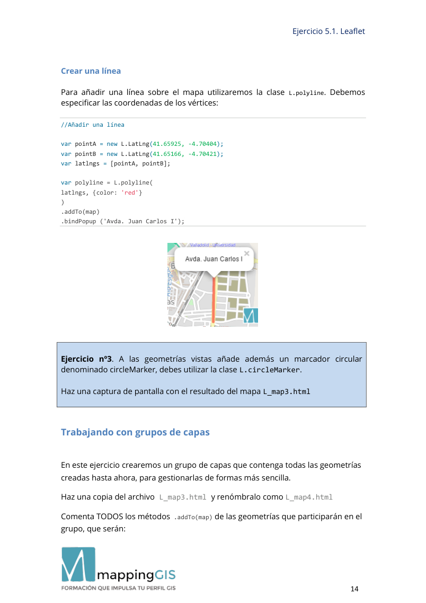</a></details>

[Consultar en el PDF · página 14](../materiales/Ejercicio_5-1_Leaflet-2025.pdf#page=14){target="_blank" rel="nofollow noopener noreferrer"}

### Leaflet · Ejercicio 4 · Ventana emergente

<div class="original-statement"><span class="eyebrow">Enunciado original · Leaflet</span><p>Haz una captura de pantalla con el mapa L_map4.html y el mensaje al hacer clic sobre un elemento.</p></div>

<details class="original-exercise" markdown="1">
<summary>Pasos y contexto originales de la clase</summary>

**Página 14**

```text
Ejercicio 5.1. Leaflet 
 
                                                                                                  14 
 
Crear una línea 
 
Para añadir una línea sobre el mapa utilizaremos la clase L.polyline. Debemos 
especificar las coordenadas de los vértices: 
 
//Añadir una línea 
 
var pointA = new L.LatLng(41.65925, -4.70404); 
var pointB = new L.LatLng(41.65166, -4.70421); 
var latlngs = [pointA, pointB]; 
 
var polyline = L.polyline( 
latlngs, {color: 'red'} 
) 
.addTo(map) 
.bindPopup ('Avda. Juan Carlos I'); 
 
 
 
 
 
 
Ejercicio nº 3. A las geometrías vistas añade además un marcador circular 
denominado circleMarker, debes utilizar la clase L.circleMarker.  
 
Haz una captura de pantalla con el resultado del mapa L_map3.html 
 
 
Trabajando con grupos de capas 
 
En este ejercicio crearemos un grupo de capas que contenga todas las geometrías 
creadas hasta ahora, para gestionarlas de formas más sencilla. 
Haz una copia del archivo L_map3.html y renómbralo como L_map4.html 
Comenta TODOS los métodos .addTo(map) de las geometrías que participarán en el 
grupo, que serán:
```

**Página 15**

```text
Ejercicio 5.1. Leaflet 
 
                                                                                                  15 
 polyline,  
 polygon,  
 circle,  
 circleMarker,  
 marker,  
 marker2 
Deberían quedar de este modo 
var circle = L.circle([41.658, -4.725], 700, { 
    color: 'red', 
    fillColor: '#f03', 
    fillOpacity: 0.5 
})//.addTo(map) 
; 
 
Abre el mapa. No deberías ver ninguna geometría. 
Ahora vamos a crear un grupo de capas que incluya todas las geometrías y las 
añadimos al mapa: 
var geometrias = L.layerGroup([polyline, polygon, circle, circleMarker, marker, 
marker2]) 
.addTo(map); 
 
Utilizando el método eachLayer iteramos sobre c ada una de las capas del grupo  
para mostrar un mensaje en una ventana emergente: 
geometrias.eachLayer(function (layer) { 
 layer.bindPopup('Pertenezco a un grupo de geometrías'); 
}); 
 
 
 
Ejercicio nº4. Haz una captura de pantalla con el mapa L_map4.html y el mensaje 
al hacer clic sobre un elemento.
```

</details>

<details class="source-page"><summary>Ver página 15 del PDF original, con sus capturas</summary><a href="../../materiales/Ejercicio_5-1_Leaflet-2025.pdf#page=15" target="_blank" rel="nofollow noopener">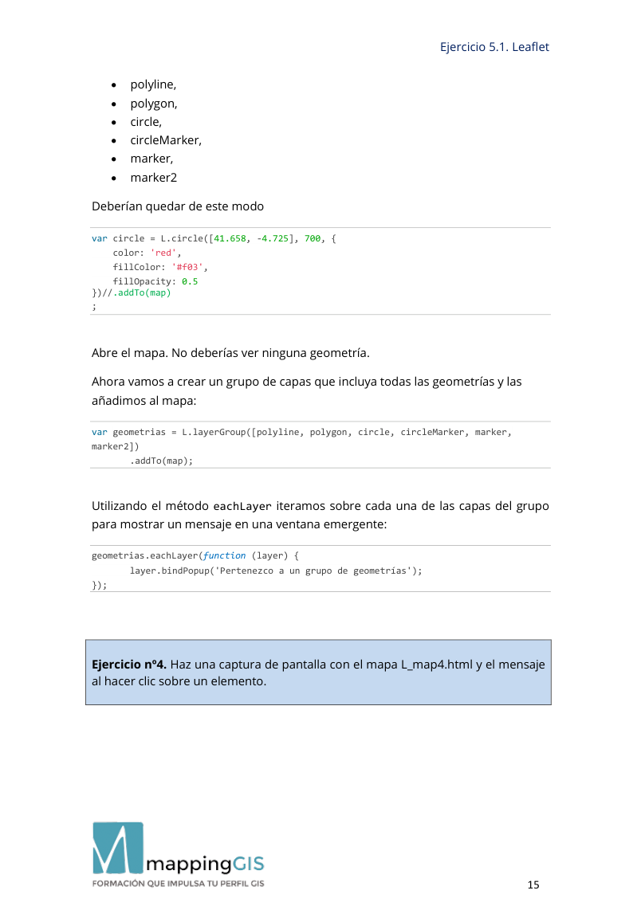</a></details>

[Consultar en el PDF · página 15](../materiales/Ejercicio_5-1_Leaflet-2025.pdf#page=15){target="_blank" rel="nofollow noopener noreferrer"}

### Leaflet · Ejercicio 5 · Eventos

<div class="original-statement"><span class="eyebrow">Enunciado original · Leaflet</span><p>Haz una captura de pant alla con el resultado del mapa L_map5.html</p></div>

<details class="original-exercise" markdown="1">
<summary>Pasos y contexto originales de la clase</summary>

**Página 15**

```text
Ejercicio 5.1. Leaflet 
 
                                                                                                  15 
 polyline,  
 polygon,  
 circle,  
 circleMarker,  
 marker,  
 marker2 
Deberían quedar de este modo 
var circle = L.circle([41.658, -4.725], 700, { 
    color: 'red', 
    fillColor: '#f03', 
    fillOpacity: 0.5 
})//.addTo(map) 
; 
 
Abre el mapa. No deberías ver ninguna geometría. 
Ahora vamos a crear un grupo de capas que incluya todas las geometrías y las 
añadimos al mapa: 
var geometrias = L.layerGroup([polyline, polygon, circle, circleMarker, marker, 
marker2]) 
.addTo(map); 
 
Utilizando el método eachLayer iteramos sobre c ada una de las capas del grupo  
para mostrar un mensaje en una ventana emergente: 
geometrias.eachLayer(function (layer) { 
 layer.bindPopup('Pertenezco a un grupo de geometrías'); 
}); 
 
 
 
Ejercicio nº4. Haz una captura de pantalla con el mapa L_map4.html y el mensaje 
al hacer clic sobre un elemento.
```

**Página 16**

```text
Ejercicio 5.1. Leaflet 
 
                                                                                                  16 
Trabajando con eventos 
 
Cada vez que algo ocurre en Leaflet, por ejemplo, cuando el usuario hace clic en 
un marcador o el mapa cambia de zoom, el objeto  correspondiente envía un 
evento que se puede suscribir a una función. Esto nos permite reaccionar a la 
interacción del usuario. 
 
Haz una copia del archivo L_map4.html y renómbralo como L_map5.html 
 
function onMapClick(e) { 
alert("Has hecho clic en " + e.latlng); 
} 
 
map.on('click', onMapClick);  
 
Cada objeto tiene su propio conjunto de eventos . El primer argumento de la 
función es el objeto del evento, que contiene información útil sobre el evento que 
ocurrirá.  
 
En este caso el objeto de l evento click ( e en nuestro ejemplo) tiene la propiedad  
latlng, que es la ubicación en la que ocurre el clic. 
 
 
Ejercicio nº  5. Haz una captura de pant alla con el resultado del mapa 
L_map5.html 
 
Controles 
 
Leaflet por defecto solamente incluye dos controles p or defecto: zoom y 
atribución. 
La clase base para todos los controles es L.control. Implementa la interfaz 
IControl. 
La sintaxis es: 
L.control( <Control options> options? ) 
 
Las opciones irán siempre entre corchetes {}.
```

</details>

<details class="source-page"><summary>Ver página 16 del PDF original, con sus capturas</summary><a href="../../materiales/Ejercicio_5-1_Leaflet-2025.pdf#page=16" target="_blank" rel="nofollow noopener">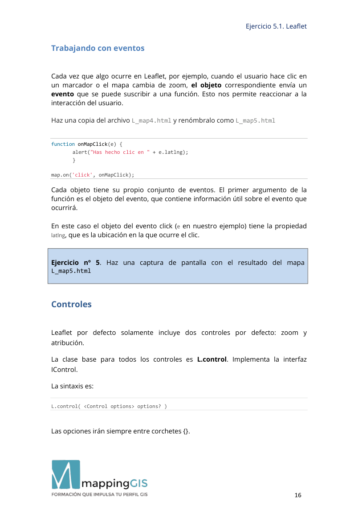</a></details>

[Consultar en el PDF · página 16](../materiales/Ejercicio_5-1_Leaflet-2025.pdf#page=16){target="_blank" rel="nofollow noopener noreferrer"}

### Leaflet · Ejercicio 6 · Escala

<div class="original-statement"><span class="eyebrow">Enunciado original · Leaflet</span><p>Cambia el valor del máximo ancho del control de escala a 75 pixeles. Haz una captura de pantalla con el resultado del mapa L_map6.html</p></div>

<details class="original-exercise" markdown="1">
<summary>Pasos y contexto originales de la clase</summary>

**Página 16**

```text
Ejercicio 5.1. Leaflet 
 
                                                                                                  16 
Trabajando con eventos 
 
Cada vez que algo ocurre en Leaflet, por ejemplo, cuando el usuario hace clic en 
un marcador o el mapa cambia de zoom, el objeto  correspondiente envía un 
evento que se puede suscribir a una función. Esto nos permite reaccionar a la 
interacción del usuario. 
 
Haz una copia del archivo L_map4.html y renómbralo como L_map5.html 
 
function onMapClick(e) { 
alert("Has hecho clic en " + e.latlng); 
} 
 
map.on('click', onMapClick);  
 
Cada objeto tiene su propio conjunto de eventos . El primer argumento de la 
función es el objeto del evento, que contiene información útil sobre el evento que 
ocurrirá.  
 
En este caso el objeto de l evento click ( e en nuestro ejemplo) tiene la propiedad  
latlng, que es la ubicación en la que ocurre el clic. 
 
 
Ejercicio nº  5. Haz una captura de pant alla con el resultado del mapa 
L_map5.html 
 
Controles 
 
Leaflet por defecto solamente incluye dos controles p or defecto: zoom y 
atribución. 
La clase base para todos los controles es L.control. Implementa la interfaz 
IControl. 
La sintaxis es: 
L.control( <Control options> options? ) 
 
Las opciones irán siempre entre corchetes {}.
```

**Página 17**

```text
Ejercicio 5.1. Leaflet 
 
                                                                                                  17 
Una opción común para todos los controles es position: la posición inicial del 
control en el mapa.  
Las posiciones posibles son: topleft, topright, bottomleft, bottomright.  
 
Control de escala 
 
Ya hemos visto en el ejercicio nº1 cómo incluir un control de escala:  
L.control.scale() 
.addTo(map); 
 
 
Haz una copia del archivo L_map2.html y renómbralo como L_map6.html 
Vamos a incluir ahora algunas opciones.   En la referencia de la API 
(http://leafletjs.com/reference.html#control-scale) podemos ver que la posición 
por defecto del control es bottomleft. 
 
 
Vamos a incluir una opción para modificar la posición del control a la parte inferior 
derecha: 
L.control.scale({position: 'bottomright'}) 
.addTo(map);
```

**Página 18**

```text
Ejercicio 5.1. Leaflet 
 
                                                                                                  18 
Las opciones metric e imperial vienen habilitadas por defecto  (valor true), pero se 
pueden cambiar a false: 
L.control.scale({imperial: false}).addTo(map); 
 
Por lo tanto, al incluir varias opciones el resultado sería: 
L.control.scale({ 
    position: 'bottomright', 
    imperial: false  
}).addTo(map); 
 
 
Ejercicio nº 6. Cambia el valor del máximo ancho del control de escala a 75 
pixeles. Haz una captura de pantalla con el resultado del mapa L_map6.html 
 
 
Control de capas 
 
Leaflet tiene un bonito control que nos permite controlar que capas queremos ver 
en el mapa.  
Hay dos tipos de capas: 
 capas base (baseLayers)  que son mutuamente excluyentes (sólo una puede 
ser visible en el mapa). 
 Capas superpuestas ( overlays): el resto de capas que ponemos sobre las 
capas base.  
Haz una copia del archivo L_map2.html y renómbralo como L_map7.html 
En este ejercicio, queremos tener una capa base y dos overlays que se puedan 
activar y desactivar. Vamos a crear primero las variables para las capas: 
var osm = new L.tileLayer('https://{s}.tile.openstreetmap.org/{z}/{x}/{y}.png', { 
    attribution: '&copy; <a href="http://osm.org/copyright">OpenStreetMap</a>   
contributors', 
 maxZoom: 18 
});
```

</details>

<details class="source-page"><summary>Ver página 18 del PDF original, con sus capturas</summary><a href="../../materiales/Ejercicio_5-1_Leaflet-2025.pdf#page=18" target="_blank" rel="nofollow noopener">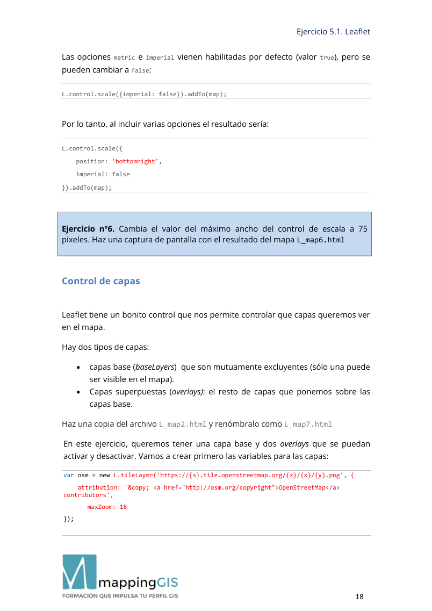</a></details>

[Consultar en el PDF · página 18](../materiales/Ejercicio_5-1_Leaflet-2025.pdf#page=18){target="_blank" rel="nofollow noopener noreferrer"}

### Leaflet · Ejercicio 7 · Control de capas

<div class="original-statement"><span class="eyebrow">Enunciado original · Leaflet</span><p>Haz una captura de pantalla con el resultado del mapa L_map7.html</p></div>

<details class="original-exercise" markdown="1">
<summary>Pasos y contexto originales de la clase</summary>

**Página 18**

```text
Ejercicio 5.1. Leaflet 
 
                                                                                                  18 
Las opciones metric e imperial vienen habilitadas por defecto  (valor true), pero se 
pueden cambiar a false: 
L.control.scale({imperial: false}).addTo(map); 
 
Por lo tanto, al incluir varias opciones el resultado sería: 
L.control.scale({ 
    position: 'bottomright', 
    imperial: false  
}).addTo(map); 
 
 
Ejercicio nº 6. Cambia el valor del máximo ancho del control de escala a 75 
pixeles. Haz una captura de pantalla con el resultado del mapa L_map6.html 
 
 
Control de capas 
 
Leaflet tiene un bonito control que nos permite controlar que capas queremos ver 
en el mapa.  
Hay dos tipos de capas: 
 capas base (baseLayers)  que son mutuamente excluyentes (sólo una puede 
ser visible en el mapa). 
 Capas superpuestas ( overlays): el resto de capas que ponemos sobre las 
capas base.  
Haz una copia del archivo L_map2.html y renómbralo como L_map7.html 
En este ejercicio, queremos tener una capa base y dos overlays que se puedan 
activar y desactivar. Vamos a crear primero las variables para las capas: 
var osm = new L.tileLayer('https://{s}.tile.openstreetmap.org/{z}/{x}/{y}.png', { 
    attribution: '&copy; <a href="http://osm.org/copyright">OpenStreetMap</a>   
contributors', 
 maxZoom: 18 
});
```

**Página 19**

```text
Ejercicio 5.1. Leaflet 
 
                                                                                                  19 
var paises = new L.tileLayer.wms("http://localhost:8080/geoserver/wms", { 
    layers: 'countries', 
    format: 'image/png', 
    transparent: true, 
    attribution: "NaturalEarth" 
}); 
var ciudades = new L.tileLayer.wms("http://localhost:8080/geoserver/wms", { 
    layers: 'cities', 
    format: 'image/png', 
    transparent: true, 
    attribution: "NaturalEarth" 
}); 
 
A continuación, crearemos dos objetos. Uno contendrá nuestra capa base y el otro 
contendrá nuestras capas overlays. Son objetos simples con pares de clave/valor.  
La clave es la que establece el texto en el control (por ejemplo, "Ciudades"). El 
valor correspondiente es la referencia a la capa (por ejemplo, ciudades). 
var baseMaps = { 
    "OpenStreetMap": osm 
}; 
 
var overlayMaps = { 
    "Paises": paises, 
    "Ciudades": ciudades 
}; 
 
El propio control ya añadirá las capas de la leyenda al mapa, por lo que no sería 
necesario añadir cada capa al mapa. Pero es necesario indicar que queremos que 
estas capas se añadan al iniciar el mapa: 
var map = L.map('map', { 
    center: new L.LatLng(41.66, -4.72), 
    zoom: 4, 
    layers: [osm, paises, ciudades] 
}); 
 
Ahora lo que queda es crear el control de capas y añadirlo al mapa. El primer 
argumento que tenemos que pasar al crear el control de capas es el objeto de las 
capas base. El segundo argumento es el objeto de las capas superpuestas.  
 
L.control.layers(baseMaps, overlayMaps).addTo(map);
```

**Página 20**

```text
Ejercicio 5.1. Leaflet 
 
                                                                                                  20 
Ambos argumentos son opcionales. Por ejemplo, se puede incluir el objeto capas 
de base omitiendo el segundo argumento: 
L.control.layers(baseMaps).addTo(map); 
 
O solo un objeto de las capas superpuestas , omitiendo el primer argumento  
introduciendo un null 
 
L.control.layers(null, overlayMaps).addTo(map); 
 
 
De igual forma si solo queremos introducer capas base , pero sí incluir opciones, 
debemos establecer el valor de las capas superpuestas como null: 
L.control.layers(baseMaps, null, {collapsed:false}).addTo(map); 
 
 
El resultado sería este: 
 
Un aspecto interesante del control es la posibilidad de añadir un icono antes o 
después del nombre, basta con inclu ir un peq ueño có digo HTML que incluya la 
etiqueta img y la fuente de la imagen: 
var overlayMaps = { 
 " Paises": paises, 
 "Ciudades": 
ciudades 
};
```

**Página 21**

```text
Ejercicio 5.1. Leaflet 
 
                                                                                                  21 
 
Por defecto el control se colapsa en un icono y se expande al pasar el ratón por 
encima o hacer clic. 
Para que el control de capas se muestre siempre desplegado podemos añadir la 
opción collapsed a la clase  L.control.layers. De esta manera establecemos su 
valor a false: {collapsed:false} 
Por lo que quedaría así: 
L.control.layers(baseMaps, overlayMaps, {collapsed:false}).addTo(map); 
 
 
Ejercicio nº 7. Haz una captura de pantalla con el resultado del mapa 
L_map7.html 
 
 
El código fuente utilizado es el siguiente: 
<!DOCTYPE html> 
<html> 
<head> 
<meta charset="utf-8" /> 
<meta name="viewport" content="width=device-width, initial-scale=1.0, maximum-
scale=1.0, user-scalable=no" /> 
<link rel="stylesheet" href="https://unpkg.com/leaflet@1.9.4/dist/leaflet.css"/> 
<script src="https://unpkg.com/leaflet@1.9.4/dist/leaflet.js"></script> 
  
<style> 
  body { 
      padding: 0; 
      margin: 0; 
  } 
  html, body, #map { 
      height: 100%; 
  } 
 
</style> 
  
 </head> 
  <body> 
   <div id="map"></div> 
 <script>
```

</details>

<details class="source-page"><summary>Ver página 21 del PDF original, con sus capturas</summary><a href="../../materiales/Ejercicio_5-1_Leaflet-2025.pdf#page=21" target="_blank" rel="nofollow noopener">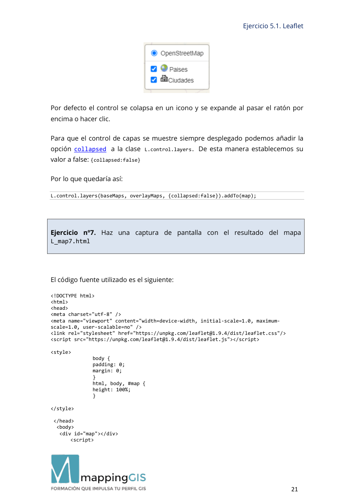</a></details>

[Consultar en el PDF · página 21](../materiales/Ejercicio_5-1_Leaflet-2025.pdf#page=21){target="_blank" rel="nofollow noopener noreferrer"}

### Leaflet · Ejercicio 8 · Título

<div class="original-statement"><span class="eyebrow">Enunciado original · Leaflet</span><p>Añade el título al mapa en el mapa L_map8.html y haz una captura de pantalla con el resultado.</p></div>

<details class="original-exercise" markdown="1">
<summary>Pasos y contexto originales de la clase</summary>

**Página 21**

```text
Ejercicio 5.1. Leaflet 
 
                                                                                                  21 
 
Por defecto el control se colapsa en un icono y se expande al pasar el ratón por 
encima o hacer clic. 
Para que el control de capas se muestre siempre desplegado podemos añadir la 
opción collapsed a la clase  L.control.layers. De esta manera establecemos su 
valor a false: {collapsed:false} 
Por lo que quedaría así: 
L.control.layers(baseMaps, overlayMaps, {collapsed:false}).addTo(map); 
 
 
Ejercicio nº 7. Haz una captura de pantalla con el resultado del mapa 
L_map7.html 
 
 
El código fuente utilizado es el siguiente: 
<!DOCTYPE html> 
<html> 
<head> 
<meta charset="utf-8" /> 
<meta name="viewport" content="width=device-width, initial-scale=1.0, maximum-
scale=1.0, user-scalable=no" /> 
<link rel="stylesheet" href="https://unpkg.com/leaflet@1.9.4/dist/leaflet.css"/> 
<script src="https://unpkg.com/leaflet@1.9.4/dist/leaflet.js"></script> 
  
<style> 
  body { 
      padding: 0; 
      margin: 0; 
  } 
  html, body, #map { 
      height: 100%; 
  } 
 
</style> 
  
 </head> 
  <body> 
   <div id="map"></div> 
 <script>
```

**Página 22**

```text
Ejercicio 5.1. Leaflet 
 
                                                                                                  22 
  
var osm = 
L.tileLayer('https://{s}.tile.openstreetmap.org/{z}/{x}/{y}.png', { 
    attribution: '&copy; <a  
href="http://osm.org/copyright">OpenStreetMap</a> contributors', 
 maxZoom: 18 
}); 
 
var paises = L.tileLayer.wms("http://localhost:8080/geoserver/wms", { 
    layers: 'countries', 
    format: 'image/png', 
    transparent: true, 
    attribution: "NaturalEarth" 
}); 
 
var ciudades = L.tileLayer.wms("http://localhost:8080/geoserver/wms", { 
    layers: 'cities', 
    format: 'image/png', 
    transparent: true, 
    attribution: "NaturalEarth" 
}); 
 
//Añadimos los dos objetos 
var baseMaps = { 
    "OpenStreetMap": osm 
}; 
 
var overlayMaps = { 
      " Paises": 
paises, 
     "Ciudades": 
ciudades 
}; 
 
//Creamos el mapa 
var map = L.map('map', { 
center: new L.LatLng(41.66, -4.72), 
zoom: 4,  
//Añadimos las capas al mapa 
layers: [osm, paises, ciudades] 
}); 
 
//creamos el control de capas y lo añadimos al mapa 
L.control.layers(baseMaps, overlayMaps, {collapsed:false}).addTo(map); 
 
 </script> 
 </body>  
 </html> 
Control de títulos y subtítulos 
 
Haz una copia del archivo  L_map2.html y renómbralo como  L_map8.html. Añade 
este código al final:  
// Insertando un título en el mapa 
 
var title = L.control();
```

**Página 23**

```text
Ejercicio 5.1. Leaflet 
 
                                                                                                  23 
title.onAdd = function (map) { 
        var div = L.DomUtil.create('div', 'info'); 
            div.innerHTML += 
            '<h2>Ciudades del mundo</h2>Tamaño según población'; 
         return div; 
}; 
  
title.addTo(map); 
 
Mediante este código, hemos creado un nuevo control denominado title, es 
necesario utilizar una función que cree un bloque div.  
Este bloque div contiene un código HTML en el que incluimos el texto que irá como 
título h2 y como párrafo. 
Por último, vamos al apartado del estilo para modificar el estilo de nuestro  título 
mediante CSS: 
<style> 
  #map {  
  width: 100%; 
  height: 600px; 
  box-shadow: 5px 5px 5px #888; 
  } 
  .info { 
 padding: 6px 8px; 
 font: 14px/16px Arial, Helvetica, sans-serif; 
 background: white; 
 background: rgba(255,255,255,0.8); 
 box-shadow: 0 0 15px rgba(0,0,0,0.2); 
 border-radius: 5px; 
} 
.info h2 { 
 margin: 0 0 5px; 
 color: #777; 
} 
</style> 
 
 
Ejercicio nº8. Añade el título al mapa en el mapa L_map8.html y haz una captura 
de pantalla con el resultado.
```

</details>

<details class="source-page"><summary>Ver página 23 del PDF original, con sus capturas</summary><a href="../../materiales/Ejercicio_5-1_Leaflet-2025.pdf#page=23" target="_blank" rel="nofollow noopener">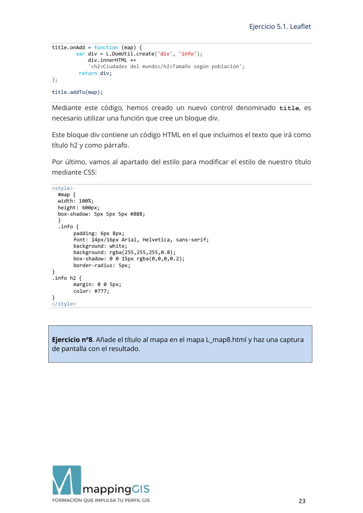</a></details>

[Consultar en el PDF · página 23](../materiales/Ejercicio_5-1_Leaflet-2025.pdf#page=23){target="_blank" rel="nofollow noopener noreferrer"}

### Leaflet · Ejercicio 9 · Leyenda

<div class="original-statement"><span class="eyebrow">Enunciado original · Leaflet</span><p>Añade la leyenda de la capa cities con el estilo cities_filter en el mapa L_map9.html y haz una captura de pantalla con el resultado.</p></div>

<details class="original-exercise" markdown="1">
<summary>Pasos y contexto originales de la clase</summary>

**Página 23**

```text
Ejercicio 5.1. Leaflet 
 
                                                                                                  23 
title.onAdd = function (map) { 
        var div = L.DomUtil.create('div', 'info'); 
            div.innerHTML += 
            '<h2>Ciudades del mundo</h2>Tamaño según población'; 
         return div; 
}; 
  
title.addTo(map); 
 
Mediante este código, hemos creado un nuevo control denominado title, es 
necesario utilizar una función que cree un bloque div.  
Este bloque div contiene un código HTML en el que incluimos el texto que irá como 
título h2 y como párrafo. 
Por último, vamos al apartado del estilo para modificar el estilo de nuestro  título 
mediante CSS: 
<style> 
  #map {  
  width: 100%; 
  height: 600px; 
  box-shadow: 5px 5px 5px #888; 
  } 
  .info { 
 padding: 6px 8px; 
 font: 14px/16px Arial, Helvetica, sans-serif; 
 background: white; 
 background: rgba(255,255,255,0.8); 
 box-shadow: 0 0 15px rgba(0,0,0,0.2); 
 border-radius: 5px; 
} 
.info h2 { 
 margin: 0 0 5px; 
 color: #777; 
} 
</style> 
 
 
Ejercicio nº8. Añade el título al mapa en el mapa L_map8.html y haz una captura 
de pantalla con el resultado.
```

**Página 24**

```text
Ejercicio 5.1. Leaflet 
 
                                                                                                  24 
Control de leyenda. Añadiendo una bonita leyenda al mapa 
 
Haz una copia del archivo L_map2.html y renómbralo como L_map9.html. Añade el 
siguiente código (si te fijas el código es muy similar al anterior): 
 
// Insertando una leyenda en el mapa 
 
var legend = L.control({position: 'bottomright'}); 
 
legend.onAdd = function (map) { 
        var div = L.DomUtil.create('div', 'info legend'); 
            div.innerHTML += 
            ''; 
        return div; 
}; 
  
legend.addTo(map); 
 
  
Ojo! El archivo leyenda.png no está incluido en los datos del curso, por lo que no 
aparecerá en el mapa.  
En lugar de apuntar a un archivo PNG estático, podemos utilizar la respuesta del 
servicio WMS de GeoServer  GetLegendGraphic, que dev uelve la leyenda de una 
capa (o grupo de capas) como un archivo PNG.  
Por ejemplo, si introduces esta url en el navegador: 
http://localhost:8080/geoserver/wms?REQUEST=GetLegendGraphic&VERSION=1.0.0&FORMAT=ima
ge/png&WIDTH=20&HEIGHT=20&LAYER=earth:cities 
  
Aparecerá la leyenda que creamos en GeoServer con el complemento de estilos 
CSS: 
 
La petición GetLegendGraphic utiliza el estilo asignado por defecto a la capa, si te 
aparece otra leyenda al visualizar la anterior url, tienes dos opciones: 
a) Ir a GeoServer y asignar el estilo cities_filter a la capa cities. 
b) Utilizar esta otra url: 
http://localhost:8080/geoserver/wms?REQUEST=GetLegendGraphic&VERSION=1.0.0&FOR
MAT=image/png&WIDTH=20&HEIGHT=20&LAYER=earth:cities&Style=cities_filter
```

**Página 25**

```text
Ejercicio 5.1. Leaflet 
 
                                                                                                  25 
 
El código final quedaría así: 
// Insertando una leyenda en el mapa 
 
var legend = L.control({position: 'bottomright'}); 
  
legend.onAdd = function (map) { 
 
        var div = L.DomUtil.create('div', 'info legend'); 
  
            div.innerHTML += 
            ''; 
  
        return div; 
 
}; 
  
legend.addTo(map); 
  
Por último, si se desea , se puede modificar el estilo de nuestra leyenda mediante 
CSS, para aplicar una transparencia a la leyenda: 
.legend { 
opacity: 0.7; 
} 
 
Para mostrar varias capas WMS en la leyenda es necesario crear un grupo: 
http://localhost:8080/geoserver/wms?REQUEST=GetLegendGraphic&VERSION=1.0.0&FORMAT=ima
ge/png&WIDTH=20&HEIGHT=20&LAYER=worldgroup 
 
 
 
Ejercicio nº 9. Añade la leyenda de la capa cities con el estilo cities_filter en el 
mapa L_map9.html y haz una captura de pantalla con el resultado.
```

</details>

<details class="source-page"><summary>Ver página 25 del PDF original, con sus capturas</summary><a href="../../materiales/Ejercicio_5-1_Leaflet-2025.pdf#page=25" target="_blank" rel="nofollow noopener">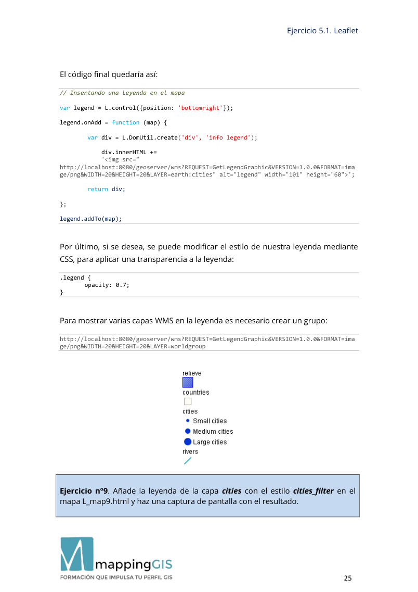</a></details>

[Consultar en el PDF · página 25](../materiales/Ejercicio_5-1_Leaflet-2025.pdf#page=25){target="_blank" rel="nofollow noopener noreferrer"}

### Leaflet · Ejercicio 10 · GeoJSON

<div class="original-statement"><span class="eyebrow">Enunciado original · Leaflet</span><p>Haz una captura de pantalla con el resultado del mapa L_map10.html</p></div>

<details class="original-exercise" markdown="1">
<summary>Pasos y contexto originales de la clase</summary>

**Página 25**

```text
Ejercicio 5.1. Leaflet 
 
                                                                                                  25 
 
El código final quedaría así: 
// Insertando una leyenda en el mapa 
 
var legend = L.control({position: 'bottomright'}); 
  
legend.onAdd = function (map) { 
 
        var div = L.DomUtil.create('div', 'info legend'); 
  
            div.innerHTML += 
            ''; 
  
        return div; 
 
}; 
  
legend.addTo(map); 
  
Por último, si se desea , se puede modificar el estilo de nuestra leyenda mediante 
CSS, para aplicar una transparencia a la leyenda: 
.legend { 
opacity: 0.7; 
} 
 
Para mostrar varias capas WMS en la leyenda es necesario crear un grupo: 
http://localhost:8080/geoserver/wms?REQUEST=GetLegendGraphic&VERSION=1.0.0&FORMAT=ima
ge/png&WIDTH=20&HEIGHT=20&LAYER=worldgroup 
 
 
 
Ejercicio nº 9. Añade la leyenda de la capa cities con el estilo cities_filter en el 
mapa L_map9.html y haz una captura de pantalla con el resultado.
```

**Página 26**

```text
Ejercicio 5.1. Leaflet 
 
                                                                                                  26 
Capas vectoriales. El formato GeoJSON 
 
GeoJSON se está convirtiendo en un formato de datos muy popular entre muchas 
tecnologías y servicios GIS. ¿Por qué?  es simple, ligero, sencillo, y Leaflet es 
bastante bueno en su manejo.  
 
Leaflet soporta todos los tipos geométricos de geoJSON. Pero los tipos “Feature” y  
“FeatureCollection” son l os más adecuado s para trabajar , ya que nos  permiten 
describir los elementos con  un conjunto de propiedades. Incluso podemos utilizar 
estas propiedades para dar estilo  a nuestros vectores de Leaflet . He aquí un 
ejemplo de un feature GeoJSON simple: 
 
var geojsonFeature = { 
    "type": "Feature", 
    "properties": { 
        "name": "Reino de León", 
        "amenity": "Campo de fútbol de la Cultural y Deportiva Leonesa", 
        "popupContent": "Aquí es donde juega el equipo de fútbol de León" 
    }, 
    "geometry": { 
        "type": "Point", 
        "coordinates": [-4.99, 39.75621] 
    } 
};
```

**Página 27**

```text
Ejercicio 5.1. Leaflet 
 
                                                                                                  27 
 
Trabajando con archivos GeoJSON en Leaflet 
 
En este ejercicio crearemos un mapa de cloropletas interactivo de los países del 
mundo. 
Haz una copia del archivo L_map1.html y renómbralo como L_map10.html 
Modifica el código y pon al comienzo el objeto map, sin la opción layers. 
Cambia la escala de visualización a 4. 
var map = L.map('map', { 
  center: [41.66, -4.72], 
  zoom: 4 
 }); 
 
Visualizaremos el mapa con tiles de MapBox que tiene una bonita escala de grises 
y se ajusta rá bien con nuestra capa de países. Sustituye el código que mostraba 
los tiles de OSM, por este otro: 
 
 
L.tileLayer('https://api.mapbox.com/styles/v1/{id}/tiles/{z}/{x}/{y}?access_token=pk.
eyJ1IjoibmFkaXJpbmciLCJhIjoiY2tob2phbXVoMDE4cjJ6cnN6Nmh5eWRpeSJ9.-9CD1Qdet6QZ0-la9X-
WxA', { 
    attribution: '© <a href="https://www.mapbox.com/feedback/">Mapbox</a> © <a 
href="http://www.openstreetmap.org/copyright">OpenStreetMap</a>', 
    maxZoom: 18, 
    id: 'mapbox/streets-v11', 
    tileSize: 512, 
    zoomOffset: -1, 
   }).addTo(map); 
 
Para que el código anterior funcione sin problemas hay que tener la precaución de 
comprobar que no hay saltos de línea incorrectos. La primera línea termina en {, y 
el resto terminan en una coma salvo la última que termina en ; 
Además, como has observado Mapbox requiere de una clave, debes comprobar 
que está perfectamente escrita, incluyendo los guiones que contiene, en caso 
contrario no funcionará: 
access_token= 
TU_TOKEN_MAPBOX'
```

**Página 28**

```text
Ejercicio 5.1. Leaflet 
 
                                                                                                  28 
 
Ahora vamos a trabajar con la capa en formato  geoJSON. Utilizaremos la capa de 
países original en formato SHP countries.shp. 
Ya hemos visto en ejercicios anteriores como convertir un shapefile a geojson . 
Tenemos varias opciones: 
1. Utilizar la librería open source   ogr2ogr que sirve para convertir datos 
vectoriales entre distintos formatos. 
2. Utilizar un conversor online: 
a. HTML5 Shapefile to GeoJSON Converter. Usando HTML5 y es simple: 
arrastra tu shapefile y obtén un GeoJSON. 
b.  MyGeodata Converter, que acepta hasta 20 formatos de entrada y 8 
de salida (ESRI Shapefile, Microstation DGN, MapInfo File, CSV, GML, 
GPX, KML y GeoJSON). 
3. Utilizar un cliente SIG como QGIS. Desde QGIS añadimos el SHP y a 
continuación guardaremos la capa en formato GeoJSON. (Capa > Guardar 
como…).
```

**Página 29**

```text
Ejercicio 5.1. Leaflet 
 
                                                                                                  29 
 
 
Guarda el nuevo archivo generado en el mism o directorio que las páginas HTML  
que estamos creando. 
 
Cambia la extensión d el archivo a " countries.js". Es importan te cambiar la 
extensión de .geojson a .js para que funcione. 
 
Ahora que hemos convertido el shapefile a JavaScript necesitamos asegurarnos de 
que Leaflet lo importará y reconocerá nuestros datos. 
 
Con un editor de texto, como el Notepad++, abr imos el archivo countries.js y 
agregamos el texto 
 
var countries = 
 
Justo antes del código ya existente del archivo, de tal forma que el contenido del 
archivo countries.js sea:
```

**Página 30**

```text
Ejercicio 5.1. Leaflet 
 
                                                                                                  30 
 
var countries = {"type":"FeatureCollection", ... } // resto del archivo geojson 
 
 
Haciendo esto, estamos estableciendo que el contenido completo del archivo 
GeoJSON sea igual a la variable countries. 
 
Una vez que hemos vinculado el archivo en el encabezado del documento del 
mismo modo que cualquier otro archivo JavaScript, ahora seremos capaces de 
manipular el archivo a través del objeto countries. 
 
Lo llevaremos a nuestro documento , incorporando la siguiente sentencia a la 
cabecera: 
 
 
<script type="text/javascript" src="countries.js"></script> 
 
 
 
Los objetos GeoJSON se añaden al mapa a través de una capa de GeoJSON. Para 
crearla y añadirla un mapa, podemos usar el siguiente código: 
 
 
L.geoJson(countries).addTo(map);
```

**Página 31**

```text
Ejercicio 5.1. Leaflet 
 
                                                                                                  31 
Un poco de color 
 
Vamos a dar estilo a nuestra capa asignando los estilos en una variable: 
 
var countryStyle = { 
    'color': "#e12a2a", 
    'weight': 2, 
    'opacity': 0.6 
}; 
 
Como hemos visto en la presentación teórica,  una capa vectorial de polígonos 
hereda las opciones de la clase Path. 
 
Las opciones de esta clase son: 
 
stroke, color, weight, opacity, fill, fillcolor, fillOpacity, dashArray, lineCap, 
lineJoin, clickable, pointerEvents, classname 
 
Juega con estas opciones para eliminar el color de relleno, po ner un borde de 
tramas… 
 
E incluimos el estilo nuevo a la capa GeoJSON: 
 
L.geoJson(countries, { 
style: countryStyle 
}).addTo(map);
```

**Página 32**

```text
Ejercicio 5.1. Leaflet 
 
                                                                                                  32 
 
 
Ahora vamos a dar color a los países de acuerdo a su población. La elección de 
colores agradables para un mapa puede ser una labor un poco complicada, pero 
hay una herramienta que puede ayudar, se trata de ColorBrewer.  
 
Utilizando los valores que recibimos de él, creamos una función que nos devuelve 
un color en función de la población: 
 
function getColor(d) { 
    return d > 100000000 ? '#800026' : 
           d > 50000000  ? '#BD0026' : 
           d > 20000000  ? '#E31A1C' : 
           d > 10000000  ? '#FC4E2A' : 
           d > 5000000   ? '#FD8D3C' : 
           d > 2000000   ? '#FEB24C' : 
           d > 1000000   ? '#FED976' : 
                            '#FFEDA0'; 
}; 
 
A continuación, definimos otra función para nuestra capa GeoJSON de manera que 
fillColor (el relleno de los polígonos)  dependerá de la  propiedad 
feature.properties.pop_est. Es decir, el campo población de nuestra capa de países.
```

**Página 33**

```text
Ejercicio 5.1. Leaflet 
 
                                                                                                  33 
También ajustar emos la apariencia y añadimos  un borde blanco con  puntos 
discontinuos. 
 
 
function style(feature) { 
    return { 
        fillColor: getColor(feature.properties.pop_est), 
        weight: 2, 
        opacity: 1, 
        color: 'white', 
        dashArray: '3', 
        fillOpacity: 0.7 
    }; 
} 
 
 
Cambia el estilo para que se refleje el nuevo estilo: 
 
 
L.geoJson(countries, { 
style: style 
}).addTo(map); 
 
 
Este sería el resultado:
```

**Página 34**

```text
Ejercicio 5.1. Leaflet 
 
                                                                                                  34 
Interactuando con el mapa 
 
Ahora vamos a añadir una funcionalidad definiendo una función que entre en las 
propiedades de los datos de nuestro geojson. El siguiente código usa la 
funcionalidad popup de Leaflet: 
 
 
function popup(feature, layer) { 
    if (feature.properties && feature.properties.name) { 
        layer.bindPopup(feature.properties.name); 
    } 
} 
 
Esta función comprueba que la parte properties del GeoJSON existe, así como la 
propiedad del campo name, que es único para el archivo de datos.  
 
La función  layer.bindPopup construye la funcionalidad de clic en el mapa como 
hemos visto anteriormente.  
 
onEachFeature es una propiedad de L.geoJson que se puede pasar con una función: 
 
geojson = L.geoJson(countries, { 
    style: style, 
    onEachFeature: popup 
}).addTo(map);
```

**Página 35**

```text
Ejercicio 5.1. Leaflet 
 
                                                                                                  35 
Ejercicio nº 10. Haz una captura de pantalla con el resultado del mapa 
L_map10.html 
 
Añadir una capa WFS de GeoServer y mostrar en una ventana 
emergente sus atributos mediante AJAX 
 
En este  ejercicio crearemos un mapa interactivo de los países del mundo 
utilizando la capa contries como servicio WFS 
Haz una copia del archivo L_map1.html y renómbralo como L_map11.html 
Modifica el código y pon al comienzo el objeto map, sin la opción layers. 
Cambia la escala de visualización a 2. 
var map = L.map('map', { 
 center: [41.66, -4.72], 
 zoom: 2 
}); 
 
En primer lugar, añadiremos al script la librería jQuery: 
<script src="https://code.jquery.com/jquery-3.5.1.js" ></script> 
 
JQuery es una librería de JavaScript de código abierto, que simplifica la tarea de 
programar en JavaScript y permite agregar interactividad a un sitio web sin tener 
conocimientos del lenguaje. 
Vamos a construir la URL con el servicio WFS de GeoS erver donde debemos 
reanudar nuestro geoJSON. 
La dirección URL servirá para crear la llamada AJAX a la página que contiene 
nuestro GeoJSON:
```

</details>

<details class="source-page"><summary>Ver página 35 del PDF original, con sus capturas</summary><a href="../../materiales/Ejercicio_5-1_Leaflet-2025.pdf#page=35" target="_blank" rel="nofollow noopener">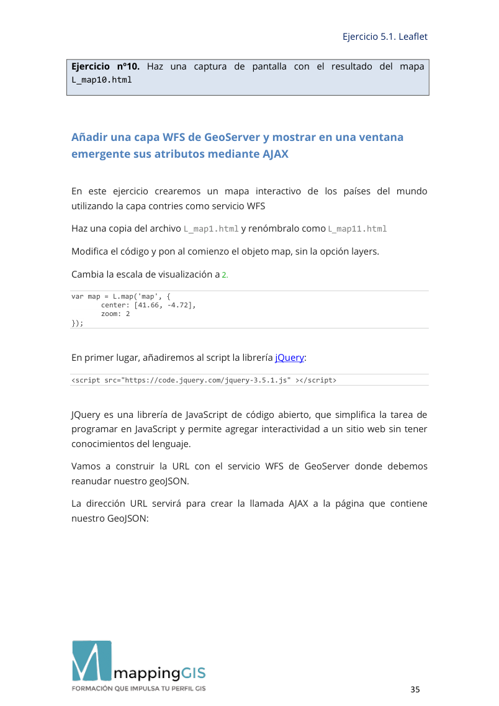</a></details>

[Consultar en el PDF · página 35](../materiales/Ejercicio_5-1_Leaflet-2025.pdf#page=35){target="_blank" rel="nofollow noopener noreferrer"}

### Leaflet · Ejercicio 11 · WFS mediante AJAX

<div class="original-statement"><span class="eyebrow">Enunciado original · Leaflet</span><p>Haz una captura de pantalla con el resultado del mapa L_map11.html</p></div>

<details class="original-exercise" markdown="1">
<summary>Pasos y contexto originales de la clase</summary>

**Página 35**

```text
Ejercicio 5.1. Leaflet 
 
                                                                                                  35 
Ejercicio nº 10. Haz una captura de pantalla con el resultado del mapa 
L_map10.html 
 
Añadir una capa WFS de GeoServer y mostrar en una ventana 
emergente sus atributos mediante AJAX 
 
En este  ejercicio crearemos un mapa interactivo de los países del mundo 
utilizando la capa contries como servicio WFS 
Haz una copia del archivo L_map1.html y renómbralo como L_map11.html 
Modifica el código y pon al comienzo el objeto map, sin la opción layers. 
Cambia la escala de visualización a 2. 
var map = L.map('map', { 
 center: [41.66, -4.72], 
 zoom: 2 
}); 
 
En primer lugar, añadiremos al script la librería jQuery: 
<script src="https://code.jquery.com/jquery-3.5.1.js" ></script> 
 
JQuery es una librería de JavaScript de código abierto, que simplifica la tarea de 
programar en JavaScript y permite agregar interactividad a un sitio web sin tener 
conocimientos del lenguaje. 
Vamos a construir la URL con el servicio WFS de GeoS erver donde debemos 
reanudar nuestro geoJSON. 
La dirección URL servirá para crear la llamada AJAX a la página que contiene 
nuestro GeoJSON:
```

**Página 36**

```text
Ejercicio 5.1. Leaflet 
 
                                                                                                  36 
 
var owsrootUrl = 'http://localhost:8080/geoserver/ows'; 
 
var defaultParameters = {  
service: 'WFS',  
version: '1.0.0',  
request: 'GetFeature',  
typeName: 'earth:countries',  
outputFormat: 'application/json' 
};  
 
var parameters = L.Util.extend(defaultParameters);  
 
var URL = owsrootUrl + L.Util.getParamString(parameters); 
 
 
La llamada AJAX se construye mediante JQuery, a través de la cual se pasa la URL y 
una función de éxito, o qué efecto debe realizarse la llamada. 
AJAX (JavaScript Asíncrono y XML) nos proporciona la posibilidad de hacer 
peticiones al servidor (intercambiar datos) sin tener que volver a cargar la página. 
En nuestro ejemplo, vamos a  hacer clic  sobre los objetos geográficos de la capa 
countries, y mostraremos un popup que conten drá la información captada por 
GeoJSON. En ese caso, veremos el nombre del país. 
El método $.ajax () realiza una solicitud asíncrona AJAX: 
$.ajax({  
    url: URL,  
    success: function (data) {  
//creamos una nueva capa geojson 
 var geojson = new L.geoJson(data, {  
      //Aplicamos un estilo 
      style: {"color":"#2ECCFA","weight":2},  
      //vinculamos un popup mostrando el nombre del país 
      onEachFeature: function(feature, layer){  
           layer.bindPopup("Has hecho click en " + feature.properties.name);  
      }}  
).addTo(map); }  
});
```

**Página 37**

```text
Ejercicio 5.1. Leaflet 
 
                                                                                                  37 
 
 
Ejercicio nº 11. Haz una captura de pantalla con el resultado del mapa 
L_map11.html
```

</details>

<details class="source-page"><summary>Ver página 37 del PDF original, con sus capturas</summary><a href="../../materiales/Ejercicio_5-1_Leaflet-2025.pdf#page=37" target="_blank" rel="nofollow noopener">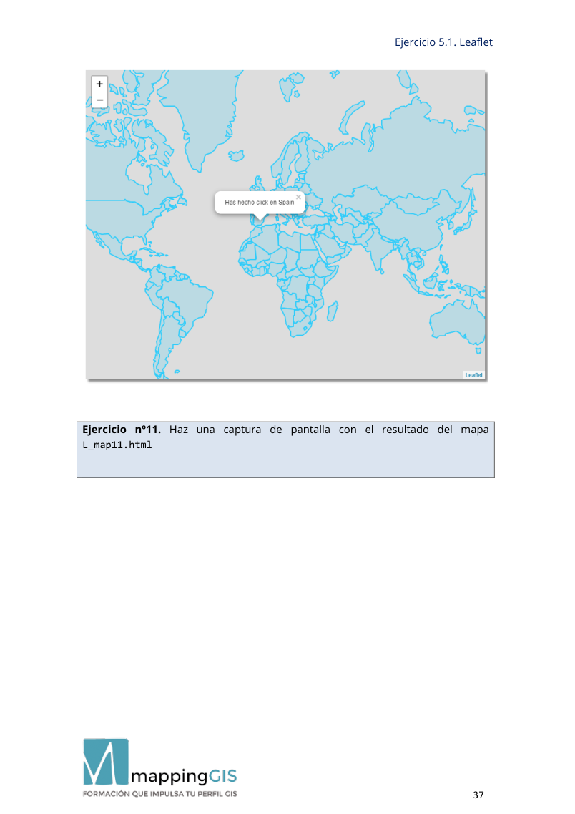</a></details>

[Consultar en el PDF · página 37](../materiales/Ejercicio_5-1_Leaflet-2025.pdf#page=37){target="_blank" rel="nofollow noopener noreferrer"}

### Leaflet · Ejercicio 12 · Plugin de búsqueda

<div class="original-statement"><span class="eyebrow">Enunciado original · Leaflet</span><p>Haz un a captura de pantalla con el resultado del mapa L_map12.html</p></div>

<details class="original-exercise" markdown="1">
<summary>Pasos y contexto originales de la clase</summary>

**Página 37**

```text
Ejercicio 5.1. Leaflet 
 
                                                                                                  37 
 
 
Ejercicio nº 11. Haz una captura de pantalla con el resultado del mapa 
L_map11.html
```

**Página 38**

```text
Ejercicio 5.1. Leaflet 
 
                                                                                                  38 
Extendiendo la funcionalidad de Leaflet mediante plugins 
 
Sin duda, una de las principales ventajas de Leaflet es el gran número de plugins 
de que dispone. La librería de Leaflet es muy ligera, contiene los elementos 
imprescindibles para crear el mapa. Podemos completar este cuerpo básico con 
los plugins.  
Insertando un  control de búsqueda de atributos en una capa  
estática GeoJSON 
 
Vamos a continuar dando interactividad a nuestro visor web incorporando  un 
control que realice una búsqueda en un campo de los atributos  de una capa en 
formato GeoJSON. 
Añadiremos a nuestro visor web un control que realice una búsqueda mediante 
atributos dentro de los objetos geográficos vectoriales.  
El control buscará en marcadores o en los objetos geográficos de un GeoJSON.
```

**Página 39**

```text
Ejercicio 5.1. Leaflet 
 
                                                                                                  39 
Haz una copia del archivo  L_map10.html (que ya debe c ontener la capa countries 
en formato GeoJSON) y renómbralo como L_map12.html 
1. Ve a la página de plugins de Leaflet: http://leafletjs.com/plugins.html 
2. Ve a la Sección: Overlay interaction  > Search & popups  y pincha sobre 
Leaflet Search. Este es el plugin para añadir las capas de Google en Leaflet: 
 
3. Hacemos clic sobre el menú Code. A continuación, nos descargamos el 
plugin haciendo clic sobre el Download ZIP, que se encuentra en la parte de 
abajo del menú. 
 
4. Descomprimimos el archivo y  lo colocamos en el mismo directorio en el 
que se encuentre nuestro HTML. 
 
5. Debajo del script que añade la capa countries.js, a ñadiremos la librería JS y 
la hoja de estilos CSS en la cabecera del HTML:
```

**Página 40**

```text
Ejercicio 5.1. Leaflet 
 
                                                                                                  40 
<script src="leaflet-search-master\src\leaflet-search.js"></script> 
<link rel="stylesheet" href="leaflet-search-master\src\leaflet-search.css" /> 
6. Creamos una variable denominada countriesJS para meter en ella la capa 
de países que tenemos en formato GeoJSON: 
var countriesJS = L.geoJson(countries, { 
 onEachFeature: popup, 
 style: style 
}).addTo(map); 
 
7. A continuación creamos una nueva variable, denominada searchControl, que 
contendrá el control de búsqueda, que se implementa a través de la clase 
L.Control.Search : 
var searchControl = new L.Control.Search({ 
 layer: countriesJS,  
 propertyName: 'name' 
}); 
En el código superior vemos como las propiedades de la clase L.Control.Search son 
layer y propertyName, en las que incluiremos la capa sobre la que queremos realizar 
la búsqueda ( countriesJS) y el campo que contendrá el texto a buscar ( name) 
respectivamente. 
8. Por último, añadimos el control al mapa: 
map.addControl(searchControl); 
Listo. Esta es la manera más simple de añadir el control de búsqueda de atr ibutos 
en una capa GeoJSON.  
Haz clic en el nuevo botón con forma de lupa e introduce el nombre de un país (en 
inglés):
```

**Página 41**

```text
Ejercicio 5.1. Leaflet 
 
                                                                                                  41 
 
Comprobarás que, al hacer clic sobre el res ultado de la búsqueda, en el país 
aparece una circunferencia roja. Esto es útil si trabajamos con una capa de puntos, 
pero en una capa de polígonos, lo interesante es resaltar el polígono con otro 
color.  
Esto sucede porque la opción de mostrar la localiza ción mediante una  
circunferencia (circleLocation) viene por defecto como true. 
Vamos a modificar el código para eliminar esta circunferencia circleLocation: false: 
var searchControl = new L.Control.Search({ 
 layer: countriesJS,  
 propertyName: 'name', 
       marker: false 
}); 
Inmediatamente después y antes de añadir el control al mapa, crearemos una 
función para definir el estilo del objeto geográfico resultado de la búsqueda: 
searchControl.on('search:locationfound', function(e) { 
 e.layer.setStyle({fillColor: '#3f0', color: '#0f0'}); 
}) 
Realiza de nuevo la búsqueda para comprobar el resultado. 
El siguiente paso es limpiar los resultados después de cada búsqueda. 
Inmediatamente después crearemos una nueva función que limpie los resultados 
de las búsquedas: 
.on('search:collapsed', function(e) { 
 countriesJS.eachLayer(function(layer) { //restauramos el color del elemento
```

**Página 42**

```text
Ejercicio 5.1. Leaflet 
 
                                                                                                  42 
  countriesJS.resetStyle(layer) 
 }) 
}); 
Y al final del script añadimos el control al mapa: 
map.addControl(searchControl);  
Listo. Al hacer clic sobre la ruleta del ratón se limpiarán los resultados.
```

**Página 43**

```text
Ejercicio 5.1. Leaflet 
 
                                                                                                  43 
Aquí tienes el HTML completo: 
<!DOCTYPE html> 
<html> 
<meta charset="utf-8" /> 
<head> 
   <link rel="stylesheet" href="https://unpkg.com/leaflet@1.9.4/dist/leaflet.css"/> 
   <script src="https://unpkg.com/leaflet@1.9.4/dist/leaflet.js"></script>   
   <script type="text/javascript" src="countries.js"></script> 
<script src="https://cdn.jsdelivr.net/npm/leaflet-search@4.0.0/dist/leaflet-
search.src.min.js"></script> 
<link rel="stylesheet" href="https://cdn.jsdelivr.net/npm/leaflet-
search@4.0.0/dist/leaflet-search.src.min.css"> 
 <style> 
  #map {  
   width: 100%; 
   height: 600px; 
   box-shadow: 5px 5px 5px #888; 
  } 
 </style> 
  
 </head> 
  <body> 
   <div id="map"></div> 
 <script> 
  
 var map = L.map('map', { 
  center: [41.66, -4.72], 
  zoom: 4 
 }); 
  
 L.tileLayer('https://{s}.tile.openstreetmap.org/{z}/{x}/{y}.png').addTo(map); 
 
 var countryStyle = { 
  'color': "#858585", 
  'weight': 2, 
  'opacity': 0.6 
 }; 
  
 function getColor(d) { 
 return d > 100000000 ? '#800026' : 
  d > 50000000 ? '#BD0026' : 
  d > 20000000 ? '#E31A1C' : 
  d > 10000000 ? '#FC4E2A' : 
  d > 5000000 ? '#FD8D3C' : 
  d > 2000000 ? '#FEB24C' : 
  d > 1000000 ? '#FED976' : 
    '#FFEDA0'; 
 }; 
   
 function style(feature) { 
  return {  
fillColor: getColor(feature.properties.pop_est), 
   weight: 2, 
   opacity: 1, 
   color: 'white', 
   dashArray: '3', 
   fillOpacity: 0.7 
  }; 
 } 
 
function popup(feature, layer) { 
  if (feature.properties && feature.properties.name) {
```

**Página 44**

```text
Ejercicio 5.1. Leaflet 
 
                                                                                                  44 
   layer.bindPopup(feature.properties.name); 
  } 
 } 
 
 var countriesJS = L.geoJson(countries, { 
  onEachFeature: popup, 
  style: style 
 }).addTo(map); 
 
  
 var searchControl = new L.Control.Search({ 
  layer: countriesJS,  
  propertyName: 'name', 
  marker: false 
 }); 
 
 searchControl.on('search:locationfound', function(e) { 
  e.layer.setStyle({fillColor: '#3f0', color: '#0f0'}); 
 }) 
 .on('search:collapsed', function(e) { 
 countriesJS.eachLayer(function(layer) {//restauramos el color del elemento 
   countriesJS.resetStyle(layer) 
  }) 
 }); 
  
 map.addControl(searchControl); 
 
 </script> 
 </body>  
 </html> 
 
Como puedes observar en el código anterior, hemos sustituido la ruta a los 
archivos descargados del plugin por un enlace CDN. De  esta forma puedes ver un 
ejemplo de las dos formas en que se puede utilizar un plugin de Leaflet: 
1. Mediante la descarga de archivos. 
2. Mediante un enlace CDN. 
Hay varios sitios donde podemos encontrar los enlaces CDN con los plugins, en 
este caso hemos utilizado el siguiente: 
https://www.jsdelivr.com/package/npm/leaflet-search
```

**Página 45**

```text
Ejercicio 5.1. Leaflet 
 
                                                                                                  45 
 
De este modo solamente debes copiar los enlaces que se indican y pegarlos en tu 
código. 
Ejercicio nº 12. Haz un a captura de pantalla con el resultado del mapa 
L_map12.html
```

</details>

<details class="source-page"><summary>Ver página 45 del PDF original, con sus capturas</summary><a href="../../materiales/Ejercicio_5-1_Leaflet-2025.pdf#page=45" target="_blank" rel="nofollow noopener">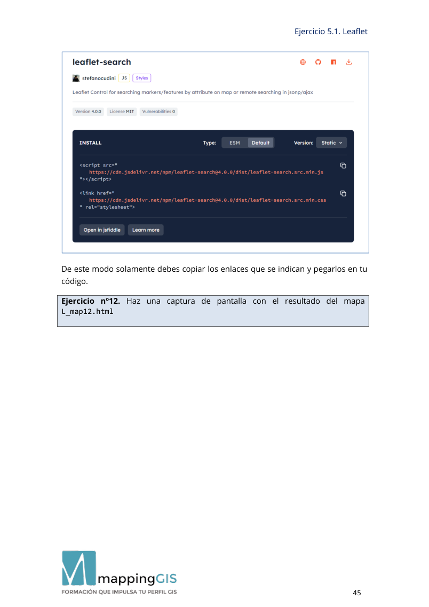</a></details>

[Consultar en el PDF · página 45](../materiales/Ejercicio_5-1_Leaflet-2025.pdf#page=45){target="_blank" rel="nofollow noopener noreferrer"}

