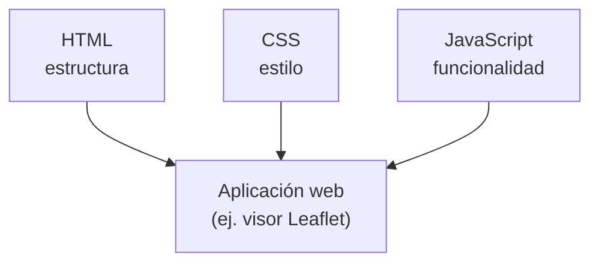
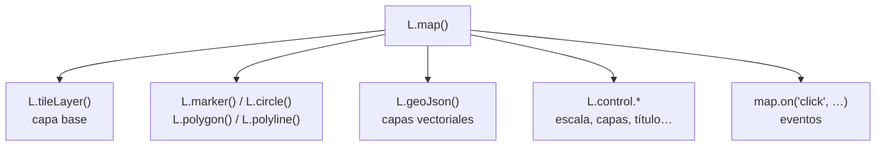

# Unidad 5. Personalización de aplicaciones web de mapas

**Antes de leer, mira el esquema.** Los tres lenguajes que forman cualquier aplicación web, incluida un visor de mapas:



### Resumen estructurado

**1. Contenido de la unidad**
- Aplicaciones web.
- Lenguajes de programación para la web: HTML, CSS y JavaScript.

**2. ¿Qué es una aplicación web?**
Una **aplicación Web** es una aplicación ejecutable en un navegador. Se construye combinando tres lenguajes con roles complementarios:

| Lenguaje | Rol |
|---|---|
| **HTML** | Lenguaje de marcado de páginas web; define la **estructura** del contenido de una página web. |
| **CSS** (*Cascading Style Sheets*) | Define los **estilos** (apariencia) de una página web. |
| **JavaScript** | Lenguaje de **programación** web para crear aplicaciones que se ejecutan en el navegador y le dan **funcionalidad**. |

*Ejemplo de aplicación webmapping mínima* (estructura HTML con cabecera CSS y JavaScript):
```html
<!DOCTYPE html>
<html>
    <meta charset="utf-8" />
    <head>
        <script src="http://cdn.leafletjs.com/leaflet/v0.7.7/leaflet.js"></script>
        <link rel="stylesheet" href="http://cdn.leafletjs.com/leaflet/v0.7.7/leaflet.css" />
        <style>
            #map {
                width: 100%;
                height: 600px;
            }
        </style>
    </head>
    <body>
        <div id="map"></div>
        <script>
            var OSM = L.tileLayer('http://{s}.tile.osm.org/{z}/{x}/{y}.png', {
                attribution: '&copy; <a href="http://osm.org/copyright">OpenStreetMap</a>'
                +'contributors',
                maxZoom: 18
            });

            var map = L.map('map', {
                center: [41.66, -4.72],
                zoom: 13,
                layers: OSM
            });
        </script>
    </body>
</html>
```
- **HTML** define la estructura (`<html>`, `<head>`, `<body>`, `<div id="map">`).
- **CSS** define el estilo (`<style>` con las dimensiones del `<div>` del mapa).
- **JavaScript** aporta la funcionalidad (creación de la capa base y del objeto mapa con Leaflet).

**3. HTML5**
- **HTML** (*HyperText Markup Language*, lenguaje de marcado de hipertexto) tiene su propia **sintaxis** (reglas para la comunicación).
- Un **navegador web** transforma el texto escrito en HTML en una página web reconocible, siguiendo la sintaxis HTML.
- Un **lenguaje de marcado** es un lenguaje de programación usado para que el texto haga más que solamente aparecer en una página; puede convertir el texto en imágenes, enlaces, tablas, listas, etc.

**4. CSS**
- **CSS** (*Cascading StyleSheets*, Hojas de Estilo en Cascada): lenguaje usado para describir la apariencia y el formato de un HTML.
- Una **hoja de estilo** es un archivo que describe cómo debería verse un archivo HTML.
- CSS es un lenguaje muy utilizado por los diseñadores web y en los últimos años se ha incorporado al mundo GIS. La edición de estilos en MapBox Studio Classic o en CartoDB se realiza utilizando **CartoCSS**.

**5. JavaScript**
- **JavaScript**: lenguaje para programar aplicaciones para internet y la web.
- La última versión estable es **ECMAScript 2016 (ES6)**, aunque ya existen ES7, ES8...
- *¿Para qué podemos usar JavaScript?*
  - Crear sitios web que respondan a las interacciones del usuario.
  - Crear aplicaciones webmapping (por ejemplo, con OpenLayers).
  - Acceder a información en internet (ej. encontrar las palabras más populares en Twitter según el tema).
  - Organizar y presentar datos (ej. automatizar el trabajo de las hojas de cálculo, o la visualización de datos).

**6. Librerías JavaScript para mapas**
La utilización de librerías JavaScript para crear mapas proporciona una serie de **ventajas** frente a las soluciones empaquetadas (como CartoDB o MapBox):
- Más personalización.
- Más control sobre las capas.
- Posibilidad de incluir nuevas herramientas y botones.

- El estándar de la industria para las librerías de JavaScript ha sido la **API de Google Maps**.
- Las bibliotecas JavaScript abiertas (**OpenLayers** o **Leaflet**) no están sujetas a los cambios de los planes de pago de soluciones comerciales.

**Arquitectura típica (posición de las librerías JS en la arquitectura general):**
- Interfaz de usuario: **Leaflet** / OpenLayers
- Servidor web: GeoServer ↔ GeoWebCache
- Base de datos: PostGIS

---

## Unidad 5-1. Leaflet

**Antes de leer, mira el esquema.** Así se compone un mapa Leaflet a partir de sus piezas:



### Resumen estructurado

**1. Contenido de la unidad**
- ¿Qué es Leaflet?
- El mapa
- Capas
- Controles
- Eventos
- Plugins

**2. ¿Qué es Leaflet?**
- **Leaflet** es una librería JavaScript *open source* para crear mapas interactivos en un entorno móvil.
- Es la elección utilizada por Flickr, Wikimedia, foursquare, OSM, CARTO, GIS Cloud, Washington Post, Wall Street Journal, Geocaching.com, etc.

*Historia de Leaflet:*

| Año | Hito |
|---|---|
| **2011** | Surge a principios de año. Creado por **Vladimir Agafonkin**, ingeniero de Mapbox, con un equipo de +8000 colaboradores especializados. |
| **2012** | OpenStreetMap adopta Leaflet. |
| **2013** | Aparecen plugins clave como: leaflet.draw, leaflet.markercluster, leaflet.fullscreen… |
| **2017–2020** | Integración con frameworks: React, Vue, Angular. Uso en apps web de QGIS (como qgis2web). |
| **2024–2025** | La comunidad mantiene vivo el proyecto. Plugins modernos, integraciones con Svelte, React y compatibilidad con OGC APIs. |

*Leaflet = Sencillez:*
- Muy ligero (39 KB).
- Sencillo y rápido de aprender.
- API bien documentada y fácil de usar.
- Características básicas pero que funcionan a la perfección.
- Soporte móvil.
- Funciona tanto en los navegadores modernos como en los antiguos.
- Ampliable con plugins para extender su funcionalidad.

*Documentación:*
- Documentación de la API: http://leafletjs.com/reference.html
- Ejemplos y tutoriales: http://leafletjs.com/examples.html
- Código: https://github.com/Leaflet/Leaflet
- Leaflet Tips and Tricks: https://leanpub.com/leaflet-tips-and-tricks/read

**3. Comenzando con Leaflet. Carga de la librería**
El encabezado del documento carga necesariamente los archivos JavaScript y CSS que serán incluidos con el mapa: la librería JavaScript **leaflet.js** y la hoja de estilo **leaflet.css**. Leaflet se puede utilizar descargando la librería (https://leafletjs.com/download.html) o mediante un enlace **CDN**:

```html
<link rel="stylesheet" href="https://unpkg.com/leaflet@1.9.4/dist/leaflet.css" integrity="sha256-p4NxAoJBhIIN+hmNHrzRCf9tD/miZyoHS5obTRR9BMY=" crossorigin=""/>
<script src="https://unpkg.com/leaflet@1.9.4/dist/leaflet.js" integrity="sha256-20nQCchB9co0qIjJZRGuk2/Z9VM+kNiyxNV1lvTlZBo=" crossorigin=""></script>
```

**4. El mapa — L.map()**
`L.map` → crear y manipular el mapa. Tiene activadas por defecto las interacciones del ratón sobre el mapa y el control de zoom y atribución.

*Sintaxis:*
```
L.map( <HTMLElement|String> id, <Map options> opciones )
```
`L.map` crea una instancia de un objeto mapa definido por un elemento `<div>`:
```javascript
var map = new L.map('map', {
    center: ...
    zoom: ..
    layers :...
});
```
Primero se crea un `<div>` que albergará el mapa, y se le da estilo (dimensiones):
```html
<div id="map"></div>
<style>
    #map { width: 700px; height: 600px; }
</style>
```

*Mi primer mapa* — un mapa básico = `L.map` + `L.tileLayer`:
```javascript
var map = L.map('map', {
    center: [40.965, -5.664],
    zoom: 16
});
L.tileLayer('https://{s}.tile.openstreetmap.org/{z}/{x}/{y}.png').addTo(map);
```

*Opciones de la clase L.map():*

| Tipo | Opción | Descripción |
|---|---|---|
| Principales | `center` | Centro geográfico inicial del mapa (coordenadas geográficas). |
| Principales | `zoom` | Zoom inicial del mapa. |
| Principales | `layers` | Capas que se añadirán al mapa inicialmente. |
| Secundarias | `minZoom` / `maxZoom` | Mínimo / máximo nivel de zoom. |
| Secundarias | `maxBounds` | Restringe la vista a las coordenadas geográficas establecidas, devolviendo al usuario a ellas si intenta desplazarse fuera. |
| Secundarias | `crs` | Sistema de referencia de coordenadas. Por defecto EPSG:3857 (proyección basada en WGS84). |

*Métodos para modificar el estado del mapa:*
- **`setView(<LatLng> center, <Number> zoom?, <zoom/pan options> options?)`**: define la vista del mapa (centro geográfico y zoom). Ejemplo: `var map = L.map('map').setView([-41.2858, 174.78682], 14);`
- Otros métodos: `setZoom()`, `zoomIn()`, `zoomOut()`, `setZoomAround()`, `fitBounds()`, `fitWorld()`, `panTo()`, `panInsideBounds()`, `panBy()`, `invalidateSize()`, `setMaxBounds()`, `locate()`, `stopLocate()`, `remove()`, `flyTo()`.

*Métodos para recuperar el estado del mapa (métodos Get):*
- **`getCenter()`**: retorna las coordenadas del centro geográfico de la vista del mapa. Ejemplo: `var center = map.getCenter(); document.write(center);` → `LatLng(41.66, -4.72)`.
- `getZoom()` → nivel de zoom de la vista actual.
- `getMinZoom()` / `getMaxZoom()` → mínimo / máximo nivel de zoom del mapa.
- `getBounds()` → retorna `LatLngBound` de la vista actual (coordenadas de las esquinas suroeste y noreste).
- Otros métodos: `getBoundsZoom()`, `getSize()`, `getPixelBounds()`, `getPixelOrigin()`.

*Métodos para trabajar con capas y controles:*
- **`addLayer(<ILayer> layer, <Boolean> insertAtTheBottom?)`** ↔ **`removeLayer()`**: añadir / eliminar una capa del mapa. Ejemplo:
```javascript
var ggl = L.gridLayer.googleMutant({ type: 'roadmap' });
map.addLayer(ggl);
```
- Otros métodos: `hasLayer`, `eachLayer`, `openPopup`, `closePopup`, `addControl`, `removeControl`.

**5. Las capas — ILayer**
Leaflet organiza las capas en **4 grupos**:

| Capas raster | Capas vectoriales | Capas de interfaz de usuario | Otras capas |
|---|---|---|---|
| TileLayer | Path | Markers | LayerGroup |
| TileLayer.WMS | Polyline | Popups | FeatureGroup |
| VideoOverlay | Polygon | Tooltip | GeoJSON |
| ImageOverlay | Rectangle, Circle, CircleMarker, SVGOverlay, SVG, Canvas | | GridLayer |

*5.1 Capas raster*

Leaflet tiene 4 clases para capas raster: capas teseladas (`tileLayer`), capas teseladas WMS (`tileLayer.WMS`), capas de imágenes (`imageOverlay`) y capas de vídeo (`VideoOverlay`).

**Capas teseladas — L.tileLayer**: carga y visualiza capas teseladas en el mapa.
```
L.tileLayer( <String> urlTemplate, <TileLayer options> opciones? )
```
La `urlTemplate` es una cadena con el formato `http://{s}.mapdomain.org/{z}/{x}/{y}.png`, donde `{s}` permite usar uno de los subdominios (para peticiones paralelas más rápidas), `{z}` declara el nivel de zoom, y `{x}`/`{y}` definen las coordenadas de las teselas. Ejemplo: `L.tileLayer('https://{s}.tile.openstreetmap.org/{z}/{x}/{y}.png').addTo(map);`

*Opciones*: `minZoom`, `maxZoom`, `tileSize`, `attribution`, `detectRetina`, `opacity`, `bounds`... La **atribución** es la colocación de una referencia adecuada a la fuente de los datos, para asegurar que se reconocen los créditos y derechos de autor del proveedor de teselas. Ejemplo:
```javascript
var OpenStreetMap_Mapnik = L.tileLayer('https://{s}.tile.openstreetmap.org/{z}/{x}/{y}.png', {
    maxZoom: 19,
    attribution: '&copy; <a href="https://www.openstreetmap.org/copyright">OpenStreetMap</a> contributors'
});
```
*Métodos*: `addTo`, `bringToFront`, `bringToBack`, `setOpacity`, `setZIndex`, `redraw`, `setUrl`, `getContainer`.

**Capas teseladas WMS — L.tileLayer.WMS**: se utiliza para visualizar servicios WMS como capa de teselas en el mapa. Extiende la clase `L.TileLayer`.
```
L.tileLayer.wms( <String> baseUrl, <TileLayer.WMS options> opciones )
```
Incluye todas las opciones de `L.TileLayer` y además: `layers` (requerido, lista de capas WMS separadas por comas), `styles` (lista de estilos WMS), `format` (formato de las imágenes; usar `image/png` para transparencia), `transparent` (por defecto `false`), `version` (por defecto 1.1.1), `crs` (por defecto el CRS del mapa). Ejemplo:
```javascript
var cities = L.tileLayer.wms("http://localhost:8080/geoserver/wms", {
    layers: 'cities', // obligatorio
    format: 'image/png',
    transparent: true,
    attribution: "Natural Earth",
    styles: "cities_label"
});
```

**Capas de imágenes — L.imageOverlay**: añade una imagen georreferenciada al mapa (requisito: georreferenciar la imagen indicando las coordenadas de las esquinas).
```
L.ImageOverlay( <String> imageUrl, <LatLngBounds> bounds, <ImageOverlay options> opciones? )
```
*Opciones*: `opacity`, `attribution`... *Métodos*: `addTo`, `bringToFront`, `bringToBack`, `setOpacity`, `setUrl`. Ejemplo:
```javascript
var imageUrl = 'http://www.lib.utexas.edu/maps/historical/newark_nj_1922.jpg',
    imageBounds = [[40.712216, -74.22655], [40.773941, -74.12544]];
L.imageOverlay(imageUrl, imageBounds).addTo(map);
```

*5.2 Capas de interfaz de usuario*

Comprenden marcadores (`Markers`), ventanas emergentes (`Popups`) y etiquetas (`Tooltip`).

**Marcadores — L.marker**: muestra un marcador/icono sobre el mapa.
```
L.marker( <LatLng> latlng, <Marker options> opciones? )
```
Ejemplo: `L.marker([41.66, -4.71]).addTo(map)`

*Opciones*: `icon` (`L.Icon`, para seleccionar el icono), `clickable` (por defecto `true`), `draggable` (por defecto `false`; si es `true`, el marcador se puede arrastrar), `keyboard` (por defecto `true`, controlable con el tabulador del teclado), `title` (texto tipo tooltip al pasar el ratón, sin valor por defecto), `alt` (texto del atributo `alt` de la imagen del icono, útil para accesibilidad), `zIndexOffset`, `opacity`, `riseOnHover` (el marcador se pone encima de los demás al pasar el ratón), `riseOffset`.

*Métodos*: `addTo`, `getLatLng`, `setLatLng`, `setIcon`, `setZIndexOffset`, `setOpacity`, `bindPopup`, `unbindPopup`, `openPopup`, `getPopup`, `closePopup`, `togglePopup`, `setPopupContent`, `toGeoJSON`. `bindPopup` lanza una ventana emergente con contenido HTML al hacer clic sobre el marcador; `openPopup()` la abre directamente. Ejemplo:
```javascript
L.marker([41.65246, -4.6982], {icon: myIcon})
    .addTo(map)
    .bindPopup("Localización de <b>MappingGIS.com</b>");
```
*Icono personalizado — L.Icon*: un icono marcador se define con un objeto `L.Icon`, pasado como opción al crear el marcador:
```javascript
var myIcon = L.icon({
    iconUrl: 'https://openlayers.org/assets/theme/img/logo70.png',
    iconSize: [30, 30],
    popupAnchor: [-1, -10]
});
```

**Ventanas emergentes — L.popup**: abre ventanas emergentes en ciertos lugares del mapa.
```
L.popup( <Popup options> options?, <ILayer> source? )
```
Ejemplo (forma más compleja que `bindPopup`, útil para popups no asociados a una capa):
```javascript
var popup = L.popup()
    .setLatLng([41.65, -4.70])
    .setContent('<p>Hola!<br/>Soy un bonito popup.</p>')
    .openOn(map);
```

**Etiquetas — L.tooltip**: se usa para visualizar pequeños textos sobre capas.
```
L.tooltip( <Tooltip options> options?, <Layer> source? )
```
Ejemplo:
```javascript
var marker = L.marker([41.66, -4.71]).addTo(map);
marker.bindTooltip("León - España", {permanent: true}).openTooltip();
```
*Opciones*: `pane` (panel HTML donde se agrega la etiqueta), `offset` (desplazamiento, por defecto `Point(0,0)`), `direction` (`right`, `left`, `top`, `bottom`, `center`, `auto`; por defecto `auto`), `permanent` (abierta de forma permanente o solo al pasar el ratón; por defecto `false`), `sticky` (si es `true`, la etiqueta sigue al ratón en vez de estar fija en el centro del objeto; por defecto `false`), `interactive` (por defecto `false`), `opacity` (por defecto `0.9`).

*5.3 Capas vectoriales*

**Path**: clase abstracta que contiene opciones y constantes compartidas por las capas vectoriales `Polygon`, `Polyline` y `Circle`. No se usa directamente.
- *Opciones*: `stroke`, `color`, `weight`, `opacity`, `fill`, `fillcolor`, `fillOpacity`, `dashArray`, `lineCap`, `lineJoin`, `clickable`, `pointerEvents`, `classname`.
- *Eventos*: `click`, `dblclick`, `mousedown`, `mouseover`, `mouseout`, `contextmenu`, `add`, `remove`, `popupopen`, `popupclose`.
- *Métodos*: `addTo`, `bindPopup`, `unbindPopup`, `openPopup`, `closePopup`, `setStyle`, `getBounds`, `bringToFront`, `bringToBack`, `redraw`.

**Polyline — L.polyline**: línea. Extiende `Path`. Requiere las coordenadas de los vértices.
```
L.polyline( <LatLng[]> latlngs, <Polyline options> options? )
```
```javascript
var pointA = new L.LatLng(41.65925, -4.70404);
var pointB = new L.LatLng(41.65166, -4.70421);
var latlngs = [pointA, pointB];
var polyline = L.polyline(latlngs, {color: 'blue'}).addTo(map).bindPopup('Avda. Juan Carlos I');
```

**Polygon — L.polygon**: polígono. Extiende `Polyline`. Requiere las coordenadas de los vértices.
```
L.polygon( <LatLng> latlngs, <Polyline options> options? )
```
```javascript
var polygon = L.polygon([
    [41.67778, -4.72163],
    [41.67349, -4.71511],
    [41.66958, -4.72017],
    [41.67169, -4.72515]
]).addTo(map).bindPopup('Mercaolid');
```

**Rectangle — L.rectangle**: rectángulo. Extiende `Polygon`. Requiere los límites geográficos.
```
L.rectangle( <LatLngBounds> bounds, <Path options> options? )
```
```javascript
var bounds = [[41.71, -4.72], [41.70, -4.74]];
L.rectangle(bounds, {color: "brown", weight: 1}).addTo(map);
```

**Circle — L.circle**: círculo. Extiende `Path`.
```
L.circle( <LatLng> coordenadas del centro, <Number> radio, <Path options> opciones )
```
```javascript
var circle = L.circle([41.658, -4.725], 700, {
    color: 'red', fillColor: '#f03', fillOpacity: 0.5
}).addTo(map);
```

**CircleMarker — L.circleMarker**: circunferencias. Extiende `Circle`. El radio se especifica en **píxeles**: al modificar el zoom del mapa, el tamaño de la circunferencia se mantiene siempre igual.
```
L.circleMarker( <LatLng> latlng, <Path options> options? )
```
```javascript
var circleMarker = L.circleMarker([41.63, -4.775], {radius: 20}).addTo(map);
```

**SVG y Canvas**: son métodos de renderización del mapa (no capas de datos), que heredan de la clase base `Renderer`. Debido a limitaciones técnicas, SVG no está disponible en todos los navegadores (ej. IE7 e IE8).
```javascript
var map = L.map('map', { renderer: L.svg() });
var map = L.map('map', { renderer: L.canvas() });
```

*5.4 Otras capas*

**Grupo de capas — L.layerGroup()**: se utiliza para agrupar varias capas y manejarlas como una sola. Extiende la clase `Layer`. Si se agrega el grupo al mapa, cualquier capa que se añada o elimine del grupo también se añade o elimina del mapa.
```
L.layerGroup( <ILayer[]> layers? )
```
```javascript
var littleton = L.marker([39.61, -105.02]).bindPopup('Littleton, CO.'),
    denver    = L.marker([39.74, -104.99]).bindPopup('Denver, CO.'),
    aurora    = L.marker([39.73, -104.8]).bindPopup('Aurora, CO.'),
    golden    = L.marker([39.77, -105.23]).bindPopup('Golden, CO.');
var cities = L.layerGroup([littleton, denver, aurora, golden]);
```

**Grupo de objetos geográficos — L.featureGroup()**: extiende `LayerGroup`, pero además tiene eventos de ratón y comparte el método `bindPopup`.
```
L.featureGroup( <ILayer[]> layers? )
```
```javascript
L.featureGroup([marker1, marker2, polyline])
    .bindPopup('Hello world!')
    .on('click', function() { alert('Clicked on a group!'); })
    .addTo(map);
```

**GeoJSON — L.geoJson()**: representa un objeto GeoJSON o un listado de objetos GeoJSON. Extiende `FeatureGroup`. Permite utilizar datos GeoJSON y visualizarlos en el mapa.
```
L.geoJson( <Object> geojson?, <GeoJSON options> options? )
```
```javascript
L.geoJSON(data, {
    style: function (feature) { return {color: feature.properties.color}; }
}).bindPopup(function (layer) {
    return layer.feature.properties.description;
}).addTo(map);
```
*Opciones*: `pointToLayer` (función para crear capas de puntos GeoJSON; si no se especifica, se crean marcadores simples), `style` (función para los estilos de las capas de tipo línea y polígono), `onEachFeature` (para llamar a eventos y desplegar popups de los *features*), `filter` (decide si un objeto geográfico se muestra en el mapa o no), `coordsToLatLng` (convierte las coordenadas GeoJSON en puntos LatLng).

**GridLayer — L.gridLayer()**: clase genérica para el manejo de una malla teselada de elementos HTML (`<canvas>`, `` o `<div>`). Es la clase base para todas las capas teseladas y sustituye a la antigua clase `TileLayer.Canvas`. Se encarga de crear y animar estos elementos DOM automáticamente.
```
L.gridLayer( <GridLayer options> options? )
```
```javascript
var CanvasLayer = L.GridLayer.extend({
    createTile: function(coords){
        var tile = L.DomUtil.create('canvas', 'leaflet-tile');
        var size = this.getTileSize();
        tile.width = size.x;
        tile.height = size.y;
        var ctx = tile.getContext('2d');
        return tile;
    }
});
```

**6. Controles**
Los controles permiten a los usuarios navegar con movimientos del ratón (arrastrar para moverse, doble clic para ampliar, botones de acercar/alejar). **Por defecto** solo están habilitados los controles de **zoom** y **atribución**. Leaflet tiene **4 controles**: Zoom, Attribution, Layers, Scale.

**Añadir control — L.control()**: implementa la interfaz `IControl`. Se puede agregar al mapa de dos formas equivalentes: `control.addTo(map);` o `map.addControl(control);`
```
L.control( <Control options> opciones )
```
*Opciones*: `position` — posición inicial del control en el mapa: `topleft`, `topright`, `bottomleft`, `bottomright` (por defecto `topright`). *Métodos*: `setPosition`, `getPosition`, `addTo`, `removeFrom`, `getContainer`.

- **Control de zoom — L.control.zoom**: añade un control de zoom básico (dos botones, acercar/alejar). Se añade al mapa por defecto (a menos que se establezca la opción `zoomControl` a `false`). Extiende `L.control`. Posición por defecto: `topleft`.
- **Control de atribución — L.control.attribution**: muestra los datos de atribución en un pequeño cuadro de texto dentro del mapa. Se añade por defecto (a menos que `attributionControl` se establezca a `false`). Extiende `L.control`. Posición por defecto: `bottomright`.
- **Control de capas — L.control.layers**: crea un control de capas que da al usuario la posibilidad de alternar la visibilidad de las capas (mostrándolas u ocultándolas). Extiende `L.control`. Posición por defecto: `topright`. Distingue entre `baseLayers` (capas base, mutuamente excluyentes) y `overlays` (capas superpuestas). Opción `collapsed` (por defecto `true`; con `false` se ve el control expandido): `L.control.layers(baseLayers, overlays, {collapsed:false}).addTo(map);`
- **Control de escala — L.control.scale**: muestra la escala del centro actual de la pantalla en el sistema métrico (m/km) e imperial (millas/pies). Extiende `L.control`. Posición por defecto: `bottomleft`. Las opciones `metric` e `imperial` vienen habilitadas por defecto, pero se pueden cambiar a `false`: `L.control.scale({imperial: false}).addTo(map);`

**7. Eventos**
Cada vez que algo ocurre en Leaflet (ej. el usuario hace clic en un marcador o el mapa cambia de zoom), el objeto correspondiente envía un **evento** que se puede suscribir a una función, permitiendo reaccionar a la interacción del usuario.
```javascript
map.on('click', function(e) {
    alert(e.latlng);
});
```
Leaflet trabaja con detectores de eventos de referencia, por lo que si se quiere agregar un oyente y luego quitarlo, se debe definir como una **función**:
```javascript
function onClick(e) { ... }
map.on('click', onClick);
map.off('click', onClick);
```
Un **objeto de evento** es el objeto que se recibe como argumento en una función de escucha cuando algún evento se activa, y contiene información útil sobre ese evento (ej. `e.latlng` es el punto geográfico donde ocurre el evento del ratón).

**8. Plugins**
Leaflet es una librería JavaScript *open source* que se centra en un conjunto básico de características, para mantenerse lo más ligera posible. Si se necesita más funcionalidad hay que recurrir a **plugins**. Uno de los aspectos clave de Leaflet es que ofrece un buen código base sobre el que desarrollar complementos.

*¿Cómo incorporo los plugins a mi mapa de Leaflet?*
1. Acceder al repositorio oficial de plugins.
2. Descargar el plugin (botón *Download ZIP*) y descomprimir el archivo.
3. Añadir la librería en la cabecera del HTML, por ejemplo: `<script src="leaflet-master\layer\tile\ejemplo.js"></script>`
4. Utilizar la nueva librería, por ejemplo: `L.control.mousePosition().addTo(map);`

---

**Ejercicios prácticos de esta unidad:** [ver ejercicios →](../ejercicios/ejercicio-5.md)

---

