# Unidad 6 · OpenLayers por componentes

<div class="visual-hero"><div class="eyebrow">Unidad 06 / Piloto visual</div><h2>Separa la vista, las capas<br>y la forma de interactuar.</h2><p>El mapa organiza componentes, cada capa tiene una fuente y la proyección da sentido a las coordenadas.</p><p>Objetos → fuentes → proyecciones → estilos → interacción</p></div>

Síntesis visual de las clases, con diagramas originales para explicar los conceptos. La práctica se conserva al final de esta misma unidad.

## 1. Map, View y contenedor

<figure class="lesson-figure"><a href="../../assets/unidad-6/objetos.svg" target="_blank" rel="noopener"></a></figure>

Una clase define propiedades y métodos; una instancia reúne valores y comportamiento. **Map** organiza capas, controles, interacciones y superposiciones. **View** gestiona centro, resolución, zoom, rotación y proyección.

`target` identifica el elemento HTML; el contenedor necesita dimensiones. `getView` recupera la vista y permite cambiarla sin reconstruir los demás componentes.

El curso muestra biblioteca completa y módulos con npm. En el proyecto modular, las importaciones declaran clases y las herramientas sirven y preparan la aplicación. La notación global `ol.*` y las importaciones son formas de carga distintas.

<p class="content-source"><strong>Fuente del apartado:</strong> <a href="../../materiales/Unidad6_webmapping_openlayers-v1.pdf">MappingGIS · Unidad6_webmapping_openlayers-v1.pdf</a><br><strong>Ampliación y precisión técnica:</strong> <a href="https://openlayers.org/doc/quickstart.html">OpenLayers · guía de inicio</a>.</p>

## 2. Layer y Source

<figure class="lesson-figure"><a href="../../assets/unidad-6/layer-source.svg" target="_blank" rel="noopener">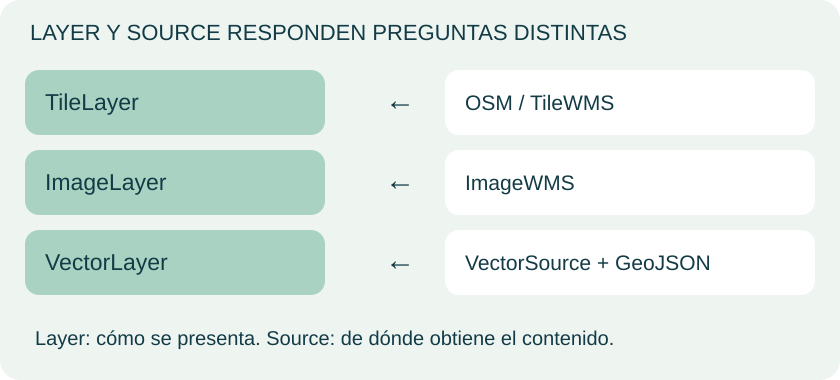</a></figure>

La **capa** controla presentación, orden, visibilidad y opacidad. La **fuente** obtiene o conserva el contenido.

| Capa | Fuente del curso | Contenido |
|---|---|---|
| TileLayer | OSM / TileWMS | Imágenes teseladas |
| ImageLayer | ImageWMS | Imagen de una extensión |
| VectorLayer | VectorSource | Entidades |
| VectorTileLayer | VectorTileSource | Entidades teseladas |
| Heatmap | Fuente vectorial | Concentración |

WFS puede alimentar una fuente vectorial. GeoJSON es un formato de intercambio; MVT codifica teselas vectoriales. Teselado no significa necesariamente ráster.

<p class="content-source"><strong>Fuente del apartado:</strong> <a href="../../materiales/Unidad6_webmapping_openlayers-v1.pdf">MappingGIS · Unidad6_webmapping_openlayers-v1.pdf</a><br><strong>Ampliación y precisión técnica:</strong> <a href="https://openlayers.org/doc/quickstart.html">OpenLayers · guía de inicio</a>.</p>

## 3. Coordenadas y proyección

<figure class="lesson-figure"><a href="../../assets/unidad-6/proyeccion.svg" target="_blank" rel="noopener">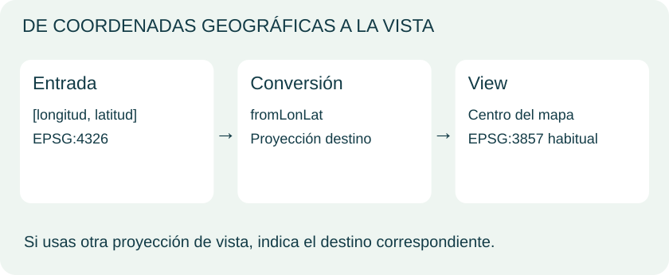</a></figure>

EPSG:3857 es la proyección habitual por defecto. Una coordenada de longitud y latitud no debe interpretarse automáticamente como X e Y de ese sistema.

`fromLonLat` transforma la entrada geográfica a la proyección destino. Si configuras otra vista, revisa el destino. Distingue la proyección del dato de la proyección con que se representa.

Extensión, resolución y tamaño del mapa están relacionados. Un dato correcto puede quedar fuera de la ventana inicial. Revisa su extensión y transformación antes de concluir que no se ha cargado.

<p class="content-source"><strong>Fuente del apartado:</strong> <a href="../../materiales/Unidad6_webmapping_openlayers-v1.pdf">MappingGIS · Unidad6_webmapping_openlayers-v1.pdf</a><br><strong>Ampliación y precisión técnica:</strong> <a href="https://openlayers.org/doc/faq.html">OpenLayers · proyecciones</a>.</p>

## 4. Features, estilos y renderizado

<figure class="lesson-figure"><a href="../../assets/unidad-6/renderizado.svg" target="_blank" rel="noopener">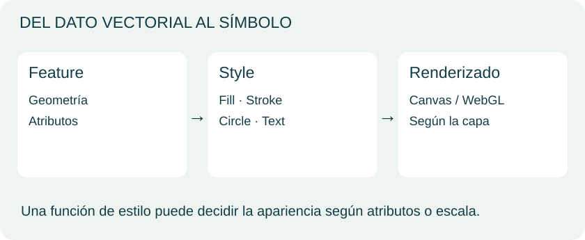</a></figure>

Una **feature** reúne geometría y propiedades. El estilo decide relleno, trazo, símbolo o texto. Una función puede elegir apariencia según atributos y resolución.

`Fill`, `Stroke`, `Circle` y `Text` cumplen tareas distintas. Una línea no utiliza relleno de superficie. `declutter` ayuda a gestionar superposiciones de símbolos o etiquetas en configuraciones compatibles.

Canvas y WebGL están disponibles según capa y versión; no son opciones idénticas para todas las clases. El mapa de calor representa concentración o pesos y necesita interpretar esos valores.

<p class="content-source"><strong>Fuente del apartado:</strong> <a href="../../materiales/Unidad6_webmapping_openlayers-v1.pdf">MappingGIS · Unidad6_webmapping_openlayers-v1.pdf</a><br><strong>Ampliación y precisión técnica:</strong> <a href="https://openlayers.org/doc/quickstart.html">OpenLayers · guía de inicio</a>.</p>

## 5. Controles, selección y dibujo

<figure class="lesson-figure"><a href="../../assets/unidad-6/interaccion.svg" target="_blank" rel="noopener">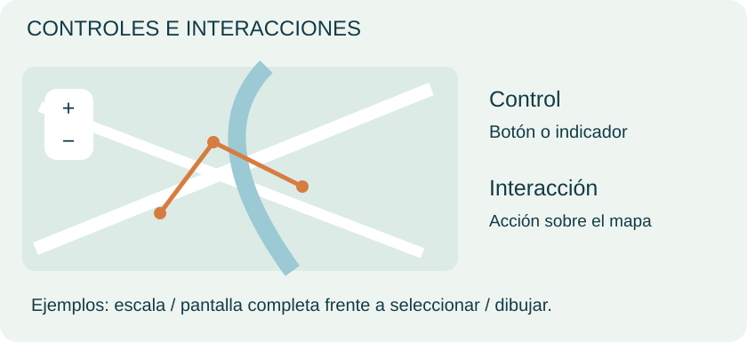</a></figure>

Un **control** es un elemento visible, como escala o pantalla completa. Una **interacción** interpreta acciones como seleccionar o dibujar. Una **overlay** puede situar contenido HTML en una posición.

Seleccionar trabaja con entidades; dibujar crea geometrías. Un cambio en el navegador no se guarda automáticamente en una base de datos: necesita un mecanismo compatible del servidor.

Las **16 prácticas originales** construyen progresivamente el visor. Las instrucciones de Git se conservan como apoyo, sin convertirlas en un ejercicio nuevo.

<p class="content-source"><strong>Fuente del apartado:</strong> <a href="../../materiales/Unidad6_webmapping_openlayers-v1.pdf">MappingGIS · Unidad6_webmapping_openlayers-v1.pdf</a><br><strong>Ampliación y precisión técnica:</strong> <a href="https://openlayers.org/doc/quickstart.html">OpenLayers · guía de inicio</a>.</p>

## Material y referencias

- [Instalar_GIT.pdf](../materiales/Instalar_GIT.pdf) · material original.
- [Unidad6_webmapping_openlayers-v1.pdf](../materiales/Unidad6_webmapping_openlayers-v1.pdf) · material original.

Ampliación técnica: [Inicio oficial de OpenLayers](https://openlayers.org/doc/quickstart.html) · [Proyecciones y preguntas frecuentes](https://openlayers.org/doc/faq.html). Las versiones e interfaces del PDF corresponden al entorno de las clases; los diagramas muestran conceptos.


## Ejercicio Unidad 6 {#ejercicios-originales-del-curso}

Enunciados y contexto de los PDF de MappingGIS. No se añaden actividades ni soluciones. Los paneles incluyen los pasos originales dentro de la unidad; el PDF conserva la maquetación completa.

**Práctica:** [PDF original completo](../materiales/Ejercicio_6_OpenLayers_2025-v3.pdf){target="_blank" rel="noopener noreferrer"}.

### Ejercicio 1 · Primer mapa

<div class="original-statement"><span class="eyebrow">Enunciado original · Práctica</span><p>Pega el resultado de tu primer mapa realizado con OpenLayers (ol_basicMap.html) en la plantilla de resultados.</p></div>

<details class="original-exercise" markdown="1">
<summary>Pasos y contexto originales de la clase</summary>

**Página 3**

```text
Ejercicio 6. OpenLayers 
   3 
Diferentes formas de trabajar con OpenLayers 
 
Como hemos visto en la presentación de este tema hay varias formas de trabajar 
con OpenLayers: 
1. Utilizando su librería, bien mediante la descarga de los archivos o bien 
mediante un enlace CDN. Se trata en ambos casos de incorporar los archivos 
ol.js y ol.css al HTML de nuestra aplicación. 
<script src="https://cdn.jsdelivr.net/npm/ol@v10.6.1/dist/ol.js"></script> 
<link rel="stylesheet" href="https://cdn.jsdelivr.net/npm/ol@v10.6.1/ol.css"> 
 
2. El método descrito en el apartado anterior no es el más aconsejable. En 
entornos de producción  se suele optar por utilizar Open Layers mediante 
Node.js. 
 
 
 
A continuación, vamos a proceder a explicar este esquema de posibles 
arquitecturas. En el estudi o posterior que hagamos de OpenLa yers crearemos un 
mapa básico utilizando los dos métodos, aunque luego nos centraremos en el que 
utiliza node por ser la forma actual de trabajar y en la que se muestran los ejemplos 
de la página web de OpenLayers: https://openlayers.org/en/latest/examples/
```

**Página 4**

```text
Ejercicio 6. OpenLayers 
   4 
La forma tradicional de utilizar OpenLayers (y quizá más sencilla pues no necesita 
ninguna instalación ) era utilizando la librería mediante sus enlaces CDN a los 
archivos ol.js y ol.css. En este caso solo necesitamos escribir un código HTML, con 
sus elementos css para los e stilos y JavaS cript para la creación del mapa. Este 
archivo puede contener o no serv icios WMS, WFS… creados por GeoS erver. En ese 
caso para poder visualizar el mapa debemos abrirlo desde el servidor para evitar 
los problemas de la directiva CORS ( Intercambio de Recursos cruzados). Esto en la 
práctica significa que nuestro archivo html no lo podemos abrir directamente desde 
el navegador. Tenemos que guardar el archivo en la carpeta \data_dir\www (la de 
los datos de GeoServer). 
Para entornos de producción actualmente es preferible utilizar node para crear el 
mapa, aunque mejor sería decir, para crear el proyecto. La ventaja de utilizar node 
es que nos permite utilizar módulos . De esta forma solo emplearemos aquella 
parte de OpenLayers (módulos) que necesitemos para nuestro proyecto. Podremos 
exportar nuestro proyecto generando los archivos para subir  al servidor. Y otra 
ventaja importante es que node no s proporciona un servidor local en el que 
podemos ver nuestro mapa. Lógicamente los servicios que hemos creado en 
GeoServer (WMS, WFS, WCS…) tienen que estar disponibles en el mapa, por lo tanto, 
GeoServer debe estar funcionando. 
Cuando trabajemos con node tendremos dos servidores en funcionamiento: 
1. El servidor GeoServer que nos suministra nuestro en mapas con los servicios 
OGC. http://localhost:8080/geoserver 
2. El servidor de node en el que visualizaremos los mapas de OpenLayers. 
http://localhost:5173
```

**Página 5**

```text
Ejercicio 6. OpenLayers 
   5 
Uso de la librería de OpenLayers 
Vamos a crear y previsualizar un ejemplo sencillo y totalmente funcional de un mapa 
de OpenLayers utilizando la librería mediante un enlace CDN a los archivos ol.js y 
ol.css.  
Crea un nuevo archivo en el directorio www y d enomínalo ol_basicMap.html por 
lo que la ruta en la que se ubicará será \data_dir\www\ol_basicMap.html 
Abre este archivo con un editor de texto como Notepad++ o Sublime Text 2. 
En la primera línea escribimos: 
 <!doctype html>  
para indicar que será un documento basado en HTML5. 
La cabecera <head> 
En la segunda línea añadimos la cabecera <head>. 
En la tercera línea (dentro del head),  cargaremos los archivos JavaScript y CSS que 
serán incluidos con el mapa: 
La librería JavaScript de OpenLayers (ol.js): 
 
<script src="https://cdn.jsdelivr.net/npm/ol@v10.6.1/dist/ol.js"></script> 
Seguido por una hoja de estilo por defecto (ol.css) que especifica el estilo: 
<link rel="stylesheet" href="https://cdn.jsdelivr.net/npm/ol@v10.6.1/ol.css"> 
Como hemos visto en la presentación, hay dos maneras de apuntar a la librería de 
OpenLayers, para este ejercicio  nos limitamos a apuntar a la página web 
openlayers.org para obtener toda la librería. En un en torno de producción, 
construiríamos una versión personalizada de la biblioteca incluyendo sólo los 
módulos necesarios para nuestra aplicación. 
A continuación, incluiremos el estilo que tendrá nuestro marco del mapa:
```

**Página 6**

```text
Ejercicio 6. OpenLayers 
   6 
 
<style> 
  #map { 
width: 100%; 
height: 400px; 
box-shadow: 5px 5px 5px #888; 
  } 
</style> 
En este estilo estamos indicando que nuestro mapa tiene un ancho del 100 % de la 
ventana del navegar. Un alto de 400 pixeles y para hacerlo más atractivo utilizamos 
la propiedad box-shadow de CSS, que produce un efecto de sombra en los bordes 
inferior y derecha. 
Después del estilo ya podemos cerrar la etiqueta head: 
</head> 
Por el momento el código que tenemos es este: 
 
<!DOCTYPE html> 
<html> 
   <head> 
<script src="https://cdn.jsdelivr.net/npm/ol@v10.6.1/dist/ol.js"></script> 
<link rel="stylesheet" href="https://cdn.jsdelivr.net/npm/ol@v10.6.1/ol.css">    
<style> 
      #map{ 
        width: 100%; 
        height: 400px; 
        box-shadow: 5px 5px 5px #888; 
      } 
    </style> 
  </head> 
 
El cuerpo del archivo <body> 
Crearemos a continuación la etiqueta <body>, y dentro incluimos un título para la 
página web: 
<h1>Mi primer mapa con ol</h1> 
Y añadimos el elemento de HTML <div> 
<div id= 'map'></div>
```

**Página 7**

```text
Ejercicio 6. OpenLayers 
   7 
Dentro del elemento de HTML <div> incluimos la aplicación de mapa. Gracias a este 
div las propiedades del mapa como anchura, altura o borde pueden ser controladas 
a través de estilos CSS, como hemos visto. 
 
El código JavaScript <script> 
 
Nota: El código JavaScript va siempre entre las etiquetas <script> y </script>. 
En primer lugar, creamos una variable que contendrá el objeto Map 
var map = new ol.Map({ 
Como hemos visto en la teoría ol.Map es la clase que permite manejar el concepto 
de mapa en nuestra aplicación. Podemos añadir o eliminar capas, controles, 
superposiciones e interacciones (layers, controls, overlays e interactions). 
La siguiente línea define la propiedad target que es el elemento HTML de destino, 
donde se representará el mapa.  
 
target: 'map', 
 
Vamos con la propiedad layers, que hace referencia a la capa o capas que se 
mostrarán. Siempre debemos incluir la capa entre corchetes: 
 
layers: [osm] 
 
En OpenLayers debemos definir un  tipo de capa (imagen, teselas o vectorial) que 
contendrá una fuente. La fuente es el protocolo necesario para recuperar las teselas 
de mapa. 
 
En este primer ejercicio añadimos una capa teselada, cuya fuente es la de las teselas 
de OpenStreetMap. 
 
 
layers: [ 
 new ol.layer.Tile({ 
     source: new ol.source.OSM() 
 }) 
], 
 
La siguiente parte del objeto map es la vista (view). La clase ol.View es la responsable 
de fijar el centro, el nivel de zoom, la proyección del mapa o el ángulo de rotación.
```

**Página 8**

```text
Ejercicio 6. OpenLayers 
   8 
Escribimos: 
view: new ol.View({ 
Para instanciar una nueva vista. Después especificamos un centro y un zoom  para 
tener una instancia de vista completa.  
 center: ol.proj.fromLonLat([-4.72, 41.66]), 
 zoom: 7 
}) 
}); 
 
 
Fíjate que especificamos un centro en coordenadas geográficas longitud/latitud 
(WGS84 - EPSG:4326). El método ol.proj.fromLonLat() sirve para proyectar las 
coordenadas geográficas en coordenadas planas (metros) en el EPSG:3857, 
que es el EPSG que utiliza OpenLayers. 
 
 
Con esto finalizamos el script, el cuerpo y el HTML: 
 
  </script> 
 </body> 
</html> 
 
Para no perdernos veamos cómo quedaría la parte del body: 
 
 
<body> 
    <h1>Mi primer mapa con ol</h1> 
    <div id="map"></div> 
    <script> 
var map = new ol.Map({ 
target: 'map', 
layers: [ 
new ol.layer.Tile({ 
source: new ol.source.OSM() 
}) 
], 
view: new ol.View({ 
   center: ol.proj.fromLonLat([-4.72, 41.66]), 
   zoom: 7 
}) 
}); 
    </script> 
  </body>
```

**Página 9**

```text
Ejercicio 6. OpenLayers 
   9 
Y el código completo: 
 
<!DOCTYPE html> 
<html> 
  <head> 
<script src="https://cdn.jsdelivr.net/npm/ol@v10.6.1/dist/ol.js"></script> 
<link rel="stylesheet" href="https://cdn.jsdelivr.net/npm/ol@v10.6.1/ol.css"> 
    <style> 
      #map{ 
        width: 100%; 
        height: 400px; 
        box-shadow: 5px 5px 5px #888; 
      } 
    </style> 
  </head> 
  <body> 
    <h1>Mi primer mapa con ol</h1> 
    <div id="map"></div> 
    <script> 
var map = new ol.Map({ 
target: 'map', 
layers: [ 
new ol.layer.Tile({ 
source: new ol.source.OSM() 
}) 
], 
view: new ol.View({ 
   center: ol.proj.fromLonLat([-4.72, 41.66]), 
   zoom: 5 
}) 
}); 
    </script> 
  </body> 
</html> 
 
Ejercicio nº 1. Pega el resultado de tu primer mapa realizado con OpenLayers 
(ol_basicMap.html) en la plantilla de resultados.
```

</details>

<details class="source-page"><summary>Ver página 9 del PDF original, con sus capturas</summary><a href="../../materiales/Ejercicio_6_OpenLayers_2025-v3.pdf#page=9" target="_blank" rel="noopener">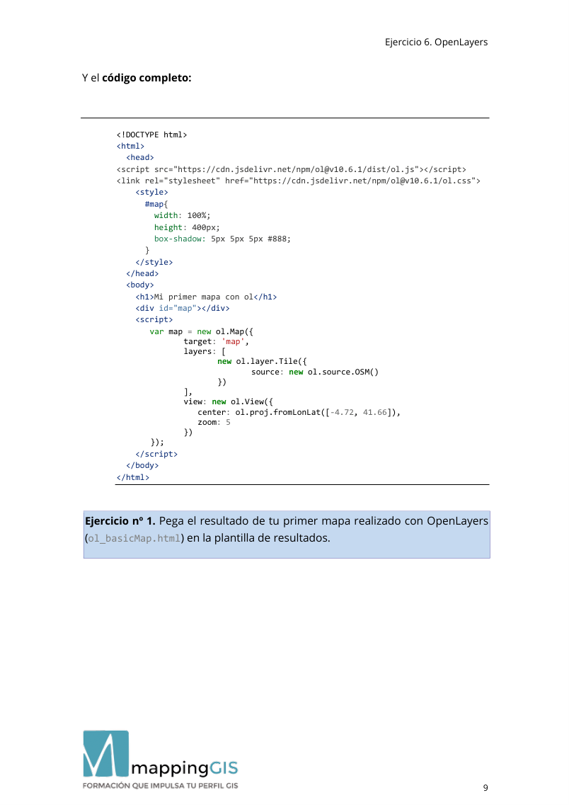</a></details>

[Consultar en el PDF · página 9](../materiales/Ejercicio_6_OpenLayers_2025-v3.pdf#page=9){target="_blank" rel="noopener noreferrer"}

### Ejercicio 2 · Vista y rotación

<div class="original-statement"><span class="eyebrow">Enunciado original · Práctica</span><p>Verifica que funciona el mapa y realiza los siguientes cambios: 1. Añade a Mivista la opción rotation con un valor de Math.PI / 6. 2. Utiliza el método setZoom para cambiar el nivel de zoom a 2. Sube una captura de pantalla del código ol_map2.js en el editor de texto a la plataforma de formación.</p></div>

<details class="original-exercise" markdown="1">
<summary>Pasos y contexto originales de la clase</summary>

**Página 9**

```text
Ejercicio 6. OpenLayers 
   9 
Y el código completo: 
 
<!DOCTYPE html> 
<html> 
  <head> 
<script src="https://cdn.jsdelivr.net/npm/ol@v10.6.1/dist/ol.js"></script> 
<link rel="stylesheet" href="https://cdn.jsdelivr.net/npm/ol@v10.6.1/ol.css"> 
    <style> 
      #map{ 
        width: 100%; 
        height: 400px; 
        box-shadow: 5px 5px 5px #888; 
      } 
    </style> 
  </head> 
  <body> 
    <h1>Mi primer mapa con ol</h1> 
    <div id="map"></div> 
    <script> 
var map = new ol.Map({ 
target: 'map', 
layers: [ 
new ol.layer.Tile({ 
source: new ol.source.OSM() 
}) 
], 
view: new ol.View({ 
   center: ol.proj.fromLonLat([-4.72, 41.66]), 
   zoom: 5 
}) 
}); 
    </script> 
  </body> 
</html> 
 
Ejercicio nº 1. Pega el resultado de tu primer mapa realizado con OpenLayers 
(ol_basicMap.html) en la plantilla de resultados.
```

**Página 10**

```text
Ejercicio 6. OpenLayers 
   10 
Directiva CORS 
 
Antes de continuar debemos detenernos un poco en el control de acceso HTTP 
(CORS). Se trata de una directiva de seguridad que impide que se puedan realizar 
peticiones cruzadas a distintos dominios web. En la práctica esto implica que si 
desde el código que hemos creado en OpenLayers intentásemos llamar a algunos 
de los mapas que tenemos en GeoServer obtendríamos un error. 
 
  
Con el mapa ol_basicMap.html anterior no tendríamos ese problema porque no 
estamos utilizando ningún recurso externo.  
Para solventar este problema podemos hacer que GeoServer elimine la referencia 
a CORS. Para ello hay que hacer lo siguiente: 
1. Abre con un editor de texto el archivo web.xml de GeoServer (C:\GeoServer 
2.26.0\webapps\geoserver\WEB-INF). Te aconsejamos que hagas una copia 
de este archivo antes de empezar la edición como medida de seguridad. 
2. Busca la línea: 
<filter-name>cross-origin</filter-name> 
Hay que descomentar este apartado de tal forma que quede como sigue: 
 
Como ves, se descomenta la sección comprendida entre las dos etiquetas 
<filter>
```

**Página 11**

```text
Ejercicio 6. OpenLayers 
   11 
Descomentamos esta parte porque estamos utilizando un servidor jetty. En 
el caso de utilizar Tomcat, en lugar de esta sección descomentaríamos la siguiente. 
3. Descomenta también la siguiente sección: 
 
4. Guarda los cambios antes de salir del editor de texto. 
 
Es necesario reiniciar el ordenador para que los cambios tengan efecto. 
De esta forma hemos eliminado la directiva CORS en GeoServer y podremos realizar 
las peticiones a nuestros mapas sin problemas.
```

**Página 12**

```text
Ejercicio 6. OpenLayers 
   12 
Instalar Node 
 
Como hemos indicado antes, en entornos de producción se aconseja trabajar con 
Node. 
Node.js es un entorno de desarrollo y ejecución de aplicaciones JavaScript. Podemos 
simplificar la definición de lo que es node diciendo que es “JavaScript en el servidor”. 
Node crea un entorno de desarrollo modular. Los módulos de O penLayers son las 
partes (clases) de las que se compone. El desarrollo en módulos permite utilizar solo 
aquellas partes de la librería que nos interesan en nuestro proyecto concreto , 
prescindiendo del resto, lo que hace la aplicación más ligera. 
Vemos a continuación cómo se instala node en Windows. Lo primero es acudir a la 
página de node. 
https://nodejs.org/en/download/ 
 
Descargamos la versión LTS (Estable). La principal diferencia con la versión Actual 
(current) es el tiempo de actualización. La versión actual recibe actualizaciones 
constantes mientras que la versión de largo plazo nos permite tener una versión de 
node sin tener que preocuparnos de las actualizaciones.
```

**Página 13**

```text
Ejercicio 6. OpenLayers 
   13 
Seleccionamos el sistema operativo y la arquitectura y descargamos el archivo msi. 
Una vez descargado el archivo .msi, lo ejecutamos. 
 
Se abrirá la ventana de instalación: 
 
Hacemos clic en Next 
 
Aceptamos la licencia de uso. Next.
```

**Página 14**

```text
Ejercicio 6. OpenLayers 
   14 
 
Confirmamos el directorio para instalar node. 
 
A continuación , nos muestra una selección de elementos para instalar . Los 
elementos fundamentales son Node.js y npm que es el gestor de paquetes.  
Npm (Node Package Manger ) viene incluido en la descarga y es una herramienta 
fundamental para trabajar con node, porque act úa como un repositorio que nos 
permite instalar y desinstalar paquetes, así como gestionar las dependencias del 
proyecto. 
Mantenemos la propuesta que nos ofrece y hacemos clic en Next.
```

**Página 15**

```text
Ejercicio 6. OpenLayers 
   15 
 
En la ventana de selección de herramientas hacemos clic en Next. No es necesario 
seleccionar la opción que nos ofrece. 
 
Hemos llegado a la ventana de confirmación de la instalación. Hacemos clic en: 
Install y comienza la instalación.
```

**Página 16**

```text
Ejercicio 6. OpenLayers 
   16 
 
Para comprobar que la instalación ha tenido éxito, abrimos una ventana símbolo de 
sistema y escribimos node –v. Como resultado obtendremos la versión de node 
instalada:
```

**Página 17**

```text
Ejercicio 6. OpenLayers 
   17 
Instalación de OpenLayers 
Una vez que tenemos instalado node, procedemos a la instalación de OpenLayers. 
Más que la descarga o instalación de OpenLayers , podemos decir que nos crea una 
aplicación con OpenLayers, pues como veremos este proceso nos descarga los 
paquetes de OpenLayer y nos crea los archivos qu e necesitamos pare ha cer un 
mapa. 
 
El proceso de instalación de OpenLayers se compone de tres pasos: 
1º paso.  Abrimos una ventana de comandos y nos situamos en nuestra carpeta 
webmapping, A continuación, escribimos: 
npm create ol-app openlayers-app 
Estamos utilizando el comando  create de npm para crear una aplicación de 
OpenLayers y además estamos indicando que nos lo haga en una carpeta 
llamada openlayers-app. Por supuesto puedes utilizar el nombre que quieras. 
Esto es todo lo que te nemos que hacer para descargar OpenL ayers y crear la 
aplicación.  
 
Recibiremos un mensaje similar al que vemos en la imagen anterior.   
Requisitos: Para instalar Openlayers como se indica aquí y se recomienda en la 
documentación de OpenLayers es necesario que tengamos instalado GIT. 
Puedes descargarlo en el siguiente enlace: 
https://github.com/git-guides/install-git 
La instalación de GIT es muy sencilla, pero si tienes alguna duda puedes seguir 
la guía que se incluye en la plataforma del curso y que encontrarás al final del 
tema de OpenLayers.
```

**Página 18**

```text
Ejercicio 6. OpenLayers 
   18 
Ahora, abre tu carpeta webmapping, verás que tiene una nueva carpeta llamada 
openlayers-app que contiene lo siguiente: 
 
2º paso. Nos dirigimos a la carpeta openlayers-app 
cd openlayers-app 
 
3º paso. Iniciamos la aplicación. 
npm start 
 
Esta operación nos permite ver la aplicación en un servidor de desarrollo VITE. 
Abre tu navegador preferido y escribe la dirección http://localhost:5173/ 
Verás tu primer mapa con OpenLayers.
```

**Página 19**

```text
Ejercicio 6. OpenLayers 
   19 
  
Contenido de la aplicación 
 
Como explicamos en el apartado anterior al crear la aplicación con OpenLayers se 
crearon varios archivos y carpetas. Tres son los archivos principales: 
- Un archivo html (index.html). Es el que se encarga de crear la página web e iniciar 
la aplicación.  
- Un archivo JavaScript (main.js). Es el que contiene el código de OpenLayers, y por 
tanto el que crea el mapa. Será el archivo sobre el que más trabajaremos. 
- Un archivo css ( style.css). Se encarga de configurar los estilos o  presentación de 
la página web. 
Index.html 
Abre en un editor de texto el archivo index.html para ver su contenido. Como vemos 
a continuación, es muy sencillo, pues solo tiene la estructura básica de un html. En 
el script incluye la referencia al archivo main.js que es el que contiene la aplicación.
```

**Página 20**

```text
Ejercicio 6. OpenLayers 
   20 
 
Las primeras líneas del código son el componente  html de nuestra página web. 
En head definimos la codificación de caracteres (UTF -8) y damos un título.   Un 
elemento fundamental de este archivo es que creamos un <div> con el id="map". 
Este elemento es el que se encarga de crear un área dentro de la página web para 
albergar el mapa. Como veremos, en el archivo main.js se hace referencia a este id 
mediante el parámetro "target". 
main.js 
Abre ahora en el editor de texto main.js para ver su contenido. 
 
 
La principal diferencia con respecto al script que vimos en el primer ejercicio es que 
aquí utilizamos import para llamar a los módulos que necesitamos de OpenLayers. 
Una de las características de Node es que nos permite utilizar solo las partes de la
```

**Página 21**

```text
Ejercicio 6. OpenLayers 
   21 
librería (módulos) que necesitamos para cada proyecto, esto convierte las 
aplicaciones en elementos más ligeros y por lo tanto más rápidos. 
import './style.css';                                      para importar los estilos css. 
import {Map, View} from 'ol';                      para importar las clases Map y View. 
import TileLayer from 'ol/layer/Tile';          para incorporar capas teseladas. 
import OSM from 'ol/source/OSM';           para añadir el recurso de OpenstreetMap. 
 
Con estos módulos tenemos lo  suficiente para crear un mapa que utilice a 
OpenStreetMap como mapa base. 
La otra diferencia con relación al mapa en el que utilizamos la librería de 
OpenLayers es la forma en que escribimos las clases. 
 
OpenLayers librería Openlayers node 
ol.Map Map 
ol.View View 
ol.layer.Tile Tilelayer 
ol.source.OSM() OSM() 
 
style.css 
Veamos su contenido en el editor de texto.
```

**Página 22**

```text
Ejercicio 6. OpenLayers 
   22 
 
El archivo de estilos css contiene los estilos de la página web. 
Publicar el mapa 
 
Con el proceso seguido hasta aquí podemos ver el mapa en nuestro equipo. Para 
publicarlo en la web necesitamos los archivos para subir al servidor. 
Creamos un paquete con la aplicación.  Escribimos en la ventana de comandos el 
siguiente: 
npm run build 
 
Como resultado se crea un directorio /dist que contiene todos los archivos que 
necesitamos para publicar el mapa.
```

**Página 23**

```text
Ejercicio 6. OpenLayers 
   23 
 
En la imagen anterior vemos como es la estructura de archivos resultado del 
proceso que hemos realizado.  
Copiamos la carpeta dist en nuestro directorio /www de GeoServer, es decir en la 
ruta: 
C:\data_dir\www 
Para no tener problemas con las rutas a los archivos contenidos en assets vamos a 
editar el archivo html 
Abre el archivo c:\data_dir\www\dist\index.html en el editor de texto y elimina 
la / que hay al principio de las urls de los archivos index.js y index.css 
 
Guarda los cambios cuando lo tengas. 
Ahora podremos ejecutar la aplicación también desde el navegador: escribiendo en 
la barra del navegador: 
http://localhost:8080/geoserver/www/dist/index.html 
 
Una cuestión importante que debes tener en cuenta:  La carpeta dist que hemos 
creado es una carpeta para publicación del mapa en la web. Podemos considerar , 
por tanto, que se trata de un proyecto cerrado o si lo prefieres de otra forma como 
de un trabajo terminado. En esa carpeta NO DEBES TRABAJAR, a partir de ahora. 
El resto de códigos que vas a utilizar se corresponde n con una etapa de 
DESARROLLO. Por lo ta nto, los archivos que vas a modificar a partir de ahora son
```

**Página 24**

```text
Ejercicio 6. OpenLayers 
   24 
index.html, style css y los archivos .js que tengas en la carpeta openlayers -app. No 
los confundas con los de la carpeta dist. 
Recapitulación de la arquitectura utilizada 
 
Ahora que hemos visto todos los elementos que necesita nuestra aplicación vamos 
a repasar las herramientas que hemos utilizado para intentar dar una visión de 
conjunto de la arquitectura que estamos utilizando. 
Por un lado estamos trabajando con Geoserver, que es nuestro servidor de  
mapas y lo podemos empelar como SERVIDOR DE PRODUCCIÓN. Y por otro lado  
tenemos el servidor de Node (VITE) que utilizamos PARA EL DESARROLLO.  
 
Vamos a intentar que queden claras las diferencias entre ambos.  
¿Para qué utilizamos GeoServer? 
GeoServer, como vimos en el tema 3, es un servidor web que nos permite  servir 
mapas y datos desde una variedad de formatos a clientes estándar tales  como 
navegadores web y programas GIS de escritorio.  
 
Hasta la unidad 5, lo que hemos  estado haciendo es construir multitud de  
mapas en distintos formatos (WMS, WFS...) que hemos servido desde  
nuestro servidor local y consumido desde QGIS  o desde el navegador.  
Como vimos en su momento, GeoServer es una aplicación web construida dentro 
de Jetty que es un servidor de aplicaciones ligero y portátil. Entonces, siempre que 
quieras consumir mapas  (desde cualquier sitio , QGIS, ARCGIS, aplicaciones 
WEB....etc) debes levantar Geoserver  con el fichero startup.bat. Al ejecutar este 
fichero, estamos  levantando un  servidor de producc ión Jetty con la aplicación 
GeoServer. Y es por eso que en realidad podemos desplegar más aplicaciones 
dentro (es lo que hacemos después cuando nos traemos la carpeta dist). Pero  
antes, es importante entender que es node.js  y el por qué lo  
empleamos.   
¿Para qué utilizamos node? 
Node es un entorno multiplataforma open source  de tiempo de ejecución de  
JavaScript, que se ejecuta del lado del servidor. Hasta la creación de Node.js, el 
lenguaje de programación  JavaScript únicamente podía ejecutarse del lado del
```

**Página 25**

```text
Ejercicio 6. OpenLayers 
   25 
navegador. Node.js sirve para crear sitios web dinámicos muy eficientes, escritos  
con el lenguaje de programación JavaScript.  
¿Para qué utilizamos npm? 
 NPM actúa como un repositorio que nos permite inst alar y  
desinstalar paquetes, así como gestionar las dependencias del proyecto.   
Y una vez que hemos creado el proyecto, instalamos las dependencias que  
vayamos a usar en nuestro proyecto. En nuestro caso hemos instalado dos: 
-OpenLayers 
- Vite. 
¿Para qué utilizamos Openlayers? 
 
Openlayers es una biblioteca Javascript que nos permite construir mapas  
y que contiene mucha funcionalidad espacial.  En definitiva, es la herramienta que 
nos permite construir los mapas para publicarlos en la web. 
 
¿Para qué utilizamos Vite? 
 
Vite es una herramienta de compilación que tiene como objetivo proporcionar una 
experiencia de desarrollo más rápida y ágil para proyectos web modernos. Consta 
de dos partes principales: 
 Un servidor de desarrollo que proporciona mejoras enriquecidas de 
funcionalidades sobre módulos ES nativos. 
 Un comando de compilación que empaqueta tu código con Rollup, 
preconfigurado para generar recursos estáticos altamente optimizados para 
producción. 
 
Cuando nuestro proyecto está acabado creamos la aplicación con el comando npm 
run build.  Ahora bien, es algo molesto que cada vez que realicemos un cambio  
tengamos que ejecutar este comando para "transformar" el código y desplegarlo en 
un servidor en producción  para ver lo que hemos cambiado.  Es por eso que 
tenemos la opción de trabajar con un pequeño servidor  interno que nos muestra 
los cambios en tiempo real que únicamente debe usarse mientras desarrollamos. 
Se ejecuta con el comando npm start  y por  defecto se muestra en la ruta 
localhost:5173.  
Para ser más prácticos, imagina que estás desarrollando  un proyecto . Mientras  
desarrollas tu proyecto, debes tener levantado el servidor de desarrollo
```

**Página 26**

```text
Ejercicio 6. OpenLayers 
   26 
node (npm start) y si en tu proyecto consumes mapas de Geoserver,  
deberás tener también levantado Geoserver. Una vez que termine tu  
desarrollo o tengas una primera versión estable de tu aplicación web,  
deberás compilar tu proyecto node  (npm run build).  Y para que puedas ver en 
producción tu aplicación deberás desplegarla en  un servidor. Puedes usar 
cualquiera: Apache, Jetty... etc. Nosotros en el curso reaprovechamos el servidor de 
Geoserver (que es Jetty).   
Trabajando con los módulos de OpenLayers 
 
En el archivo main.js que h abíamos creado en la aplicación anterior , hemos 
definido como coordenadas del centro del mapa [0,0]. Si queremos utilizar otras 
coordenadas y definiendo un sistema de proyección como hicimos en 
ol_basicMap.html necesitaremos utilizar la clase correspondiente: 
ol.proj.fromLonLat(). Esto implica qu e tendremos que utilizar un nuevo módulo. 
En la página de documentación de OpenLayers 
https://openlayers.org/en/latest/apidoc/ 
Escribimos el nombre de la clase: fromLonLat() 
 
Hacemos clic sobre el método y nos muestra el módulo que tenemos que importar: 
 
Paso 1: Abre el archivo main.js y lo editas de la siguiente forma: 
Importa el módulo que vimos antes en la documentación de OpenLayers: 
import {fromLonLat} from 'ol/proj';
```

**Página 27**

```text
Ejercicio 6. OpenLayers 
   27 
En la vista modifica las coordenadas para que queden así: 
center:fromLonLat([-4.72, 41.66]), 
Como puedes observar estamos utilizando el método fromLonLat y a continuación 
estamos definiendo las nuevas coordenadas. 
Guarda este archivo como ol_map1.js 
El código completo de este archivo es: 
 
Paso 2: Como el punto de entrada de nuestra aplicación es index.html deberemos 
modificar este archivo para que apunte al código que hemos creado. 
Por lo tanto, debes editar index.html y modificar el script por el siguiente: 
<script type="module" src="./ol_map1.js"></script> 
Paso 3: Visualiza el mapa en http://localhost:5173/ 
Este paso en realidad se hace de forma automática, de tal manera que cada vez que 
hagas un cambio en index.html o en los archivos .js estos cambios se reflejaran de 
forma inmediata en la vista del navegador.
```

**Página 28**

```text
Ejercicio 6. OpenLayers 
   28 
Estos pasos que hemos seguido son los que repetiremos en el resto de ejercicios: 
 
Haz una copia del mapa anterior y renómbralo a ol_map2.js. 
Vamos a crear una variable denominada MiVista. Esta variable contendrá  la clase 
instanciada View con las propiedades de centro y zoom:  
 
var Mivista = new View({ 
      center: fromLonLat([-4.72, 41.66]), 
      zoom: 5 
}); 
 
Ahora vamos al objeto map y modificamos el valor de la propiedad view para incluir 
la variable MiVista: 
 
const map = new Map({ 
layers: … 
       target: … 
       view: Mivista 
 });   
 
Crear un objeto Mivista, como hemos hecho aquí, presenta algunas ventajas.  Por 
ejemplo, si deseamos modificar el nivel de zoom definido al principio podemos 
utilizar algunos de los métodos de OpenLayers, como setZoom().  
Mivista.setZoom(2); 
Edita index.html para cambiar el script a: 
<script type="module" src="./ol_map2.js"></script> 
Abre el mapa en tu navegador web: 
http://localhost:5173 
 
 
 
Editar códigos 
ol_map*.js 
Editar 
index.html 
Visualizar 
http://localhost:5173
```

**Página 29**

```text
Ejercicio 6. OpenLayers 
   29 
Ejercicio nº2. Verifica que funciona el mapa y realiza los siguientes cambios: 
1. Añade a Mivista la opción rotation con un valor de Math.PI / 6.  
2. Utiliza el método setZoom para cambiar el nivel de zoom a 2. 
Sube una captura de pantalla del código ol_map2.js en el editor de texto a la 
plataforma de formación.
```

</details>

<details class="source-page"><summary>Ver página 29 del PDF original, con sus capturas</summary><a href="../../materiales/Ejercicio_6_OpenLayers_2025-v3.pdf#page=29" target="_blank" rel="noopener">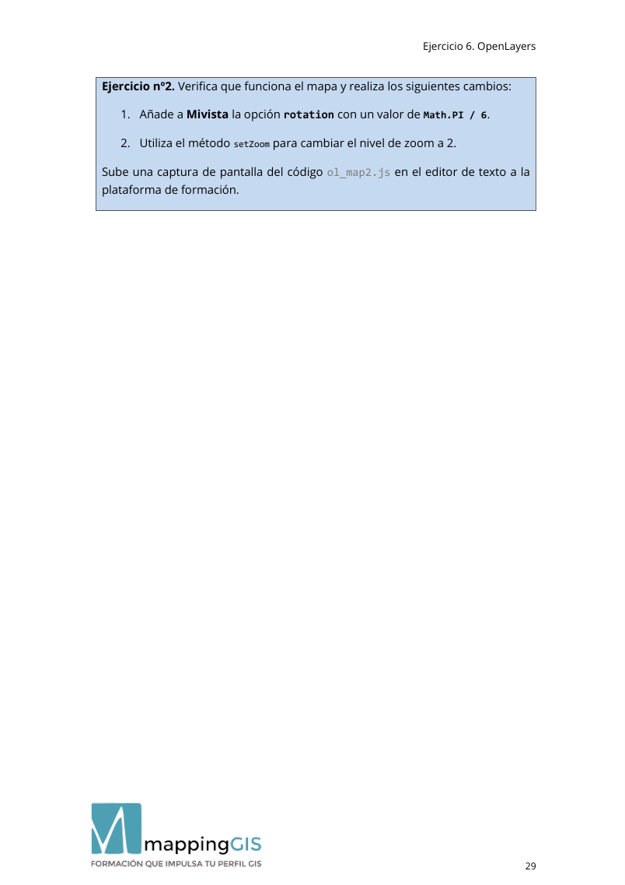</a></details>

[Consultar en el PDF · página 29](../materiales/Ejercicio_6_OpenLayers_2025-v3.pdf#page=29){target="_blank" rel="noopener noreferrer"}

### Ejercicio 3 · Capas cities y countries

<div class="original-statement"><span class="eyebrow">Enunciado original · Práctica</span><p>Crea un mapa que contenga las capas cities y countries y haz una captura de pantalla.</p></div>

<details class="original-exercise" markdown="1">
<summary>Pasos y contexto originales de la clase</summary>

**Página 29**

```text
Ejercicio 6. OpenLayers 
   29 
Ejercicio nº2. Verifica que funciona el mapa y realiza los siguientes cambios: 
1. Añade a Mivista la opción rotation con un valor de Math.PI / 6.  
2. Utiliza el método setZoom para cambiar el nivel de zoom a 2. 
Sube una captura de pantalla del código ol_map2.js en el editor de texto a la 
plataforma de formación.
```

**Página 30**

```text
Ejercicio 6. OpenLayers 
   30 
Añadiendo capas teseladas desde un servidor WMS 
 
OpenLayers nos ofrece fuentes para añadir imágenes de servidores que c umplen 
con la OGC, utilizando los estándares WMS y WMST. 
 
Vamos a visualizar nuestras capas de GeoServer basadas en el estándar WMS, que 
nos permite servir imágenes de mapa georreferenciadas. 
OpenLayers ofrece dos posibles clases para realizar peticiones a servidores WMS: 
 ol/layer/Image 
 ol/layer/Tile 
 
Capas de imágenes – ol/Image 
La clase Image tiene como fuente para servidores WMS la clase ImageWMS y acepta los 
siguientes parámetros: 
 attributions, crossOrigin, ratio, resolutions 
 url: La URL del servicio WMS que será consultado. 
 params: es un objeto donde debemos especificar muchos de los parámetros 
de la operación GetMap, como son: 
o LAYERS (obligatorio) 
o VERSION (por defecto 1.3.0) 
o TRANSPARENT 
o STYLES (por defecto ‘’) 
o WIDTH 
o HEIGHT 
o BBOX 
o CRS (o SRS para la versión WMS < 1.3.0). 
 
Copia el mapa ol_map2.js a un archivo nuevo y renómbralo a ol_map3.js 
Añade los módulos correspondientes a Image y ImageWMS: 
import ImageWMS from 'ol/source/ImageWMS.js'; 
import {Image} from 'ol/layer';
```

**Página 31**

```text
Ejercicio 6. OpenLayers 
   31 
Creamos la capa cities de la siguiente forma: 
 
var cities = new Image({ 
             source: new ImageWMS({ 
                  url: 'http://localhost:8080/geoserver/wms', 
                  params: { 
                       'LAYERS': 'cities', 
                       'FORMAT': 'image/png' 
                  }, 
             }) 
      }); 
 
Añade esta capa al mapa: 
var map = new Map({ 
   … 
   layers: [cities], 
   … 
}); 
 
Si en lugar de añadir una capa, deseamos añadir más capas, debemos incluirlas en 
una lista separada por comas: 
   layers: [capa1, capa2, capa3, capa4], 
 
Ejercicio nº3. Crea un mapa que contenga las capas cities y countries y haz 
una captura de pantalla. 
Añadiendo filtros ECQL 
 
Acabamos de ver la opción params en la que  especificamos muchos de los 
parámetros de la operación GetMap (LAYERS, VERSION, FORMAT). 
GeoServer admite además una variedad de parámetros WMS no estándar, pero 
proporcionan capacidades mejoradas. Uno de estos parámetros es cql_filter 
El parámetro cql_filter es similar al parámetro de filtro estándar, pero en este caso 
el filtro se expresa mediante el lenguaje ECQL (Extended Common Query Language).  
ECQL proporciona una sintaxis más compacta y legible en comparación con los 
filtros XML de la OGC. Para obtener más detalles, consulta  la ECQL Reference y el 
tutorial de CQL y ECQL.
```

</details>

<details class="source-page"><summary>Ver página 31 del PDF original, con sus capturas</summary><a href="../../materiales/Ejercicio_6_OpenLayers_2025-v3.pdf#page=31" target="_blank" rel="noopener">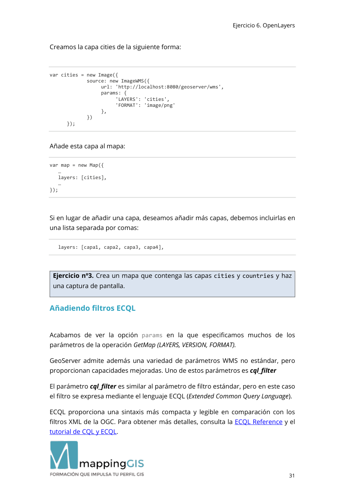</a></details>

[Consultar en el PDF · página 31](../materiales/Ejercicio_6_OpenLayers_2025-v3.pdf#page=31){target="_blank" rel="noopener noreferrer"}

### Ejercicio 4 · Filtros CQL

<div class="original-statement"><span class="eyebrow">Enunciado original · Práctica</span><p>Añade el parámetro cql_filter a las dos capas WMS del ejercicio anterior y selecciona en la capa de ciudades la ciudad Madrid y en la de países el país Spain. Haz una captura de pantalla que muestre las capas con sus filtros.</p></div>

<details class="original-exercise" markdown="1">
<summary>Pasos y contexto originales de la clase</summary>

**Página 31**

```text
Ejercicio 6. OpenLayers 
   31 
Creamos la capa cities de la siguiente forma: 
 
var cities = new Image({ 
             source: new ImageWMS({ 
                  url: 'http://localhost:8080/geoserver/wms', 
                  params: { 
                       'LAYERS': 'cities', 
                       'FORMAT': 'image/png' 
                  }, 
             }) 
      }); 
 
Añade esta capa al mapa: 
var map = new Map({ 
   … 
   layers: [cities], 
   … 
}); 
 
Si en lugar de añadir una capa, deseamos añadir más capas, debemos incluirlas en 
una lista separada por comas: 
   layers: [capa1, capa2, capa3, capa4], 
 
Ejercicio nº3. Crea un mapa que contenga las capas cities y countries y haz 
una captura de pantalla. 
Añadiendo filtros ECQL 
 
Acabamos de ver la opción params en la que  especificamos muchos de los 
parámetros de la operación GetMap (LAYERS, VERSION, FORMAT). 
GeoServer admite además una variedad de parámetros WMS no estándar, pero 
proporcionan capacidades mejoradas. Uno de estos parámetros es cql_filter 
El parámetro cql_filter es similar al parámetro de filtro estándar, pero en este caso 
el filtro se expresa mediante el lenguaje ECQL (Extended Common Query Language).  
ECQL proporciona una sintaxis más compacta y legible en comparación con los 
filtros XML de la OGC. Para obtener más detalles, consulta  la ECQL Reference y el 
tutorial de CQL y ECQL.
```

**Página 32**

```text
Ejercicio 6. OpenLayers 
   32 
La sintaxis es: 
cql_filter=filter1;filter2... 
 
Que aplicado a OpenLayers y utilizando una operación de comparación sería: 
'cql_filter': "name = 'Spain'" 
 
De este modo restringimos la visualización a un único objeto espacial de la capa (en 
este caso el país de España de la capa de países). 
Para incluir una lista de valores en la consulta podemos hacer uso del operador 
IN y a continuación, dentro del paréntesis el listado de nombres. Por lo que la 
consulta quedaría así: 
'cql_filter': "name IN ('Madrid','Paris')" 
 
 
Copia el mapa ol_map3.js a un archivo nuevo y renómbralo a ol_map4.js. Como 
siempre no olvides actualizar el archivo index.html : 
<script type="module" src="./ol_map4.js"></script>  
 
Ejercicio nº 4. Añade el parámetro cql_filter a las dos capas WMS del ejercicio 
anterior y selecciona en la capa de ciudades la ciudad Madrid y en la de países el 
país Spain. 
Haz una captura de pantalla que muestre las capas con sus filtros.
```

</details>

<details class="source-page"><summary>Ver página 32 del PDF original, con sus capturas</summary><a href="../../materiales/Ejercicio_6_OpenLayers_2025-v3.pdf#page=32" target="_blank" rel="noopener">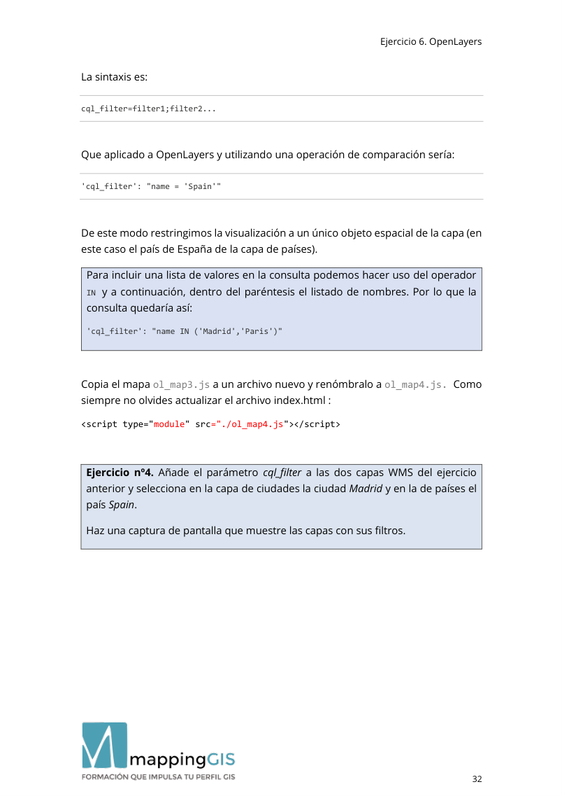</a></details>

[Consultar en el PDF · página 32](../materiales/Ejercicio_6_OpenLayers_2025-v3.pdf#page=32){target="_blank" rel="noopener noreferrer"}

### Ejercicio 5 · Imagen WMS y ortofoto

<div class="original-statement"><span class="eyebrow">Enunciado original · Práctica</span><p>Crea un mapa que contenga dos capas WMS: 1. Nuestra capa worldgroup local de tipo Image (Source: ImageWMS). 2. Una nueva denominada IGN de tipo TileLayer (source: TileWMS), que será u na capa con ortoimágenes . U tiliza los siguientes parámetros del servidor:  url: &#x27;https://www.ign.es/wms-inspire/pnoa-ma&#x27;,  LAYERS&#x27;: &#x27;OI.OrthoimageCoverage&#x27;,  TRANSPARENT: &#x27;true&#x27;</p></div>

<details class="original-exercise" markdown="1">
<summary>Pasos y contexto originales de la clase</summary>

**Página 32**

```text
Ejercicio 6. OpenLayers 
   32 
La sintaxis es: 
cql_filter=filter1;filter2... 
 
Que aplicado a OpenLayers y utilizando una operación de comparación sería: 
'cql_filter': "name = 'Spain'" 
 
De este modo restringimos la visualización a un único objeto espacial de la capa (en 
este caso el país de España de la capa de países). 
Para incluir una lista de valores en la consulta podemos hacer uso del operador 
IN y a continuación, dentro del paréntesis el listado de nombres. Por lo que la 
consulta quedaría así: 
'cql_filter': "name IN ('Madrid','Paris')" 
 
 
Copia el mapa ol_map3.js a un archivo nuevo y renómbralo a ol_map4.js. Como 
siempre no olvides actualizar el archivo index.html : 
<script type="module" src="./ol_map4.js"></script>  
 
Ejercicio nº 4. Añade el parámetro cql_filter a las dos capas WMS del ejercicio 
anterior y selecciona en la capa de ciudades la ciudad Madrid y en la de países el 
país Spain. 
Haz una captura de pantalla que muestre las capas con sus filtros.
```

**Página 33**

```text
Ejercicio 6. OpenLayers 
   33 
Capas teseladas – ol/Tile - Tile 
En lugar de una consulta única para toda la extensión de la vista, hay otra manera 
para conseguir las imágenes de un servidor WMS. 
Hace peticiones de imágenes WMS como si fuera un proveedo r de teselas. Para 
hacerlo la fuente calcula la malla de teselas para cada nivel de zoom y lo divide en 
teselas, cada una con un cuadro delimitador. Es decir, en lugar de hacer una petición 
para una sola imagen, hace una petición para cada tesela. Aunque a priori, parece 
una mala estrategia, esto tiene dos beneficios: 
El servidor WM S trabaja en piezas más pequeñas de datos y produce pequeñas 
imágenes, con lo que el servidor trabaja menos. 
Como las teselas tienen el mismo cuadro delimitador ayuda realizar el cacheado de 
los datos para peticiones futuras. 
Hay dos fuentes posibles para servidores WMS 
 ol/source/TileWMS 
 ol/source/ImageWMS  
Tanto ol/source/ImageWMS y ol/source/ TileWMS aceptan los siguientes 
parámetros: 
 attributions, crossOrigin, ratio, resolutions 
 url: La URL del servicio WMS que será consultado 
 params: es un objeto JavaScript donde podemos especificar muchos de los 
parámetros de la operación GetMap, como son LAYERS (obligatorio), VERSION 
(por defecto 1.3.0), TRANSPARENT, STYLES, WIDTH, HEIGHT, BBOX, CRS. 
Copia el mapa ol_map4.js a un archivo nuevo y renómbralo a ol_map5.js 
Importa el módulo: 
import TileWMS from 'ol/source/TileWMS.js';
```

**Página 34**

```text
Ejercicio 6. OpenLayers 
   34 
Ejercicio nº5. Crea un mapa que contenga dos capas WMS: 
1. Nuestra capa worldgroup local de tipo Image (Source: ImageWMS). 
2. Una nueva denominada IGN de tipo TileLayer (source: TileWMS), que 
será u na capa con ortoimágenes . U tiliza los siguientes parámetros del 
servidor: 
 url: 'https://www.ign.es/wms-inspire/pnoa-ma', 
 LAYERS': 'OI.OrthoimageCoverage', 
 TRANSPARENT: 'true' 
 
Haz una captura de pantalla que muestre las dos capas.
```

</details>

<details class="source-page"><summary>Ver página 34 del PDF original, con sus capturas</summary><a href="../../materiales/Ejercicio_6_OpenLayers_2025-v3.pdf#page=34" target="_blank" rel="noopener">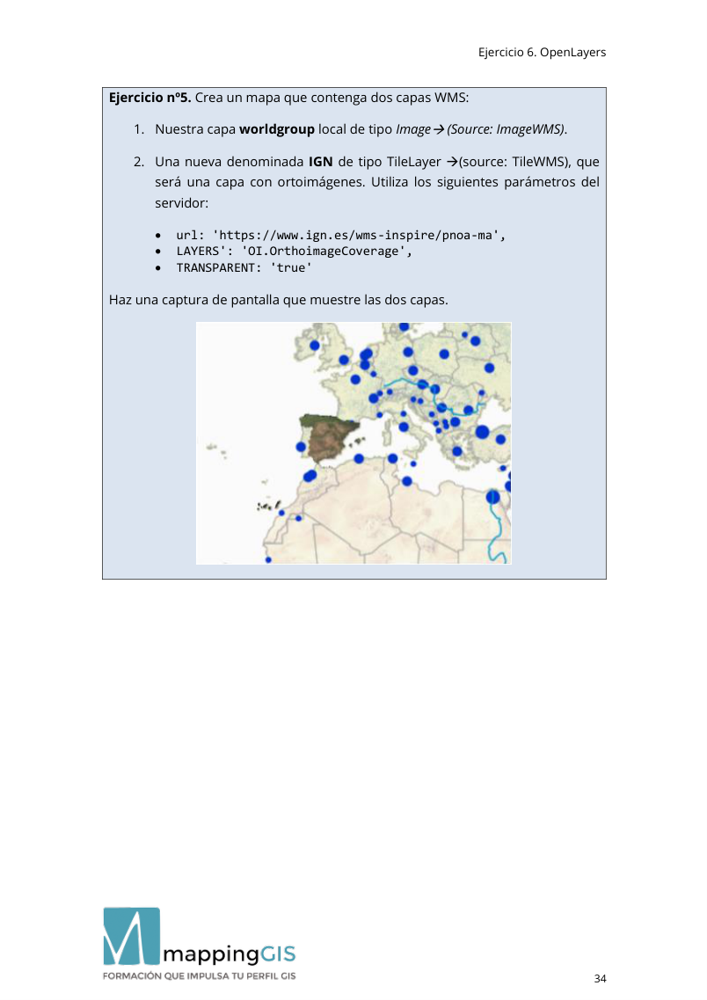</a></details>

[Consultar en el PDF · página 34](../materiales/Ejercicio_6_OpenLayers_2025-v3.pdf#page=34){target="_blank" rel="noopener noreferrer"}

### Ejercicio 6 · Mapas base

<div class="original-statement"><span class="eyebrow">Enunciado original · Práctica</span><p>Pega el resultado de tu mapa ( ol_map6.js) en la plantilla de resultados con algunos mapas base.</p></div>

<details class="original-exercise" markdown="1">
<summary>Pasos y contexto originales de la clase</summary>

**Página 34**

```text
Ejercicio 6. OpenLayers 
   34 
Ejercicio nº5. Crea un mapa que contenga dos capas WMS: 
1. Nuestra capa worldgroup local de tipo Image (Source: ImageWMS). 
2. Una nueva denominada IGN de tipo TileLayer (source: TileWMS), que 
será u na capa con ortoimágenes . U tiliza los siguientes parámetros del 
servidor: 
 url: 'https://www.ign.es/wms-inspire/pnoa-ma', 
 LAYERS': 'OI.OrthoimageCoverage', 
 TRANSPARENT: 'true' 
 
Haz una captura de pantalla que muestre las dos capas.
```

**Página 35**

```text
Ejercicio 6. OpenLayers 
   35 
Añadiendo capas teseladas de OpenStreetMap, Bing y 
OpenTopoMap. 
 
Ya hemos visto cómo se crea una capa de OSM (OpenStreetMap) : 
      var layerOSM = new TileLayer({ 
 source: new OSM()         
      }); 
 
Los datos recopi lados por OpenStreetMap están disponibles de forma gratuita. 
Algunas compañías han usado estos datos para producir sus propios mapas, con 
colores y estilos personalizados. 
Capas base de Bing Maps (de Microsoft) 
import BingMaps from 'ol/source/BingMaps.js'; 
Del mismo modo que hemos utilizado las capas de OSM podemos añadir las capas 
de Bing: 
var layerBing = new TileLayer({ 
     source: new BingMaps({ 
    key: 'AuhiCJHlGzhg93IqUH_oCpl_-ZUrIE6SPftlyGYUvr9Amx5nzA-WqGcPquyFZl4L', 
   imagerySet:'CanvasGray' 
     }) 
});
```

**Página 36**

```text
Ejercicio 6. OpenLayers 
   36 
La API de Bing requiere que registr emos para una API  key para usar en nuestras 
aplicaciones de mapas. En este ejemplo hemos utilizado una clave de API que no se 
debe utilizar en producción. Para utilizar la capa de Bing en producción, regístrate 
en https://www.bingmapsportal.com/ 
 
Los mapas de Bing admiten diversos estilos  que debemos incluir en el parámetro 
imagerySet:  
 'Aerial' 
 'AerialWithLabelsOnDemand' 
 'CanvasDark' 
 'CanvasLight' 
 'CanvasGray' 
 'OrdnanceSurvey' 
 'RoadOnDemand' 
 
 
Capas de OpenTopoMap 
OpenTopoMap es un proyecto de código abierto que proporciona mapas 
topográficos de todo el mundo en formato de teselas . Estos mapas muestran 
información detallada sobre topografía, elevación del terreno, cuerpos de agua, 
caminos, etc… Al tratarse de datos abiertos están disponibles libremente para su 
uso.  
En el caso de OpenTopoMap no tenemos un source específico como hem os visto 
que tienen OpenStreetMap o Bing. En este caso utilizamos el source XYZ. 
import XYZ from 'ol/source/XYZ.js';
```

**Página 37**

```text
Ejercicio 6. OpenLayers 
   37 
La fuente XYZ se utiliza para datos de mosaicos a los que se accede a través de URL 
que incluyen un nivel de zoom y coordenadas x/y de cuadrículas de mosaicos. 
 
   
var openTopoMapLayer = new TileLayer({ 
  source: new XYZ({ 
    url: 'https://tile.opentopomap.org/{z}/{x}/{y}.png', 
    attributions: '© OpenTopoMap' 
  }) 
});  
 
Otras fuentes de datos 
Openlayers dispone clases para utilizar otras fuentes de datos como CartoDB, 
StadiaMaps, mapguide… Estos recursos, no son libres, y por tanto están sometidos 
a condiciones de uso. Deberás, por lo tanto, ver cuáles son sus  condiciones antes 
de emplearlos en producción. Por ejemplo, los mapas de Stamen que han sido muy 
utilizados, por proporcionar vistas “artísticas” de los mapas, has pasado a depender 
de Stadia. Las condiciones de uso han cambiado, y ahora estos mapas solo son 
libres para uso en local. Si queremos utilizarlos en un servicio web deberemos 
aceptar sus condiciones. 
 
Haz una copia del archivo ol_map1.js y renómbralo a ol_map6.js 
Utiliza la capa que desees en tu mapa (OSM, OpenTopoMap o Bing): 
//Creando las capas 
 
var layerBing = new… 
 
//creando el mapa 
 
const map = new Map({ 
   target: 'map', 
   layers: [layerBing], 
   view: miVista 
}) 
 
 
Ejercicio nº 6. Pega el resultado de tu mapa ( ol_map6.js) en la plantilla de 
resultados con algunos mapas base.
```

</details>

<details class="source-page"><summary>Ver página 37 del PDF original, con sus capturas</summary><a href="../../materiales/Ejercicio_6_OpenLayers_2025-v3.pdf#page=37" target="_blank" rel="noopener">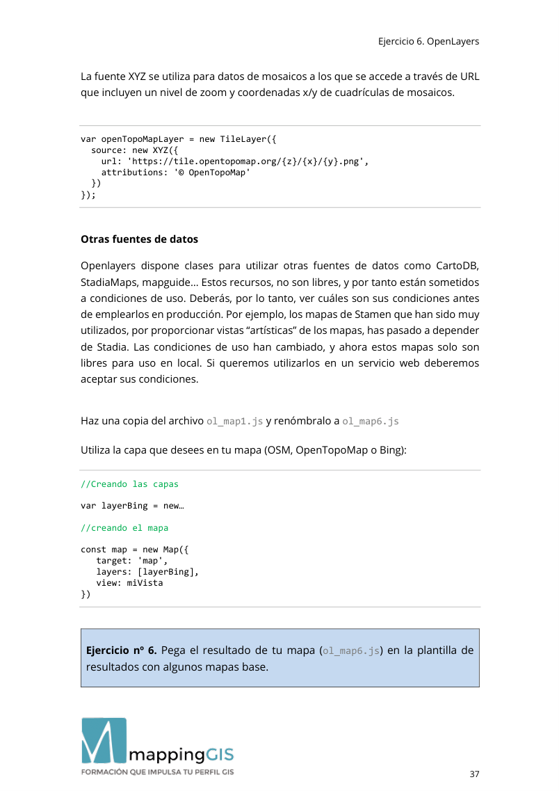</a></details>

[Consultar en el PDF · página 37](../materiales/Ejercicio_6_OpenLayers_2025-v3.pdf#page=37){target="_blank" rel="noopener noreferrer"}

### Ejercicio 7 · Capa WFS

<div class="original-statement"><span class="eyebrow">Enunciado original · Práctica</span><p>Haz una captura de pantalla con el resultado.</p></div>

<details class="original-exercise" markdown="1">
<summary>Pasos y contexto originales de la clase</summary>

**Página 37**

```text
Ejercicio 6. OpenLayers 
   37 
La fuente XYZ se utiliza para datos de mosaicos a los que se accede a través de URL 
que incluyen un nivel de zoom y coordenadas x/y de cuadrículas de mosaicos. 
 
   
var openTopoMapLayer = new TileLayer({ 
  source: new XYZ({ 
    url: 'https://tile.opentopomap.org/{z}/{x}/{y}.png', 
    attributions: '© OpenTopoMap' 
  }) 
});  
 
Otras fuentes de datos 
Openlayers dispone clases para utilizar otras fuentes de datos como CartoDB, 
StadiaMaps, mapguide… Estos recursos, no son libres, y por tanto están sometidos 
a condiciones de uso. Deberás, por lo tanto, ver cuáles son sus  condiciones antes 
de emplearlos en producción. Por ejemplo, los mapas de Stamen que han sido muy 
utilizados, por proporcionar vistas “artísticas” de los mapas, has pasado a depender 
de Stadia. Las condiciones de uso han cambiado, y ahora estos mapas solo son 
libres para uso en local. Si queremos utilizarlos en un servicio web deberemos 
aceptar sus condiciones. 
 
Haz una copia del archivo ol_map1.js y renómbralo a ol_map6.js 
Utiliza la capa que desees en tu mapa (OSM, OpenTopoMap o Bing): 
//Creando las capas 
 
var layerBing = new… 
 
//creando el mapa 
 
const map = new Map({ 
   target: 'map', 
   layers: [layerBing], 
   view: miVista 
}) 
 
 
Ejercicio nº 6. Pega el resultado de tu mapa ( ol_map6.js) en la plantilla de 
resultados con algunos mapas base.
```

**Página 38**

```text
Ejercicio 6. OpenLayers 
   38 
Capas vectoriales 
Añadiendo capas vectoriales WFS 
Cuando trabajamos con capas vectoriales WFS, la renderización y visualización se 
realiza en el navegador del usuario que navegue por el mapa web. 
Haz una copia del archivo ol_map1.js y renómbralo a ol_map7.js 
Debemos importar los módulos para las capas vectoriales: 
import VectorLayer from 'ol/layer/Vector.js'; 
import VectorSource from 'ol/source/Vector.js'; 
import GeoJSON from 'ol/format/GeoJSON.js'; 
Vamos a añadir nuestra capa vectorial cities desde GeoServer como WFS.  
Las capas vectoriales GeoJSON se representan mediante la clase ol/layer/Vector 
y maneja la visualización de los datos vectoriales en el lado del cliente.  
Vamos a aprender cómo crear e interactuar con vectores de mapa creados a partir 
de objetos GeoJSON. 
En primer lugar, añadimos la capa base de OpenStreetMap: 
var osm = new TileLayer({ 
 source: new OSM() 
}); 
A continuación creamos la capa vectorial mediante la clase ol.layer.Vector, 
utilizando una fuente de datos de tipo vectorial y el formato GeoJSON para su 
renderización en el navegador web: 
 
var vector = new VectorLayer({ 
source: new VectorSource({ 
  format: new GeoJSON(), 
  url: 'http://localhost:8080/geoserver/earth/wfs?' + 
   'service=WFS&' + 
   'version=1.0.0&request=GetFeature&typename=cities&'+ 
   'outputFormat=application/json' 
})  
});
```

**Página 39**

```text
Ejercicio 6. OpenLayers 
   39 
Vamos a ver despacio lo que hemos hecho.  
 
En primer lugar, utilizamos la clase VectorLayer para añadir la capa cities como una 
capa de tipo vectorial, esta clase necesita una fuente de datos, como hemos visto 
en la teoría. 
 
La fuente de datos será una fuente vectorial: VectorSource. 
 
Esta clase requiere al menos los parámetros format y url. 
 
El formato a utilizar será el GeoJSON: 
 
format: new GeoJSON(), 
 
La url que debemos especificar la obtenemos desde nuestro servidor GeoServer. 
 
Vamos a la sección Datos > Previsualización de capas > y en la capa cities 
seleccionamos dentro de la sección WFS > GeoJSON, como se muestra en la 
siguiente imagen: 
 
 
 
 
Se abre el archivo cities en formato geoJSON, siendo su enlace: 
 
http://localhost:8080/geoserver/earth/ows?service=WFS&version=1.0.0&request=GetFeature&typeNa
me=earth:cities&maxFeatures=50&outputFormat=application%2Fjson 
 
Esta url tiene un parámetro restrictivo por defecto: 
 
maxFeatures=50 
 
Eliminamos este parámetro y la url queda como en el código anterior, es decir:
```

**Página 40**

```text
Ejercicio 6. OpenLayers 
   40 
 
http://localhost:8080/geoserver/earth/ows?service=WFS&version=1.0.0&request=GetFeatur
e&typeName=earth:cities&outputFormat=application%2Fjson 
En segundo lugar, añadimos las dos capas al mapa: la capa de OSM y la vectorial: 
const map = new Map({ 
  target: 'map', 
  layers: [osm, vector], 
  view: new View({ 
 center:fromLonLat([-4.72, 41.66]), 
    zoom: 0 
  }) 
}); 
 
Recuerda que para poder ver la capa WFS GeoServer debe estar funcionando. 
Abre el mapa en: 
http://localhost:5173/
 
 
Ejercicio nº7. Haz una captura de pantalla con el resultado. 
 
Añadiendo capas teseladas vectoriales  
Al igual que en el caso anterior, cuando trabajamos con capas teseladas vectoriales, 
la renderización y visualización se realiza en el navegador del usuario que navega 
por el mapa web.
```

</details>

<details class="source-page"><summary>Ver página 40 del PDF original, con sus capturas</summary><a href="../../materiales/Ejercicio_6_OpenLayers_2025-v3.pdf#page=40" target="_blank" rel="noopener">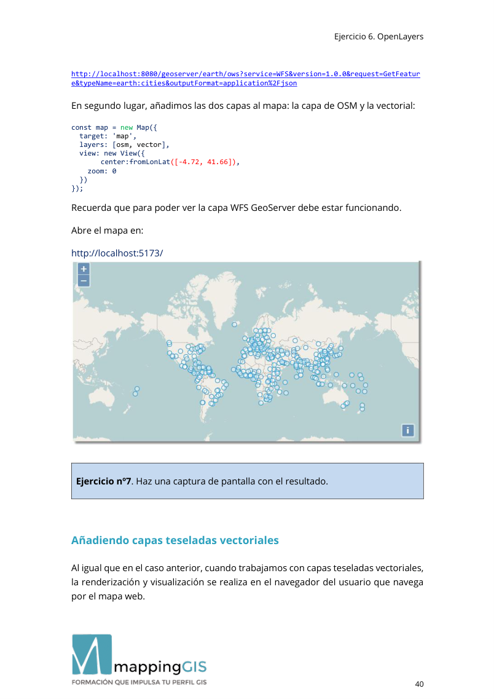</a></details>

[Consultar en el PDF · página 40](../materiales/Ejercicio_6_OpenLayers_2025-v3.pdf#page=40){target="_blank" rel="noopener noreferrer"}

### Ejercicio 8 · Teselas vectoriales

<div class="original-statement"><span class="eyebrow">Enunciado original · Práctica</span><p>Haz una captura de pantalla que muestre la capa countries en formato de tipos de datos vectoriales. Ojo! Recuerda que para poder utilizar la capa countries como teselas vectoriales deberás habilitar la opción application/vnd.mapbox-vector-tile, que se encuentra en Cacheado de teselas de Geoserver.</p></div>

<details class="original-exercise" markdown="1">
<summary>Pasos y contexto originales de la clase</summary>

**Página 40**

```text
Ejercicio 6. OpenLayers 
   40 
 
http://localhost:8080/geoserver/earth/ows?service=WFS&version=1.0.0&request=GetFeatur
e&typeName=earth:cities&outputFormat=application%2Fjson 
En segundo lugar, añadimos las dos capas al mapa: la capa de OSM y la vectorial: 
const map = new Map({ 
  target: 'map', 
  layers: [osm, vector], 
  view: new View({ 
 center:fromLonLat([-4.72, 41.66]), 
    zoom: 0 
  }) 
}); 
 
Recuerda que para poder ver la capa WFS GeoServer debe estar funcionando. 
Abre el mapa en: 
http://localhost:5173/
 
 
Ejercicio nº7. Haz una captura de pantalla con el resultado. 
 
Añadiendo capas teseladas vectoriales  
Al igual que en el caso anterior, cuando trabajamos con capas teseladas vectoriales, 
la renderización y visualización se realiza en el navegador del usuario que navega 
por el mapa web.
```

**Página 41**

```text
Ejercicio 6. OpenLayers 
   41 
Vamos a añadir nuestra capa vectorial cities desde GeoServer como capa teselada 
vectorial, ya que así la tenemos configurada en GeoServer.  
Las capas vectoriales teseladas  se representan mediante la clase  
ol.layer.VectorTile. 
Haz una copia del archivo ol_map7.html y renómbralo a ol_map8.html 
Creamos la capa vectorial mediante la clase ol/layer/VectorTile, utilizando una 
fuente de datos de tipo vector ol/source/VectorTile y el formato ol/format/MVT para 
su renderización en el navegador web: 
//import GeoJSON from 'ol/format/GeoJSON'; 
import VectorTileLayer from 'ol/layer/VectorTile.js'; 
import VectorTile from 'ol/source/VectorTile.js'; 
import MVT from 'ol/format/MVT.js'; 
Con relación al ejercicio número 7 podemos comentar ol/format/GeoJSON pues en 
este caso no lo necesitamos. 
Una vez que hemo s importado los módulos con  las c lases correspondientes 
creamos la capa: 
 
var layer1 = new VectorTileLayer({ 
  source: new VectorTile({ 
   format: new MVT(), 
   url: 'http://localhost:8080/geoserver/gwc/service/tms/1.0.0/' +  
    'earth:cities' + 
    '@EPSG:900913'+ 
    '@pbf/{z}/{x}/{-y}.pbf' 
})  
}); 
 
 
La metodología utilizada es prácticamente igual que en el caso anterior: En primer 
lugar, utilizamos la clase ol/layer/VectorTile para añadir la c apa cities como una 
capa de tipo  vectorial, y como fuente de datos  utilizamos una fuente de teselas 
vectoriales ol/source/VectorTile y el formato de objetos espaciales para leer los  
datos de Mapbox MVT. 
 
La url es diferente puesto que hace referencia al enlace de GeoWebCache que es , 
como vimos en las unidades 3 y 4, el responsable de generar el formato de teselas 
vectoriales para cada capa.
```

**Página 42**

```text
Ejercicio 6. OpenLayers 
   42 
Ejercicio nº 8. Haz una captura de pantalla que muestre la capa countries en 
formato de tipos de datos vectoriales. Ojo! Recuerda que para poder utilizar la 
capa countries como teselas vectoriales deberás habilitar la opción 
application/vnd.mapbox-vector-tile, que se encuentra en Cacheado de teselas de 
Geoserver.  
 
Trabajando con archivos GeoJSON estáticos 
En este ejercicio no vamos a trabajar con capas alojadas en el servidor. 
Esta opción para crear un visor web de mapas es más rápida que almacenar la capa 
en un servidor como GeoServer, y a que podemos alojar el archivo G eoJSON 
directamente en un servidor web. 
 
Esto representa una ventaja  si no que remos tener una gran infraestructura de 
despliegue. 
 
Vamos a crear una  capa en formato G eoJSON. Utilizaremos la capa de ciudades 
original en formato SHP ne_110m_populated_places.shp.  
 
Para convertir un shapefile a GeoJSON tenemos varias opciones: 
1. Utilizar la librería open source   ogr2ogr que sirve para convertir datos 
vectoriales entre distintos formatos.  Esta utilidad se ha instalado con 
PostgreSQL y es muy utilizada internamente por programas con Q GIS. 
Podemos ejecutar manualmente la utilidad de conversión de shp a GeoJSOn 
del siguiente modo:
```

</details>

<details class="source-page"><summary>Ver página 42 del PDF original, con sus capturas</summary><a href="../../materiales/Ejercicio_6_OpenLayers_2025-v3.pdf#page=42" target="_blank" rel="noopener">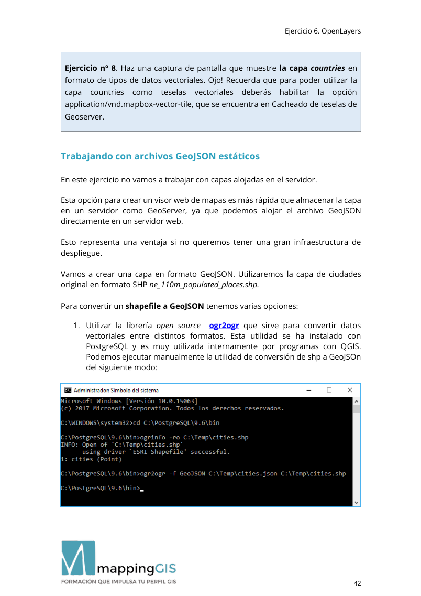</a></details>

[Consultar en el PDF · página 42](../materiales/Ejercicio_6_OpenLayers_2025-v3.pdf#page=42){target="_blank" rel="noopener noreferrer"}

### Ejercicio 9 · Mapa de calor

<div class="original-statement"><span class="eyebrow">Enunciado original · Práctica</span><p>Añade como opción el radio de los círculos de tamaño 15 y añade una capa base de tu elección. Haz una captura de pantalla con el resultado.</p></div>

<details class="original-exercise" markdown="1">
<summary>Pasos y contexto originales de la clase</summary>

**Página 42**

```text
Ejercicio 6. OpenLayers 
   42 
Ejercicio nº 8. Haz una captura de pantalla que muestre la capa countries en 
formato de tipos de datos vectoriales. Ojo! Recuerda que para poder utilizar la 
capa countries como teselas vectoriales deberás habilitar la opción 
application/vnd.mapbox-vector-tile, que se encuentra en Cacheado de teselas de 
Geoserver.  
 
Trabajando con archivos GeoJSON estáticos 
En este ejercicio no vamos a trabajar con capas alojadas en el servidor. 
Esta opción para crear un visor web de mapas es más rápida que almacenar la capa 
en un servidor como GeoServer, y a que podemos alojar el archivo G eoJSON 
directamente en un servidor web. 
 
Esto representa una ventaja  si no que remos tener una gran infraestructura de 
despliegue. 
 
Vamos a crear una  capa en formato G eoJSON. Utilizaremos la capa de ciudades 
original en formato SHP ne_110m_populated_places.shp.  
 
Para convertir un shapefile a GeoJSON tenemos varias opciones: 
1. Utilizar la librería open source   ogr2ogr que sirve para convertir datos 
vectoriales entre distintos formatos.  Esta utilidad se ha instalado con 
PostgreSQL y es muy utilizada internamente por programas con Q GIS. 
Podemos ejecutar manualmente la utilidad de conversión de shp a GeoJSOn 
del siguiente modo:
```

**Página 43**

```text
Ejercicio 6. OpenLayers 
   43 
2. Utilizar un conversor online: 
a. HTML5 Shapefile to GeoJSON Converter. Usa HTML5 y es simple: 
arrastra tu shapefile y obtén un GeoJSON. 
b. MyGeodata Converter, que acepta hasta 20 formatos de entrada y 8 
de salida (ESRI Shapefile, Microstation DGN, MapInfo File, CSV, GML,  
GPX, KML y GeoJSON). 
3. Utilizar un cliente SIG como QGIS. Desde QGIS añadimos el SHP y a 
continuación guardaremos la capa en formato G eoJSON. (Capa > Guardar 
como…). 
 
 
Guarda el nuevo archivo generado en el mismo directorio que los códigos js que 
estamos creando. Abre el archivo que hemos creado con el editor de texto y añade 
al inicio: 
export const cities =
```

**Página 44**

```text
Ejercicio 6. OpenLayers 
   44 
Debe quedar algo como lo siguiente: 
 
 
Guarda el archivo como cities.js 
De esta forma estamos exportando la constante cities, lo que nos  permite 
importarla después en nuestro código. 
 
Creación de un Heat map con la densidad de las ciudades del 
mundo 
 
En este ejercicio debes crear un mapa calor utilizando el archivo vectorial que 
acabamos de crear. 
Haz una copia del archivo ol_map1.js y renómbralo a ol_map9.js 
Lo primero como siempre es importar los módulos. 
 
Para crear mapas de calor OpenLayers dispone de capas específicas por lo que la 
importamos desde ol/layer/Heatmap, también importamos el recurso 
correspondiente (ol/source/Vector) y por último importamos el formato GeoJSON. 
Los datos como hemos indicado antes proceden en este caso de un archivo 
GeoJSON en lugar de un mapa de GeoServer. Para importar los datos que creamos 
antes al exportar el archivo con las ciudades utilizamos:
```

**Página 45**

```text
Ejercicio 6. OpenLayers 
   45 
import {cities} from './cities.js'; 
Debido a que la capa de ciudades no tiene un campo  con valor de población en el 
rango 0 -1 para poder utilizar la como peso, el mapa renderiza rá las ciudades 
mostrando dónde se encuentra la mayor densidad de ciudades.  
var heatmap = new Heatmap({ 
   source: new VectorSource({ 
    features: new GeoJSON().readFeatures(cities), 
    }), 
   }); 
En el código anterior hemos instanciado una capa y la hemos denominado heatmap, 
cuya fuente es un archivo GeoJSON. Utilizamos el método readFeatures para indicar 
que la fuente de datos es cities. 
Ahora creamos la instancia al mapa: 
 
const map = new Map({ 
  target: 'map', 
  layers: [osm, heatmap], 
  view: new View({ 
   projection:'EPSG:4326', 
   center:[-4.72, 41.66], 
   zoom:1 
  }) 
}); 
Como vemos la vista es un poco diferente a los ejemplos anteriores. Aquí estamos 
definiendo la proyección EPSG:4326 tal y como hemos definido al exportar la capa 
cities. 
Modifica el archivo index.html de la siguiente forma: 
<script type="module" src="./ol_map9.js"></script> 
Visualizalo en: 
http://localhost:5173 
Ejercicio nº 9. Añade como opción el radio de los círculos de tamaño 15 y añade 
una capa base de tu elección. Haz una captura de pantalla con el resultado.
```

</details>

<details class="source-page"><summary>Ver página 45 del PDF original, con sus capturas</summary><a href="../../materiales/Ejercicio_6_OpenLayers_2025-v3.pdf#page=45" target="_blank" rel="noopener">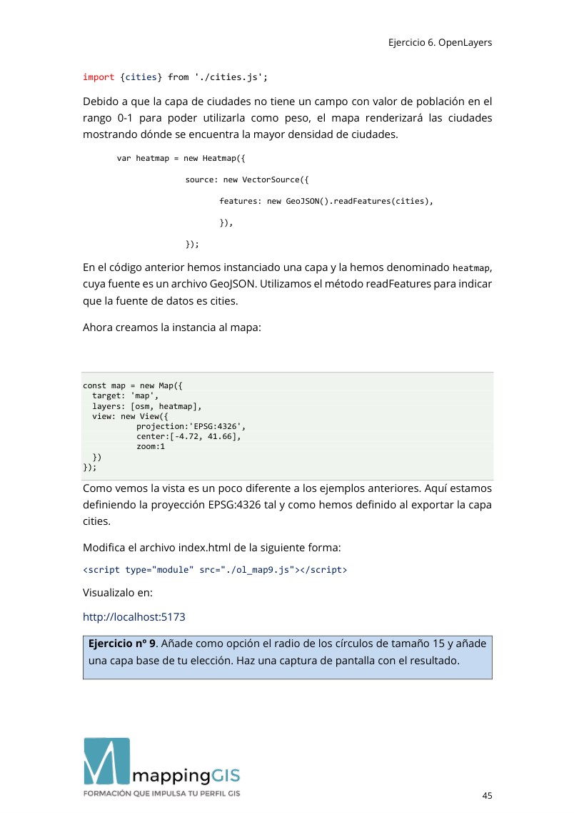</a></details>

[Consultar en el PDF · página 45](../materiales/Ejercicio_6_OpenLayers_2025-v3.pdf#page=45){target="_blank" rel="noopener noreferrer"}

### Ejercicio 10 · Simbología vectorial

<div class="original-statement"><span class="eyebrow">Enunciado original · Práctica</span><p>Pega el resultado de tu mapa (ol_map10.js)</p></div>

<details class="original-exercise" markdown="1">
<summary>Pasos y contexto originales de la clase</summary>

**Página 45**

```text
Ejercicio 6. OpenLayers 
   45 
import {cities} from './cities.js'; 
Debido a que la capa de ciudades no tiene un campo  con valor de población en el 
rango 0 -1 para poder utilizar la como peso, el mapa renderiza rá las ciudades 
mostrando dónde se encuentra la mayor densidad de ciudades.  
var heatmap = new Heatmap({ 
   source: new VectorSource({ 
    features: new GeoJSON().readFeatures(cities), 
    }), 
   }); 
En el código anterior hemos instanciado una capa y la hemos denominado heatmap, 
cuya fuente es un archivo GeoJSON. Utilizamos el método readFeatures para indicar 
que la fuente de datos es cities. 
Ahora creamos la instancia al mapa: 
 
const map = new Map({ 
  target: 'map', 
  layers: [osm, heatmap], 
  view: new View({ 
   projection:'EPSG:4326', 
   center:[-4.72, 41.66], 
   zoom:1 
  }) 
}); 
Como vemos la vista es un poco diferente a los ejemplos anteriores. Aquí estamos 
definiendo la proyección EPSG:4326 tal y como hemos definido al exportar la capa 
cities. 
Modifica el archivo index.html de la siguiente forma: 
<script type="module" src="./ol_map9.js"></script> 
Visualizalo en: 
http://localhost:5173 
Ejercicio nº 9. Añade como opción el radio de los círculos de tamaño 15 y añade 
una capa base de tu elección. Haz una captura de pantalla con el resultado.
```

**Página 46**

```text
Ejercicio 6. OpenLayers 
   46 
Simbología de capas vectoriales 
Trataremos en los siguientes apartados la forma en que podemos asignar 
simbología a las capas vectoriales. Vamos a utilizar el mismo código que en un caso 
anterior.  
1. Copia el archivo js nº7 (ol_map7.js) y guardarlo como ol_map10.js 
2. Vamos a definir la simbología para la capa vectorial del tipo ol.layer.Vector. 
Añade lo siguiente: 
   var vector = new VectorLayer({ 
 title:'cities', 
 source: new VectorSource({ 
  format: new GeoJSON(), 
  url: 'http://localhost:8080/geoserver/earth/wfs?' + 
   'service=WFS&' + 
   'version=1.0.0&request=GetFeature&typename=cities&'+ 
   'outputFormat=application/json' 
 })  
}); 
 
La capa vectorial tiene un título  (title) ‘cities’, cuyo origen (source) es un vectorial  
geoJSON  VectorSource (ol/source/Vector) que apunta a una ruta y el formato es 
GeoJSON. 
Para definir la simbología de una capa vectorial necesitamos utilizar la cl ase 
ol/style/Style. 
import {Fill, Stroke, Circle, Style} from 'ol/style'; 
Como puedes observar además de la clase style importamos el resto de clases que 
vamos a necesitar; Circle, Fill y Stroke. 
Según esto el principio de nuestro código queda de la siguiente forma:
```

**Página 47**

```text
Ejercicio 6. OpenLayers 
   47 
Dependiendo del tipo de geometría, se pueden utilizar diferentes simbolizadores. 
Las líneas funcionan como los polígonos, pero no pueden tener un relleno.  
En este ejercicio vamos a  darle simbología a nuestra capa de ciudades, que es de 
tipo punto, cómo debemos representarlos : ¿con la clase ol/style/Circle o con 
ol/style/Icon? 
Actualiza la capa vectorial ya existente para añadir su simbología: 
 var vector = new VectorLayer({ 
 title:'cities', 
 source: new VectorSource({ 
  format: new GeoJSON(), 
  url: 'http://localhost:8080/geoserver/earth/wfs?' + 
   'service=WFS&' + 
   'version=1.0.0&request=GetFeature&typename=cities&'+ 
   'outputFormat=application/json' 
 }), 
 style: new Style({ 
  image: new Circle({ 
   radius: 3, 
   fill: new Fill({ 
    color: 'orange'}), 
   stroke: new Stroke({ 
    color: 'black'}) 
   }) 
    }) 
}); 
 
Para dibujar un objeto geográfico de tipo punto con un color de relleno naranja y 
un borde negro, deberemos utilizar dos simbolizadores Fill y Stroke. 
Actualiza el index.html. 
<script type="module" src="./ol_map10.js"></script> 
Ve a http://localhost:5173
```

**Página 48**

```text
Ejercicio 6. OpenLayers 
   48 
 
Ejercicio nº 10. Pega el resultado de tu mapa (ol_map10.js)  
Añadiendo texto con una función de estilo 
 
Copia el html anterior y guárdalo como ol_map11.js 
 
En primer lugar, importamos la clase ol/style/Text.js. 
Ahora vamos a crear una función de estilo. El siguiente código muestra cómo aplicar 
una función de estilo sobre una capa vectorial, renderizando todos los elementos 
usando la propiedad NAMEASCII. Observa el uso del método getFeature. 
Crea la función antes de crear el objeto vectorial:
```

</details>

<details class="source-page"><summary>Ver página 48 del PDF original, con sus capturas</summary><a href="../../materiales/Ejercicio_6_OpenLayers_2025-v3.pdf#page=48" target="_blank" rel="noopener">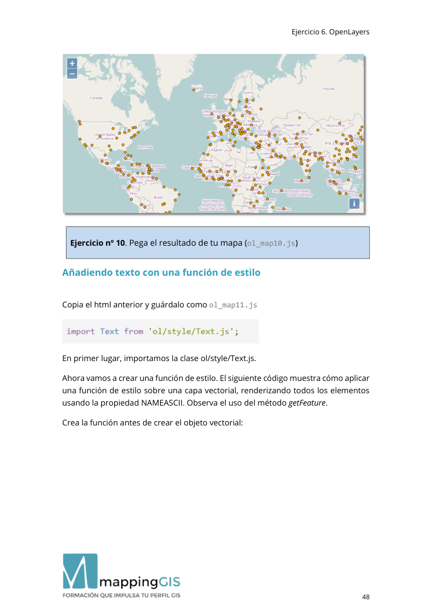</a></details>

[Consultar en el PDF · página 48](../materiales/Ejercicio_6_OpenLayers_2025-v3.pdf#page=48){target="_blank" rel="noopener noreferrer"}

### Ejercicio 11 · Etiquetas

<div class="original-statement"><span class="eyebrow">Enunciado original · Práctica</span><p>Pega el resultado de tu mapa (ol_map11.js)</p></div>

<details class="original-exercise" markdown="1">
<summary>Pasos y contexto originales de la clase</summary>

**Página 48**

```text
Ejercicio 6. OpenLayers 
   48 
 
Ejercicio nº 10. Pega el resultado de tu mapa (ol_map10.js)  
Añadiendo texto con una función de estilo 
 
Copia el html anterior y guárdalo como ol_map11.js 
 
En primer lugar, importamos la clase ol/style/Text.js. 
Ahora vamos a crear una función de estilo. El siguiente código muestra cómo aplicar 
una función de estilo sobre una capa vectorial, renderizando todos los elementos 
usando la propiedad NAMEASCII. Observa el uso del método getFeature. 
Crea la función antes de crear el objeto vectorial:
```

**Página 49**

```text
Ejercicio 6. OpenLayers 
   49 
 
var TextStyle = function(feature) { 
 return [new Style({ 
     text: new Text({ 
  font: '16px Calibri,sans-serif',     
  text: feature.get('nameascii'), 
  fill: new Fill({ 
   color: '#000'}), 
   stroke: new Stroke({ 
     color: '#fff', 
     width: 1 
    }) 
    }) 
  })]; 
 }; 
 
 
Y asignamos este estilo a la capa vectorial: 
var vector =  new VectorLayer({ 
       title: 'cities', 
       style: TextStyle, 
       source: new VectorSource({  
 format: new GeoJSON(), 
 url: 'http://localhost:8080/geoserver/earth/wfs?' + 
 'service=WFS&' +     
 'version=1.0.0&request=GetFeature&typename=cities&'+ 
 'outputFormat=application/json' 
  }) 
 });
```

**Página 50**

```text
Ejercicio 6. OpenLayers 
   50 
De este modo se representará n las etiquetas, pero no su localizaci ón puntual. 
Vamos a completar el código para que se muestre  un símbolo circular además del 
texto con el nombre: 
 
 
var TextStyle = function(feature) { 
 return [new Style({ 
  text: new Text({ 
  font: '16px Calibri,sans-serif',     
  text: feature.get('nameascii'), 
  fill: new Fill({ 
   color: '#000'}), 
  stroke: new Stroke({ 
   color: '#fff', 
   width: 1}) 
  }), 
  image: new Circle({ 
   radius: 6, 
   fill: new Fill({ 
    color: 'orange' 
    }),   
   stroke: new Stroke({ 
    color: 'black'}) 
  }) 
 })]; 
}; 
 
 
Ahora bien, si hacemos zoom por el mapa vemos que las etiquetas se solapan .
```

**Página 51**

```text
Ejercicio 6. OpenLayers 
   51 
OpenLayers, desde la versión 4.5.0, nos proporciona la opción declutter aplicable 
a las capas vectoriales y se usa para evitar la superposición de imágenes y etiquetas 
y su correcta representación. Por defecto está desactivado. 
Para aplicar el declutter debemos establecerlo como verdadero (declutter: 
true). Utilizaremos esta opción en la capa vectorial: 
 
var vector =  new VectorLayer({ 
            title: 'cities', 
  declutter: true, 
  style: TextStyle, 
  … 
 
Vuelve a desplazarte por el mapa en una zona con gran concentración de etiquetas 
(Europa o América Central) para observar la diferencia. 
Ejercicio nº 11. Pega el resultado de tu mapa (ol_map11.js)
```

</details>

<details class="source-page"><summary>Ver página 51 del PDF original, con sus capturas</summary><a href="../../materiales/Ejercicio_6_OpenLayers_2025-v3.pdf#page=51" target="_blank" rel="noopener">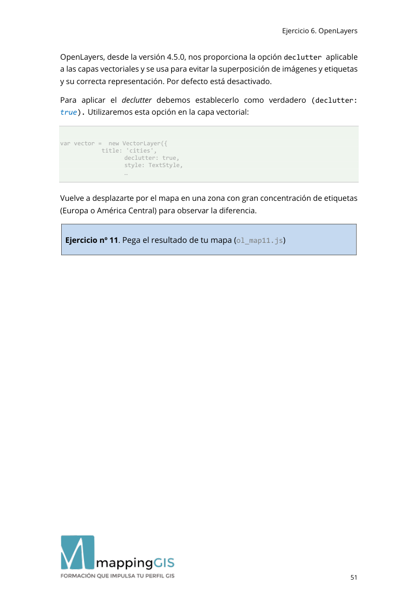</a></details>

[Consultar en el PDF · página 51](../materiales/Ejercicio_6_OpenLayers_2025-v3.pdf#page=51){target="_blank" rel="noopener noreferrer"}

### Ejercicio 12 · Estilos por atributos

<div class="original-statement"><span class="eyebrow">Enunciado original · Práctica</span><p>Pega el resultado de tu mapa que contiene la capa cities con su estilo basado en atributos (ol_map12.js).</p></div>

<details class="original-exercise" markdown="1">
<summary>Pasos y contexto originales de la clase</summary>

**Página 51**

```text
Ejercicio 6. OpenLayers 
   51 
OpenLayers, desde la versión 4.5.0, nos proporciona la opción declutter aplicable 
a las capas vectoriales y se usa para evitar la superposición de imágenes y etiquetas 
y su correcta representación. Por defecto está desactivado. 
Para aplicar el declutter debemos establecerlo como verdadero (declutter: 
true). Utilizaremos esta opción en la capa vectorial: 
 
var vector =  new VectorLayer({ 
            title: 'cities', 
  declutter: true, 
  style: TextStyle, 
  … 
 
Vuelve a desplazarte por el mapa en una zona con gran concentración de etiquetas 
(Europa o América Central) para observar la diferencia. 
Ejercicio nº 11. Pega el resultado de tu mapa (ol_map11.js)
```

**Página 52**

```text
Ejercicio 6. OpenLayers 
   52 
Estilos basados en atributos 
 
Antes de continuar haz una copia del archivo ol_map11.js y renómbralo a 
ol_map12.js para trabajar sobre este último. 
Una capa vector ial puede tener una función para la configuración del estilo en el 
que se elegirá un estilo diferente basado en los atributos de un elemento.  
La función de estilo recibe el argumento feature. 
Asumiendo que desea mos aplicar un estil o a todo s los objetos geográficos que 
tienen un atributo denominado POP_MAX con valor mayor a 100 .000, 
comenzaríamos la función de estilo del siguiente modo: 
function(feature) { 
  if (feature.get('POP_MAX') > 1000000) { 
    // return the style 
  } 
} 
La función de estilo devolverá un array (una colección) de objetos ol/style/Style.  
Supongamos que deseamos que todas nuestras ciudades sean de color azul, salvo 
aquellas que ten gan su población ( el atributo POP_MAX) con un valor “mayor a 
100.000 habitantes” (queremos que estas ciudades además sean de color rojo y con 
un radio mayor). 
Para comenzar elimina el código correspondiente a la función de estilo TextStyle 
Debemos crear una función de estilo como la siguiente:
```

**Página 53**

```text
Ejercicio 6. OpenLayers 
   53 
 
var condStyle = function(feature) { 
 var smallcities = [new Style({ 
  image: new Circle({ 
   radius: 2.5, 
   fill: new Fill({color: 'blue'}) 
  }) 
 }) 
 ]; 
 var largecities = [new Style({ 
  image: new Circle({ 
   radius: 3.5, 
   fill: new Fill({color: 'red'}) 
  }) 
 }) 
 ]; 
    
 if (feature.get('pop_max') > 1000000) { 
  return largecities; 
 } else { 
   return smallcities; 
 } 
}; 
 
Añade este estilo a la capa vectorial: 
var vector =  new VectorLayer({ 
         title: 'cities', 
 declutter: true, 
 style: condStyle, 
 source: ... 
}); 
 
¿Qué hemos hecho en esta función? 
En primer lugar, hemos creado dos variables, una variable que se denomina 
smallcities que encapsula un estilo de color azul y radio 2.5. La segunda variable 
denominada largecities tiene una simbología de relleno rojo y radio 3.5.  
Por último, hemos creado la función en la que creamos la condición. Si la población 
es mayor a 100.000 habitantes utiliza el estilo de la variable largecities, y si no se 
cumple esta condición, entonces debe utilizar la variable smallcities 
Actualiza index.html 
<script type="module" src="./ol_map12.js"></script> 
Ve a  http://localhost:5173
```

**Página 54**

```text
Ejercicio 6. OpenLayers 
   54 
Ejercicio nº 12. Pega el resultado de tu mapa  que contiene la capa cities con 
su estilo basado en atributos (ol_map12.js).
```

</details>

<details class="source-page"><summary>Ver página 54 del PDF original, con sus capturas</summary><a href="../../materiales/Ejercicio_6_OpenLayers_2025-v3.pdf#page=54" target="_blank" rel="noopener">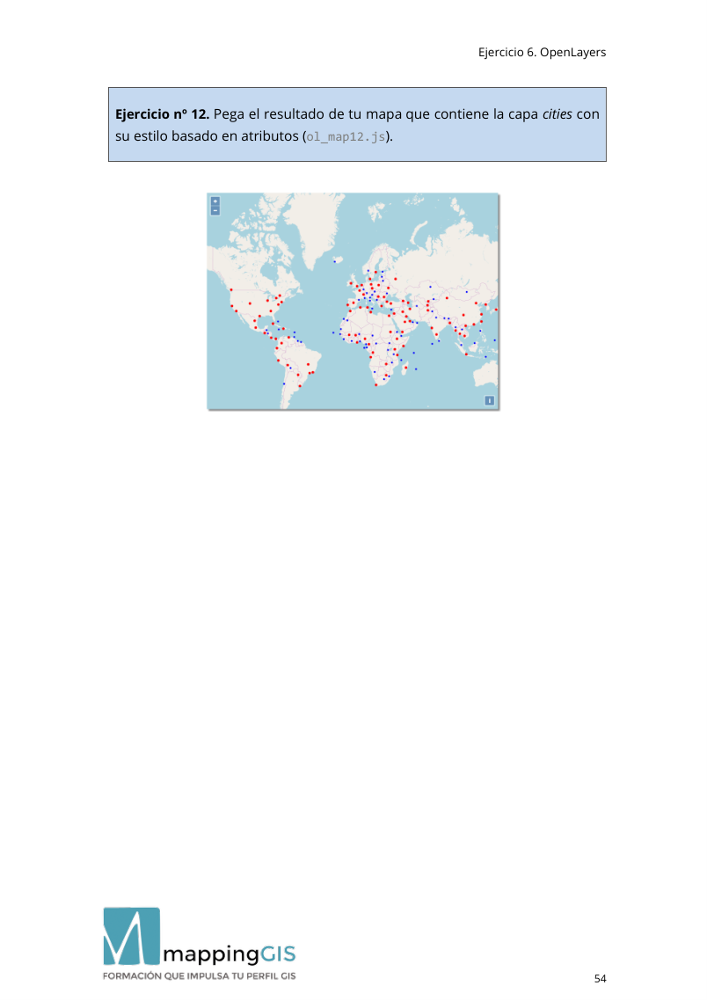</a></details>

[Consultar en el PDF · página 54](../materiales/Ejercicio_6_OpenLayers_2025-v3.pdf#page=54){target="_blank" rel="noopener noreferrer"}

### Ejercicio 13 · Controles

<div class="original-statement"><span class="eyebrow">Enunciado original · Práctica</span><p>Añade otros 3 controles:  Un control que muestre las coordenadas del ratón.  Otro que cambie la vista del mapa a pantalla completa.  Un control de escala (ScaleLine). Haz una captura de pantalla con los nuevos controles (ol_map13.js)</p></div>

<details class="original-exercise" markdown="1">
<summary>Pasos y contexto originales de la clase</summary>

**Página 54**

```text
Ejercicio 6. OpenLayers 
   54 
Ejercicio nº 12. Pega el resultado de tu mapa  que contiene la capa cities con 
su estilo basado en atributos (ol_map12.js).
```

**Página 55**

```text
Ejercicio 6. OpenLayers 
   55 
Controles 
En esta sección, vamos a ampliar la funcionalidad del mapa añadiendo más 
controles para interactuar y tener más información del mapa. 
Copia el mapa ol_map1.js y renómbralo a ol_map13.js 
Importamos los controles : 
import {defaults, Attribution, OverviewMap, ZoomSlider, ScaleLine, MousePosition, 
FullScreen} from 'ol/control.js'; 
Crearemos un objeto controls que extenderá los controles que tiene O penLayers 
por defecto. 
Añade el siguiente código: 
var controls = defaults().extend( [ 
  new Attribution(), 
  new OverviewMap({ 
       layers: [ 
   new TileLayer({ 
       source: new OSM() 
   }) 
       ] 
  }), 
  new ZoomSlider(), 
]); 
 
El control ol/control/Attribution crea un control de atribución: 
 
El control ol/control/OverviewMap crea un mapa de localización con una capa base que 
deseemos:
```

**Página 56**

```text
Ejercicio 6. OpenLayers 
   56 
 
El control ol/control/ZoomSlider crea un control deslizante de zoom: 
 
Lo siguiente que tenemos que hacer es indicar al constructor de mapas que ya 
tenemos, que utilice estas opciones. 
const map = new Map({ 
     controls: controls, 
     layers: 
     ... 
 
Guarda el archivo y vuelve a cargar en el navegador para ver los cambios.
```

**Página 57**

```text
Ejercicio 6. OpenLayers 
   57 
Ejercicio nº 13. Añade otros 3 controles: 
 Un control que muestre las coordenadas del ratón. 
 Otro que cambie la vista del mapa a pantalla completa. 
 Un control de escala (ScaleLine).  
Haz una captura de pantalla con los nuevos controles (ol_map13.js) 
 
 
Vamos modificar las propiedades coordinateFormat y projection del control 
MousePosition. 
import {createStringXY} from 'ol/coordinate'; 
 Estableceremos a 4 los decimales y las unidades del SRID con el que estamos 
trabajando: 
 
new MousePosition({ 
  coordinateFormat: createStringXY(4), 
  projection: 'EPSG:4326' 
}) 
 
En la etiqueta de un mismo documento, añadiremos unas declaraciones de estilo 
CSS para modificar a fuente del texto referente al control de posición del ratón. 
Si abrimos la hoja de estilo CSS de O penLayers con el navegador 
(https://openlayers.org/en/master/css/ol.css) vemos que existe un  selector de estilo 
predefinido para este control: 
.ol-mouse-position { 
top:8px; 
right:8px; 
position:absolute 
} 
 
Por lo tanto, podemos agregar nuevas propiedades y valores al selector ol-mouse-
position:
```

</details>

<details class="source-page"><summary>Ver página 57 del PDF original, con sus capturas</summary><a href="../../materiales/Ejercicio_6_OpenLayers_2025-v3.pdf#page=57" target="_blank" rel="noopener">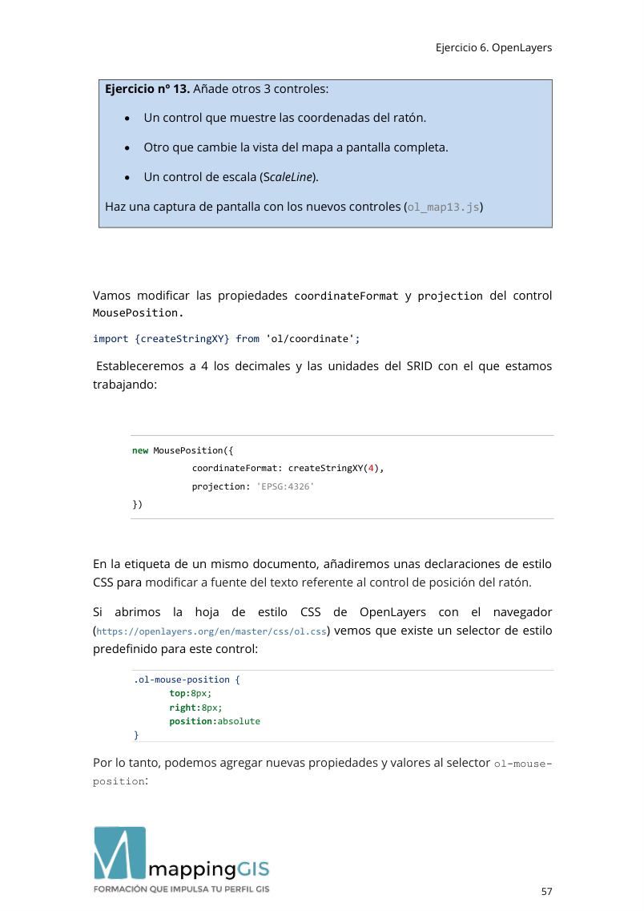</a></details>

[Consultar en el PDF · página 57](../materiales/Ejercicio_6_OpenLayers_2025-v3.pdf#page=57){target="_blank" rel="noopener noreferrer"}

### Ejercicio 14 · Selector de capas

<div class="original-statement"><span class="eyebrow">Enunciado original · Práctica</span><p>Haz una captura de pantalla con el visor web que contenga el nuevo control de visibilidad de capas.</p></div>

<details class="original-exercise" markdown="1">
<summary>Pasos y contexto originales de la clase</summary>

**Página 57**

```text
Ejercicio 6. OpenLayers 
   57 
Ejercicio nº 13. Añade otros 3 controles: 
 Un control que muestre las coordenadas del ratón. 
 Otro que cambie la vista del mapa a pantalla completa. 
 Un control de escala (ScaleLine).  
Haz una captura de pantalla con los nuevos controles (ol_map13.js) 
 
 
Vamos modificar las propiedades coordinateFormat y projection del control 
MousePosition. 
import {createStringXY} from 'ol/coordinate'; 
 Estableceremos a 4 los decimales y las unidades del SRID con el que estamos 
trabajando: 
 
new MousePosition({ 
  coordinateFormat: createStringXY(4), 
  projection: 'EPSG:4326' 
}) 
 
En la etiqueta de un mismo documento, añadiremos unas declaraciones de estilo 
CSS para modificar a fuente del texto referente al control de posición del ratón. 
Si abrimos la hoja de estilo CSS de O penLayers con el navegador 
(https://openlayers.org/en/master/css/ol.css) vemos que existe un  selector de estilo 
predefinido para este control: 
.ol-mouse-position { 
top:8px; 
right:8px; 
position:absolute 
} 
 
Por lo tanto, podemos agregar nuevas propiedades y valores al selector ol-mouse-
position:
```

**Página 58**

```text
Ejercicio 6. OpenLayers 
   58 
<style> 
    #map { 
        width: 100%; 
        height: 400px; 
  box-shadow:5px 5px 5px #888; 
    } 
  .ol-mouse-position { 
        font-size: 12px; 
        font-family: Arial Black; 
  } 
 
</style> 
Añade estos cambios en index.html, guarda los cambios y actualiza la página en el 
navegador. 
Añadiendo un control de capas - layerswitcher 
Una de las principales carencias de OpenLayers es la ausencia de un control de 
capas en el núcleo de OpenLayers.  
Veamos cómo podemos solucionar este pequeño inconveniente y cómo integrar un 
control de capas en nuestros mapas web. 
ol3-layerswitcher 
Matt Walker ha desarrollado una clase nueva ( ol/control/LayerSwitcher) para 
añadir un control de capas en OpenLayers. 
Haz una copia del archivo ol_map1.js y renómbralo a ol_map14.js 
La información sobre el complemento la tenemos en : 
https://github.com/walkermatt/ol-layerswitcher 
Tenemos que instalar el complemento ol.layerswitcher. 
Abre una nueva terminal y escribe: 
npm install ol-layerswitcher --save
```

**Página 59**

```text
Ejercicio 6. OpenLayers 
   59 
 
 
Con esta operación se nos crean nuevos módulos.  El plugin ol.layerswitcher 
contiene un archivo de estilos css: 
 
Incorporamos este archivo css a nuestro código: 
import 'ol-layerswitcher/src/ol-layerswitcher.css'; 
Procedemos a importar las clases del complemento: 
import LayerSwitcher from 'ol-layerswitcher'; 
import { BaseLayerOptions, GroupLayerOptions } from 'ol-layerswitcher'; 
 
Para poder utilizar esta nueva clase es necesario agrupar las capas en Grupos, por 
lo tanto, es necesario utilizar la clase ol/layer/Group. 
import LayerGroup from 'ol/layer/Group.js';
```

**Página 60**

```text
Ejercicio 6. OpenLayers 
   60 
 
Vemos en la imagen anterior los módulos que vamos a necesitar en este ejemplo. 
Para tener varias capas con las que trabajar incluimos XYZ para OpenTopoMap  y 
OSM. 
Además, tanto los grupos de capas, como las capas en sí, deben tener la 
propiedad title (que será el texto que se muestre en el control de capas) y en cada 
capa base la propiedad type fijada como base. 
Veamos cómo quedaría el código para las capas. Primero creamos el objeto mapa, 
y dentro de la propiedad layers creamos el grupo, que incluirá las capas que 
deseemos: 
var map = new Map({ 
  layers:  
   [new LayerGroup({ 
    'title': 'Base maps', 
    layers: [ 
      new TileLayer({ 
  title: 'OpenTopoMap', 
  type: 'base', 
  visible: true, 
  source: new XYZ({ 
   url: 'https://tile.opentopomap.org/{z}/{x}/{y}.png', 
   attributions: '© OpenTopoMaplor' 
         }) 
     }) 
 ... 
En el código anterior vemos como la propiedad  visible está fijada como true. Solo 
una de las capas base debe tener la propiedad fijada como true, que será la que 
queremos mostrar cuando se inicie el mapa. 
A continuación, creamos otro grupo de capas para las capas superpuestas:
```

**Página 61**

```text
Ejercicio 6. OpenLayers 
   61 
 
new LayerGroup({ 
  title: 'Overlays', 
  layers: [ 
   new TileLayer({ 
     title: 'Countries', 
     source: new TileWMS({ 
        url: 'http://localhost:8080/geoserver/wms', 
        params: { 
             'LAYERS': 'earth:countries', 
             ‘FORMAT’: ‘image/png’ 
 } 
     }) 
   }) 
  ] 
}) 
Por último, creamos un objeto layerSwitcher: 
var layerSwitcher = new LayerSwitcher(); 
Añadimos el control al mapa: 
map.addControl(layerSwitcher); 
Si deseamos que el mapa se inicie con el control de capas desplegado podemos 
hacer uso del método showPanel. Para ello incluimos: 
layerSwitcher.showPanel(); 
 
El código completo quedaría de la siguiente manera:
```

**Página 62**

```text
Ejercicio 6. OpenLayers 
   62 
 
import './style.css'; 
import 'ol-layerswitcher/src/ol-layerswitcher.css'; 
 
import Map from 'ol/Map.js'; 
import View from 'ol/View.js'; 
import LayerGroup from 'ol/layer/Group.js'; 
import TileLayer from 'ol/layer/Tile.js'; 
import OSM from 'ol/source/OSM.js'; 
import XYZ from 'ol/source/XYZ.js';//OpenTopoMap 
import TileWMS from 'ol/source/TileWMS.js'; 
import {fromLonLat} from 'ol/proj'; 
 
import LayerSwitcher from 'ol-layerswitcher'; 
import { BaseLayerOptions, GroupLayerOptions } from 'ol-layerswitcher'; 
 
var map = new Map({ 
   layers:  
  [new LayerGroup({ 
   'title': 'Base maps', 
   layers: [ 
    new TileLayer({ 
     title: 'OpenTopoMap', 
     type: 'base', 
     visible: true, 
     source: new XYZ({ 
      url: 
'https://tile.opentopomap.org/{z}/{x}/{y}.png', 
      attributions: '© OpenTopoMaplor' 
     }) 
    }), 
    new TileLayer({ 
     title: 'OSM', 
     type: 'base', 
     visible: false, 
     source: new OSM() 
    }) 
   ] 
  }), 
  new LayerGroup({ 
   title: 'Overlays', 
   layers: [ 
    new TileLayer({ 
     title: 'Countries', 
     source: new TileWMS({ 
      url: 
'http://localhost:8080/geoserver/wms', 
      params: { 
       'LAYERS': 'earth:countries', 
       'FORMAT': 'image/png' 
      }  
     }) 
    }) 
   ] 
  }) 
  ],  
  target: 'map',
```

**Página 63**

```text
Ejercicio 6. OpenLayers 
   63 
  view: new View({ 
   center: fromLonLat([-4.72, 41.66]), 
   zoom: 3 
  }) 
}); 
    
var layerSwitcher = new LayerSwitcher(); 
map.addControl(layerSwitcher); 
layerSwitcher.showPanel(); 
 
  
Ejercicio nº 1 4. Haz una captura de pantalla con el visor web  que contenga el 
nuevo control de visibilidad de capas.
```

</details>

<details class="source-page"><summary>Ver página 63 del PDF original, con sus capturas</summary><a href="../../materiales/Ejercicio_6_OpenLayers_2025-v3.pdf#page=63" target="_blank" rel="noopener">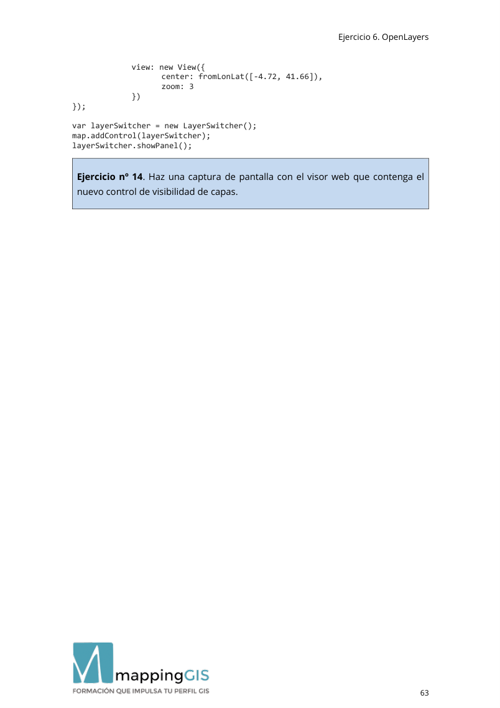</a></details>

[Consultar en el PDF · página 63](../materiales/Ejercicio_6_OpenLayers_2025-v3.pdf#page=63){target="_blank" rel="noopener noreferrer"}

### Ejercicio 15 · Selección

<div class="original-statement"><span class="eyebrow">Enunciado original · Práctica</span><p>Pega el resultado de tu mapa ( ol_map15.js) en la plantilla de resultados.</p></div>

<details class="original-exercise" markdown="1">
<summary>Pasos y contexto originales de la clase</summary>

**Página 63**

```text
Ejercicio 6. OpenLayers 
   63 
  view: new View({ 
   center: fromLonLat([-4.72, 41.66]), 
   zoom: 3 
  }) 
}); 
    
var layerSwitcher = new LayerSwitcher(); 
map.addControl(layerSwitcher); 
layerSwitcher.showPanel(); 
 
  
Ejercicio nº 1 4. Haz una captura de pantalla con el visor web  que contenga el 
nuevo control de visibilidad de capas.
```

**Página 64**

```text
Ejercicio 6. OpenLayers 
   64 
Interacciones 
En esta sección, vamos a ampliar la funcionalidad del mapa añadiendo una nueva 
interacción. 
Selección de objetos geográficos 
Haz una copia del mapa ol_map10.js y renómbralo a ol_map15.js 
En ese mapa tenemos la capa ciudades en formato vectorial sobre la capa base de 
OSM. 
Importamos los módulos para la interacción: 
import {defaults} from 'ol/interaction/defaults'; 
import Select from 'ol/interaction/Select.js'; 
En las propiedades del objeto mapa vamos a añadir una propiedad nueva, la 
propiedad interaction. La añadiremos después de la vista: 
const map = new Map({ 
… 
view: new View({ 
  center:fromLonLat([-4.72, 41.66]), 
  zoom: 2 
    }), 
 interactions: defaults().extend([new Select()]) 
}); 
Utilizamos las propiedades por defecto de interactions, es decir defaults() y sobre 
ella aplicamos el método extender para añadir una nueva interacción, que en este 
caso se trata de ol/interaction/Select. 
Ahora haz clic sobre una ciudad, se debería seleccionar la ciudad cambiando su 
apariencia:
```

**Página 65**

```text
Ejercicio 6. OpenLayers 
   65 
 
 
Dibujando nuevas geometrías 
 
Haz una copia del mapa anterior y renómbralo a ol_map16.js 
import Draw from 'ol/interaction/Draw.js'; 
Importamos el módulo de dibujo de nuevos elementos. 
En primer lugar, vamos a crear al principio del <script>una nueva variable source 
para indicar cuál es la fuente de los datos sobre la que dibujaremos las nuevas 
geometrías: 
 
var source = new VectorSource({ 
 url: 'http://localhost:8080/geoserver/earth/ows?'+ 
  'service=WFS&version=1.0.0&request=GetFeature&'+ 
  'typeName=earth:cities&'+ 
  'outputFormat=application%2Fjson', 
 format: new GeoJSON()}); 
 
 
En segundo lugar, especificaremos que la capa vectorial debe utilizar esta fuente: 
Ejercicio nº 1 5.  Pega el resultado de tu mapa ( ol_map15.js) en la plantilla de 
resultados.
```

</details>

<details class="source-page"><summary>Ver página 65 del PDF original, con sus capturas</summary><a href="../../materiales/Ejercicio_6_OpenLayers_2025-v3.pdf#page=65" target="_blank" rel="noopener">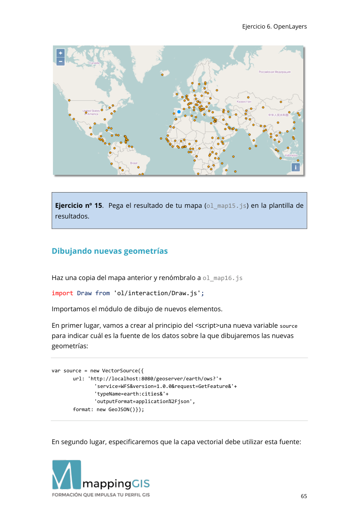</a></details>

[Consultar en el PDF · página 65](../materiales/Ejercicio_6_OpenLayers_2025-v3.pdf#page=65){target="_blank" rel="noopener noreferrer"}

### Ejercicio 16 · Dibujo

<div class="original-statement"><span class="eyebrow">Enunciado original · Práctica</span><p>Pega el resultado de tu mapa (ol_map16.js) con algunos puntos en la plantilla de resultados.</p></div>

<details class="original-exercise" markdown="1">
<summary>Pasos y contexto originales de la clase</summary>

**Página 65**

```text
Ejercicio 6. OpenLayers 
   65 
 
 
Dibujando nuevas geometrías 
 
Haz una copia del mapa anterior y renómbralo a ol_map16.js 
import Draw from 'ol/interaction/Draw.js'; 
Importamos el módulo de dibujo de nuevos elementos. 
En primer lugar, vamos a crear al principio del <script>una nueva variable source 
para indicar cuál es la fuente de los datos sobre la que dibujaremos las nuevas 
geometrías: 
 
var source = new VectorSource({ 
 url: 'http://localhost:8080/geoserver/earth/ows?'+ 
  'service=WFS&version=1.0.0&request=GetFeature&'+ 
  'typeName=earth:cities&'+ 
  'outputFormat=application%2Fjson', 
 format: new GeoJSON()}); 
 
 
En segundo lugar, especificaremos que la capa vectorial debe utilizar esta fuente: 
Ejercicio nº 1 5.  Pega el resultado de tu mapa ( ol_map15.js) en la plantilla de 
resultados.
```

**Página 66**

```text
Ejercicio 6. OpenLayers 
   66 
var vector = new VectorLayer({ 
 title: 'cities', 
 source: source, 
       style: ... 
 ... 
}); 
 
A continuación, creamos la instancia de dibujo, especificando las propiedades 
obligatorias source y Type: 
var draw = new Draw({ 
 source: source, 
 type: 'Point' 
}); 
 
Y por último modificamos la propiedad interaction para indicar que queremos crear 
una interacción de dibujo: 
 
const map = new Map({ 
  target: 'map', 
  layers: [osm, vector], 
  view: new View({ 
 center:fromLonLat([-4.72, 41.66]), 
    zoom: 2 
  }), 
 interactions: defaults().extend([draw]) 
}); 
 
Listo, guarda el código y ve al mapa para crear nuevas ciudades.
```

**Página 67**

```text
Ejercicio 6. OpenLayers 
   67 
 
 
 
Ejercicio nº 16.  Pega el resultado de tu mapa (ol_map16.js) con algunos puntos 
en la plantilla de resultados.
```

</details>

<details class="source-page"><summary>Ver página 67 del PDF original, con sus capturas</summary><a href="../../materiales/Ejercicio_6_OpenLayers_2025-v3.pdf#page=67" target="_blank" rel="noopener">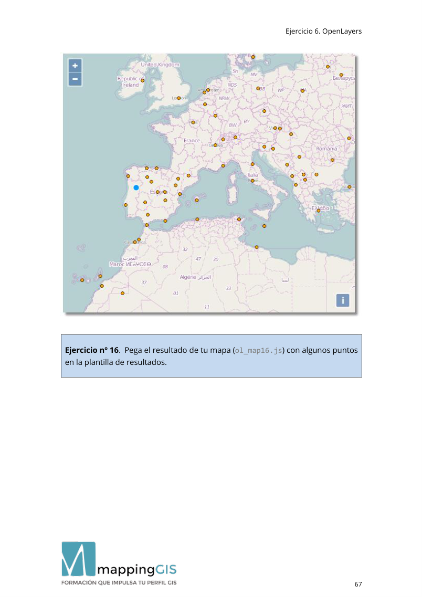</a></details>

[Consultar en el PDF · página 67](../materiales/Ejercicio_6_OpenLayers_2025-v3.pdf#page=67){target="_blank" rel="noopener noreferrer"}

