# Unidad 7 · Componer recursos con MapStore

<div class="visual-hero"><div class="eyebrow">Unidad 07 / Piloto visual</div><h2>De una colección de capas<br>a una experiencia de consulta.</h2><p>Organiza mapas, filtros, gráficos y permisos. Diferencia un mapa, un panel, una historia y un contexto de aplicación.</p><p>Servicios → recursos → permisos → filtros → contextos</p></div>

Síntesis visual de las clases, con diagramas originales para explicar los conceptos. La práctica se conserva al final de esta misma unidad.

## 1. Servicios y recursos

<figure class="lesson-figure"><a href="../../assets/unidad-7/recursos.svg" target="_blank" rel="noopener">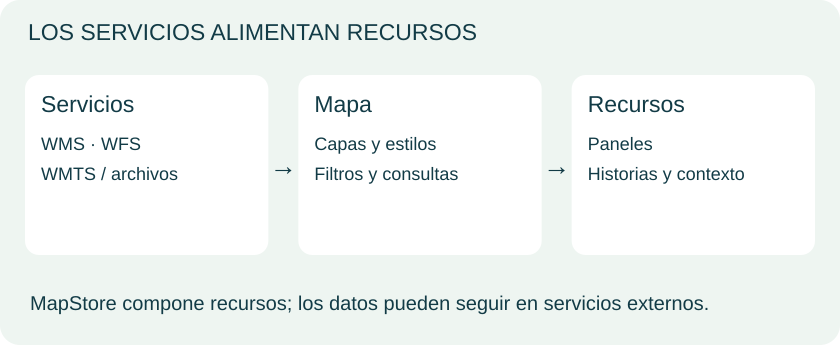</a></figure>

MapStore crea, gestiona y comparte recursos geográficos. Puede utilizarse como producto configurable y como base para desarrollos. Integra servicios y archivos compatibles; no exige copiar todos los datos a un único lugar.

| Recurso | Finalidad |
|---|---|
| Mapa | Explorar, consultar y filtrar |
| Panel | Combinar mapas y widgets |
| Historia | Lectura narrativa y multimedia |
| Contexto | Configurar visor y herramientas |

La tabla de contenidos organiza capas. Opacidad, estilos, filtros y consultas dependen de versión, complementos, datos y permisos.

<p class="content-source"><strong>Fuente del apartado:</strong> <a href="../../materiales/Unidad7_webmapping.pdf">MappingGIS · Unidad7_webmapping.pdf</a><br><strong>Ampliación y precisión técnica:</strong> <a href="https://docs.mapstore.geosolutionsgroup.com/en/latest/user-guide/home-page/">MapStore · guía de usuario</a>.</p>

## 2. Diseñar un panel

<figure class="lesson-figure"><a href="../../assets/unidad-7/dashboard.svg" target="_blank" rel="noopener">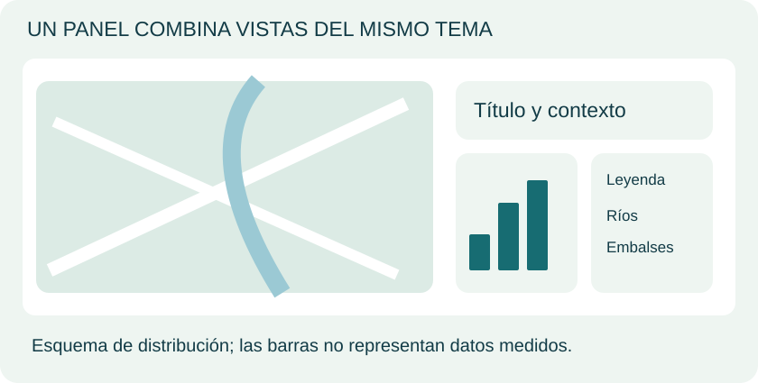</a></figure>

El mapa aporta ubicación; una tabla permite leer registros; un gráfico resume patrones; el texto explica alcance y la leyenda aclara símbolos.

Los widgets pueden incluir tablas, gráficos, contadores o textos. Revisa de qué capa y selección procede cada resultado. Una cifra pierde sentido si se desconoce su universo de datos.

El gráfico es una maqueta sin valores reales. La práctica pide un panel con mapa, leyenda y texto o título: no se añaden requisitos a esa entrega.

<p class="content-source"><strong>Fuente del apartado:</strong> <a href="../../materiales/Unidad7_webmapping.pdf">MappingGIS · Unidad7_webmapping.pdf</a><br><strong>Ampliación y precisión técnica:</strong> <a href="https://docs.mapstore.geosolutionsgroup.com/en/latest/user-guide/home-page/">MapStore · guía de usuario</a>.</p>

## 3. Usuarios, roles y permisos

<figure class="lesson-figure"><a href="../../assets/unidad-7/permisos.svg" target="_blank" rel="noopener">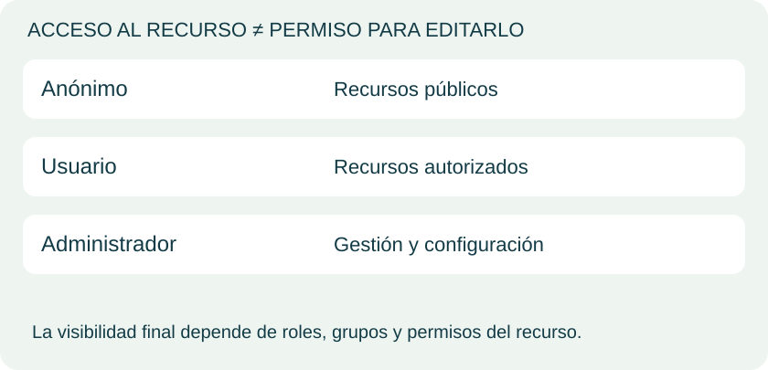</a></figure>

El curso distingue usuarios anónimos, registrados y administradores. Los roles se combinan con permisos de recursos y grupos para determinar quién ve, edita o administra.

Compartir una URL no vuelve público un mapa restringido. Revisa acceso y contexto de quien abrirá el enlace. Guardar y compartir son operaciones distintas.

Las capturas corresponden al entorno de clase. Este piloto no crea usuarios, modifica permisos ni expone tu servidor local.

<p class="content-source"><strong>Fuente del apartado:</strong> <a href="../../materiales/Unidad7_webmapping.pdf">MappingGIS · Unidad7_webmapping.pdf</a><br><strong>Ampliación y precisión técnica:</strong> <a href="https://docs.mapstore.geosolutionsgroup.com/en/latest/user-guide/home-page/">MapStore · guía de usuario</a>.</p>

## 4. Filtros, atributos y widgets

<figure class="lesson-figure"><a href="../../assets/unidad-7/filtros.svg" target="_blank" rel="noopener">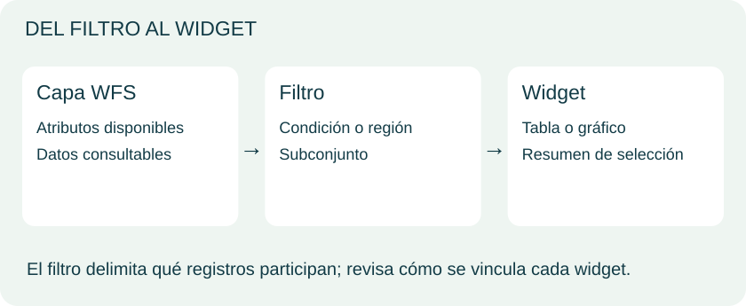</a></figure>

Una condición por atributos o una región de interés delimita registros. El curso combina una capa WFS, un filtro y un widget para construir una consulta visual.

Ocultar una capa cambia la representación; filtrar sus entidades decide cuáles participan. La tabla permite examinar los valores detrás del mapa.

Las anotaciones incorporan puntos, textos o polígonos. La práctica exporta una anotación para usarla en Leaflet y conectar la composición visual con el desarrollo estudiado antes.

<p class="content-source"><strong>Fuente del apartado:</strong> <a href="../../materiales/Unidad7_webmapping.pdf">MappingGIS · Unidad7_webmapping.pdf</a><br><strong>Ampliación y precisión técnica:</strong> <a href="https://docs.mapstore.geosolutionsgroup.com/en/latest/user-guide/home-page/">MapStore · guía de usuario</a>.</p>

## 5. Contextos e historias

<figure class="lesson-figure"><a href="../../assets/unidad-7/contexto.svg" target="_blank" rel="noopener">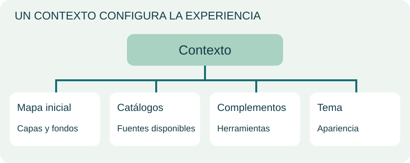</a></figure>

Un contexto define mapa inicial, catálogos, complementos y apariencia. Permite preparar herramientas para un público concreto.

Una historia organiza texto, imágenes y mapas en secuencia; un panel favorece la consulta simultánea. Ambos requieren guardar y comprobar recursos vinculados.

Los **9 ejercicios originales** conservan sus tareas de usuarios, mapas, anotaciones, filtros, exportación, contexto y panel. No se añaden actividades al curso.

<p class="content-source"><strong>Fuente del apartado:</strong> <a href="../../materiales/Unidad7_webmapping.pdf">MappingGIS · Unidad7_webmapping.pdf</a><br><strong>Ampliación y precisión técnica:</strong> <a href="https://docs.mapstore.geosolutionsgroup.com/en/latest/user-guide/home-page/">MapStore · guía de usuario</a>.</p>

## Material y referencias

- [Unidad7_webmapping.pdf](../materiales/Unidad7_webmapping.pdf) · material original.

Ampliación técnica: [Guía oficial de MapStore](https://docs.mapstore.geosolutionsgroup.com/en/latest/user-guide/home-page/). Las versiones e interfaces del PDF corresponden al entorno de las clases; los diagramas muestran conceptos.


## Ejercicio Unidad 7 {#ejercicios-originales-del-curso}

Enunciados y contexto de los PDF de MappingGIS. No se añaden actividades ni soluciones. Los paneles incluyen los pasos originales dentro de la unidad; el PDF conserva la maquetación completa.

**Práctica:** [PDF original completo](../materiales/Ejercicio_7_MapStore-2025-v4.pdf){target="_blank" rel="noopener noreferrer"}.

### Ejercicio 1 · Iniciar como administrador

<div class="original-statement"><span class="eyebrow">Enunciado original · Práctica</span><p>Inicia sesión como USUARIO ADMINISTRADOR y haz una captura de pantalla de la página completa de MapStore. Pega la imagen obtenida en la hoja de ejercicios.</p></div>

<details class="original-exercise" markdown="1">
<summary>Pasos y contexto originales de la clase</summary>

**Página 3**

```text
Unidad 7.MapStore: Personalizar mapas, trabajar con datos y creación de paneles de control. 
 
                                                                                                  3 
MapStore 
 
La herramienta MapStore nos sirve para para sacar el máximo apro vechamiento a 
las capas alojadas en GeoS erver sin necesidad de programar, permitiéndonos 
construir un framework WebGIS.   
Las principales características de MapStore son: 
- La excelente gestión de los servicios OGC (CSW, WFS, WMS y WMTS). 
- La administración de usuarios, permitiendo la creación de usuarios, grupos 
de usuarios y roles. 
- La posibilidad de crear paneles de control (dashboards) con un  Look & 
Feel moderno. 
- Es una herramienta en pleno desarrollo y actualización permanente. 
- Es de código libre por lo que su desarrollo y personalización son casi totales. 
 
Podemos dividir MapStore en 5 áreas: 
1.- Gestión de usuarios y grupos. 
2.- Gestión de contextos.  
3.- Creación y edición de Mapas. 
4.- Panel de control o dashboard. 
5.- Stories. 
 
Veremos ejemplos de las herramientas más útiles de MapStore en los capítulos 
siguientes. 
Descarga e instalación de MapStore 
 
En el menú de la página de inicio de MapStore 
https://mapstore.readthedocs.io/en/latest/ veremos en su parte derecha la opción 
de descargas.
```

**Página 4**

```text
Unidad 7.MapStore: Personalizar mapas, trabajar con datos y creación de paneles de control. 
 
                                                                                                  4 
 
Al hacer clic sobre Downloads se nos abre la página de descargas de MapStore. Está 
disponible para Linux y para Windows y se pueden hacer dos tipos de instalación: 
- Instalación desde un paquete binario 
- Instalación mediante un archivo WAR. 
 
Vamos a realizar una instalación mediante un archivo bin comprimido por lo tanto 
será la opción que elijamos en la página de descargas. Nos movemos por la página 
de MapStore hasta encontrar el apartado Assets. Seleccionamos el archivo bin de la 
versión actual.
```

**Página 5**

```text
Unidad 7.MapStore: Personalizar mapas, trabajar con datos y creación de paneles de control. 
 
                                                                                                  5 
 
Una vez finalizada la descarga del archivo procedemos a descomprimir el archivo 
.zip. 
 
 Nos creará una carpeta llamada mapstore2 que contiene lo siguiente. 
 
Hay que abrir el archivo mapstore2-startup.bat 
MapStore utiliza un servidor Apache Tomcat, el archivo startup.bat se encarga de 
iniciar el servidor. Cada vez que queramos trabajar con MapStore hay que abrir 
el servidor. Al abrir este archivo se abren dos ventanas del símbolo de sistemas con 
la información del proceso.
```

**Página 6**

```text
Unidad 7.MapStore: Personalizar mapas, trabajar con datos y creación de paneles de control. 
 
                                                                                                  6 
 
Una vez finalizada la operación escribimos en la barra de nuestro de navegador. 
http://localhost:8082/mapstore 
Se nos abre en el navegador la vista de inicio de MapStore. 
 
MapStore utiliza Java. Si estamos utilizando el mismo equipo que en los temas 
anteriores, es decir en el que tenemos la instalación de Geo Server, no habrá que 
hacer ninguna operación adicional, con la configuración que tenemos será 
suficiente. Si trabajamos en un equipo diferente o tienes algún problema al iniciar 
MapStore hay que comprobar que la variable de entorno JAVA_HOME está bien 
configurada. En ese caso debemos acudir al Panel de Control  Sistema  
Configuración avanza da del Sistema  y comprobar las variables de entorno. 
Obtendremos una vista como la que sigue:
```

**Página 7**

```text
Unidad 7.MapStore: Personalizar mapas, trabajar con datos y creación de paneles de control. 
 
                                                                                                  7 
 
Aquí tenemos que comprobar que la variable JAVA_HOME apunta a nuestro JRE. 
Nota: Cuando iniciamos sesión con MapStore al abrir un mapa preguntará el 
navegador si permitimos acceder a la ubicación: 
 
Es conveniente permitir el acceso, porque si no lo hacemos habrá algunas opciones, 
como la identificación de elementos del mapa, que no estarán activas.
```

**Página 8**

```text
Unidad 7.MapStore: Personalizar mapas, trabajar con datos y creación de paneles de control. 
 
                                                                                                  8 
Gestión de usuarios MapStore 
 
Abordamos ahora la creación y gestión de usuarios en MapStore. La página de inicio 
de MapStore nos muestra en la barra de menú un icono para seleccionar el idioma 
y a su lado otro para el usuario.  El icono azul hace referencia a un USUARIO 
ANÓNIMO. 
 
Al hacer clic sobre el icono del usuario nos abre el menú de INICIAR SESION y al 
abrirlo nos despliega la ventana de Login.  Al instalar MapStore se ha creado un 
usuario por defecto con rol de administrador. 
 
El nombre de usuario es: admin 
Clave: admin 
No será necesario escribir nada en esta ocasión. Cuando tengamos varios usuarios 
tendremos que elegir alguno de las opciones que nos ofrezca. Ahora hacemos clic 
sobre Login y entonces pasamos a estar como USUARIO ADMINISTRADOR (icono 
de usuario de color verde). 
Se nos abre una nueva página de MapStore con algunas novedades.
```

**Página 9**

```text
Unidad 7.MapStore: Personalizar mapas, trabajar con datos y creación de paneles de control. 
 
                                                                                                  9 
 
Vemos que además del mapa inicial ahora nos muestra otro llamado user Map. Pero 
sobre todo vemos un nuevo botón. 
 
Este botón nos permite entre otros crear un nuevo mapa, un nuevo contexto o una 
geohistoria. 
 
Ejercicio nº1. Inicia sesión como USUARIO ADMINISTRADOR y haz una captura de 
pantalla de la página completa de MapStore. Pega la imagen obtenida en la hoja 
de ejercicios.
```

</details>

<details class="source-page"><summary>Ver página 9 del PDF original, con sus capturas</summary><a href="../../materiales/Ejercicio_7_MapStore-2025-v4.pdf#page=9" target="_blank" rel="noopener">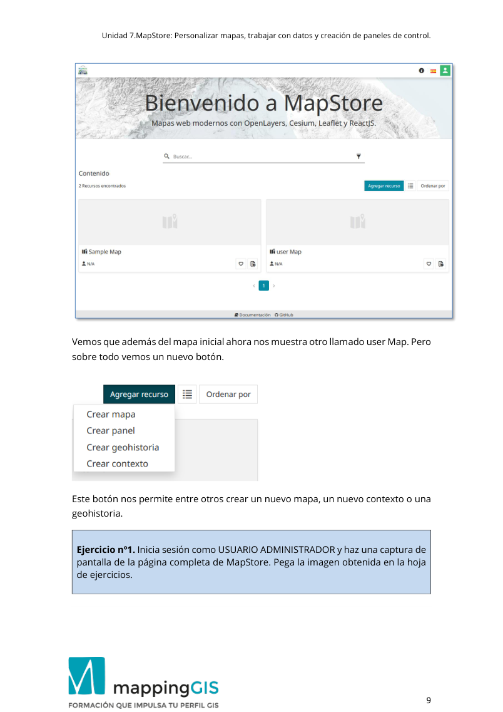</a></details>

[Consultar en el PDF · página 9](../materiales/Ejercicio_7_MapStore-2025-v4.pdf#page=9){target="_blank" rel="noopener noreferrer"}

### Ejercicio 2 · Crear usuario

<div class="original-statement"><span class="eyebrow">Enunciado original · Práctica</span><p>Haz una captura d e pantalla del Administrador de Usuarios de MapStore en que se vea el usuario creado y pégala en la hoja de ejercicios.</p></div>

<details class="original-exercise" markdown="1">
<summary>Pasos y contexto originales de la clase</summary>

**Página 9**

```text
Unidad 7.MapStore: Personalizar mapas, trabajar con datos y creación de paneles de control. 
 
                                                                                                  9 
 
Vemos que además del mapa inicial ahora nos muestra otro llamado user Map. Pero 
sobre todo vemos un nuevo botón. 
 
Este botón nos permite entre otros crear un nuevo mapa, un nuevo contexto o una 
geohistoria. 
 
Ejercicio nº1. Inicia sesión como USUARIO ADMINISTRADOR y haz una captura de 
pantalla de la página completa de MapStore. Pega la imagen obtenida en la hoja 
de ejercicios.
```

**Página 10**

```text
Unidad 7.MapStore: Personalizar mapas, trabajar con datos y creación de paneles de control. 
 
                                                                                                  10 
Crear un nuevo usuario 
 
Hacemos clic sobre el icono de usuario de colore verde para desplegar las opciones. 
 
Al hacer clic sobre “ Administrador de cuentas de usuario ” del botón Manager, 
MapStore nos ofrece una nueva vista con los usuarios disponibles. 
 
Vamos a crear un nuevo usuario, para lo cual hacemos clic sobre el botón “Nuevo” 
y completamos los datos del usuario. 
En nombre de usuario escribimos alumno y en clave también escribimos alumno. 
Nos permite elegir entre USER o ADMIN. En esta ocasión vamos a crear un usuario 
normal que no sea administrador por lo que elegimos la opción USER.
```

**Página 11**

```text
Unidad 7.MapStore: Personalizar mapas, trabajar con datos y creación de paneles de control. 
 
                                                                                                  11 
 
Haz clic sobre Crear cuando lo tengas. 
Se habrá creado un nuevo usuario que podemos ver en la vista de usuarios.  
Administrar grupos de usuarios 
 
En el menú superior elegimos la opción Grupos. MapStore nos muestra los grupos 
actuales. 
 
Haz clic en “Nuevo grupo” para crear un grupo nuevo.
```

**Página 12**

```text
Unidad 7.MapStore: Personalizar mapas, trabajar con datos y creación de paneles de control. 
 
                                                                                                  12 
 
 
 
Tenemos que escribir un nombre para el grupo, por ejemplo: Mappinggis. 
En la pestaña siguiente podemos asignar usuarios al grupo. 
 
 
Aquí seleccionamos alguno de los usuarios, en el ejemplo que estamos haciendo 
seleccionamos al usuario “alumno” que habíamos creado antes. 
Para terminar, hacemos clic en el botón “Guardar”.
```

**Página 13**

```text
Unidad 7.MapStore: Personalizar mapas, trabajar con datos y creación de paneles de control. 
 
                                                                                                  13 
Regresa ahora de nuevo a “ Administrar usuarios”. Debes ver el usuario alumno 
con los dos grupos a los que pertenece . Además, en la parte inferior del control se 
muestran los iconos para editar el usuario o borrarlo. 
 
 
Ejercicio nº 2. Haz una captura d e pantalla del Administrador de Usuarios de 
MapStore en que se vea el usuario creado y pégala en la hoja de ejercicios. 
 
 
Trabajando con usuarios y roles 
 
En esta sección veremos cómo se asigna a un mapa un usuario y sobre todo un rol, 
es decir qué permisos dispone cada usuario para realizar tareas en el mapa. 
Vuelve ahora a la página de inicio. Estando como usuario administrador, es decir 
con rol: Admin, vemos dos mapas con sus correspondientes herramientas : abrir 
propiedades, añadir a favoritos, compartir y borrar. 
 
 
Si ahora cerrásemos la sesión como administrador y la abriésemos como el usuario 
alumno que creamos anteriormente solo veríamos el mapa Sample Map pero no el 
mapa user Map. Esto se debe a que el grupo de usuario Mappinggis no está 
autorizado para ver user Map. Para asignar grupos de usuarios a un mapa tenemos 
que utilizar la herramienta de edición.
```

</details>

<details class="source-page"><summary>Ver página 13 del PDF original, con sus capturas</summary><a href="../../materiales/Ejercicio_7_MapStore-2025-v4.pdf#page=13" target="_blank" rel="noopener">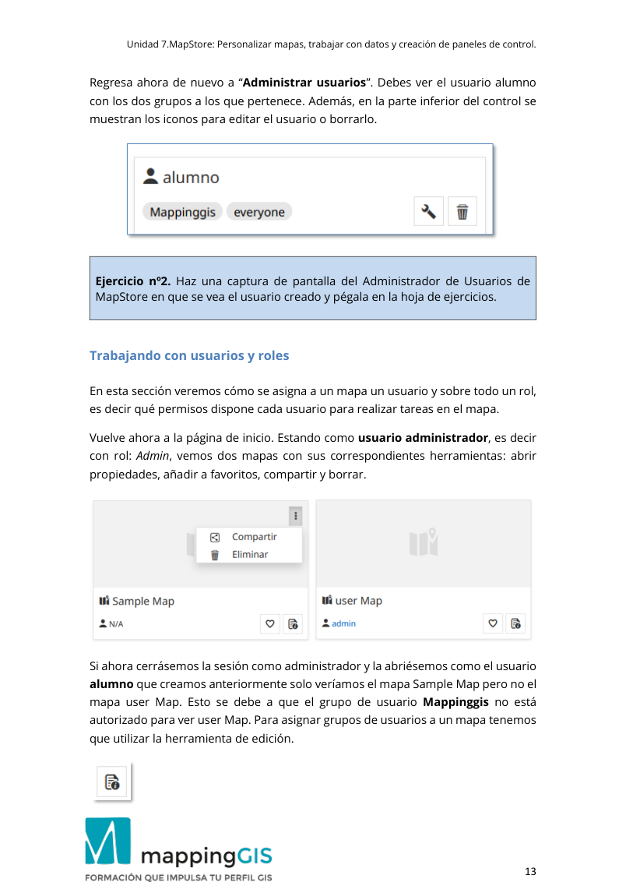</a></details>

[Consultar en el PDF · página 13](../materiales/Ejercicio_7_MapStore-2025-v4.pdf#page=13){target="_blank" rel="noopener noreferrer"}

### Ejercicio 3 · Mapa con servicios

<div class="original-statement"><span class="eyebrow">Enunciado original · Práctica</span><p>Crea un nuevo mapa en MapStore, utilizando la herramienta de “Catálogo” e incorpora las capas cities, countries y rivers. Haz una captura d e pantalla del mapa y pégala en la hoja de ejercicios.</p></div>

<details class="original-exercise" markdown="1">
<summary>Pasos y contexto originales de la clase</summary>

**Página 13**

```text
Unidad 7.MapStore: Personalizar mapas, trabajar con datos y creación de paneles de control. 
 
                                                                                                  13 
Regresa ahora de nuevo a “ Administrar usuarios”. Debes ver el usuario alumno 
con los dos grupos a los que pertenece . Además, en la parte inferior del control se 
muestran los iconos para editar el usuario o borrarlo. 
 
 
Ejercicio nº 2. Haz una captura d e pantalla del Administrador de Usuarios de 
MapStore en que se vea el usuario creado y pégala en la hoja de ejercicios. 
 
 
Trabajando con usuarios y roles 
 
En esta sección veremos cómo se asigna a un mapa un usuario y sobre todo un rol, 
es decir qué permisos dispone cada usuario para realizar tareas en el mapa. 
Vuelve ahora a la página de inicio. Estando como usuario administrador, es decir 
con rol: Admin, vemos dos mapas con sus correspondientes herramientas : abrir 
propiedades, añadir a favoritos, compartir y borrar. 
 
 
Si ahora cerrásemos la sesión como administrador y la abriésemos como el usuario 
alumno que creamos anteriormente solo veríamos el mapa Sample Map pero no el 
mapa user Map. Esto se debe a que el grupo de usuario Mappinggis no está 
autorizado para ver user Map. Para asignar grupos de usuarios a un mapa tenemos 
que utilizar la herramienta de edición.
```

**Página 14**

```text
Unidad 7.MapStore: Personalizar mapas, trabajar con datos y creación de paneles de control. 
 
                                                                                                  14 
Haz clic sobre este icono en user Map.  Se nos abre una nueva ventana con 
información sobre el mapa, y un menú. 
 
 
Seleccionamos el menú “Permisos”. 
 
Hacemos clic en el botón situado en la parte superior derecha.  
Se abre un nuevo menú donde podemos añadir el grupo Mappinggis haciendo clic 
sobre el signo + que tiene a su lado.
```

**Página 15**

```text
Unidad 7.MapStore: Personalizar mapas, trabajar con datos y creación de paneles de control. 
 
                                                                                                  15 
 
Después de añadir el grupo lo podemos ver en la lista. 
Para finalizar debemos hacer clic en el botón “Aplicar los cambios”. 
Lo que hemos h echo con los pasos anteriores es asignar un rol a el mapa , de tal 
manera que esté disponible para el usuario alumno.
```

**Página 16**

```text
Unidad 7.MapStore: Personalizar mapas, trabajar con datos y creación de paneles de control. 
 
                                                                                                  16 
Cierra la sesión de administrador y abre otra nueva como usuario alumno. 
 
 
 
Ahora MapStore nos muestra los dos mapas, pero a diferencia de cuando se accede 
como administrador (admin) no disponemos de todas las opciones. 
Por ejemplo, si accedes al menú con el símbolo de los tres puntos verás que solo 
tiene la opción compartir, pero no tiene la de borrar. 
 
Y si accedes a “Abrir propiedades” verás que solo ofrece el menú con la 
información del mapa, pero no el de permisos.
```

**Página 17**

```text
Unidad 7.MapStore: Personalizar mapas, trabajar con datos y creación de paneles de control. 
 
                                                                                                  17 
Interfaz de MapStore 
 
Si a ccedemos a MapStore como usuario administrador y abrimos el mapa: user 
Map, obtenemos la vista siguiente: 
 
Esta vista nos proporciona un mapa ba se de OpenStreetMap con los diferente s 
menús de MapStore. 
Comenzamos la descripción de la interfaz de MapStore fijándonos en la parte 
superior. Los dos primeros son los botones para regresar a la página de inicio y el 
icono del menú de usuario. 
 
Aquí también nos encontramos con la opción del idioma y con el botón “Acerca de…” 
que nos ofrece información sobre la versión de MapStore. 
En la vista de mapas de MapStore hay una barra de utilidades con las siguientes 
opciones:
```

**Página 18**

```text
Unidad 7.MapStore: Personalizar mapas, trabajar con datos y creación de paneles de control. 
 
                                                                                                  18 
-  Mostrar posición . Al hacer cli c sobre este botón se da la posición del 
usuario. 
-  Acercar o Zoom +  
-  Alejar o Zoom – 
-  Pantalla completa. 
-  Ajustar a la máxima extensión. 
-  Modo 3D, visualización con Cesium. 
-  Expandir/replegar, que muestra nuevas opciones. 
Entre estas opciones que muestra el botón expandir/replegar una muy interesante 
es la que nos ofrece la posibilidad de Buscar objetos en el mapa . Si est á activa 
aparece de color verde: 
  
 
Es interesante también el menú de pie de página, que contiene una escala gráfica 
y una escala numérica que además permite elegir la escala. Cuando el icono del 
mouse está verde muestra las coordenadas de la posición del ratón. Si el icono está 
de color azul las oculta. El botón situado más a la derecha permite elegir el sistema 
de coordenadas.
```

**Página 19**

```text
Unidad 7.MapStore: Personalizar mapas, trabajar con datos y creación de paneles de control. 
 
                                                                                                  19 
 
 
En la página de MapStore veremos también un menú lateral situado a la derecha 
que contiene las utilidades de MapStore.  
 
En la barra de menú superior encontramos:
```

**Página 20**

```text
Unidad 7.MapStore: Personalizar mapas, trabajar con datos y creación de paneles de control. 
 
                                                                                                  20 
En la esquina inferior izquierda del mapa verás una ventana con el mapa de fondo, 
que por defecto es OpenStreetMap. Al hacer clic sobre él nos despliega una 
ventana donde podremos seleccionar otro mapa de fondo 
 
Iremos viendo algunas de estas herramientas en los capítulos siguientes. 
Creación y edición de mapas con MapStore 
 
Una de las ventajas de MapStore es la facilidad que tiene para incorporar servicios 
OGC como WMS o WFS. Empezaremos creando un mapa que incorpore alguno de 
estos servicios. 
Acceso a nuestros datos de GeoServer mediante WMS 
 
El botón que vamos a utilizar para añadir la capa WMS es Agregar capas al mapa. 
 
 Esta opción es la que nos permite añadir servicios OGC como los que proporciona 
GeoServer. Una de las características principales de MapStore es su perfecta 
conexión con Geo Server ya que está diseñado especialmente para trabajar con 
servicios WMS, WFS, etc…
```

**Página 21**

```text
Unidad 7.MapStore: Personalizar mapas, trabajar con datos y creación de paneles de control. 
 
                                                                                                  21 
 
Al pinchar sobre el signo + creamos un nuevo servicio. 
En Url, escribimos la url del servicio wms, por ejemplo 
http://localhost:8080/geoserver/wms 
En tipo seleccionamos WMS y escribimos un título.
```

**Página 22**

```text
Unidad 7.MapStore: Personalizar mapas, trabajar con datos y creación de paneles de control. 
 
                                                                                                  22 
Haz clic en el botón Guardar. 
Una vez creado el servicio accedemos a él mediante el botón buscar. Nos tiene que 
aparecer todas las capas de GeoServer. 
 
Buscamos la capa y con el botón  la añadimos al mapa. 
Añade de esta forma al mapa las capas: cities, countries y rivers. 
Nota importante. Para poder crear un nuevo catálogo, GeoServer debe estar 
abierto. Si no lo está debes inicializarlo, porque de lo contrario obtendrás un 
error en la conexión.
```

**Página 23**

```text
Unidad 7.MapStore: Personalizar mapas, trabajar con datos y creación de paneles de control. 
 
                                                                                                  23 
 
Si al intentar cargar alguna de las capas obtienes un mensaje de error como el 
siguiente: 
 
Este aviso se produce porque tu mapa de MapStore no está en el sistema de 
coordenadas de las capas de GeoServer. En ese caso haz clic en el icono de 
selección de proyección y selecciona EPSG:4326 
 
 
Hay que guardar los cambios realizados , para ello v olvemos al menú y vamos a 
guardar como.
```

**Página 24**

```text
Unidad 7.MapStore: Personalizar mapas, trabajar con datos y creación de paneles de control. 
 
                                                                                                  24 
Damos un nombre y hacemos clic en “Crear”. 
 
En la página de in icio de MapStore ahora tendremos el nuevo mapa que hemos 
creado. 
Con el fin de optimizar la visualiz ación de las capas se puede fijar el orden de las 
mismas y su transparencia. Esto se hace desde el menú de capas  situado a la 
izquierda de la vista. 
 
Haz clic sobre el botón para abrir el menú.
```

**Página 25**

```text
Unidad 7.MapStore: Personalizar mapas, trabajar con datos y creación de paneles de control. 
 
                                                                                                  25 
 
Sitúate con el ratón sobre los puntos que hay junto al nombre de la capa.  
Verás un marcador con forma de mano  que permite mover la capa. Arrastra de 
esta forma la capa cities para ponerla en la parte de arriba. 
Mueve también el cursor para asignar la opacidad de la capa. Actuando sobre el 
icono > situado a la derecha del nombre de la capa vemos su leyenda. 
 
Guarda el mapa antes de salir.  
 
Ejercicio nº3. Crea un nuevo mapa en MapStore, utilizando la herramienta de 
“Catálogo” e incorpora las capas  cities, countries y rivers. Haz una captura d e 
pantalla del mapa y pégala en la hoja de ejercicios.
```

</details>

<details class="source-page"><summary>Ver página 25 del PDF original, con sus capturas</summary><a href="../../materiales/Ejercicio_7_MapStore-2025-v4.pdf#page=25" target="_blank" rel="noopener">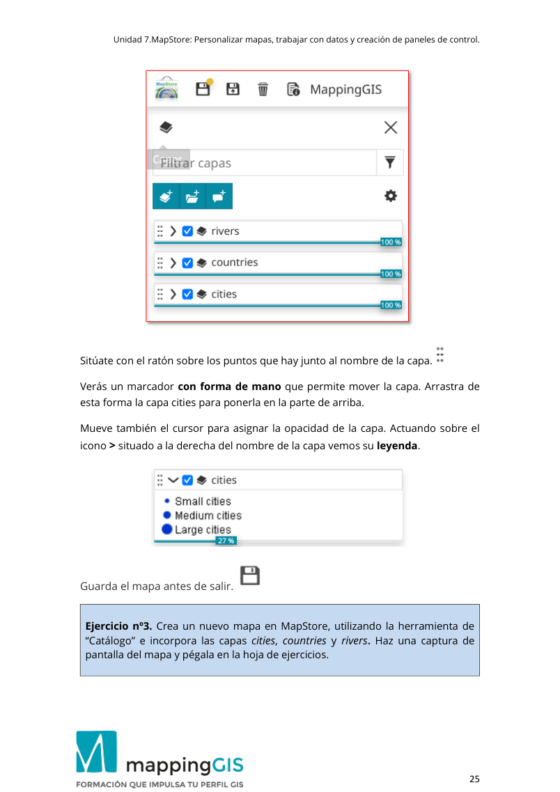</a></details>

[Consultar en el PDF · página 25](../materiales/Ejercicio_7_MapStore-2025-v4.pdf#page=25){target="_blank" rel="noopener noreferrer"}

### Ejercicio 4 · Anotación

<div class="original-statement"><span class="eyebrow">Enunciado original · Práctica</span><p>Crea una anotación de l tipo que desees (polígono, texto, marcador…) personaliza su estilo y gu árdala. Haz una captura de pantalla del mapa con la anotación y pégala en la hoja de ejercicios.</p></div>

<details class="original-exercise" markdown="1">
<summary>Pasos y contexto originales de la clase</summary>

**Página 25**

```text
Unidad 7.MapStore: Personalizar mapas, trabajar con datos y creación de paneles de control. 
 
                                                                                                  25 
 
Sitúate con el ratón sobre los puntos que hay junto al nombre de la capa.  
Verás un marcador con forma de mano  que permite mover la capa. Arrastra de 
esta forma la capa cities para ponerla en la parte de arriba. 
Mueve también el cursor para asignar la opacidad de la capa. Actuando sobre el 
icono > situado a la derecha del nombre de la capa vemos su leyenda. 
 
Guarda el mapa antes de salir.  
 
Ejercicio nº3. Crea un nuevo mapa en MapStore, utilizando la herramienta de 
“Catálogo” e incorpora las capas  cities, countries y rivers. Haz una captura d e 
pantalla del mapa y pégala en la hoja de ejercicios.
```

**Página 26**

```text
Unidad 7.MapStore: Personalizar mapas, trabajar con datos y creación de paneles de control. 
 
                                                                                                  26 
Creación de Anotaciones 
 
MapStore permite dibujar elementos sobre el mapa de forma rápida y sencilla. Las 
geometrías que podemos dibujar son; marcadores, líneas, polígonos, textos o 
círculos. Es una herramienta interesante porque los elementos creados pueden ser 
exportados, por lo que podemos compartir esas geometrías. 
Desde la página de in icio de MapStore iniciamos un nuevo mapa haciendo clic en 
user Map. 
Una vez abierto el mapa crearemos una anotación. 
En el bo tón de capas situado en la esquina superior izquierda  encontramos la 
opción correspondiente. 
 
Haz clic sobre el botón anotaciones. 
 
Ahora se abrirá el menú para crear una nueva anotación.
```

**Página 27**

```text
Unidad 7.MapStore: Personalizar mapas, trabajar con datos y creación de paneles de control. 
 
                                                                                                  27 
Escribe un título y una descripción. A continuación , haz clic sobre  el menú 
“Geometrías”. 
  
Selecciona el icono del marcador.  
Podremos navegar por el mapa hasta elegir el lugar en que deseamos dibujar el 
marcador. Hacemos clic sobre el punto y sus coordenadas se transmiten al 
formulario de las anotaciones. 
 
Luego puedes ir al menú de “Estilo” para definir los estilos de la geometría.
```

**Página 28**

```text
Unidad 7.MapStore: Personalizar mapas, trabajar con datos y creación de paneles de control. 
 
                                                                                                  28 
Elige una de las geometrías, como por ejemplo el polígono.  Dibuja el polígono 
directamente sobre el mapa. 
 
Cuando hayas terminado de dibujar debes guardar el mapa.  
  
Haz luego clic en “Crear” para guardar el mapa. 
 
 
Ejercicio nº 4. Crea una anotación de l tipo que desees (polígono, texto, 
marcador…) personaliza su estilo y gu árdala. Haz una captura de pantalla del 
mapa con la anotación y pégala en la hoja de ejercicios.
```

</details>

<details class="source-page"><summary>Ver página 28 del PDF original, con sus capturas</summary><a href="../../materiales/Ejercicio_7_MapStore-2025-v4.pdf#page=28" target="_blank" rel="noopener">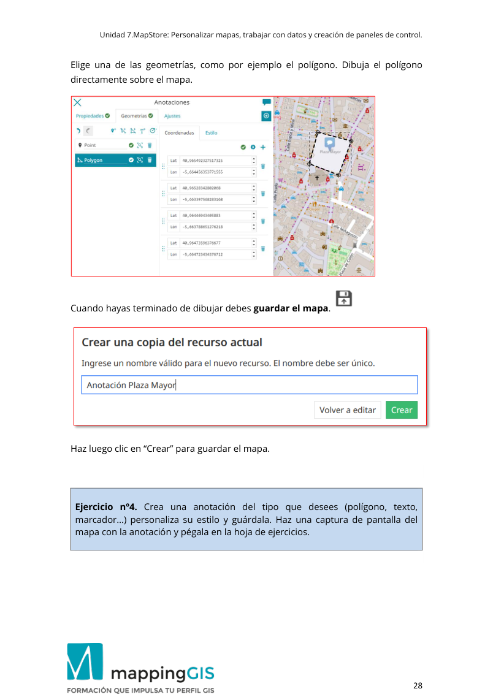</a></details>

[Consultar en el PDF · página 28](../materiales/Ejercicio_7_MapStore-2025-v4.pdf#page=28){target="_blank" rel="noopener noreferrer"}

### Ejercicio 5 · Importar GeoJSON

<div class="original-statement"><span class="eyebrow">Enunciado original · Práctica</span><p>Importa el archivo SalamancaMonumental.geojson asigna un estilo y haz una captura de pantalla de la nueva capa. Pégala en la hoja de ejercicios.</p></div>

<details class="original-exercise" markdown="1">
<summary>Pasos y contexto originales de la clase</summary>

**Página 28**

```text
Unidad 7.MapStore: Personalizar mapas, trabajar con datos y creación de paneles de control. 
 
                                                                                                  28 
Elige una de las geometrías, como por ejemplo el polígono.  Dibuja el polígono 
directamente sobre el mapa. 
 
Cuando hayas terminado de dibujar debes guardar el mapa.  
  
Haz luego clic en “Crear” para guardar el mapa. 
 
 
Ejercicio nº 4. Crea una anotación de l tipo que desees (polígono, texto, 
marcador…) personaliza su estilo y gu árdala. Haz una captura de pantalla del 
mapa con la anotación y pégala en la hoja de ejercicios.
```

**Página 29**

```text
Unidad 7.MapStore: Personalizar mapas, trabajar con datos y creación de paneles de control. 
 
                                                                                                  29 
Importar capas locales 
 
MapStore nos permite añadir los datos geográficos de un archivo al mapa. Los 
formatos que permite incorporar son: KML, KMZ, GPX o GeoJSON. Veamos cómo se 
hace. 
En el menú elegimos importar. 
 
Se nos abre la ventana de importación de archivos. 
 
Vamos a importar un archivo en formato GeoJSON llamado 
SalamancaMonumental.geojson que puedes encontrar en la plataforma del curso 
en la carpeta correspondiente a la unidad de MapStore. 
Seleccionamos el archivo, buscándolo en la ruta donde lo hayamos guardado.
```

**Página 30**

```text
Unidad 7.MapStore: Personalizar mapas, trabajar con datos y creación de paneles de control. 
 
                                                                                                  30 
 
MapStore nos muestra una ventana donde podemos elegir el estilo de la nueva 
capa. Podemos elegir en forma de marcador como en la vista anterior 
seleccionando: Marker. 
También nos permite asignar un estilo en forma de círculo en donde podemos elegir 
el color y espesor del círculo y el color de relleno y tamaño del círculo. 
 
Haz clic en Terminar. 
Guarda el mapa. 
Hemos añadido de esta forma tan sencilla una nueva capa al mapa.
```

**Página 31**

```text
Unidad 7.MapStore: Personalizar mapas, trabajar con datos y creación de paneles de control. 
 
                                                                                                  31 
 
Seleccionando la capa en el menú de gestión de capas para habilitarla, podremos 
luego seleccionar cualquiera de los nuevos marcadores para que nos abr a un 
control a la derecha con sus datos. Esos datos son los que trae el archivo GeoJSON 
que hemos importado. Vemos también que la nueva capa se ha inc orporado en el 
control de capas de la izquierda. 
 
Si hacemos clic sobre el botón de información, nos muestra también la dirección 
del punto sel eccionado, obtenida de la base de datos Nominatin de 
OpenStreetMap.
```

**Página 32**

```text
Unidad 7.MapStore: Personalizar mapas, trabajar con datos y creación de paneles de control. 
 
                                                                                                  32 
 
 
Ejercicio nº5. Importa el archivo SalamancaMonumental.geojson asigna un estilo 
y haz una captura de pantalla de la nueva capa. Pégala en la hoja de ejercicios.
```

</details>

<details class="source-page"><summary>Ver página 32 del PDF original, con sus capturas</summary><a href="../../materiales/Ejercicio_7_MapStore-2025-v4.pdf#page=32" target="_blank" rel="noopener">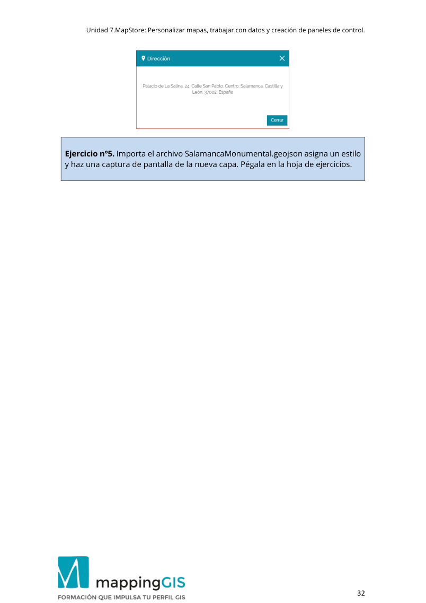</a></details>

[Consultar en el PDF · página 32](../materiales/Ejercicio_7_MapStore-2025-v4.pdf#page=32){target="_blank" rel="noopener noreferrer"}

### Ejercicio 6 · Filtro y widget

<div class="original-statement"><span class="eyebrow">Enunciado original · Práctica</span><p>Sobre l a capa WFS c ities, crea un nu evo filtro por sov0name=United States . Crea un widget de gráfico a partir del filtro e incorpóralo al mapa. Haz una captura de pantalla y pégala en la hoja de ejercicios.</p></div>

<details class="original-exercise" markdown="1">
<summary>Pasos y contexto originales de la clase</summary>

**Página 32**

```text
Unidad 7.MapStore: Personalizar mapas, trabajar con datos y creación de paneles de control. 
 
                                                                                                  32 
 
 
Ejercicio nº5. Importa el archivo SalamancaMonumental.geojson asigna un estilo 
y haz una captura de pantalla de la nueva capa. Pégala en la hoja de ejercicios.
```

**Página 33**

```text
Unidad 7.MapStore: Personalizar mapas, trabajar con datos y creación de paneles de control. 
 
                                                                                                  33 
Gestión de capas 
 
Para trabajar con el gestor de capas vamos a utilizar el mapa que habíamos creado 
antes que contiene nuestras capas de GeoServer.  
La tabla de contenidos  nos ofrece las herramientas para gestionar las capas en 
MapStore. Inicialmente aparece minimizada por lo q ue para desplegarla hacemos 
clic en el botón situado en la esquina superior izquierda del mapa. 
 
Se nos abre una nueva ventana con las capas que contiene el mapa. 
 
Al seleccionar una de las capas, por ejemplo : cities, se muestra un nuevo 
menú que contiene las opciones de la capa.
```

**Página 34**

```text
Unidad 7.MapStore: Personalizar mapas, trabajar con datos y creación de paneles de control. 
 
                                                                                                  34 
 
 
Podemos hacer visible u ocultar cada una de las capas haciendo clic sobre el botón 
de ‘check’ azul que hay en cada capa . El menú que se abre al seleccionar una capa 
contiene lo siguiente: 
 
Según el tipo de capa que seleccionemos veremos más opciones o menos. 
Las opciones de este menú son: 
- Zoom a la extensión de la capa seleccionada. 
- Configuración de la capa seleccionada. 
- Filtrar capas. 
- Abrir tabla de atributos. 
- Eliminar capa seleccionada. 
- Crear un widget para la capa seleccionada. 
- Exportar datos de la capa.
```

**Página 35**

```text
Unidad 7.MapStore: Personalizar mapas, trabajar con datos y creación de paneles de control. 
 
                                                                                                  35 
Además si nos situamos sobre una de las capas del gestor de capas y 
hacemos clic con el botón derecho del ratón se abre un menú con opciones 
adicionales. 
 
Este menú nos aporta dos nuevas herramientas para visualizar los datos: 
- Vidrio espía, que tiene forma de círculo. 
- Golpe fuerte. Con este nombre tan poco afortunado a lo que se refiere es a 
crear una línea sobre el mapa de tal manera que a un lado oculte los 
elementos de la capa y al otro los muestre. 
Si seleccionamos alguna de estas opciones (Golpe fuerte, vidrio espía) nos 
muestra un icono junto al nombre de la capa en el gestor. 
 
Configurar se refiere a la configuración de estas herramientas. Abre una ventana 
para configurar el radio de la lupa o la dirección de la línea de Golpe fuerte
```

**Página 36**

```text
Unidad 7.MapStore: Personalizar mapas, trabajar con datos y creación de paneles de control. 
 
                                                                                                  36 
 
Puedes probar estas herramientas sobre la capa cities. Si seleccionas “Vidrio 
espía” al mover el cursor irán apareciendo y ocultándose ciudades. 
 
Gestión de estilos 
MapStore permite uti lizar los estilos definidos en G eoServer. Vamos a ver un 
ejemplo en que manejaremos los estilos que creamos para la capa ciudades cuando 
trabajamos con GeoServer. 
Entra en GeoServer y vete a “Capas”; selecciona: eart:cities
```

**Página 37**

```text
Unidad 7.MapStore: Personalizar mapas, trabajar con datos y creación de paneles de control. 
 
                                                                                                  37 
 
Haz clic en la pestaña Publicación. Desplázate hasta la parte de estilos. Selecciona 
en la ventana de la izquierda el estilo earth:cities_labels y haz clic sobre la flecha 
para trasladarlo al panel derecho. Cuando lo tengas desplázate al final de la página 
y dale a guardar. 
 
Con los pasos anteriores hemos asignado dos estilos a la capa ciudades. 
Vuelve ahora a MapStore y reinicia el mapa. En la tabla de contenidos selecciona la 
capa ciudades. 
 Haz clic sobre la herramienta.
```

**Página 38**

```text
Unidad 7.MapStore: Personalizar mapas, trabajar con datos y creación de paneles de control. 
 
                                                                                                  38 
 
Se nos abre un nuevo menú en donde elegimos el símbolo del cuentagotas (estilo). 
Nos mostrará los estilos disponibles para la capa cities. Elige cities_labels. 
 
En nuestro mapa veremos la capa ciudades con el estilo seleccionado.
```

**Página 39**

```text
Unidad 7.MapStore: Personalizar mapas, trabajar con datos y creación de paneles de control. 
 
                                                                                                  39 
Servicios WFS en MapStore 
 
Hasta aquí hemos utilizado servicios WMS, pero MapStore también tiene la opción 
de utilizar otros serv icios como WFS, CSW o WMTS. Vamos a ver un ejemplo de 
empleo de servicios WFS. 
Inicia sesión con MapStore (si no lo has hecho antes) y accede como administrador. 
Vamos a crear un nuevo mapa. 
Haz clic sobre.  
 
En la barra de menú selecciona la opción catálogo como hicimos anteriormente. 
Cuando se abra el menú haz clic sobre el signo + para crear una nueva conexión. 
Vamos a crear ahora un servicio WFS, por lo que seleccionaremos esta opción. 
En tipo seleccionamos WFS. 
Escribimos un título.  
En url escribe: http://localhost:8080/geoserver/wfs
```

**Página 40**

```text
Unidad 7.MapStore: Personalizar mapas, trabajar con datos y creación de paneles de control. 
 
                                                                                                  40 
 
En ajustes avanzados selecciona la opción “Buscar en la selección de servicios”. Haz 
clic en Guardar. 
 
Añade al mapa cities.
```

**Página 41**

```text
Unidad 7.MapStore: Personalizar mapas, trabajar con datos y creación de paneles de control. 
 
                                                                                                  41 
Ahora debes Guardar el mapa.  
Y escribir un nombre, por ejemplo: Mapas WFS. 
Vamos a trabajar ahora con la tabla de contenidos. 
Haz clic sobre la capa cities.  
 
Y a continuación en la herramienta.  
Define un nuevo estilo. Elige un color para los círculos de las ciudades. 
 
Guárda los cambios.
```

**Página 42**

```text
Unidad 7.MapStore: Personalizar mapas, trabajar con datos y creación de paneles de control. 
 
                                                                                                  42 
Filtrando los datos 
 
Uno de los aspectos más interesantes de MapStore es su capacidad para manejar 
los datos y realizar operaciones sobre ellos. Vamos a trabajar con los datos 
obtenidos del servicio WFS y empezamos por una operación de filtrado de datos. 
Selecciona la capa cities y haz clic sobre.  
 
Para crear un filtro sobre un atributo hacemos clic sobre el signo +, para añadir uno 
nuevo. 
En atributo seleccionamos pop_max 
En el operador elegimo una operación de mayor que…> 
En valor escribimos 10.000.000 
De esta forma filtraremos las ciudades con una población superior a 10 millones de 
habitantes.
```

**Página 43**

```text
Unidad 7.MapStore: Personalizar mapas, trabajar con datos y creación de paneles de control. 
 
                                                                                                  43 
 
Aplicamos  
 y Guardamos.
```

**Página 44**

```text
Unidad 7.MapStore: Personalizar mapas, trabajar con datos y creación de paneles de control. 
 
                                                                                                  44 
Con el filtro activo, los datos y los widget que realice MapStore tienen como campo 
de acción solo los datos filtrados. 
Por ejemplo si ahora abrimos la tabla  solo nos mostrará las ciudades con más 
de 10 millones de habitantes. 
 
 
Además de un filtro por atributo podemos hacer filtros por regiones de interés, en 
donde seleccionamos un área definida por un rectángulo, c írculo o polígono.  
También hay que seleccionar el tipo de operación geométrica que vamos a utilizar. 
Las opciones entre las que podemos elegir son : intersecta, está contenido  o 
contiene. 
Como ejemplo podemos hacer un filtro sobre la capa ciudades, con un tipo de filtro 
de círculo y que intersecte con las geometrías.  
Para borrar el filtro anterior hacemos clic sobre el botón . Ahora podemos crear 
el nuevo filtro. 
 
Seguidamente debemos dibujar el círculo sobre el mapa. Se nos marca el centro del 
círculo, hacemos clic en el punto. Esto nos habrá creado un círculo. Para adaptar el 
tamaño del círculo al tamaño que deseamos haz clic en el botón de editar. Eso nos 
permite definir el radio del círculo.
```

**Página 45**

```text
Unidad 7.MapStore: Personalizar mapas, trabajar con datos y creación de paneles de control. 
 
                                                                                                  45 
 
Siempre que hagamos un filtro debemos hacer clic en Validar  
El resultado del filtro sobre la capa ciudades será algo como esto:
```

**Página 46**

```text
Unidad 7.MapStore: Personalizar mapas, trabajar con datos y creación de paneles de control. 
 
                                                                                                  46 
Configurar un servicio de búsqueda 
 
La barra de menú contiene un control para realizar búsquedas de la ubicación de 
una dirección mediante la base de datos Nominatin de OpenStreetMap. P ero 
además permite configurar esta búsqueda  para una capa WFS. De esta forma 
podremos realizar búsquedas de  nuestras capas alojadas en GeoS erver. Los 
resultados de esta búsqueda se ofrecerán como una altern ativa adicional a los  de 
OpenStreetMap. Vamos a ver un ejemplo, de cómo se configura esta búsqueda. 
En la ventana de búsquedas de ubicación hacemos clic sobre el icono de la 
herramienta: 
  
 
Seleccionamos “configurar los servicios de Búsqueda”, lo que nos abre una nueva 
ventana. 
 
Si es la primera vez que accedemos a esta configuración nos aparece una lista vacía. 
Cuando tengamos alguna creada nos la mostrará con las opciones de editar o 
borrar. 
Cuando el servicio de búsqueda esté configurado, podremos buscar entre nuestros 
datos, pero por defecto nos ofrece también los datos de localizaciones de 
Nominatim, que es la base de datos de direcciones de OpenStreetMap. Si queremos 
que solo nos muestre nuestros datos marcaríamos la opción que se muestra en la
```

**Página 47**

```text
Unidad 7.MapStore: Personalizar mapas, trabajar con datos y creación de paneles de control. 
 
                                                                                                  47 
ventana: “ Servicios por defecto excedentarios ”. En nuestro ejemplo podemos 
dejarla como está, y así veremos cómo funciona. 
Hacemos clic en Añadir. 
Ahora nos abre la ventana de crear/modificar un servicio de búsqueda. 
Los campos a completar son: 
El nombre del buscador. Elegimos un nombre, por ejemplo “Ciudades”. 
Url del servicio . Esta es la dirección del servic io WFS del mapa sobre el que  
deseamos hacer la búsqueda. http://localhost:8080/geoserver/wfs 
Capa: es la capa de nuestro servidor de GeoS erver sobre la que hacemos la 
búsqueda. En nuestro ejemplo la haremos sobre earth:cities 
Atributos: se refiere al atributo de la capa sobre la que hace la búsqueda. Elegimos 
el atributo: name. 
 
Haz clic en siguiente. 
A continuación, se configura el resultado de la búsqueda. Esto es lo que veremos en 
el control de búsqueda como resultado final de la operación. 
En título escribe: properties.name, esta es la propiedad que contiene el nombre de 
la ciudad y por lo tanto lo que deseamos buscar.
```

**Página 48**

```text
Unidad 7.MapStore: Personalizar mapas, trabajar con datos y creación de paneles de control. 
 
                                                                                                  48 
Descripción, es un texto libre que nos sirve para identificar el tipo de búsqueda. 
Como se pueden configurar varias búsquedas a la vez, este es un nombre que nos 
permite identificarlas.  
Prioridad. Esto hace referencia al orden en que se muestran l os resultados de la 
búsqueda. Como hemos dicho pueden hacerse varias búsquedas a la vez . Por 
ejemplo, podemos tener una para ciudades (como el ejemplo que estamos 
escribiendo) otra para countries y la de OpenStreetMap. Aquellas que tengan un 
número más baj o se mostrarán antes de las que tengan un número más alto. 
OpenStreetMap tiene asignado por defecto el valor 5, por lo que si queremos que 
nuestra búsqueda tenga prioridad hay que seleccionar un número más bajo. Lo 
dejamos en 1. 
 
Haz clic en Siguiente. 
Se abre el panel de propiedades opcionales. 
Ordenado por, hace referencia al atributo por el que se ordenan los resultados. 
En Máximo de características elegimos el número de resultados que muestra la 
búsqueda.
```

**Página 49**

```text
Unidad 7.MapStore: Personalizar mapas, trabajar con datos y creación de paneles de control. 
 
                                                                                                  49 
El Nivel Máximo de Zo om que se establecerá par a el mapa al abrir desde el 
resultado de búsqueda personalizado. 
 
Terminamos en Guardar/actualizar. 
Si todo ha ido bien ahora al escribir en el control el nombre de una ciudad nos irá 
autocompletando el texto y ofreciendo el resultado de la búsqueda. 
 
Al hacer clic sobre la opción elegida nos llevará a su ubicación en el mapa.
```

**Página 50**

```text
Unidad 7.MapStore: Personalizar mapas, trabajar con datos y creación de paneles de control. 
 
                                                                                                  50 
Creación de widget 
 
Esta fantástica herramienta que nos ofrece MapStore permite obtener gr áficos y 
añadir textos a partir de los datos de la capa. 
En el mapa WFS de las ciudades creamos un filtro. 
Selecciona la opción:  
Elegimos Filtro por atributo  e indicamos el valor sov0name, operador igual y 
escribimos el nombre del país ( United States). 
 
No te olvides de validar y guardar el filtro cuando lo tengas. 
Como resultado de esta  operación tendremos un mapa en que solo veremos las 
ciudades de Estados Unidos, estando ocultas las demás. 
Regresamos al menú inicial de capas y s eleccionamos en el menú de la tabla de 
contenidos la opción widget
```

**Página 51**

```text
Unidad 7.MapStore: Personalizar mapas, trabajar con datos y creación de paneles de control. 
 
                                                                                                  51 
 
Se nos abre una nueva ventana donde podemos elegir el tipo de Widget. 
Seleccionamos la opción de Gráfico.
```

**Página 52**

```text
Unidad 7.MapStore: Personalizar mapas, trabajar con datos y creación de paneles de control. 
 
                                                                                                  52 
Podemos elegir entre tres tipos de gráficos; gráfico de barras, gr áfico de líneas y 
gráfico circular . 
Elegimos el Gráfico de barras. 
En Atributo X, elegimos  name. 
En Atributo Y elegimos pop_max. 
En Operación elegimos SUM. 
En el momento en que hagamos estos cambios veremos en la parte superior una 
vista del gráfico. 
Podemos seguir personalizando nuestro gráfico, cambiando por ejemplo el color. 
 
Seleccionamos un color 
Damos al botón  para configurar. 
 
En la ventana que se nos abre escribimos un título y una descripción.
```

**Página 53**

```text
Unidad 7.MapStore: Personalizar mapas, trabajar con datos y creación de paneles de control. 
 
                                                                                                  53 
 
Agregamos al mapa  
En el mapa se habrá incorporado el nuevo recurso que hemos creado. 
Los datos que muestran los widget hacen referencia al área del mapa visible. Si 
hacemos zoom o movemos el mapa los datos del gráfico se sincronizan con el mapa.
```

**Página 54**

```text
Unidad 7.MapStore: Personalizar mapas, trabajar con datos y creación de paneles de control. 
 
                                                                                                  54 
Widget Contador 
Creamos a continuación un filtro de tipo contador. 
1.- Selecciona la capa cities. 
2.- Haz clic sobre el botón widget. 
3.- Elegimos contador. 
 
4.-En configurar datos: 
 Utilizar: name 
 Operación: COUNT 
 
Haz clic en  cuando lo tengas. 
5. Escribimos un nombre y una descripción.
```

**Página 55**

```text
Unidad 7.MapStore: Personalizar mapas, trabajar con datos y creación de paneles de control. 
 
                                                                                                  55 
 
6. Agregamos el widget.   
 
Se insertará en el mapa un botón para controlar la visibilidad de los 
controles. 
 
Ejercicio nº6.  Sobre l a capa WFS c ities, crea un nu evo filtro por 
sov0name=United States . Crea un widget de gráfico a partir del filtro e 
incorpóralo al mapa. Haz una captura de pantalla y pégala en la hoja de 
ejercicios.
```

</details>

<details class="source-page"><summary>Ver página 55 del PDF original, con sus capturas</summary><a href="../../materiales/Ejercicio_7_MapStore-2025-v4.pdf#page=55" target="_blank" rel="noopener">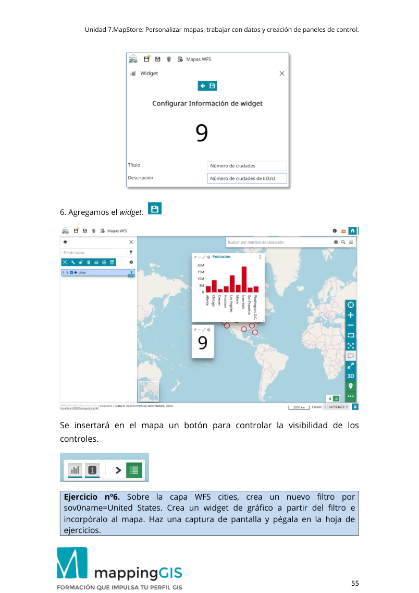</a></details>

[Consultar en el PDF · página 55](../materiales/Ejercicio_7_MapStore-2025-v4.pdf#page=55){target="_blank" rel="noopener noreferrer"}

### Ejercicio 7 · Exportar a Leaflet

<div class="original-statement"><span class="eyebrow">Enunciado original · Práctica</span><p>Exporta en MapStore una anotación , crea un mapa con Leaflet a partir de ella. Haz una captura de pantalla del mapa y pégalo en la hoja de ejercicios.</p></div>

<details class="original-exercise" markdown="1">
<summary>Pasos y contexto originales de la clase</summary>

**Página 55**

```text
Unidad 7.MapStore: Personalizar mapas, trabajar con datos y creación de paneles de control. 
 
                                                                                                  55 
 
6. Agregamos el widget.   
 
Se insertará en el mapa un botón para controlar la visibilidad de los 
controles. 
 
Ejercicio nº6.  Sobre l a capa WFS c ities, crea un nu evo filtro por 
sov0name=United States . Crea un widget de gráfico a partir del filtro e 
incorpóralo al mapa. Haz una captura de pantalla y pégala en la hoja de 
ejercicios.
```

**Página 56**

```text
Unidad 7.MapStore: Personalizar mapas, trabajar con datos y creación de paneles de control. 
 
                                                                                                  56 
Modo escritorio, móvil y 3D 
 
Hemos dicho anteriormente que MapStore utiliza OpenLayers, Leaflet y Cesium 
para la visualización de los mapas. Concretamente los utiliza de la siguiente forma: 
Modo Librería 
Escritorio OpenLayers 
Móvil Leaflet 
3D Cesium 
 
Por defecto MapStore utilizará OpenLayers cuando se encuentre en modo escritorio 
y Leaflet cuando se trate de un móvil. 
Para acceder al modo 3D de MapStore se utiliza un botón específico situado en la 
barra lateral. 
 
Haz clic sobre 3D para abrir las vista con Cesium. 
Obtendrás una vista del mapa sobre la esfera terrestre. Puedes hacer zoom y girar 
la esfera terrestre con el ratón. También puedes girar la vista y modificar el norte 
actuando sobre el control.
```

**Página 57**

```text
Unidad 7.MapStore: Personalizar mapas, trabajar con datos y creación de paneles de control. 
 
                                                                                                  57 
 
Para volver a la vista de escritorio 2D simplemente vuelve a clicar sobre 3D. 
Exportar, guardar y compartir nuestros mapas. 
 
Hemos visto que todos los cambios que hagamos en el mapa o vista de MapStore 
debemos guardarlos para que no se pierdan. 
Ya conocemos las opciones del menú “Guardar” y Guardar como”. 
 
Nota: estas opciones estarán disponibles en función de los roles que tenga el 
usuario con los que estemos trabajando. 
También puedes acceder desde la página de inicio a cada mapa para editar las 
propiedades.
```

**Página 58**

```text
Unidad 7.MapStore: Personalizar mapas, trabajar con datos y creación de paneles de control. 
 
                                                                                                  58 
Con el botón de edición abrimos la ventana de información del mapa: 
 
Si lo deseas puedes añadir una imagen al guardar el mapa, que será la imagen que 
identifique a este mapa. Para ello solo tienes que seleccionar la imagen que deseas 
incorporar.  
 
Una vez incorporada la imagen hacemos clic en Aplicar.
```

**Página 59**

```text
Unidad 7.MapStore: Personalizar mapas, trabajar con datos y creación de paneles de control. 
 
                                                                                                  59 
Tendremos una imagen identificando el mapa. 
 
 
Exportar un mapa 
 
MapStore nos permite exportar las capas y las anotaciones de un mapa a formato 
JSON. Este es un formato de texto que adopta la estructura de un objeto JavaScript. 
Es una alternativa a XML y dispone de una adaptación a datos geográficos que es 
GeoJSON. En consecuencia, los archivos generados durante la exportación de capas 
de MapStore los podremos utilizar en las librerías OpenLayers y Leaflet. 
Vamos a ver la exportación de datos en MapStore utilizando una de las anotaciones 
que habíamos creado antes. Por lo tanto, lo primero que tenemos que hacer es ir al 
apartado anotaciones del menú. La opción de exportaciones está disponible desde 
el menú de anotación, por lo tanto , debes crear una nueva anotación o si vas a 
exportar la que has creado anteriormente debes hacer clic primero en el icono de 
edición.
```

**Página 60**

```text
Unidad 7.MapStore: Personalizar mapas, trabajar con datos y creación de paneles de control. 
 
                                                                                                  60 
 
 
Se nos abre el control de anotaciones, con todas las disponibles. 
 
Seleccionamos la correspondiente al polígono y hacemos clic sobre el último botón, 
el de descargas:
```

**Página 61**

```text
Unidad 7.MapStore: Personalizar mapas, trabajar con datos y creación de paneles de control. 
 
                                                                                                  61 
 
Nos descarga un archivo en formato JSON como hemos dicho anteriormente. 
Abrimos el archivo descargado con un editor de texto y añadimos al inicio: 
 var geojson = 
La primera parte de ese archivo tendrá el siguiente aspecto: 
var geojson = 
{"type":"FeatureCollection","msType":"annotations","features":[{"type":"Feature","id"
:"cf748e20-e7d4-11ef-ad5f-23903330398f","properties":{"id":"cf748e20-e7d4-11ef-
ad5f-
23903330398f","name":"Polygon","annotationType":"Polygon","geodesic":false,"anno
tationLayerId":"annotations:bd8a3890-e7d4-11ef-ad5f-
23903330398f","annotationLayerTitle":"Plaza Mayor"}…. 
Guardamos este archivo con extensión js. 
Guárdalo como poligono.js 
Ahora podemos crear un mapa utilizando Leaflet y los datos descargados. Para ello 
tenemos que incorporar el archivo poligono.js a nuestro mapa. Eso se hace 
añadiendo en la cabecera del documento: 
<script src="poligono.js"></script> 
 Hay que incorporar también la librería Leaflet, mediante sus correspondientes 
archivos css y js.  
A continuación, escribimos el código para dibujar la capa a partir de la exportación 
de la anotación.
```

**Página 62**

```text
Unidad 7.MapStore: Personalizar mapas, trabajar con datos y creación de paneles de control. 
 
                                                                                                  62 
 
<!DOCTYPE html> 
<html> 
<head>  
<meta charset="UTF-8"> 
<title>MapStore Leaflet</title> 
<link rel="stylesheet" href="https://unpkg.com/leaflet@1.9.4/dist/leaflet.css"/> 
  
<style>  
   #map { 
    width: 700px; 
    height: 600px; } 
</style>  
</head>   
<body> 
<script src="https://unpkg.com/leaflet@1.9.4/dist/leaflet.js"></script>   
<script src="poligono.js"></script> 
 
<div id ="map"> </div>  
<script> 
var map = L.map('map', {center: [40.965, -5.664],zoom: 15}); 
L.tileLayer('https://{s}.tile.openstreetmap.org/{z}/{x}/{y}.png').addTo(map); 
 
  function style(feature) { 
    return { 
      fillColor: 'red', 
      weight: 2, 
      opacity: 1, 
      color: 'white', 
      dashArray: '3', 
      fillOpacity: 0.7 
    }; 
  } 
   
  function popup(feature, layer) { 
         layer.bindPopup(geojson.features[0].properties. annotationLayerTitle); 
  } 
 
  geojson = L.geoJson(geojson, { 
    style: style, 
    onEachFeature: popup 
  }).addTo(map); 
 
</script> 
</body>  
</html>
```

**Página 63**

```text
Unidad 7.MapStore: Personalizar mapas, trabajar con datos y creación de paneles de control. 
 
                                                                                                  63 
En el código anterior creamos una función para definir el estilo de la capa : function 
style y otra para crear un popup o ventana emergente que muestre el título de la  
anotación. 
Utilizamos la clase de Leaflet, L.geoJson que es la que nos permite utilizar el archivo 
en formato GeoJSON. Como primer parámetro recibe la variable geojson  que es el 
nombre que utilizamos cuando creamos el archivo polígono.js y a continuación las 
opciones style y onEachFeature. 
El resultado es un mapa que contiene la anotación exportada por MapStore. 
 
 
 
Ejercicio nº7. Exporta en MapStore una anotación , crea un mapa con Leaflet a 
partir de ella.  Haz una captura de pantalla del mapa y pégalo en la hoja de 
ejercicios. 
 
Compartir mapas 
 
Podemos acceder a las opciones de compartir mapa de Mapstore desde el Burger 
menú: 
 
O directamente desde la vista de mapas mediante el botón compartir.
```

</details>

<details class="source-page"><summary>Ver página 63 del PDF original, con sus capturas</summary><a href="../../materiales/Ejercicio_7_MapStore-2025-v4.pdf#page=63" target="_blank" rel="noopener">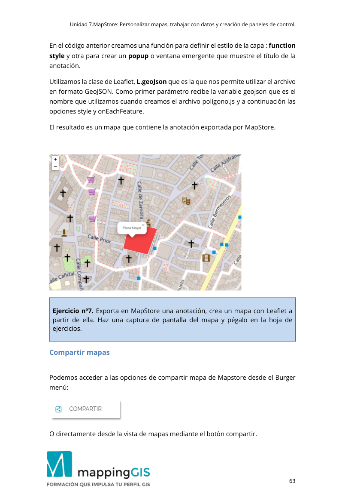</a></details>

[Consultar en el PDF · página 63](../materiales/Ejercicio_7_MapStore-2025-v4.pdf#page=63){target="_blank" rel="noopener noreferrer"}

### Ejercicio 8 · Crear contexto

<div class="original-statement"><span class="eyebrow">Enunciado original · Práctica</span><p>Crea un nuevo contexto siguiendo los pasos indicados. Cuando lo tengas haz una captura de pantalla del Administrador de contexto donde se v ea el nuevo contexto y la pegas en la hoja de ejercicios.</p></div>

<details class="original-exercise" markdown="1">
<summary>Pasos y contexto originales de la clase</summary>

**Página 63**

```text
Unidad 7.MapStore: Personalizar mapas, trabajar con datos y creación de paneles de control. 
 
                                                                                                  63 
En el código anterior creamos una función para definir el estilo de la capa : function 
style y otra para crear un popup o ventana emergente que muestre el título de la  
anotación. 
Utilizamos la clase de Leaflet, L.geoJson que es la que nos permite utilizar el archivo 
en formato GeoJSON. Como primer parámetro recibe la variable geojson  que es el 
nombre que utilizamos cuando creamos el archivo polígono.js y a continuación las 
opciones style y onEachFeature. 
El resultado es un mapa que contiene la anotación exportada por MapStore. 
 
 
 
Ejercicio nº7. Exporta en MapStore una anotación , crea un mapa con Leaflet a 
partir de ella.  Haz una captura de pantalla del mapa y pégalo en la hoja de 
ejercicios. 
 
Compartir mapas 
 
Podemos acceder a las opciones de compartir mapa de Mapstore desde el Burger 
menú: 
 
O directamente desde la vista de mapas mediante el botón compartir.
```

**Página 64**

```text
Unidad 7.MapStore: Personalizar mapas, trabajar con datos y creación de paneles de control. 
 
                                                                                                  64 
 
Haz clic en el botón  del mapa para abrir el menú compartir. 
Mapstore permite compartir un mapa de tres formas: 
1.- Mediante un enlace directo. 
 
Nota: Aquí estamos trabajando con un servidor local (localhost) por lo tanto nuestro 
mapa no estará visible para usuarios fuera de nuestro sitio, salvo que conviertas 
tu equipo en un servidor público. Esta es una operación posible aunque compleja y 
poco recomendable por diferentes motivos.  
2.- Mediante redes sociales  
. 
3.- Mediante código embebido.
```

**Página 65**

```text
Unidad 7.MapStore: Personalizar mapas, trabajar con datos y creación de paneles de control. 
 
                                                                                                  65 
Nota: Es preciso advertir que sol o podremos compartir aquellos mapas que sean 
autorizados previamente. Si intentamos compartir un mapa sin permisos 
obtendremos un aviso como el siguiente: 
 
Si este es el caso hay que conceder permisos al mapa. Debes ir a "Editar 
propiedades", que es el icono de herramienta que aparece sobre el mapa. En Grupos 
de permisos debes elegir "everyone" puede ver, y lo añades. Lo guardas y ahora ya 
puedes compartir el mapa. 
 
Vamos a ver un ejemplo en que utilizamos el código embebido. Haz clic en el icono: 
 
Esta operación nos permite copiar la etiqueta <iframe>, que podemos insertar 
directamente en un código html, mediante el editor de texto, como se ve en las 
siguientes líneas:
```

**Página 66**

```text
Unidad 7.MapStore: Personalizar mapas, trabajar con datos y creación de paneles de control. 
 
                                                                                                  66 
 
<!DOCTYPE html> 
<html> 
<body> 
<h2>HTML Iframes</h2> 
<p>Mapa de MapStore</p> 
<iframe style="border: none;" height="500" width="700" 
src="http://localhost:8082/mapstore/embedded.html?forceDrawer=true#/78"></iframe> 
</body> 
</html> 
 
Hemos modificado los atributos heigth y width para crear un “área” del mapa 
mayor. 
Guarda el código anterior como html y ejecútalo en el navegador. La vista que 
obtenemos es la siguiente: 
 
De esta forma no solo estamos compartiendo el mapa, también nos incorpora el 
menú de capas de MapStore, el menú lateral y el control de búsqueda de 
direcciones.
```

**Página 67**

```text
Unidad 7.MapStore: Personalizar mapas, trabajar con datos y creación de paneles de control. 
 
                                                                                                  67 
Administrar contextos. Añadir extensiones 
 
El Administrador de contexto de MapStore es una herramienta administrativa 
diseñada para crear y configurar los visores de MapStore . Lo que haremos con el 
gestor de contexto es crear un entorno personalizado donde podremos configurar 
las herramientas que contiene añadiendo nuevas extensiones que no están en la 
vista por defecto. Lo entenderemos mejor con un ejemplo. 
Empezamos por crear un nuevo contexto. 
 
Nos ofrece un tutorial, que en esta ocasión nos podemos saltar. 
 
La creación del contexto tiene cuatro pasos que se nos va indicando en la parte 
inferior de cada página.
```

**Página 68**

```text
Unidad 7.MapStore: Personalizar mapas, trabajar con datos y creación de paneles de control. 
 
                                                                                                  68 
Cada vez que completemos una fase haremos clic en Siguiente, también podemos 
retroceder con el botón Atrás. 
 
En la nueva ventana daremos un nombre al contexto. 
 
MapStore permite también importar y exportar un contexto. 
Cuando hayas escrito el nombre del contexto y el título de la ventana haz clic en 
Siguiente. 
 
En este paso podemos configurar algunos aspectos del mapa.
```

**Página 69**

```text
Unidad 7.MapStore: Personalizar mapas, trabajar con datos y creación de paneles de control. 
 
                                                                                                  69 
Se trata de definir una vista del mapa y/o incorporar capas, por eso dispone de las 
herramientas de catálogo, importar y exportar en el menú. 
Vamos a modificar el mapa base para este contexto. Haz clic en el selector de mapas 
de fondo situado en la parte inferior del mapa.  
 
Selecciona uno de ellos, por ejemplo, Sentinel 2 Cloudless. 
Cuando lo tengas haz clic en siguiente. 
 
En esta sección tenemos dos ventanas. La ventana de la izquierda contiene los 
complementos disponibles y en la ventana de la derecha los complementos 
seleccionados. 
 
Para pasar los complementos de una ventana a otra utilizaremos los botones:
```

**Página 70**

```text
Unidad 7.MapStore: Personalizar mapas, trabajar con datos y creación de paneles de control. 
 
                                                                                                  70 
 
Añade varios complementos pasándolos de la ventana de la izquierda a la derecha 
con el botón >. 
 
Incluye el complemento de Geoprocesamiento y Catálogo porque lo utilizaremos 
más adelante. 
Haz clic en Siguiente cuando lo tengas. 
 
En esta sección podemos asignar estilos a la vista del contexto. 
Para simplificar un poco la cuestión vamos a elegir el tema Dark que nos ofrece 
MapStore. De esta forma tendremos un nuevo estilo ya configurado.
```

**Página 71**

```text
Unidad 7.MapStore: Personalizar mapas, trabajar con datos y creación de paneles de control. 
 
                                                                                                  71 
 
Con este último paso habremos terminado de crear y configurar el contexto, por lo 
que haremos clic en Guardar. 
 
En el administrador de contextos veremos el nuevo contexto que hemos creado. 
 
Si necesitas modificar un contexto, lo puedes hacer desde aquí con la opción de 
edición  
 
Ejercicio nº8. Crea un nuevo contexto siguiendo los pasos indicados. Cuando lo 
tengas haz una captura de pantalla del Administrador de contexto donde se v ea 
el nuevo contexto y la pegas en la hoja de ejercicios.
```

</details>

<details class="source-page"><summary>Ver página 71 del PDF original, con sus capturas</summary><a href="../../materiales/Ejercicio_7_MapStore-2025-v4.pdf#page=71" target="_blank" rel="noopener">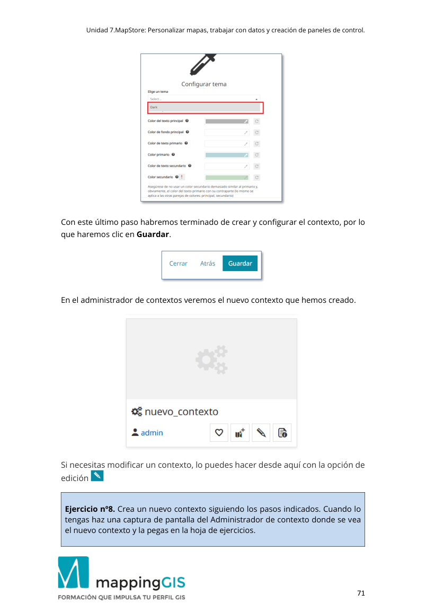</a></details>

[Consultar en el PDF · página 71](../materiales/Ejercicio_7_MapStore-2025-v4.pdf#page=71){target="_blank" rel="noopener noreferrer"}

### Ejercicio 9 · Panel de control

<div class="original-statement"><span class="eyebrow">Enunciado original · Práctica</span><p>Crea un panel de control con un mapa, su leyenda y un texto o título. Haz una captura de pantalla y pégala en la hoja de ejercicios.</p></div>

<details class="original-exercise" markdown="1">
<summary>Pasos y contexto originales de la clase</summary>

**Página 71**

```text
Unidad 7.MapStore: Personalizar mapas, trabajar con datos y creación de paneles de control. 
 
                                                                                                  71 
 
Con este último paso habremos terminado de crear y configurar el contexto, por lo 
que haremos clic en Guardar. 
 
En el administrador de contextos veremos el nuevo contexto que hemos creado. 
 
Si necesitas modificar un contexto, lo puedes hacer desde aquí con la opción de 
edición  
 
Ejercicio nº8. Crea un nuevo contexto siguiendo los pasos indicados. Cuando lo 
tengas haz una captura de pantalla del Administrador de contexto donde se v ea 
el nuevo contexto y la pegas en la hoja de ejercicios.
```

**Página 72**

```text
Unidad 7.MapStore: Personalizar mapas, trabajar con datos y creación de paneles de control. 
 
                                                                                                  72 
 
Complemento de Geoprocesamiento 
 
La herramienta de Geoprocesamiento utiliza los procesos WPS para realizar 
operaciones de buffer e intersección sobre las geometrías del mapa. Como hemos 
indicado esta herramienta no está disponible en la vista inicial de MapStore, por lo 
tanto, la tendremos que utilizarla desde el contexto que hemos creado. 
Abrimos el co ntexto. Veremos en el menú la herramienta de catálogo y la de 
Geoprocesamiento, junto con las otras herramientas que hayas añadido durante la 
creación del contexto. 
 
Utiliza la herramienta de Catálogo para definir la conexión al servicio WMS que 
contiene las capas que hemos creado en GeoServer, como hemos explicado 
anteriormente.
```

**Página 73**

```text
Unidad 7.MapStore: Personalizar mapas, trabajar con datos y creación de paneles de control. 
 
                                                                                                  73 
 Añade la capa con los ríos al mapa. 
Ahora utilizaremos la herramienta de Geoprocesos para crear un buffer entorno a 
uno de ellos.  
Haz clic sobre  para abrir la herramienta.  Nos aparece un formulario donde 
definiremos los parámetros de la operación de geoprocesamiento.  
1.- Indicamos el proceso que vamos a realizar: Buffer o intersección. 
2.- Definimos la capa de origen: rivers. 
3.- En características de origen se elige la entidad sobre la que hace el buffer. En el 
control de selección debemos elegir una. 
4.- En distancia indicamos el valor en metros o kilómetros que tendrá el buffer. 
5.- En ajustes avanzados podemos definir la forma que tendrán los extremos del 
buffer. Podemos elegir entre Redonda, plana o cuadrada. 
Por último, se ejecuta el proceso y veremos el resultado de la operación en el mapa, 
tal como se muestra en la imagen siguiente.
```

**Página 74**

```text
Unidad 7.MapStore: Personalizar mapas, trabajar con datos y creación de paneles de control. 
 
                                                                                                  74 
Creación de paneles de control (dashboards) 
 
Un panel de control en MapStore es una presentación en la que se combinan 
diferentes elementos como vistas del mapa, textos, leyendas y widget para crear 
un documento personalizado. 
Un panel de control se crea desde la página de inicio de MapStore con el botón 
“Crear panel”. 
 
  
Este botón nos abre una nueva ventana con el control vacío. 
 
Añadir widgets: mapa, leyenda y texto. 
 
Hacemos clic sobre el botón + situado en la esquina superior izquierda de la 
ventana. 
Para empezar, necesitamos incorporar un mapa; por lo tanto elegimos la opción de 
agregar un mapa.
```

**Página 75**

```text
Unidad 7.MapStore: Personalizar mapas, trabajar con datos y creación de paneles de control. 
 
                                                                                                  75 
 
Veremos un selector de mapas con los diferentes mapas que hemos creado en 
MapStore. Elegimos el que llamamos M appingGIS que contiene los servic ios WMS 
de nuestro servidor GeoServer. 
 
Hacemos clic sobre “Usar este mapa”  
Nos permite configurar la vista del mapa, ocultando/mostrando capas o 
modificando su opacidad.
```

**Página 76**

```text
Unidad 7.MapStore: Personalizar mapas, trabajar con datos y creación de paneles de control. 
 
                                                                                                  76 
 
Hacemos clic de nuevo sobre  en la siguiente ventana. 
Escribimos un título y una descripción. 
 
Agregamos al mapa.
```

**Página 77**

```text
Unidad 7.MapStore: Personalizar mapas, trabajar con datos y creación de paneles de control. 
 
                                                                                                  77 
 
Para agregar un nuevo elemento volvemos a pinchar sobre el signo +. 
Ahora nos aparece una nueva opción que antes no teníamos: se trata de la leyenda. 
Hasta que no tenemos un mapa en el panel de control, la opción de Leyenda está 
oculta. 
 
Nos ofrece una vista previa de la leyenda.
```

**Página 78**

```text
Unidad 7.MapStore: Personalizar mapas, trabajar con datos y creación de paneles de control. 
 
                                                                                                  78 
Si estamos de acuerdo hacemos clic sobre  
Escribimos un nombre y una descripción. 
 
Añadimos el recurso  
De la misma forma podemos añadir un texto. 
Los elementos creados pueden ser distribuidos por el panel, adaptando la forma y 
tamaño deseados. 
 
Guardamos el panel de control antes de salir.  
 
 
Ejercicio nº9. Crea un panel de control con un mapa, su leyenda y un texto o 
título. Haz una captura de pantalla y pégala en la hoja de ejercicios.
```

</details>

<details class="source-page"><summary>Ver página 78 del PDF original, con sus capturas</summary><a href="../../materiales/Ejercicio_7_MapStore-2025-v4.pdf#page=78" target="_blank" rel="noopener">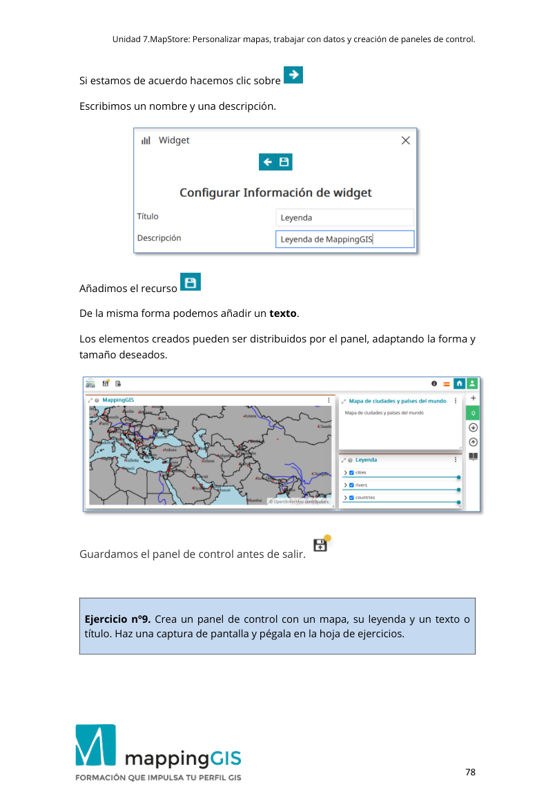</a></details>

[Consultar en el PDF · página 78](../materiales/Ejercicio_7_MapStore-2025-v4.pdf#page=78){target="_blank" rel="noopener noreferrer"}

