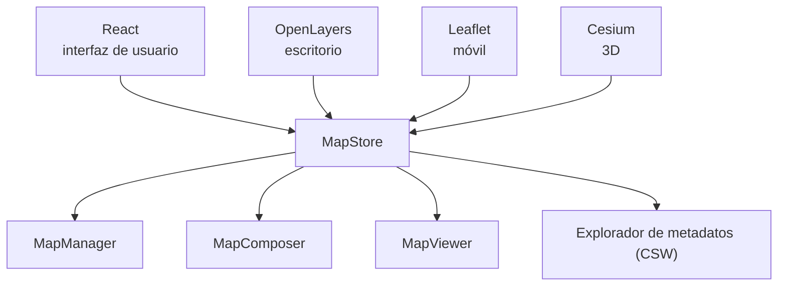

# Unidad 7. MapStore: Personalizar mapas, trabajar con datos y creación de paneles de control

**Antes de leer, mira el esquema.** Las librerías sobre las que se apoya MapStore y sus módulos principales:

### Resumen estructurado

**1. Contenido de la unidad**
- ¿Qué es MapStore? Entornos MapStore. Tipos de datos que podemos utilizar con MapStore.
- Componentes: Gestión de usuarios, Gestión de mapas, Gestión de capas, Panel de control, Gestor de contexto, Stories.

**2. ¿Qué es MapStore?**
- **MapStore** es un *framework webGIS* desarrollado por **GeoSolutions** que permite crear, gestionar y compartir mapas, así como gestionar recursos (mapas, tablas, presentaciones, gráficos…).
- Puede utilizarse de dos formas:
  - **Producto** → sin programación → funciona como un **geoportal estándar**.
  - **Framework** → con programación → permite construir **aplicaciones geoespaciales sofisticadas**.
- **Componentes** (librerías) sobre los que se apoya MapStore:

| Librería | Uso |
|---|---|
| **OpenLayers** | Visualización en modo escritorio |
| **Leaflet** | Visualización en dispositivos móviles |
| **Cesium** | Visualizaciones 3D |
| **React** | Interfaz de usuario |

- MapStore se organiza además en 4 módulos/aplicaciones:

| Módulo | Función |
|---|---|
| **MapManager** | Administrar mapas |
| **MapComposer** | Crear mapas |
| **MapViewer** | WebGIS: geolocalizador, análisis de datos… |
| **Explorador de metadatos** | Cliente **CSW** (*Catalogue Service for the Web*) |

- MapStore es **software libre**, distribuido bajo **licencia GNU (GPL3)**.
- Se puede dividir en **5 áreas**: 1) Gestión de usuarios y grupos, 2) Gestión de contextos, 3) Creación y edición de mapas, 4) Panel de control o *dashboard*, 5) *Stories*.

**3. Entornos MapStore**
MapStore ofrece funcionalidades diferenciadas según el perfil de quien lo utiliza:

| MapStore para usuarios | MapStore para desarrolladores |
|---|---|
| Crear y gestionar recursos o mapas | Construir una infraestructura web |
| Compartir mapas | Realizar desarrollos con MapStore |
| Explorar mapas | Configurar MapStore |
| Crear paneles o *Dashboard* | Integrar MapStore con otros recursos como **GeoServer** |
| Explorar *Stories* | |

**4. Tipos de datos que podemos utilizar en MapStore**
- **Estándares OGC soportados**: WMS (1.1.1, 1.3.0), WFS (1.0.0, 1.1.0), WPS (1.0.0), WMTS (1.0.0), TMS (1.0.0), CSW (2.0.2). MapStore está especialmente diseñado para trabajar con estos servicios, con una excelente integración con **GeoServer**.
- **Formatos de archivo que se pueden importar**: KML, KMZ, GPX, Shapefile, GeoJSON.
- **Formato de exportación**: JSON.
- MapStore permite además **crear anotaciones** directamente sobre el mapa.

**5. Componentes MapStore**

| Componente | Función |
|---|---|
| **Gestor de usuarios** | Crear y gestionar usuarios y roles |
| **Gestor de mapas** | Crea mapas, permite la navegación por los mapas, consultas, manejo de estilos… |
| **Panel de control** | Crear presentaciones personalizadas a partir de los mapas y sus datos |
| **Gestor de contexto** | Un contexto en MapStore es el formato y contenido del gestor de mapas; se puede configurar el aspecto y las utilidades del gestor de mapas |
| **Historias (Stories)** | *StoryMaps* es una herramienta que permite crear presentaciones animadas que integren mapas, imágenes, vídeos o textos |

**6. Gestión de usuarios MapStore**
MapStore distingue **tres tipos de usuarios**:

| Anónimo | Normal | Administrador |
|---|---|---|
| Acceso a la página de inicio | Usuario anónimo + crear nuevos recursos | Usuario Normal + crear usuarios y grupos de usuarios |
| Ver los mapas | | Asignar roles |
| Funciones básicas: compartir el recurso o elegir el idioma | | Acceder a **todas** las funcionalidades de MapStore |

**7. Gestor de mapas**
El **Gestor de Mapas** es la herramienta principal de MapStore: permite crear, visualizar y trabajar con los mapas. Contiene: barra de menú, tabla de contenidos, barra lateral, selector de mapas de fondo y control de pie de página.

**8. Gestión de capas con MapStore**
Desde la **tabla de contenidos** (gestor de capas) se puede: configurar la capa (visualización/opacidad, cacheado, estilos, formato de información de la capa), **filtrar** elementos de la capa (por atributo o por regiones de interés), abrir la **tabla de atributos**, **borrar** la capa y crear un ***widget*** (gráficos, textos, tablas o contadores).

**9. Panel de control**
El **Panel de control** o ***dashboard*** es un área de trabajo para crear una presentación o una vista, combinando recursos o *widgets*: vistas de mapas, leyendas, textos, tablas, gráficos y contadores. Un ***widget*** es un gráfico, tabla, texto o contador generado por MapStore a partir de los datos de una capa del mapa.

**10. Gestor de contexto**
El **Gestor de contexto** de aplicación es una herramienta administrativa diseñada para **construir y configurar** MapStore para los usuarios. Configurar un visor MapStore permite personalizar: el **nombre del contexto** (el espectador tiene una URL específica), la **configuración predeterminada del mapa y contenido** (capas, fondos, catálogos, CRS…) y el **conjunto de complementos disponibles** para el espectador.

**11. Stories**
**StoryMap** es una herramienta que permite crear historias o presentaciones dinámicas. Las historias suponen un nuevo concepto en la elaboración de mapas, en donde el elemento cartográfico se combina con recursos multimedia (texto, vídeo, fotografía) para crear una experiencia en el usuario.

**12. Ejemplos de uso y recursos**
- Ejemplo de instancia pública de MapStore: `https://mapstore.geosolutionsgroup.com/mapstore/#/`
- Documentación oficial: `https://mapstore.readthedocs.io/en/latest/user-guide/home-page/`
- Guía para desarrolladores: `https://mapstore2.readthedocs.io/en/latest/developer-guide/requirements/`

---

**Ejercicios prácticos de esta unidad:** [ver ejercicios →](../ejercicios/ejercicio-7.md)

---

