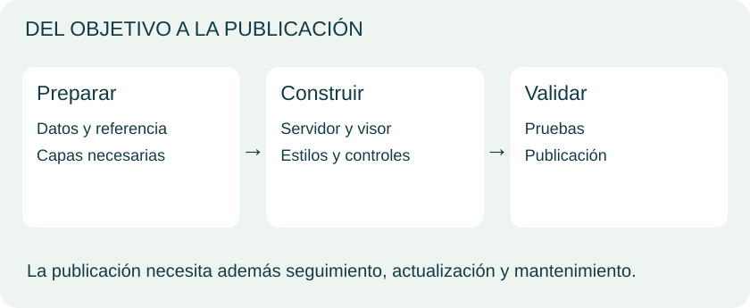
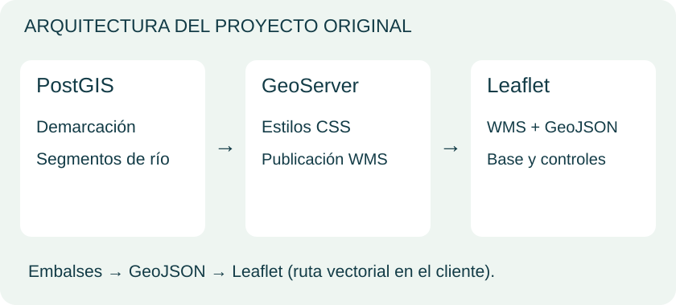
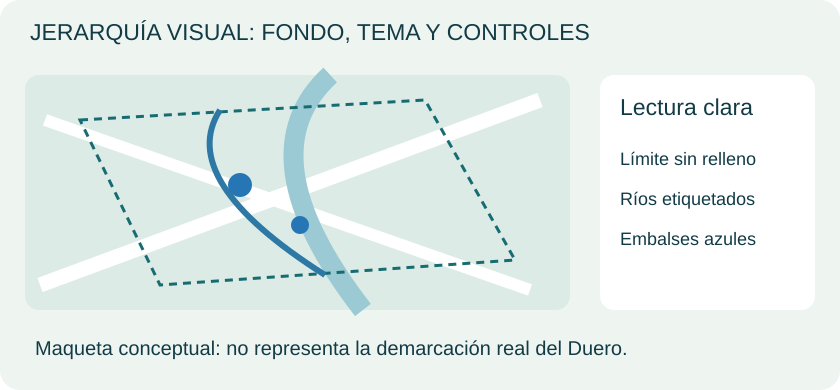
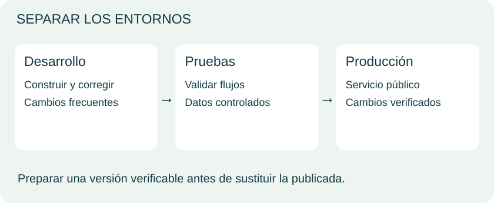
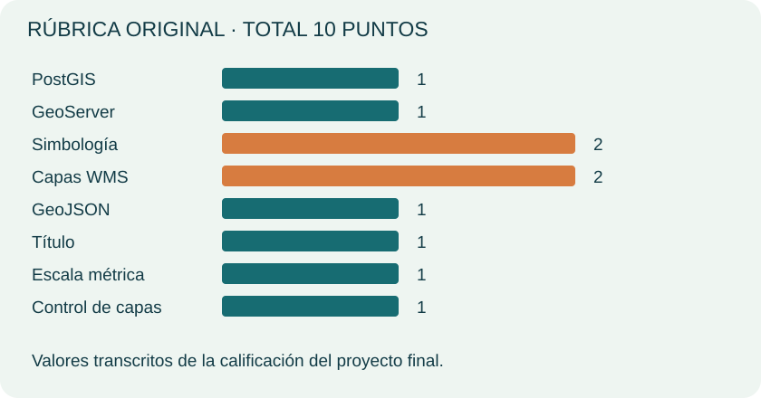
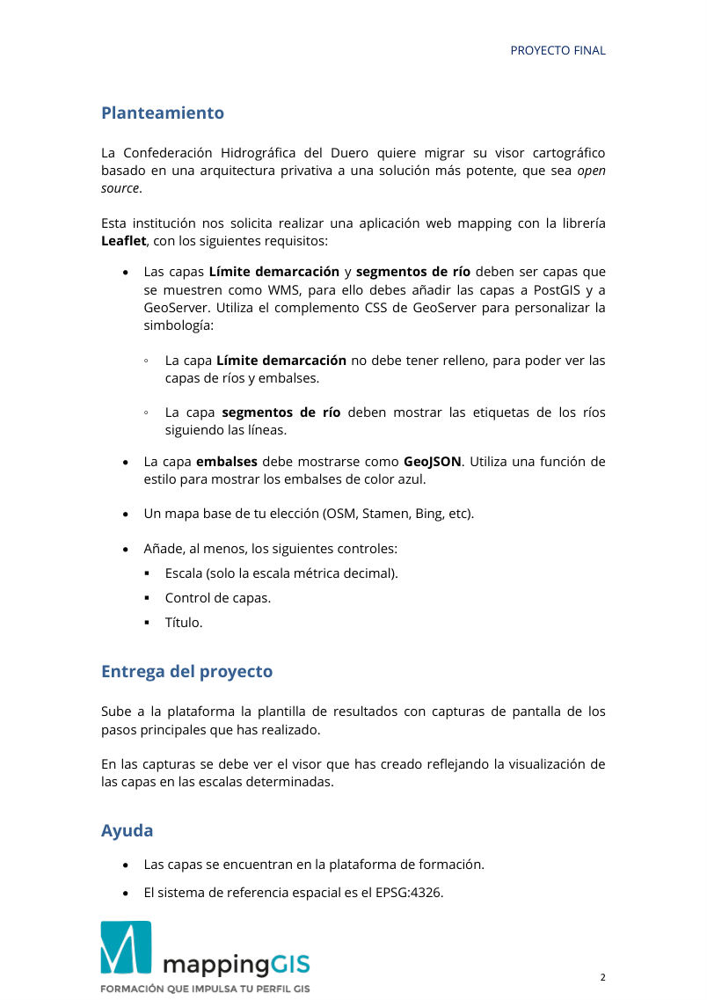
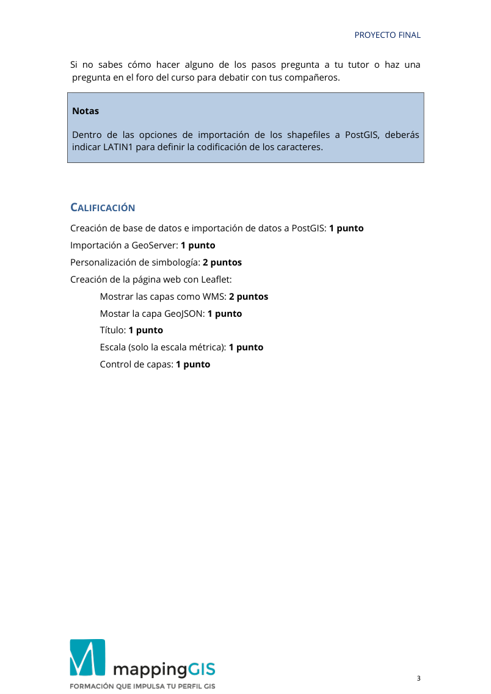

# Unidad 8 · Integrar y publicar el proyecto

Unidad 08 / Piloto visual
<h2>Un visor claro por fuera. Una arquitectura coherente por dentro.</h2>
Reúne datos, servicios y experiencia de uso en el proyecto original de la Confederación Hidrográfica del Duero.

Preparar → integrar → diseñar → validar → entregar

Síntesis visual de las clases, con diagramas originales para explicar los conceptos. La práctica se conserva al final de esta misma unidad.

## 1. Preparar el despliegue

<figure class="lesson-figure"></figure>

Define qué pregunta resolverá el visor, para quién y con qué datos. Comprueba geometrías, atributos, referencia, origen y fecha.

La infraestructura debe responder al volumen, consultas y mantenimiento. Un alojamiento estático puede servir el frontend, pero no ejecuta por sí solo PostGIS o GeoServer. Los servicios necesitan un entorno apropiado.

La interoperabilidad permite combinar componentes compatibles. Cambiar herramientas exige revisar funciones, formatos y configuración; no toda sustitución es automática.

<strong>Fuente del apartado:</strong> <a href="../../materiales/Unidad8_webmapping.pdf" rel="nofollow">MappingGIS · Unidad8_webmapping.pdf</a>.

## 2. Arquitectura del proyecto

<figure class="lesson-figure"></figure>

El proyecto solicita Leaflet. Demarcación y ríos se incorporan a PostGIS y GeoServer y se representan como WMS. Los embalses se cargan como GeoJSON.

| Elemento | Tratamiento solicitado |
|---|---|
| Demarcación | WMS; sin relleno |
| Ríos | WMS; etiquetas siguiendo líneas |
| Embalses | GeoJSON; azul |
| Fondo | A elección |
| Controles | Escala métrica, capas y título |

El esquema sintetiza el enunciado, sin añadir entregables. Las instrucciones completas aparecen al final.

<strong>Fuente del apartado:</strong> <a href="../../materiales/Ejercicio_8_Proyecto%20final.pdf" target="_blank" rel="nofollow noopener noreferrer">MappingGIS · Ejercicio_8_Proyecto final.pdf</a>.

## 3. Diseñar para comprender

<figure class="lesson-figure"></figure>

Un mapa útil necesita fondo discreto, temas distinguibles y controles comprensibles. Un relleno opaco puede ocultar otras capas aunque estén cargadas.

Usa símbolos coherentes, leyenda cuando haga falta y etiquetas que no saturen las escalas. Ofrece las herramientas que necesita la tarea: no hace falta reproducir todos los menús de un SIG de escritorio.

La maqueta no representa la geografía real del Duero. Permite estudiar bordes, líneas y puntos antes de aplicar estilos a las capas del curso.

<strong>Fuente del apartado:</strong> <a href="../../materiales/Unidad8_webmapping.pdf" rel="nofollow">MappingGIS · Unidad8_webmapping.pdf</a> · <a href="../../materiales/Ejercicio_8_Proyecto%20final.pdf" target="_blank" rel="nofollow noopener noreferrer">MappingGIS · Ejercicio_8_Proyecto final.pdf</a>.

## 4. Pruebas y mantenimiento

<figure class="lesson-figure"></figure>

Desarrollo permite construir; pruebas valida recorridos; producción atiende a usuarios. Conservar versiones recuperables permite sustituir una implementación cuando la siguiente está lista.

Comprueba carga, capas, referencia, leyendas, consultas, controles y pantalla. Revisa peticiones cuando un servicio falla. Las pruebas reducen problemas, sin garantizar su ausencia absoluta.

Caché, volumen y peticiones influyen en rendimiento. Documentar origen, fecha y configuración facilita mantener el visor cuando cambian datos o servicios.

<strong>Fuente del apartado:</strong> <a href="../../materiales/Unidad8_webmapping.pdf" rel="nofollow">MappingGIS · Unidad8_webmapping.pdf</a>.

## 5. Evaluación original

<figure class="lesson-figure"></figure>

La rúbrica reparte diez puntos. Simbología y WMS reciben dos cada uno; los demás criterios, uno.

La entrega utiliza una plantilla con capturas de los pasos y del visor en las escalas indicadas. El PDF también especifica EPSG:4326 y LATIN1 en la importación de los shapefiles de la práctica.

Estos criterios pertenecen al curso: no son una evaluación nueva del piloto. El proyecto original, con ayuda y puntuación, se conserva a continuación.

<strong>Fuente del apartado:</strong> <a href="../../materiales/Ejercicio_8_Proyecto%20final.pdf" target="_blank" rel="nofollow noopener noreferrer">MappingGIS · Ejercicio_8_Proyecto final.pdf</a>.

## Material y referencias

- [Unidad8_webmapping.pdf](../materiales/Unidad8_webmapping.pdf) · material original.

Ampliación técnica: [Publicación con GeoServer](https://docs.geoserver.org/stable/en/user/data/webadmin/index.html) · [Visor Leaflet](https://leafletjs.com/examples/quick-start/). Las versiones e interfaces del PDF corresponden al entorno de las clases; los diagramas muestran conceptos.

## Ejercicio Unidad 8 {#ejercicios-originales-del-curso}

Enunciados y contexto de los PDF de MappingGIS. No se añaden actividades ni soluciones. Los paneles incluyen los pasos originales dentro de la unidad; el PDF conserva la maquetación completa.

**Práctica:** [PDF original completo](../materiales/Ejercicio_8_Proyecto%20final.pdf){target="_blank" rel="nofollow noopener noreferrer"}.

### Proyecto final · Enunciado y entrega

Enunciado del proyecto final propuesto al terminar el curso, que integra PostGIS, GeoServer (WMS + estilos CSS) y Leaflet (WMS + GeoJSON).

#### Planteamiento
La **Confederación Hidrográfica del Duero** quiere migrar su visor cartográfico, basado en una arquitectura privativa, a una solución más potente que sea *open source*. Solicita realizar una aplicación web mapping con la librería **Leaflet**, con los siguientes requisitos:

- Las capas **Límite demarcación** y **segmentos de río** deben mostrarse como **WMS**: para ello hay que añadir las capas a **PostGIS** y a **GeoServer**, utilizando el complemento **CSS** de GeoServer para personalizar la simbología:
  - La capa **Límite demarcación** no debe tener relleno, para poder ver las capas de ríos y embalses.
  - La capa **segmentos de río** debe mostrar las etiquetas de los ríos siguiendo las líneas.
- La capa **embalses** debe mostrarse como **GeoJSON**. Hay que utilizar una función de estilo para mostrar los embalses de color azul.
- Un **mapa base** a elección (OSM, Stamen, Bing, etc.).
- Añadir, al menos, los siguientes **controles**:
  - Escala (solo la escala métrica decimal).
  - Control de capas.
  - Título.

#### Entrega del proyecto
Subir a la plataforma la plantilla de resultados con capturas de pantalla de los pasos principales realizados. En las capturas se debe ver el visor creado, reflejando la visualización de las capas en las escalas determinadas.

#### Ayuda
- Las capas se encuentran en la plataforma de formación.
- El sistema de referencia espacial es el **EPSG:4326**.
- Si no se sabe cómo hacer alguno de los pasos, se puede preguntar al tutor o plantear una pregunta en el foro del curso para debatir con los compañeros.

#### Notas
Dentro de las opciones de importación de los shapefiles a PostGIS, debe indicarse **LATIN1** para definir la codificación de los caracteres.

#### Calificación

| Criterio | Puntuación |
|---|---|
| Creación de base de datos e importación de datos a PostGIS | 1 punto |
| Importación a GeoServer | 1 punto |
| Personalización de simbología | 2 puntos |
| Mostrar las capas como WMS (visor Leaflet) | 2 puntos |
| Mostrar la capa GeoJSON (visor Leaflet) | 1 punto |
| Título (visor Leaflet) | 1 punto |
| Escala, solo la escala métrica (visor Leaflet) | 1 punto |
| Control de capas (visor Leaflet) | 1 punto |
| **Total** | **10 puntos** |

### Proyecto final · Páginas originales

Ver página 2 del proyecto original

Ver página 3 del proyecto original

