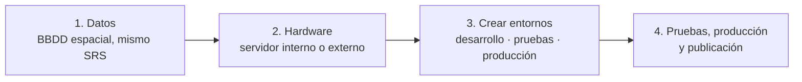

# Unidad 8. Consideraciones finales y recomendaciones

### Resumen estructurado

**1. Contenido de la unidad**
- Pasos para desplegar una aplicación web mapping.
- Recomendaciones.
- Cómo diseñar una aplicación web mapping.

**2. Pasos para desplegar una aplicación web mapping**

Flujo de despliegue en 4 etapas: **1. Datos → 2. Hardware → 3. Crear entornos → 4. Pruebas, producción y publicación**.

- **1. Datos:**
  - Definir qué información mostrará cada capa.
  - Incluirlos en una base de datos espacial.
  - Utilizar el mismo sistema de referencia espacial.
- **2. Hardware:** decidir dónde desplegar la arquitectura. **Una infraestructura web GIS es un trabajo difícil y caro de implementar.**
  - **Servidor interno.**
  - **Servidor externo:**
    - Un servidor especializado en WEB GIS.
    - En un servidor compartido no se podrá crear una arquitectura completa → se necesitará un servidor dedicado no administrado.
  - *Más info:* recurso del curso "Opciones para crear una arquitectura WEB GIS en un servidor" (AcuGIS).
- **3. Crear entornos:**
  - Entorno de desarrollo.
  - Entorno de pruebas.
  - Entorno de producción.
- **4. Pruebas, producción y publicación:** después de desarrollar una aplicación debe pasar por una fase de *testing*, en la que se debe testar para detectar fallos, hasta llegar al punto en el que la aplicación esté libre de errores. Una vez probada, se puede poner en el entorno de producción y publicarla en la web.

**3. Recomendaciones**

- **Cumple con los estándares de la OGC.** Las herramientas hacen uso de los estándares de la OGC, lo que permite que distintos componentes se intercambien con facilidad → **¡Interoperabilidad!**

- **Herramientas alternativas a las vistas en el curso** (equivalencias posibles según el diagrama del curso, en el que un cliente —Google, OpenLayers, Bing— envía una petición de tesela a una caché tipo GeoWebCache: si la tesela ya existe se devuelve directamente, y si no existe se recupera del servidor de mapas —GeoServer, ArcGIS, MapServer— y se guarda antes de devolverla):

| Herramienta vista en el curso | Alternativa posible |
|---|---|
| GeoServer | **MapServer** / **deegree** |
| QGIS | **gvSIG** / **ArcGIS** |
| OpenLayers | **Google Maps** / **Leaflet** |
| GeoWebCache | **TileCache** |

- **La heterogeneidad es buena.** Mezcla y combina las herramientas que mejor funcionen en tu proyecto: no es necesario desarrollar una aplicación con los mismos componentes que se han visto en el curso.
  - *Ejemplo:* se puede implementar **GeoServer sobre Oracle**.
  - *Ejemplo:* se puede implementar **ArcGIS Enterprise sobre PostGIS**.
  - *Arquitectura de ejemplo del curso:* una aplicación empresarial (navegador, JavaScript, OpenLayers) se comunica con un servidor de aplicaciones **J2EE** (Java) y con **GeoServer**, ambos apoyados sobre una base de datos **Oracle**.

- **Tu aplicación web mapping no debería ser como un SIG de escritorio.** Las aplicaciones deben ser intuitivas y familiares para los usuarios; hay que pensar en cómo lo hacen **Google Maps** u **OpenStreetMap** (interfaces sencillas), en contraposición a la complejidad de paneles, barras de herramientas y menús propia de un SIG de escritorio como QGIS.

**4. Cómo diseñar una aplicación web mapping**

Siete recomendaciones de diseño:

1. **Haz un mapa atractivo e informativo.** Un buen diseño de un mapa web va más allá del simple objetivo de proporcionar información geográfica: debe ofrecer una experiencia atractiva e informativa al usuario.
2. **No lo juntes todo.** Hay una tendencia a la sobrecarga con tantas capas como sea posible en un único mapa web.
3. **Simplifica herramientas, menús y botones.** Un mapa web será eficaz si es fácil de usar. Evita llenarlo de muchas herramientas, menús y botones; piensa para qué se va a usar el mapa y ofrece la funcionalidad imprescindible.
4. **Hazlo intuitivo.** El mapa debe ser capaz de entenderse sin necesidad de un manual o unas instrucciones.
   - Recomendaciones asociadas a los puntos 3 y 4:
     - Los datos deben tener una **simbología lógica**.
     - Incluye una **leyenda** para las capas que necesiten una explicación adicional.
     - Utiliza un **fondo neutro** para las capas base, de forma que no compitan con las capas importantes.
     - Configura la **visibilidad de las etiquetas** utilizando los rangos de escala; haz lo mismo con las vistas.
5. **Optimízalo. El mapa debe ser servido rápidamente.** Almacena en caché los *tiles* para mejorar la representación de las imágenes que uses como *base maps* (con baja frecuencia de actualización). **Evita las reproyecciones al vuelo.** Cada vez hay más usuarios con *tablets* y *smartphones*, así que optimizar el mapa web para **dispositivos móviles** es fundamental: si el mapa tarda mucho en mostrarse, el usuario no lo usará.
6. **Actualízalo.** Los datos que muestres deben ser ante todo fiables y deben estar actualizados.
7. **Documéntalo.** Muestra información de la **fecha y origen de los datos**; los usuarios quieren saber cuándo se creó el mapa y quién lo creó. Que no falte información esencial.

**5. La formación es esencial**
- MappingGIS recomienda continuar la formación con el curso online **"Web mapping interactivo con Leaflet, React y PostGIS"**.
- **Leaflet** en combinación con **React** permite crear mapas interactivos; utilizando **Node.js** y, más concretamente, **Express**, se puede establecer la conexión con una base de datos **PostGIS**.
- Contenidos que se plantean como continuación del curso:
  - Añadir datos propios con GeoJSON.
  - Interactuar con el mapa mediante eventos e interacciones.
  - Animar marcadores, crear mapas de calor, realizar geocodificación.
  - Crear formularios para filtrar datos y una herramienta para buscar los datos.
  - Desarrollar funcionalidades **CRUD** (Crear, Leer, Actualizar, Eliminar) para permitir la edición y actualización de datos geoespaciales (PostGIS) directamente desde el cliente Leaflet.
  - Publicar los visores webmapping en internet utilizando un servidor gratuito.

---

**Ejercicios prácticos de esta unidad:** [ver ejercicios →](../ejercicios/ejercicio-8.md)

---

